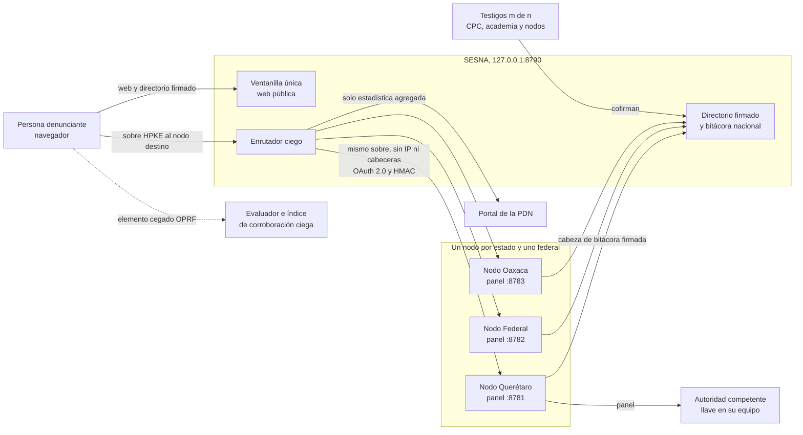
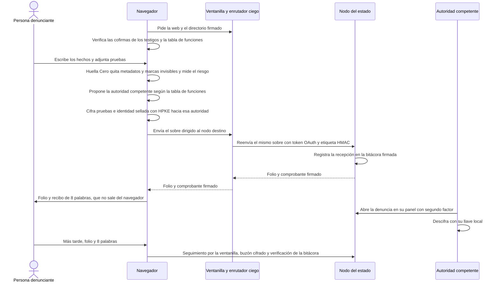
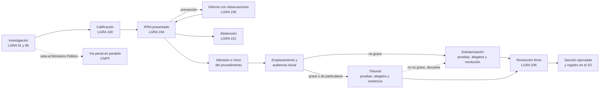
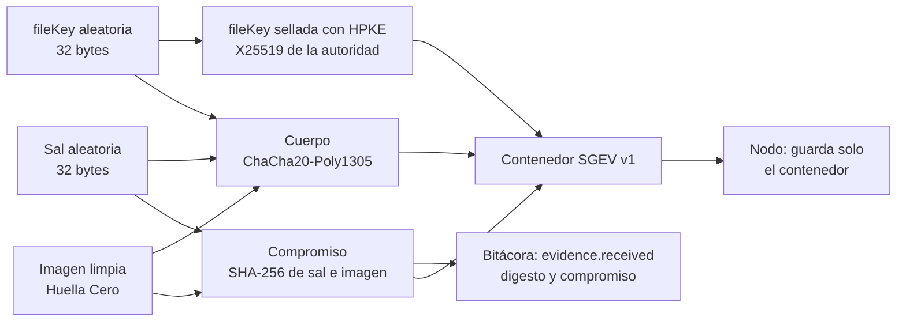

<p align="center">
  <picture>
    <source media="(prefers-color-scheme: dark)" srcset="apps/web/public/marca/sigilo-horizontal-oscuro.svg">
    
  </picture>
</p>

<p align="center">
  <strong>Capa de anonimato verificable y propuesta de estándar abierto para el Sistema de denuncias
  públicas (S5) de la Plataforma Digital Nacional.</strong>
</p>

<p align="center">
  <a href="https://github.com/GuilleOp/sigilo-s5/actions/workflows/ci.yml"></a>
  <a href="LICENSE"></a>
  <a href="CHANGELOG.md"></a>
  <a href="estandar/CHANGELOG.md"></a>
  
</p>

SIGILO protege a quien denuncia faltas administrativas y hechos de corrupción de ser identificada
por lo que envía y por quien opera el sistema, y hace visible cuando una autoridad deja morir una
denuncia. Es el proyecto del **Equipo Sigilo** para el Datatón Anticorrupción 2026 de la SESNA
(reto S5): un prototipo funcional de referencia con su red federada, su estándar (OpenAPI,
diccionarios, catálogos y perfiles) y pruebas unitarias y de extremo a extremo.

> [!IMPORTANT]
> **No es el sistema oficial** ni está listo para recibir denuncias reales sin una evaluación de
> seguridad independiente (ver [SECURITY.md](SECURITY.md)). Las personas, empresas y casos son
> [sintéticos](docs/datos-sinteticos.md); los catálogos de entes públicos (directorio de la PDN) y
> de municipios (INEGI) son reales, y ninguna institución real aparece denunciada en la
> demostración.

## Contenido

- [Cómo funciona SIGILO en 10 líneas](#cómo-funciona-sigilo-en-10-líneas)
- [Diagramas](#diagramas): [red](#arquitectura-de-la-red), [denuncia de punta a punta](#una-denuncia-de-punta-a-punta), [ciclo de vida legal](#ciclo-de-vida-legal) y [cifrado de pruebas](#cifrado-de-las-pruebas)
- [Inicio rápido](#inicio-rápido)
- [El Estándar S5](#el-estándar-s5)
- [Seguridad](#seguridad)
- [Pruebas](#pruebas)
- [Estructura del repositorio](#estructura-del-repositorio)
- [Documentación](#documentación)
- [Licencia](#licencia) y [autor](#autor-y-contacto)

## Cómo funciona SIGILO en 10 líneas

1. Quien denuncia entra a **una sola ventanilla nacional en la SESNA**; un **enrutador ciego** lleva
   su denuncia cifrada al **nodo de su estado** (uno por estado y uno federal) sin poder leerla.
2. Cada nodo **firma su tabla de funciones**: quién recibe, investiga, substancia, resuelve, juzga
   y supervisa, y **qué OIC atiende a cada dependencia**
   ([competencia por dependencia](docs/competencia-por-dependencia.md)).
3. Con esa tabla, el navegador **cifra la denuncia hacia la autoridad competente**; si el OIC aún no
   tiene llaves, va a la autoridad receptora con la nota de a quién turnarla.
4. El trámite sigue la **LGRA**: investigación, calificación, Informe de Presunta Responsabilidad
   Administrativa (IPRA), substanciación y **resolución** (no grave) o **Tribunal** (grave o de
   particulares), y después los **recursos** (inconformidad, reclamación, revocación, apelación y
   revisión) ([ciclo de vida legal](docs/ciclo-de-vida-legal.md)).
5. La **vía penal** corre en paralelo: la autoridad da vista al Ministerio Público y la fiscalía la
   sigue en su propia capa.
6. Si un ente estatal o municipal ejerce **recursos federales**, el panel ofrece dar vista a la ASF,
   la SABG y la FGR y turnar al nodo Federal.
7. Quien denuncia **sigue su caso con el folio y 8 palabras**, sin cuenta ni datos de contacto, y ve
   cada apertura de su identidad.
8. La **SESNA recibe solo estadística agregada** por OAuth 2.0, como en el S2 y el S3; nunca una
   denuncia.
9. Quien opera un nodo (la SESEA o la contraloría) lo mantiene y da de alta autoridades, pero **no
   lee ni turna denuncias**, salvo que la ley de su estado lo faculte y su tabla lo declare.
10. Cada paso queda en una **bitácora firmada y cofirmada por testigos**; si la autoridad deja morir
    la denuncia, reglas públicas la escalan a su superior.

El detalle legal, paso por paso, está en el
[proceso legal de una denuncia](docs/proceso-legal-de-la-denuncia.md) y sus
[fuentes legales](docs/fuentes-legales.md).

## Diagramas

### Arquitectura de la red

«Un S5, muchas llaves»: una ventanilla nacional sin llaves, un nodo por estado (más el federal) y
ningún nodo común. El directorio que reparte la ventanilla lo firma la operación y lo cofirman m de
n testigos; cada tabla de funciones va firmada además por su nodo
([arquitectura](docs/arquitectura.md#red-federada), [ADR 0005](docs/adr/0005-estandar-s5-federado.md)).



### Una denuncia de punta a punta

Todo lo que puede identificar a la persona se procesa en su navegador. El enrutador ve solo el nodo
destino, la hora y un tramo de tamaño fijo; el nodo guarda hechos, sobres cifrados y la bitácora
([recepción](docs/arquitectura.md#recepción), [seguimiento](docs/arquitectura.md#seguimiento)).



### Ciclo de vida legal

Las etapas son nacionales (LGRA y, en la vía penal, CNPP); cada nodo solo declara qué institución
cumple cada función. Encima corren los recursos, las medidas cautelares y la marca de recursos
federales ([ciclo de vida legal](docs/ciclo-de-vida-legal.md), máquina de estados completa con
artículos).



### Cifrado de las pruebas

Cada archivo limpio se cifra en el navegador con una llave propia, sellada con HPKE hacia la
autoridad. El compromiso salado permite la cadena de custodia sin servir de oráculo a quien tenga
una imagen candidata ([criptografía](docs/criptografia.md#pruebas-cifradas-de-extremo-a-extremo)).



Al turnar a otro nodo, el navegador de quien turna vuelve a cifrar cada prueba hacia la autoridad
destino con la misma sal (mismo compromiso), y el origen borra sus copias cuando verifica el
comprobante del destino.

## El modelo: un S5, muchas llaves

- **Un estándar nacional:** las mismas etapas para los 32 estados y la federación; lo que depende de
  la ley de cada estado (por ejemplo, si su SESEA turna denuncias) se configura en su nodo, no en el
  estándar. Querétaro y Oaxaca son solo el ejemplo de la demostración
  ([proceso legal](docs/proceso-legal-de-la-denuncia.md#un-estándar-nacional-la-federación-y-los-32-estados)).
- **Una sola ventanilla nacional en la SESNA**, donde denuncian ciudadanos y personas servidoras
  públicas, junto con un **enrutador ciego** que entrega cada denuncia cifrada sin poder leerla.
- **Un nodo por estado** (más el federal, solo con autoridades federales). Cada autoridad tiene sus
  propias llaves y en producción el nodo no recibe denuncias directas (perfil `nodo`).
- **Una tabla de funciones por nodo**, firmada por el estado. En el formato 2 declara además el OIC
  de **cada dependencia** (cada municipio con su propio OIC; las faltas graves, con la Sala
  Especializada del tribunal). El CPC vigila el sistema con datos agregados, no los casos.
- **APIs con la SESNA como las de la PDN** (OAuth 2.0, igual que S2 y S3): entregas al buzón del
  nodo y estadística agregada para el portal.

## Inicio rápido

### La red completa en un comando (Docker)

Requisitos: Docker en marcha (Docker Desktop, o Docker Engine con Compose 2.17 o posterior) y
Node.js 22.18 o posterior. Con un usuario normal, no root:

```sh
npm ci
npm run demo:todo     # genera llaves y cuentas sintéticas, construye, levanta, espera y siembra
npm run demo:apagar   # baja la red y borra .red-demo/
```

Levanta la ventanilla de la SESNA con el enrutador ciego, los nodos de Querétaro, Federal y Oaxaca
(solo con su panel), el evaluador, el índice y los testigos, y siembra el escenario de
[demo-escenario.md](docs/demo-escenario.md) hasta el día 35. Con caché tarda alrededor de un
minuto.

| Qué                        | Dónde                                                                                             |
| -------------------------- | ------------------------------------------------------------------------------------------------- |
| Ventanilla única (SESNA)   | <http://127.0.0.1:8790/>                                                                          |
| Paneles de los nodos       | <http://127.0.0.1:8781/autoridad>, `:8782/autoridad` y `:8783/autoridad`                          |
| Cuentas del panel          | `.red-demo/nodos/<nodo>/credenciales.json`                                                        |
| Código del segundo factor  | `npm run demo:codigo -- supervision-oic`                                                          |
| Llaves de las autoridades  | `.red-demo/autoridades/<id>.json`; la del buzón general, en `.red-demo/nodos/<nodo>/llaves-demo/` |
| Folios y recibos sembrados | `.red-demo/semilla.json`                                                                          |

Cuentas con el segundo factor ya inscrito: `supervision-oic`, `contraloria.titular`,
`operacion.federal`, `operacion.queretaro`, `operacion.oaxaca`, `fiscalia`, `fiscalia.queretaro` y
`tja.queretaro`; `oic-programas` lo inscribe al entrar. Todas las cuentas, por nodo, en
[demo-escenario.md](docs/demo-escenario.md#22-autoridades). Tiempos y problemas comunes (incluido
Linux con otro UID) en el
[guion de la demostración](docs/demo.md#red-federada-con-el-escenario-completo-docker-un-comando).

### Un solo nodo, sin Docker

Requisitos: Node.js 22.18 o superior (ver `.nvmrc`; desde 22.18 Node ejecuta TypeScript sin
compilar) y Python 3.10 o superior (para las pruebas del proceso de datos de la PDN).

```sh
npm ci
npm run keys:generate      # llaves de demostración y llaves fijadas de la web
npm run accounts:generate  # cuentas individuales sintéticas de la autoridad
npm run dev:server         # API en http://127.0.0.1:8787
npm run dev:web            # en otra terminal: http://127.0.0.1:5173
```

`keys:generate` escribe las llaves privadas en `apps/server/data/` (no versionada) y las públicas en
`apps/web/src/config/pinned-keys.json`, que sí está versionado: no confirmes ese cambio, son las
llaves sintéticas de tu equipo.

En `http://127.0.0.1:5173/autoridad` se entra con una cuenta de
`apps/server/data/authority-demo-credentials.json` y se importa la llave
`apps/server/data/authority-demo-key.json`. Sin `VITE_SIGILO_PERFIL`, la web se compila en perfil
`completo` (todas las pantallas sobre un solo nodo); la red usa los perfiles `ventanilla` y `panel`.

<details>
<summary>Otros comandos</summary>

| Comando                                                         | Uso                                                                                                                                                                                    |
| --------------------------------------------------------------- | -------------------------------------------------------------------------------------------------------------------------------------------------------------------------------------- |
| `npm run demo:reset -- --yes`                                   | Borra la base y las pruebas de la demostración y conserva las llaves. Se niega a correr con el servidor en marcha; sin `--yes` exige el marcador `.sigilo-demo` en `apps/server/data`. |
| `SIGILO_ANCHOR_URL=http://127.0.0.1:8787 npm run ledger:anchor` | Escribe `anchors/AAAA-MM-DD.json` con la cabeza pública firmada, leída de la API. Sin la variable lee la base local en solo lectura.                                                   |
| `npm run keys:generate -- --force`                              | Reemplaza las llaves; después reconstruye la web para fijar las nuevas.                                                                                                                |
| `npm run validate -- <url> [--modo pasivo\|conformidad]`        | Valida un sitio contra el Estándar S5 y escribe el reporte JSON y HTML en `estandar/reportes` (ver [tools/validador](tools/validador/README.md)).                                      |
| `npm run standard:build`                                        | Regenera `estandar/` desde los esquemas de `packages/contracts`; con `-- --check` solo comprueba que esté al día.                                                                      |
| `npm run auditor:eval`                                          | Regenera `packages/auditor/EVALUACION.md`; con `-- --check` solo comprueba que esté al día.                                                                                            |

Un solo origen sin Vite:

```sh
npm run build -w @sigilo/web
SIGILO_WEB_DIST=../web/dist npm run start -w @sigilo/server
```

La web queda en `http://127.0.0.1:8787` con su CSP, `frame-ancestors 'none'` y `X-Frame-Options`.
Las variables del servidor están en `apps/server/.env.example` y en
[interfaces.md](docs/interfaces.md). Una base creada antes de las migraciones 3 o 4 del servidor no
arranca: ejecuta `npm run demo:reset -- --yes` con el servidor detenido.

</details>

### Instala el nodo de tu estado (producción)

Para el equipo de TI del estado: un servidor Linux con Docker, un dominio y tres comandos. No se
necesita Node ni el código fuente; el CLI `sigilo` corre dentro de la imagen publicada
(`ghcr.io/guilleop/sigilo-nodo`).

```sh
./sigilo instalar      # unas 10 preguntas; deja una solicitud de alta sin secretos y una huella
./sigilo iniciar       # cuando la SESNA confirme el alta
./sigilo diagnostico   # todo en verde
```

La SESNA acepta la solicitud con la huella que el estado lee por teléfono y la publica en el
directorio con las cofirmas de los testigos (`./sigilo-sesna aceptar` y `publicar`). Los secretos
compartidos se derivan en los dos lados y nunca viajan. Guías:
[nodo del estado](docs/instalacion-nodo.md), [SESNA](docs/instalacion-sesna.md),
[seguridad en producción](docs/seguridad-produccion.md) y
[ADR 0011](docs/adr/0011-configuracion-en-tiempo-de-ejecucion.md).

## El Estándar S5

Propuesta de especificación del S5 con el formato de las de la PDN ([estandar/](estandar/README.md),
versión 0.4.0, con su propio [registro de cambios](estandar/CHANGELOG.md)):

- **OpenAPI:** un documento por grupo en OpenAPI 3.0.3, el que lee el Swagger UI de la PDN
  ([`estandar/oas/`](estandar/oas/)), y el estándar completo en OpenAPI 3.1
  ([`openapi.yaml`](estandar/openapi.yaml)).
- **Diccionarios de datos** con las columnas oficiales: el
  [completo](estandar/diccionario-de-datos.md) y el
  [del perfil PDN](estandar/diccionario-de-datos-pdn.md).
- **Catálogos** en pares CSV y JSON `{ clave, valor }` ([`estandar/catalogos/`](estandar/catalogos/)):
  faltas, etapas legales, transiciones, recursos, entidades, municipios y más.
- **Perfiles** de [seguridad](estandar/perfil-seguridad.md) y de
  [privacidad](estandar/perfil-privacidad.md), con fundamento en OWASP ASVS y la LGRA.
- **Validador** ([tools/validador](tools/validador/README.md)): `npm run validate -- <url>` revisa
  la privacidad de cualquier sitio de denuncias y `npm run validate:pdn` reproduce los casos
  públicos de ValidAPI contra un nodo.
- **Swagger UI sin CDN:** con la demostración, en <http://127.0.0.1:8790/estandar/swagger/>. Sin
  Docker: `npm run standard:build` y `python3 -m http.server 8080 -d estandar`.

Todo `estandar/` se genera desde los esquemas zod de `packages/contracts` (fuente única de verdad);
la integración continua comprueba que esté al día.

## Seguridad

| Etapa       | Mecanismo                                                                                                                                                                                                                  |
| ----------- | -------------------------------------------------------------------------------------------------------------------------------------------------------------------------------------------------------------------------- |
| Recepción   | Huella Cero: limpieza de pruebas en el navegador, eliminación de marcas invisibles, revisión del texto, semáforo de riesgo y vista previa de lo que verá la autoridad.                                                     |
| Trámite     | Identidad sellada: los datos personales se cifran en el navegador hacia la autoridad competente, vinculados a su denuncia; abrirlos exige dos personas, y cada apertura queda registrada y es visible para quien denuncia. |
| Seguimiento | Recibo de ocho palabras, buzón cifrado bidireccional sin datos de contacto, bitácora publicada por día en orden barajado, anclable y verificable, y conciliación de aperturas de identidad.                                |

- **Primitivas estándar:** HPKE (RFC 9180, X25519 y ChaCha20-Poly1305), Ed25519, SHA-256,
  HKDF-SHA256 y VOPRF (RFC 9497) para la corroboración ciega
  ([especificación del formato v1](docs/criptografia.md)).
- **Nadie en medio lee.** El enrutador ve solo el nodo destino, la hora y un tramo de tamaño fijo,
  y no registra la IP. Cada entrega lleva un token OAuth y la etiqueta HMAC v2 (marca de tiempo y
  nonce de un solo uso).
- **Llaves fuera del servidor.** La llave de cada autoridad vive en su equipo; la del buzón general
  queda fuera del volumen del nodo al instalar.
- **Panel con segundo factor** TOTP (RFC 6238), obligatorio en producción para toda función, con
  códigos de un solo uso y 10 códigos de recuperación.
- **Cadena de suministro:** acciones de CI fijadas por SHA, `npm audit` y verificación de firmas
  del registro en cada push, SBOM CycloneDX y Dependabot.
- **Lo que no resuelve.** Los hechos quedan en claro en el nodo de destino, el TOTP no resiste un
  phishing en tiempo real (WebAuthn es el siguiente paso) y persiste la correlación por tiempo
  entre la ventanilla y un nodo. Riesgos residuales en el
  [modelo de amenazas](docs/modelo-de-amenazas.md) y en
  [seguridad en producción](docs/seguridad-produccion.md#4-riesgos-que-quedan).

En lugar de pedir confianza, la web da formas de comprobar el anonimato: escribir en modo avión,
«Lo que sale de tu equipo», «¿Quién sabe qué de ti?» y las cifras de la bitácora comprobada
([confianza verificable](docs/confianza-verificable.md)). Para reportar una vulnerabilidad, ver
[SECURITY.md](SECURITY.md).

### Qué más propone

| Idea                                 | En concreto                                                                                                                                                                                                  |
| ------------------------------------ | ------------------------------------------------------------------------------------------------------------------------------------------------------------------------------------------------------------ |
| La PDN como escudo                   | Los datos de la PDN protegen a quien denuncia (tamaño de su grupo de anonimato, calculado con S1) y respaldan su denuncia ante la autoridad (contexto, conflicto de interés y prioridad con S2, S3 y S6).    |
| Rendición de cuentas de la autoridad | Plazos legales, reglas públicas de escalamiento a supervisión y un auditor que señala cierres con plantilla o calificaciones degradadas ([ADR 0007](docs/adr/0007-rendicion-de-cuentas-de-la-autoridad.md)). |
| Un auditor que señala y no decide    | Las reglas AUD-01 a AUD-08 son cálculos deterministas y públicos; lo que se escala lo decide una regla, no un modelo ([ADR 0009](docs/adr/0009-ia-local.md)).                                                |
| Corroboración ciega                  | Varias denuncias independientes sobre lo mismo se juntan sin revelar quiénes las presentaron ([ADR 0006](docs/adr/0006-corroboracion-ciega.md)).                                                             |

## Pruebas

```sh
npm run check                         # formato, lint, tipos, pruebas unitarias (Vitest) y del proceso de datos
npx playwright install chromium       # una sola vez
npm run test:e2e                      # construye la web y ejecuta las pruebas E2E (Playwright + axe)
```

Hay 1,685 pruebas unitarias en 190 archivos, 34 del proceso de datos en Python y 110 de extremo a
extremo en 26 archivos. La [integración continua](.github/workflows/ci.yml) las corre en cada push
con Node 22.18 y la versión más reciente. Las E2E requieren haber ejecutado
`npm run keys:generate` y cubren, entre otras cosas, cero peticiones a terceros, denuncia anónima y
sellada, limpieza de metadatos, buzón, apertura de identidad, bitácora y anclas, salida rápida,
llaves sustituidas, segundo factor, el ciclo de vida legal, la competencia por dependencia y
accesibilidad WCAG 2.0 AA.

## Estructura del repositorio

```
packages/contracts      Esquemas, catálogos y rutas de la API (fuente única de verdad)
packages/core           Criptografía: HPKE, Ed25519, recibo, buzón, comprobante y bitácora
packages/huella         Limpieza de pruebas, marcas invisibles y revisión de riesgo
packages/red            Red federada: directorio firmado, autoridad competente, sobres y bitácora nacional
packages/anonimato      Grupo de anonimato en el navegador, con los fragmentos de datos/grupos-anonimato
packages/contexto-pdn   Verificaciones contra la PDN, conflicto de interés y prioridad
packages/auditor        Señales deterministas sobre las actuaciones de la autoridad (AUD-01 a AUD-08)
packages/corroboracion  Corroboración ciega: cliente VOPRF, resumen difuso y señales de independencia
apps/server             Servidor de referencia y nodo de la red (Hono + node:sqlite)
apps/web                Aplicación de referencia (Vite + React)
apps/enrutador          Enrutador ciego, directorio y bitácora nacional; incluye el proceso de testigo
apps/corroboracion      Evaluador OPRF e índice de coincidencias de la corroboración ciega
tools/validador         Validador del Estándar S5 (npm run validate y npm run validate:pdn)
tools/sigilo            CLI de instalación y operación de nodos, SESNA y testigos
instalacion/            Envoltorios sigilo y sigilo-sesna y compose de producción (imágenes de GHCR)
estandar/               Estándar S5: OpenAPI, diccionarios, perfiles, catálogos, ejemplos y reportes
datos/                  Proceso reproducible de la PDN (Python) y sus productos agregados
docker/                 Dockerfile multietapa de los servicios de la red de demostración
compose.yaml            Red federada de demostración en local (npm run demo:todo)
scripts/                Llaves, cuentas, red y semilla de la demostración, estándar, anclaje y reinicio
e2e/                    Pruebas de extremo a extremo (Playwright + axe)
anchors/                Anclas publicadas de la bitácora (npm run ledger:anchor)
docs/                   Arquitectura, decisiones, modelo de amenazas y guías
```

## Documentación

### Para revisar el proyecto

| Busco                      | Dónde                                                                                                                                                             |
| -------------------------- | ----------------------------------------------------------------------------------------------------------------------------------------------------------------- |
| Auditarlo de punta a punta | [Guía para la auditoría](docs/auditoria-guia.md): mapa del repositorio, cómo correr todo, dónde vive cada función y límites conocidos                             |
| El cumplimiento del reto   | [Matriz de requisitos](docs/requisitos.md): cada requisito, su nivel y su evidencia                                                                               |
| El modelo y la red         | [Arquitectura](docs/arquitectura.md) y [ADR 0005](docs/adr/0005-estandar-s5-federado.md)                                                                          |
| La seguridad               | [Modelo de amenazas](docs/modelo-de-amenazas.md), [criptografía](docs/criptografia.md) e [historial de seguridad](docs/historial-de-seguridad.md)                 |
| El fundamento legal        | [Proceso legal de una denuncia](docs/proceso-legal-de-la-denuncia.md), [fuentes legales](docs/fuentes-legales.md) y [marco legal](docs/requisitos.md#marco-legal) |

### Índice de `docs/`

**Diseño y arquitectura**

- [Arquitectura](docs/arquitectura.md): componentes, fronteras de confianza, flujos y red federada
- [Interfaces entre paquetes](docs/interfaces.md)
- [Decisiones de arquitectura (ADR 0001 a 0011)](docs/adr/): alcance, criptografía, stack, Huella
  Cero, estándar federado, corroboración ciega, rendición de cuentas, datos de la PDN, IA local,
  integridad y configuración en tiempo de ejecución

**Seguridad y privacidad**

- [Criptografía: especificación del formato v1](docs/criptografia.md)
- [Modelo de amenazas](docs/modelo-de-amenazas.md)
- [Seguridad en producción](docs/seguridad-produccion.md)
- [Historial de seguridad](docs/historial-de-seguridad.md)
- [Confianza verificable](docs/confianza-verificable.md)
- [Cuando denuncia una persona ciudadana](docs/personas-ciudadanas.md)
- [¿Quién protege a quien denuncia?](docs/proteccion-de-quien-denuncia.md)

**Marco legal y trámite**

- [El proceso legal de una denuncia](docs/proceso-legal-de-la-denuncia.md) y sus
  [fuentes legales](docs/fuentes-legales.md)
- [Ciclo de vida legal en el estándar](docs/ciclo-de-vida-legal.md): etapas, Tribunal, recursos,
  vía penal y recursos federales
- [Competencia por dependencia](docs/competencia-por-dependencia.md): quién investiga a cada ente

**Adopción, instalación y datos**

- [Integración con el S5](docs/integracion-s5.md)
- [Instala el nodo de tu estado](docs/instalacion-nodo.md) y
  [la ventanilla de la SESNA](docs/instalacion-sesna.md)
- [Guía para conectar un estado](docs/guia-conecta-tu-estado.md) (conceptos)
- [Datos de la PDN: proceso y productos agregados](datos/README.md)
- [Contexto PDN de la dependencia](docs/contexto-pdn.md) (datos públicos en vivo)
- [Datos sintéticos](docs/datos-sinteticos.md)
- [Accesibilidad](docs/accesibilidad.md)

**Demostración y proyecto**

- [Guion de la demostración](docs/demo.md) y [escenario sintético](docs/demo-escenario.md)
- [Guion de la presentación ante el jurado](docs/guion-presentacion.md)
- [Matriz de requisitos](docs/requisitos.md) y [plan de trabajo](docs/plan.md)
- [Guía para la auditoría externa](docs/auditoria-guia.md)
- [Declaración de uso de IA](docs/uso-de-ia.md)
- [Marca](docs/marca.md), [convenciones](docs/convenciones.md) y [glosario](docs/glosario.md)
- [Registro de cambios](CHANGELOG.md) del software y del [estándar](estandar/CHANGELOG.md)

## Uso de inteligencia artificial

El desarrollo usó Claude Code (Anthropic) como asistente, bajo la dirección y revisión del equipo.
La aplicación no usa modelos de IA ni envía datos a servicios de IA de terceros; el paquete del
auditor trae un adaptador para un modelo abierto local opcional, desactivado y todavía sin conectar
al servidor. Detalle en la [declaración de uso de IA](docs/uso-de-ia.md).

## Datos

El repositorio no contiene datos personales reales. Las personas, empresas, autoridades del
directorio de la red, folios y recibos de la demostración son sintéticos, y los casos usan entes
rotulados «(ficticia)». Los catálogos públicos son reales: 7,213 entes del directorio de la PDN y
2,478 municipios del INEGI ([detalle](packages/contracts/src/entes/README.md)). Los datos de la PDN
se usan solo en forma agregada, con su proceso reproducible en [datos/](datos/README.md).

## Contribuir

Las contribuciones son bienvenidas: lee [CONTRIBUTING.md](CONTRIBUTING.md) y el
[código de conducta](CODE_OF_CONDUCT.md). Las vulnerabilidades se reportan en privado según
[SECURITY.md](SECURITY.md).

## Licencia

[Creative Commons Atribución-NoComercial 4.0 Internacional](LICENSE) (CC BY-NC 4.0), conforme a las
bases del Datatón Anticorrupción 2026. Uso libre con fines no comerciales y con atribución.

## Autor y contacto

Desarrollado por **[@GuilleOp](https://github.com/GuilleOp)** (Equipo Sigilo).

- GitHub: [@GuilleOp](https://github.com/GuilleOp)
- LinkedIn: (pendiente) <!-- TODO: URL de LinkedIn -->

Abierto a oportunidades laborales; contacto vía LinkedIn. Más detalle en [CONTACTO.md](CONTACTO.md).
