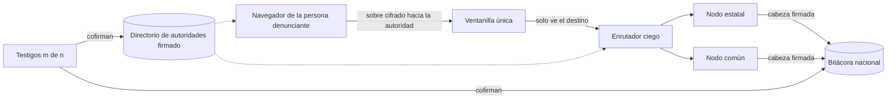

# 0005. Estándar S5 y red federada «un S5, muchas llaves»

- Estado: aceptada
- Fecha: 2026-11-05
- Complementa: 0001 (alcance), 0002 (criptografía)

## Contexto

La PDN especifica cada sistema con un diccionario de datos, una especificación OpenAPI y ejemplos
JSON; el S5 sigue «en construcción» y no tiene especificación publicada. SESNA pidió en el taller
del 27 de octubre una base que conecte la experiencia ciudadana con la institucional, que pueda
replicarse en local con herramientas libres y que explique qué significa cada estatus (por ejemplo,
«turnada»).

El marco legal reparte el S5 entre muchas autoridades:

- **LGSNA, art. 56.** El S5 lo establece el Comité Coordinador y lo implementan las autoridades
  competentes. No hay una sola autoridad que reciba, investigue y resuelva.
- **Bases para el funcionamiento de la PDN (DOF 23-10-2018), arts. 56 a 61.** Canal único de
  denuncia (art. 56); ventanilla única, en la que también se registran las autoridades (art. 57);
  protocolos de turno y obligación de registrar las denuncias recibidas por otros medios (art. 58);
  seguimiento (art. 59); estadística para el Comité Coordinador (art. 60); y portal público con
  información agregada (art. 61). La sección «Seguridad de la Información» exige confidencialidad,
  integridad, disponibilidad, autenticidad, confiabilidad, trazabilidad y no repudio.
- **LGRA, art. 93** (texto vigente con la reforma publicada en el DOF el 15-12-2025). Las
  autoridades pueden recibir denuncias por medios electrónicos propios, sin menoscabo de la
  plataforma del SNA.
- **LGRA, art. 91.** Denuncias anónimas y confidencialidad de quien denuncia.

Hoy SIGILO es un solo servidor con las llaves de una sola autoridad fijadas en el bundle
(ADR 0002). El flujo del demo de SESNA concentra todo en un buzón general que turna a instituciones
con usuarios. Ninguno de los dos escala a cientos de autoridades sin que alguien en medio pueda
leer las denuncias.

## Decisión

### 1. Estándar S5

| Parte                  | Contenido                                                                                                                                                                                                                                                                                              | Nivel |
| ---------------------- | ------------------------------------------------------------------------------------------------------------------------------------------------------------------------------------------------------------------------------------------------------------------------------------------------------ | ----- |
| Especificación OpenAPI | OpenAPI 3.1 con JSON Schema 2020-12, **generado** desde los esquemas zod de `packages/contracts` (`z.toJSONSchema` de zod 4). Nunca se edita a mano; una prueba falla si el archivo publicado difiere del generado.                                                                                    | A     |
| Diccionario de datos   | Tabla por entidad al estilo de la PDN: campo, tipo, obligatoriedad, descripción, catálogo, ejemplo sintético y clasificación de privacidad (público, autoridad, cifrado). Se genera de los mismos esquemas y sus descripciones.                                                                        | A     |
| Catálogo de estados    | Une el flujo actual de SESNA (buzón general, turnada, aceptada, reasignada, devuelta, cerrada con motivo) con las etapas de la LGRA (recepción, investigación, calificación, archivo, informe de presunta responsabilidad) y sus plazos. Ver abajo.                                                    | A     |
| Perfil de seguridad    | Requisitos de OWASP ASVS 4.0.3 (nivel 2, con nivel 3 en V6 criptografía, V2 y V3 autenticación e identidades y V7 bitácora) y de OWASP API Security Top 10 2023, cada uno con su forma de verificación (prueba, validador o revisión manual).                                                          | A     |
| Perfil de privacidad   | Requisitos verificables sobre la persona denunciante (por ejemplo: sin IP en registros, sin terceros, respuesta idéntica ante folio inexistente, relleno fijo, llaves comparadas con el directorio). Cada requisito tiene un identificador `PRV-NN`.                                                   | A     |
| Validador              | CLI con dos modos. Pasivo: solo `GET` a páginas y recursos públicos, sin enviar formularios, usable con cualquier sitio. Conformidad: además envía denuncias sintéticas, pero solo a nodos propios o con autorización (`--confirmo-nodo-propio`). Reporta qué cumple, qué no y qué no puede comprobar. | A     |

Catálogo de estados (las claves técnicas se definen en `packages/contracts`):

| Etapa (LGRA)              | Estados que ve la ciudadanía                                                  | Plazo que se vigila                                                                                                      |
| ------------------------- | ----------------------------------------------------------------------------- | ------------------------------------------------------------------------------------------------------------------------ |
| Recepción                 | Recibida; en turno; turnada; devuelta                                         | Registro de denuncias recibidas por otros medios (Bases, art. 58)                                                        |
| Investigación             | Aceptada; en investigación; requerimiento abierto                             | 30 días naturales para iniciar ante falta grave (LGRA, art. 64, fr. II); requerimientos de 5 a 15 días hábiles (art. 96) |
| Calificación              | Calificada (no grave o grave)                                                 | La calificación interrumpe la prescripción (art. 74)                                                                     |
| Archivo                   | Archivada por falta de elementos                                              | Notificación en 10 días hábiles a quien sea identificable; reapertura con nuevos indicios (art. 100)                     |
| Responsabilidad           | Turnada a substanciación                                                      | Prescripción de 3 años (no graves) o 7 (graves) y caducidad por 6 meses de inactividad (art. 74)                         |
| Cierre (motivos de SESNA) | Atendida; canalizada; improcedente; información insuficiente; acumulada; otro | Cada cierre exige fundamento (ADR 0007)                                                                                  |

Cada estado lleva una explicación en lenguaje claro de qué significa y qué sigue.

### 2. Red federada «un S5, muchas llaves»

| Componente         | Decisión                                                                                                                                                                                                                                                                                                            | Nivel |
| ------------------ | ------------------------------------------------------------------------------------------------------------------------------------------------------------------------------------------------------------------------------------------------------------------------------------------------------------------- | ----- |
| Ventanilla única   | Un solo punto de entrada ciudadano (Bases, arts. 56 y 57), que sirve la web y orienta hacia la autoridad competente. No guarda denuncias.                                                                                                                                                                           | A     |
| Directorio firmado | Documento JSON versionado con cada autoridad: identificador, ámbito, entidad, tipos de ente que atiende, nodo, llaves públicas X25519 y Ed25519, vigencia y autoridad supervisora (ADR 0007). Lo firma la operación de la ventanilla y lo cofirman los testigos m de n. Cada versión entra en la bitácora nacional. | A     |
| Enrutador ciego    | Recibe un sobre HPKE con un encabezado externo que solo dice el identificador de la autoridad destino y lo entrega a su nodo. No puede leer hechos, pruebas ni identidad. Los sobres se rellenan a tamaños fijos por tramo.                                                                                         | A     |
| Nodos              | Cada entidad puede operar un nodo estatal (SESEA) o usar el nodo común. Un nodo guarda sobres de sus autoridades y su propia bitácora; el servidor de referencia actual funciona como nodo común. `docker compose` levanta ventanilla, enrutador, dos nodos y testigos.                                             | A     |
| Turnado re-cifrado | Para turnar, el navegador de la autoridad que tiene la denuncia la descifra, toma la llave de la autoridad destino del directorio verificado y vuelve a cifrar. El evento de turnado registra los digestos de origen y destino. Nadie en medio ve el contenido.                                                     | A     |
| Bitácora nacional  | Encadena las cabezas firmadas de cada nodo y las versiones del directorio. Una cabeza nacional vale solo con firmas de m de n testigos, que antes comprueban que la cadena solo creció. El navegador fija las llaves de los testigos, no las de cada autoridad.                                                     | A     |

En la red, los hechos viajan cifrados hacia la autoridad: el nodo valida forma, tamaño y prueba de
trabajo; la validación de catálogos ocurre en el navegador antes de cifrar y en el de la autoridad
al descifrar. El perfil de nodo único (hechos en claro hacia el servidor, como en v0.9) sigue
disponible para quien adopte SIGILO sin la red.

## Alternativas consideradas

| Alternativa           | A favor                                                                                                                    | En contra                                                                                                                                                                                |
| --------------------- | -------------------------------------------------------------------------------------------------------------------------- | ---------------------------------------------------------------------------------------------------------------------------------------------------------------------------------------- |
| S5 único centralizado | Simple de operar; un solo lugar para la estadística (Bases, art. 60).                                                      | Quien opera el servidor central puede leer o perder todo; contradice que el S5 lo implementen las autoridades competentes (LGSNA, art. 56); un solo punto de falla y de presión.         |
| Federado puro         | Cada autoridad controla su sistema (LGRA, art. 93).                                                                        | La ciudadanía no sabe dónde denunciar; no hay canal ni ventanilla únicos (Bases, arts. 56 y 57); el turno entre autoridades queda sin protocolo (art. 58) y la estadística, fragmentada. |
| **Híbrido (elegido)** | Una ventanilla y un estándar comunes; las llaves y los datos quedan con cada autoridad; el centro solo enruta y atestigua. | Más piezas que operar; depende de que las autoridades custodien sus llaves y de que existan testigos independientes.                                                                     |

## Consecuencias

### Positivas

- Las autoridades y las SESEA pueden implementar el S5 contra una especificación generada, con un
  validador cuyo modo pasivo cualquiera ejecuta sin credenciales; el de conformidad, solo contra
  nodos propios.
- Ningún intermediario (ventanilla, enrutador, operación central) puede leer una denuncia.
- La sustitución de una llave de autoridad requiere a la operación y a m testigos, y queda pública.
- Los estados tienen un significado único y legal en todo el país.

### Negativas

- Las llaves fijadas en el bundle (ADR 0002) se sustituyen por el directorio verificado con las
  llaves de los testigos; un error en el directorio afecta a todas las autoridades.
- En el perfil federado el nodo ya no puede rechazar catálogos inválidos; la autoridad debe
  manejar sobres que al descifrarse no validan.
- El turnado depende de que la autoridad de origen actúe; si no lo hace, entra el escalamiento
  (ADR 0007).

### Riesgos

- El enrutador ve destino, tamaño por tramo y hora: con colusión entre enrutador y nodo se pueden
  correlacionar metadatos, no contenidos.
- Si m testigos se coluden con la operación, pueden aprobar un directorio con una llave falsa. Por
  eso los testigos deben ser de sectores distintos (ADR 0007) y todo cambio queda en la bitácora.
- El código servido por la ventanilla sigue siendo un punto de confianza (modelo de amenazas, C03).
- Nivel C fuera del alcance de la entrega: operación productiva con SESEA reales, llaves en
  módulos de hardware y calendario oficial de días inhábiles por autoridad.
