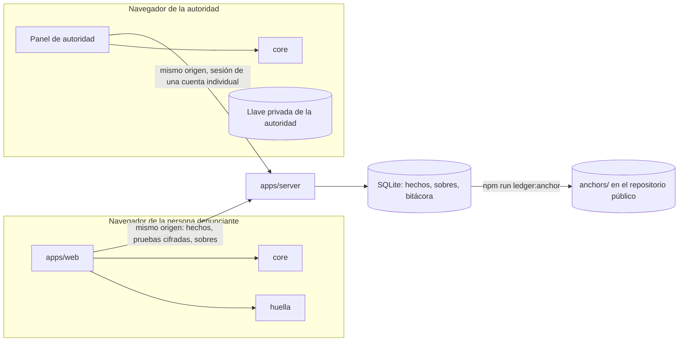
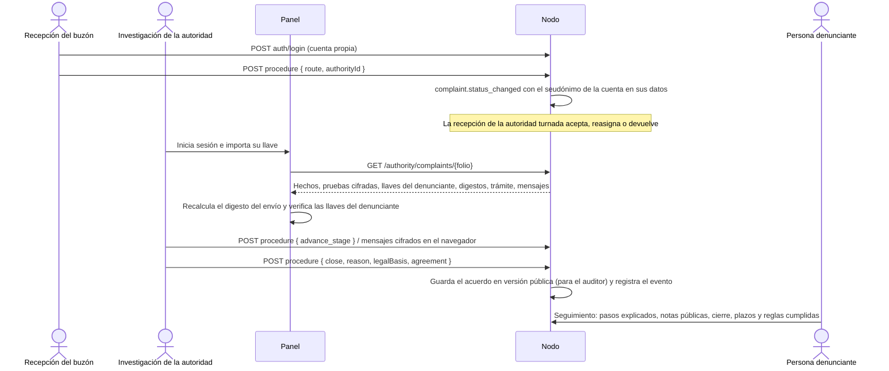
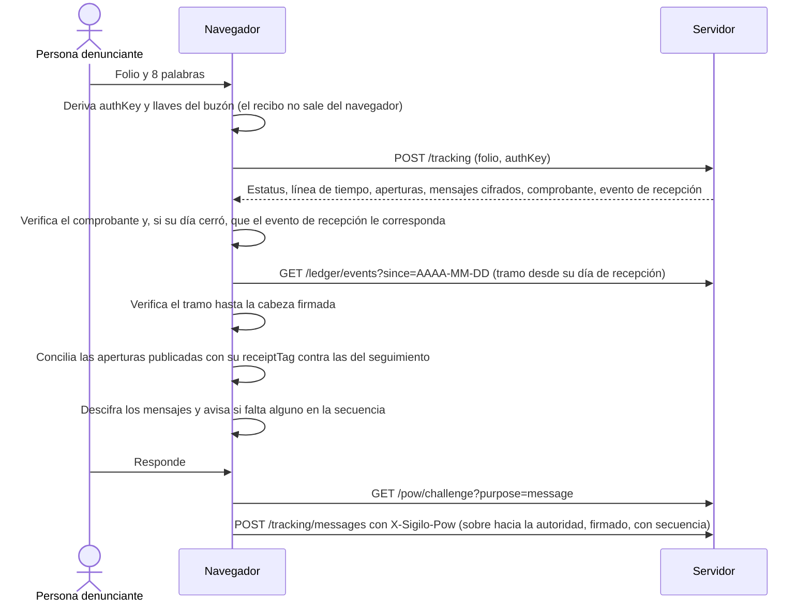
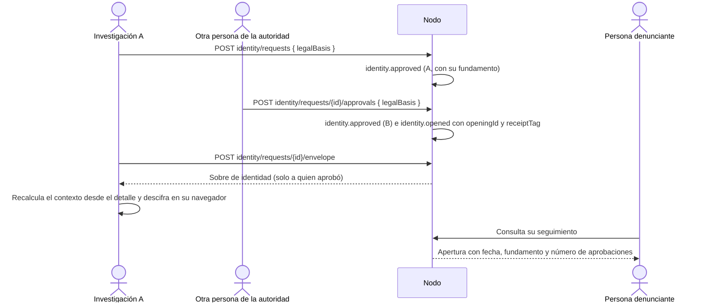
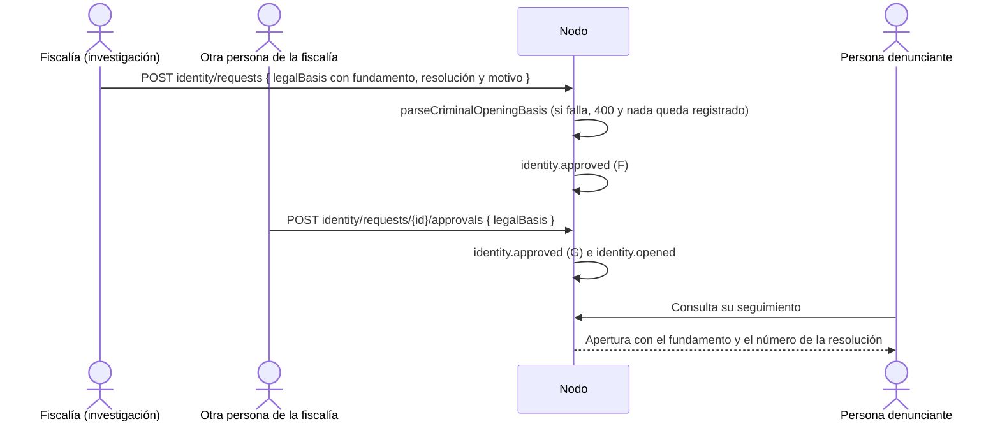
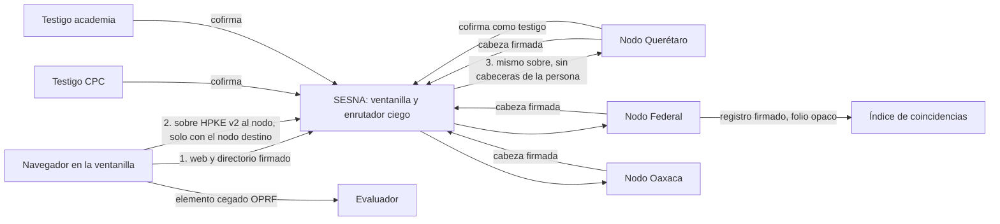

# Arquitectura

SIGILO es una capa de anonimato para un sistema de denuncias. Todo lo que puede identificar a la
persona denunciante se procesa en su navegador; el servidor almacena hechos, sobres cifrados y una
bitácora, y no puede leer identidades.

El estándar S5 y la red federada se deciden en los [ADR 0005 a 0011](adr/).

## Componentes

| Componente                | Ubicación                | Responsabilidad                                                                               |
| ------------------------- | ------------------------ | --------------------------------------------------------------------------------------------- |
| Contratos                 | `packages/contracts`     | Esquemas zod, catálogos y rutas de la API v1. Fuente única de verdad.                         |
| Núcleo criptográfico      | `packages/core`          | HPKE, Ed25519, recibo, derivación de llaves, comprobante, buzón, bitácora.                    |
| Huella Cero               | `packages/huella`        | Limpieza de pruebas, marcas invisibles, revisión de texto, semáforo de riesgo.                |
| Red federada              | `packages/red`           | Directorio firmado, autoridad competente, sobres del enrutador, bitácora nacional.            |
| Grupo de anonimato        | `packages/anonimato`     | Tamaño del grupo de trabajo en el navegador, con los fragmentos de S1 y S2.                   |
| Contexto de la PDN        | `packages/contexto-pdn`  | Verificaciones con tres resultados, conflicto de interés y prioridad.                         |
| Auditor                   | `packages/auditor`       | Señales deterministas sobre las actuaciones de la autoridad (AUD-01 a AUD-08).                |
| Corroboración ciega       | `packages/corroboracion` | Cliente VOPRF, resumen difuso y señales de independencia.                                     |
| Servidor de referencia    | `apps/server`            | API v1 sobre Hono y `node:sqlite`; nodo de la red. Valida, almacena, registra y sirve la web. |
| Aplicación de referencia  | `apps/web`               | Denuncia, seguimiento, panel de autoridad, datos abiertos y verificación.                     |
| Enrutador ciego           | `apps/enrutador`         | Reenvía sobres sin poder leerlos; directorio, bitácora nacional y testigos.                   |
| Servicio de corroboración | `apps/corroboracion`     | Evaluador OPRF e índice de coincidencias.                                                     |
| Validador                 | `tools/validador`        | Revisa un sitio contra el Estándar S5 (`npm run validate`).                                   |
| Scripts                   | `scripts/`               | Llaves, cuentas, red y semilla de la demostración, anclaje y reinicio.                        |



## Fronteras de confianza

1. **Navegador de la persona denunciante.** Zona de confianza. Aquí se genera el recibo, se derivan
   las llaves, se limpian las pruebas, se eliminan las marcas invisibles y se cifran la identidad y
   las pruebas.
2. **Red y servidor.** Zona no confiable para la identidad. El servidor recibe solo lo necesario para
   el trámite y no registra direcciones IP. Sí entrega el código de la web: un servidor
   comprometido puede alterarlo (ver `modelo-de-amenazas.md`, C03 y D03).
3. **Navegador de la autoridad.** Zona de confianza para la llave privada de la autoridad, que se
   importa en memoria. La identidad sellada solo se descifra ahí, después de una solicitud
   registrada.
4. **Anclaje externo.** La operación ejecuta `npm run ledger:anchor`, que escribe la cabeza pública
   firmada en `anchors/AAAA-MM-DD.json`, y versiona el archivo en el repositorio público. Cualquier
   persona puede comparar la bitácora contra esas anclas en `/verificar`.

## Qué ve cada actor

| Dato                                          | Persona denunciante  | Servidor y operación                               | Autoridad competente                                 | Público                                                                                           |
| --------------------------------------------- | -------------------- | -------------------------------------------------- | ---------------------------------------------------- | ------------------------------------------------------------------------------------------------- |
| Hechos (descripción, ente, conducta, periodo) | Sí                   | Sí                                                 | Sí                                                   | No                                                                                                |
| Pruebas limpias                               | Sí                   | Solo el contenedor cifrado, su tamaño y su digesto | Sí, al descifrarlas en su navegador                  | No                                                                                                |
| Pruebas originales                            | Solo en su navegador | No                                                 | No (solo su digesto, dentro de la identidad sellada) | No                                                                                                |
| Identidad (modo `sealed`)                     | Sí                   | Solo texto cifrado                                 | Sí, tras solicitud con fundamento registrada         | No                                                                                                |
| Recibo de 8 palabras                          | Sí                   | No (solo `SHA-256(authKey)`)                       | No                                                   | No                                                                                                |
| Mensajes del buzón                            | Sí                   | Solo texto cifrado                                 | Sí                                                   | No                                                                                                |
| Folio                                         | Sí                   | Sí                                                 | Sí                                                   | No (la bitácora pública usa `folioDigest`)                                                        |
| Eventos de la bitácora                        | Los de su denuncia   | Todos                                              | Todos                                                | Solo los de días cerrados, barajados, con `folioDigest`                                           |
| Estadísticas agregadas                        | Sí                   | Sí                                                 | Sí                                                   | Meses congelados, redondeo aleatorio a múltiplos de 5, celdas que redondean a menos de 5 omitidas |

## Flujos por etapa

### Recepción

```mermaid
sequenceDiagram
  actor D as Persona denunciante
  participant W as Navegador (web + huella + core)
  participant S as Servidor
  D->>W: Escribe hechos y adjunta pruebas
  W->>W: Limpia pruebas, elimina marcas invisibles, revisa el texto
  W->>D: Semáforo de riesgo y vista «Así te verá la autoridad»
  W->>S: GET /keys (compara con las llaves fijadas; si difieren, no envía nada)
  W->>S: GET /pow/challenge (reto de un solo uso)
  W->>W: Resuelve la prueba de trabajo en un Web Worker
  W->>W: Elige el folio y cifra cada imagen limpia hacia la autoridad (contenedor SGEV)
  W->>S: POST /evidence con X-Sigilo-Pow (solo contenedores cifrados)
  S-->>W: evidenceId, sha256 del contenedor
  W->>W: Genera recibo, deriva authKey y llaves del buzón
  W->>W: (modo sealed) Cifra la identidad con HPKE hacia la autoridad
  W->>S: POST /complaints?folio= con X-Sigilo-Pow (hechos, sobre, llaves públicas, authVerifier)
  S->>S: Valida catálogos y folio, deja complaint.received y evidence.received pendientes
  S-->>W: folio y comprobante firmado
  W->>D: Muestra folio y recibo; pide confirmar dos palabras
```

El sobre de identidad se cifra con un AAD que incluye `authVerifier`, las llaves públicas de la
persona denunciante y `contentDigest` (digesto de los hechos, las pruebas, el modo y la solicitud
de protección). Así no puede moverse a otra denuncia. Ver [criptografia.md](criptografia.md).

### Trámite

El servidor es un **nodo de varias autoridades**. Cada persona de la autoridad entra con su cuenta
individual (`authority-accounts.json`, fuera del repositorio), que tiene una autoridad y una
función, o recepción e investigación juntas (`AUTHORITY_FUNCTION_SETS`; la LGRA no obliga a
separarlas). Ninguna otra combinación se admite:

| Función                                        | Puede                                                                                                                                                                | No puede                                    |
| ---------------------------------------------- | -------------------------------------------------------------------------------------------------------------------------------------------------------------------- | ------------------------------------------- |
| Recepción y turnado (`intake`)                 | Turnar desde el buzón general (con motivo de al menos 10 caracteres), aceptar, reasignar (hasta 3 veces), devolver, cerrar lo improcedente del buzón, descartar spam | Solicitar ni aprobar aperturas de identidad |
| Investigación (`investigation`)                | Investigar y calificar, presentar el informe (IPRA), cerrar lo que investiga, escribir por el buzón, solicitar y aprobar aperturas                                   | Turnar                                      |
| Substanciación y resolución (`substantiation`) | Avanzar las etapas posteriores al informe y cerrar desde que se presentó (LGRA arts. 3 y 115); nunca es la misma persona que investiga                               | Turnar ni abrir identidades                 |
| Supervisión (`supervision`)                    | Aprobar aperturas, leer los acuerdos de cierre (auditor) y, en la supervisora, recibir escalamientos y alertas de turnado vencido                                    | Acciones del trámite                        |
| Operación del nodo (`operation`)               | Revisar y resolver las solicitudes de alta de autoridades                                                                                                            | Ver denuncias, turnar ni abrir identidades  |

Cada denuncia la tiene una autoridad (el buzón general hasta que se turna). Solo las cuentas de esa
autoridad la ven: otra recibe `404`, igual que con un folio inexistente. La sesión vence a los 15
minutos sin actividad o a las 8 horas y se cierra en el servidor.

**Semáforo de turnado** (`TURN_SEMAPHORE`, como en la bandeja del S5): una denuncia sin turnar o
turnada sin aceptar queda «por vencer» al cumplir 1 día hábil esperando y «vencida» a los 2; la
supervisión recibe el aviso de las vencidas.



Los plazos se cuentan con el día civil en la hora del centro de México (`legalOn`), no con el día
UTC que se publica por privacidad. Cada paso guarda ambos.

### Motor de plazos y escalamiento

Una tarea periódica (la misma que cierra los días de la bitácora) evalúa las reglas públicas de
`ESCALATION_RULES` con `evaluateEscalationRules` de `@sigilo/core`: posible falta grave sin iniciar
el procedimiento correspondiente a los 30 días naturales (LGRA, art. 64, fr. II), archivo de una
persona identificable sin aviso por el buzón en 10 días hábiles, acto resolutivo con conflicto sin
excusa (art. 58), archivo o calificación de no grave con dos o más señales del auditor, alertas de
prescripción a 12, 6 y 3 meses e inactividad a los 5 y 6 meses. Durante la investigación la
inactividad es solo una alerta; la caducidad de la instancia (art. 74) se alerta únicamente después
de admitido el informe. La calificación de no grave se notifica por el buzón y la persona puede
inconformarse desde su seguimiento (arts. 102 a 110), abriendo su identidad solo para el recurso. Cada regla
cumplida se registra una vez (`rule.triggered`, actor `system`) y aparece en el seguimiento. Las de
escalamiento dejan la denuncia disponible para la autoridad supervisora, que recibe la **segunda
llave**: el sobre de hechos y pruebas (nunca la identidad) que la web cifró al enviar hacia la
llave fijada de la supervisora. Antes de que se cumpla una regla, el nodo no lo entrega.

### Seguimiento



- Las credenciales inválidas y los folios inexistentes producen la misma respuesta.
- El estado de publicación del evento de recepción se muestra en lenguaje claro: pendiente de
  publicar, ya publicado o, si no coincide, un aviso de que el sistema podría mostrar cosas distintas
  a cada persona.
- Si la bitácora publicada tiene una apertura con su `receiptTag` que el seguimiento no muestra, o
  el seguimiento muestra una de un día publicado que no está en la bitácora, se avisa.
- Solo los fallos de autenticación consumen el límite por folio; los mensajes tienen su propio
  límite.

### Apertura de identidad (2 de 3)



Una misma persona no cuenta dos veces, quien turna no participa y la solicitud vence a los 7 días.
El servidor nunca descifra: solo decide a quién y cuándo entregar el sobre, y cada entrega queda en
el registro de seguridad. Sigue siendo un control de política: quien tenga la llave de la
autoridad y una copia de la base puede descifrar sin pasar por la ruta.

**En la vía penal.** Cuando la denuncia está en una etapa del proceso penal (fiscalía, función
`prosecution`), el resguardo de la identidad solo cede ante una resolución del Órgano
jurisdiccional o un requerimiento fundado del Ministerio Público (CNPP, art. 109 fr. XXVI, arts.
218 a 220 y art. 131 fr. IX). El panel cambia el formulario: lista de fundamentos, número de la
resolución o del requerimiento y motivo. El nodo rechaza con `400` una solicitud penal sin esa
forma. Lo demás no cambia: segunda aprobación, evento `identity.opened` en la bitácora pública y
aviso en el seguimiento con el fundamento completo. Análisis legal en
[proteccion-de-quien-denuncia.md](proteccion-de-quien-denuncia.md).



### Pruebas y cadena de custodia

Las pruebas se cifran de extremo a extremo hacia la autoridad competente: el navegador limpia cada
imagen, elige el folio y la cifra (llave aleatoria por archivo sellada con HPKE, con el folio y la
autoridad en el AAD) antes de subirla. El nodo guarda solo el contenedor cifrado con su tipo
declarado, su tamaño, su digesto y el compromiso salado de su contenido; el enrutador, el nodo, la
SESEA y la SESNA no pueden ver las imágenes.

- **Al recibir**, el nodo ancla en la bitácora (`evidence.received`) el digesto de cada contenedor
  y su compromiso. El panel abre las pruebas en el navegador con la llave de la autoridad, comprueba
  que coincidan con lo anclado y lo muestra en «Cadena de custodia».
- **Supervisora**: la segunda llave lleva la llave de cada archivo; si una regla escala la
  denuncia, la supervisora abre las pruebas sin la llave de la autoridad competente.
- **Turnado dentro del nodo**: el navegador re-cifra la llave de cada archivo hacia la autoridad
  destino antes de cederla; el contenedor no cambia.
- **Turnado a otro nodo**: el navegador abre cada prueba y la vuelve a cifrar hacia la autoridad
  destino con el folio nuevo y la misma sal (mismo compromiso). Cuando el destino confirma con su
  comprobante firmado, el origen borra sus copias y registra `evidence.custody_transferred`: queda
  una sola copia viva. Sin confirmación, el origen las conserva.

Detalle del formato en [criptografia.md](criptografia.md), «Pruebas cifradas de extremo a
extremo». Subidas reanudables y pruebas en la cola de entrega son siguientes pasos.

## Bitácora

- Cada evento (`complaint.received`, `complaint.status_changed`, `identity.approved`,
  `identity.opened`, `message.sent`, `evidence.discarded`, `rule.triggered`) se encadena con el hash del anterior. Triggers de SQLite impiden modificar o borrar eventos.
- **Cierre diario barajado.** Un evento nuevo queda pendiente, sin `seq`, con una fecha que nunca
  es anterior a la del último evento. Una tarea programada (cada 10 minutos; las lecturas no
  publican) baraja los pendientes de cada día cerrado (UTC) con aleatoriedad criptográfica y los
  encadena en lotes de 1000, sin bloquear el servidor. La cabeza
  pública es la del último evento encadenado; un día está publicado si y solo si `at <= head.at`.
  Así ni la hora ni el orden de llegada se pueden deducir de la bitácora.
- **Etiqueta del recibo.** `identity.opened` lleva `receiptTag`, derivado del `authVerifier`, para que
  la persona denunciante encuentre sus aperturas aunque se registren con otro folio.
- **Anclaje.** `ledger:anchor` verifica la cabeza pública con la llave fijada, recalcula la cadena
  desde la ancla anterior (o el génesis) y escribe `anchors/AAAA-MM-DD.json`. La forma preferida es
  leer la API pública (`SIGILO_ANCHOR_URL`); sin ella lee la base local en solo lectura.
- **Verificación.** `/verificar` descarga la bitácora pública, comprueba la cadena y la cabeza
  firmada, y permite pegar un ancla para comprobar que la cadena contiene ese `seq` y ese hash.

Ver [criptografia.md](criptografia.md).

## Red federada

La red «un S5, muchas llaves» ([ADR 0005](adr/0005-estandar-s5-federado.md)) sigue el modelo
acordado con la SESNA:

- **Una sola ventanilla nacional** para ciudadanos y personas servidoras públicas. La monta la SESNA
  junto con el enrutador ciego, en el mismo origen. La SESNA no tiene llaves y no lee denuncias.
- **Cada estado monta su propio nodo** (lo opera su SESEA o su secretaría de buen gobierno o
  contraloría). **No hay nodo común**: ningún estado vive en el nodo de otro. Los nodos no tienen
  ventanilla pública: solo el panel de autoridades y las rutas de API que necesita el enrutador.
- **El nodo federal** aloja solo autoridades federales y lo opera el lado federal que investiga (la
  Secretaría Anticorrupción y Buen Gobierno), no la SESNA.
- **Cada nodo declara su tabla de funciones**: qué institución cumple cada función en su entidad
  (buzón general, operación del nodo, investigación y calificación, substanciación, resolución,
  supervisión, vía penal y observador). Con esa tabla el navegador propone la autoridad (turnado automático) y el enrutador entrega el sobre a ciegas.

Agrega tres piezas sin cambiar la API v1 del nodo:

| Pieza                 | Ubicación                    | Responsabilidad                                                                                                                                 |
| --------------------- | ---------------------------- | ----------------------------------------------------------------------------------------------------------------------------------------------- |
| Red (funciones puras) | `packages/red`               | Directorio firmado y cofirmado, autoridad competente, sobres de red, bitácora nacional, cliente de nodo                                         |
| Enrutador ciego       | `apps/enrutador`             | Publica el directorio, reenvía sobres opacos, lleva la bitácora nacional y el corte de datos abiertos; sirve la ventanilla única (`src/web.ts`) |
| Testigos              | `apps/enrutador/src/witness` | Verifican que la bitácora nacional solo creció y cofirman su cabeza (m de n)                                                                    |



- **Directorio.** Documento canónico versionado (`AuthorityDirectory`) con nodos, autoridades
  (entidad, orden de gobierno, competencia por órdenes, entidades, entes y leyes, llaves X25519 y
  Ed25519, vigencia y supervisora), observadores y la tabla de funciones de cada nodo. Lo firma la operación sobre su digesto
  (`sigilo/red/directory/operator/v1:`) y lo cofirman los testigos (`.../witness/v1:`). El
  navegador fija solo la llave de la operación y las de los testigos (`NetworkTrustAnchor`) y exige
  m cofirmas válidas de testigos fijados distintos. Una versión nueva debe encadenar el digesto
  anterior y llevar m cofirmas de los testigos de la anterior.
- **Tabla de funciones.** Cada nodo declara, en una `FunctionTable` (formato 1), qué institución
  cumple cada función para los entes de su entidad (la del nodo federal, para los entes federales).
  Cada regla dice a qué órdenes de gobierno aplica y, si hace falta, a qué entes específicos y a qué
  gravedad: «entes estatales → Contraloría; municipales sin OIC → Contraloría; ente X → su OIC;
  resolución de falta grave → tribunal». La regla que nombra al ente gana sobre la de todo su orden.
  - **Dónde se publica y por qué.** Dentro del directorio (`functionTables`), **firmada por el nodo**
    con su llave de firma del directorio (`sigilo/red/function-table/v1:` + digesto). Así hay dos
    firmas: la del estado, que declara su tabla, y la del directorio, que firma la operación y
    cofirman m de n testigos. La SESNA no puede cambiar la tabla de un estado sin su firma; los
    testigos (por ejemplo, el CPC) ven cada versión y la bitácora nacional registra cada versión del
    directorio. El navegador verifica todo con la misma raíz fijada, sin descargar nada más. Una
    tabla suelta firmada por el nodo obligaría a una segunda descarga y a otro canal de frescura; y
    como la tabla nombra autoridades del directorio, cambiarla casi siempre exige reemitirlo.
  - **Qué revisa el directorio** (`functionTableProblems`): una tabla por nodo y por entidad, firma
    válida del nodo, una tabla estatal no cubre entes federales (ni la federal, estatales), solo
    nombra autoridades de su propio nodo y entidad (ningún estado vive en el nodo de otro), y el
    buzón y la investigación son autoridades con el papel `inbox` e `investigating`, porque reciben
    sobres cifrados. Las demás funciones pueden ser una institución sin llaves (el tribunal, la
    fiscalía estatal, quien opera el nodo).
- **Autoridad competente.** `proposeCompetentAuthority` corre en el navegador: la conducta define
  la ley (LGRA → investigación; CPF → vía penal) y el ente el orden de gobierno. Si el ente es
  federal manda la tabla del nodo federal; si no, la de la entidad de los hechos. Si la tabla no
  nombra a una autoridad para el ente, se prueba la ley de una conducta equivalente y, si tampoco,
  la propuesta es el **buzón general** de esa tabla (papel `inbox`, estado `inbox` de la
  propuesta). Ahí una persona la turna a quien corresponda, como en la bandeja general del S5: la
  ventanilla es un canal único (Bases de la PDN, art. 56) con protocolos de recepción y turno a la
  autoridad competente (art. 58). Devuelve el razonamiento en lenguaje claro y, como alternativas,
  las demás autoridades cuya competencia declarada atiende al ente. Las supervisoras nunca se
  proponen. Si **la entidad no tiene nodo** (no hay tabla que la cubra) y el ente no es federal,
  no se envía nada y se dice claramente (`isStateWithoutNode`). No hay buzón nacional de respaldo:
  un buzón en otro nodo leería las denuncias de un estado que no lo eligió. Con un directorio sin
  tablas se usa la competencia declarada, como antes, pero nunca el buzón de otra entidad.
- **Ventanilla única y perfiles de la web.** La web se compila con `VITE_SIGILO_PERFIL`:
  - `ventanilla`: la sirve el enrutador (`SIGILO_ROUTER_WEB_DIST`, `apps/enrutador/src/web.ts`) en
    su mismo origen, con su propia CSP. Tiene todas las pantallas públicas y «¿Quién atiende tu
    denuncia en tu estado?» (`/quien-atiende`), que muestra cada tabla. Usa el directorio, el
    relevo y el corte nacional del enrutador, y pasos mínimos a rutas públicas (`VENTANILLA_ROUTES`,
    que no son parte del Estándar S5): el evaluador OPRF, la bitácora pública de cada nodo (el
    registro público elige el nodo y verifica con su llave del directorio) y la solicitud de alta,
    que va al nodo de la entidad de la institución según su tabla. «Datos abiertos» muestra el corte
    nacional. En `/autoridad` dice que cada autoridad entra por el nodo de su estado.
  - `panel`: la web de cada nodo, solo con `/autoridad`; las demás rutas dicen «La ventanilla
    única está en …» (`VITE_SIGILO_VENTANILLA_URL`). En el detalle de una denuncia, el panel
    muestra quién sigue según la tabla (substanciación, resolución, supervisión, vía penal y
    observador).
  - `completo` (por omisión): un solo nodo con todas las pantallas, sin red, para pruebas y E2E.
- **Enrutador ciego.** El navegador cifra con HPKE hacia la llave del nodo una petición de la API
  v1 (`RoutedRequest`) rellenada a un tramo fijo (4 KiB, 64 KiB, 1 MiB o 16 MiB) e incluye una
  llave efímera para la respuesta. **Sobre v2:** el encabezado externo solo dice el **nodo**
  destino (`{ v: 2, node, sealed }`); la autoridad (`RoutedRequest.to`) va cifrada adentro y el
  AAD (`sigilo/red/relay/request/v2:` + nodo) liga el sobre a ese nodo. Así la operación de la
  ventanilla no puede contar denuncias por OIC: a lo más, por nodo (estado). El nodo abre el sobre,
  comprueba que la autoridad esté alojada en él y vigente en el directorio verificado, y la
  entrega internamente; si no, responde como a un sobre que no abre. Un sobre v1 (con `to` a la
  vista) se rechaza con `400` y un mensaje fijo que pide actualizar la ventanilla. El enrutador no
  guarda el sobre, no lee la IP ni reenvía cabeceras, y responde con la misma forma para cualquier
  destino (relleno si no pudo entregar). Qué ve y qué no: `apps/enrutador/README.md`.
- **Cola de entrega («store and forward»).** Si el nodo destino no responde, una denuncia sin
  pruebas adjuntas no se pierde: la web paga el reto propio del enrutador
  (`GET /api/v1/red/queue/challenge`) y reenvía el sobre con `deferral`; el enrutador guarda el
  sobre **cerrado** en `relay_queue` (sqlite), responde con un acuse firmado por la operación
  (`RelayQueueReceipt`) y reintenta con espera exponencial (30 s, duplicando hasta 1 h) hasta
  entregarlo o hasta que vence a los 7 días; al entregarlo lo borra. El folio lo elige el
  navegador al azar (`RoutedRequest.folio`; el nodo rechaza uno repetido), así la persona tiene
  folio y 8 palabras desde el inicio y ve su comprobante después en «Mi denuncia». El nodo acepta
  la entrega diferida solo con la etiqueta HMAC del enrutador, solo para denuncias con folio y con
  tope por hora, sin pedir su prueba de trabajo. Límites por nodo: 500 sobres y 64 MiB.
- **Salud de los nodos y versión mínima.** El enrutador consulta cada minuto
  `GET /api/v1/red/health` de cada nodo (identificador y versiones) y publica para la operación
  `GET /api/v1/red/health/nodes` (JSON) y `.../health/nodes.html` (tabla): arriba o abajo,
  versiones, último contacto, registro, si se le entrega y sobres en cola; nada de denuncias. Con
  `SIGILO_ROUTER_MIN_NODE_VERSION`, a un nodo con software menor (o desconocido) no se le entrega:
  lo que pidió la cola espera, y el enrutador lo avisa una vez por nodo.
- **Bitácora nacional.** Entradas encadenadas por hash con cada cabeza firmada de nodo y cada
  versión del directorio. El enrutador recoge las cabezas en `GET /api/v1/ledger/head` de cada
  nodo (o el nodo las publica) y rechaza las que retroceden o se bifurcan. La cabeza nacional la
  firma la operación y vale con m cofirmas; cada testigo cofirma solo después de recalcular el
  tramo desde su última cofirma. `GET /api/v1/red/national/inclusion` entrega la prueba de que una
  cabeza de nodo quedó incluida, que el navegador verifica con `verifyNodeHeadInclusion`.
- **Corte nacional de datos abiertos (Bases de la PDN, arts. 60 y 61).** Igual que en el S1, donde
  cada entidad publica y la SESNA consulta por API, aquí **la SESNA consulta números y pruebas,
  nunca denuncias**. En cada vuelta el enrutador descarga el CSV público de cada nodo del
  directorio (`GET /api/v1/open-data/complaints.csv`, el mismo que cualquiera puede bajar), lo
  valida y descarta completo el que no cumpla: encabezado exacto, claves de los catálogos, solo
  meses anteriores al mes en curso, conteos múltiplos de 5 y de al menos 5, sin celdas repetidas y
  con su fila de suprimidas. Suma por entidad, conducta, mes y estatus, vuelve a aplicar la celda
  mínima después de sumar y publica el corte en `GET /api/v1/red/national/open-data` (JSON) y
  `GET /api/v1/red/national/open-data.csv`. Un nodo que no responde queda `unreachable` («sin
  datos de ese nodo en este corte») y el corte se publica igual. La web lo lee por el paso del
  mismo origen del nodo y el observatorio lo muestra; sin red, el observatorio usa la línea base
  sintética rotulada «Datos de ejemplo».
  - **Qué se verifica:** que cada CSV cumple las reglas de publicación (un nodo que publica un
    mes abierto o una celda pequeña no entra al corte) y que la suma es reproducible: cualquiera
    puede rehacerla con los CSV públicos de los nodos.
  - **Qué no se verifica:** que los conteos correspondan a las denuncias reales del nodo. El CSV
    no está firmado y la bitácora del nodo no contiene conteos. Cada nodo del corte lleva la cabeza
    firmada de su bitácora vigente en la bitácora nacional solo como referencia de integridad del
    momento del corte, no como prueba de los números. El corte tampoco lo firma la operación: el
    nodo que lo pasa a la web podría alterarlo, y se compara contra el del enrutador.
  - El reloj del corte es el reloj real; en la demostración, con `SIGILO_ROUTER_CLOCK_FILE`, es el
    reloj simulado de los nodos, para que «mes cerrado» signifique lo mismo en ambos lados.
- **APIs entre la SESNA y los nodos (OAuth 2.0, metodología de la PDN).** Como en las APIs del
  S2 y del S3, **cada nodo es el proveedor** y su propio servidor de autorización
  (`POST /oauth/token`, RFC 6749), y **la SESNA (enrutador) es el cliente** con sus credenciales
  ante cada nodo (`node-credentials.json`, 0600; en producción, el secreto se deriva en los dos
  lados y no se entrega). Flujos: `password` (el de la PDN;
  desaconsejado en OAuth 2.1), `client_credentials` (el que usa el enrutador) y `refresh_token`.
  El token de acceso es un JWT HS256 de 5 minutos que solo verifica el nodo que lo emitió
  (`iss` = `aud` = id del nodo, `sub` = cliente, `scope`, `exp`, `jti`). Permisos:
  `sesna:entregas` (buzón de red, además del HMAC como defensa en profundidad),
  `sesna:estadisticas` (estadística) y `sesna:salud` (reservado). Todo es _pull_ desde la SESNA:
  - **Entregas.** El enrutador pide el token con `sesna:entregas`, lo guarda hasta 30 s antes de
    vencer y lo agrega como `Authorization: Bearer` al reenviar; el nodo lo exige antes de leer el
    cuerpo. Un `401` hace que el enrutador pida otro en la siguiente entrega.
  - **Estadística para el portal (Bases, art. 61).** `POST /v1/denuncias/estadisticas` con
    `sort`, `page`, `pageSize` (máx. 200) y `query`, y respuesta `{ pagination, results }`, como
    el S2 y el S3. Filas por mes cerrado, autoridad, entidad y conducta: recibidas, turnadas y
    aceptadas a tiempo o vencidas (semáforo de turnado), archivadas por motivo, calificadas grave
    o no grave, escalamientos, estatus al cerrar el mes y medianas de días hábiles (solo con 10
    observaciones). Cada mes se congela una sola vez (`pdn_statistics_months`), cada conteo se
    redondea al azar a múltiplos de 5 con una semilla que solo existe al congelar y se suprime
    (`null`) bajo 5; los filtros solo eligen filas, no vuelven a sumar. El enrutador consulta a
    cada nodo, valida y publica el corte en `GET /api/v1/red/national/statistics`.
  - **Cabezas, registro y salud.** La cabeza de bitácora ya se jala de la ruta pública
    `GET /api/v1/ledger/head`; el _push_ opcional (`POST .../heads`) y el registro siguen como
    _push_ porque van firmados con la llave del nodo en el directorio (no necesitan secreto) y el
    registro es lo que avisa que el buzón está listo. `sesna:salud` queda para una API de salud.
- **El nodo en la red.** El servidor de referencia monta el buzón de red, se registra ante el
  enrutador (acepta sobres), publica su cabeza después de cada cierre y, si el directorio lo nombra
  testigo, cofirma la cabeza nacional. Aloja varias autoridades con sus llaves del directorio
  verificado. Una denuncia que llega por el enrutador queda turnada a la autoridad que eligió el
  navegador; si va dirigida al buzón general (o a una supervisora), queda en el buzón como
  `received_in_inbox` y su recepción la turna, reasigna o cierra; el turnado a otro nodo lo re-cifra el navegador de la autoridad y el nodo solo lo
  transporta (SEC-19), con `complaint.transferred` en la bitácora y el folio nuevo en el
  seguimiento.
- **Contexto, auditor y corroboración en el nodo.** Al turnar, el nodo revisa el conflicto de
  interés de la persona titular con S1 y S2 (alerta y pide excusa o justificación; nunca bloquea).
  El detalle de la autoridad trae la ficha con prioridad explicable, las señales del auditor y las
  fuentes independientes del índice. La tarea periódica corre el auditor sobre los acuerdos del
  nodo y los importados (`audit.signal`), reverifica sanciones contra S3 y aplica las reglas
  públicas, entre ellas `escalation.conflict` (resolver con conflicto sin excusa, LGRA art. 58) y
  `escalation.archive-signals` (archivo con dos o más señales AUD-01 y AUD-02). Las fuentes son
  sintéticas en la demostración o las bases SQLite descargadas; ninguna consulta sale del nodo.
- **Despliegue local.** `npm run red:demo` genera llaves, tablas de funciones y cuentas sintéticas
  en `.red-demo/` y `docker compose up` levanta el enrutador con la ventanilla única
  (`127.0.0.1:8790`), los nodos Querétaro (8781), Federal (8782) y Oaxaca (8783) con la web
  en perfil `panel` y el servidor en perfil `nodo`, el evaluador, el índice (los dos sin puerto en el
  equipo) y dos testigos observadores. `npm run demo:seed` siembra
  el escenario. Guía: [conecta tu estado](guia-conecta-tu-estado.md).
- **Hecho: rutas de denuncia directa cerradas en el servidor.** En perfil `nodo`
  (`apps/server/src/http/exposure.ts`, H03) el nodo publica solo los frentes red, público y panel:
  la denuncia, las pruebas, el seguimiento y los pasos del evaluador responden `not_found`, con una
  lista positiva de rutas, y el panel puede ir en su propio puerto (`SIGILO_PANEL_PORT`).
- **Pendiente.** La guarda de custodias de la corroboración (nivel B).

## Despliegue

- **Producción.** Imágenes genéricas publicadas en GHCR (sin llaves de ningún nodo) y el CLI `sigilo`
  dentro de ellas: `sigilo instalar`, `iniciar` y `diagnostico` en cada estado; `sigilo-sesna
instalar`, `aceptar` y `publicar` en la SESNA; `sigilo testigo cofirmar` en cada testigo
  ([instalacion-nodo.md](instalacion-nodo.md), [instalacion-sesna.md](instalacion-sesna.md)). El
  alta viaja sin secretos: solicitud firmada por el nodo y huella por teléfono; los secretos de
  enlace se derivan con X25519 y HKDF. Los compose de producción están en `instalacion/`.
- **Configuración en tiempo de ejecución** ([ADR 0011](adr/0011-configuracion-en-tiempo-de-ejecucion.md)).
  La web lee las llaves de su nodo, la raíz de la red y la ventanilla de `/config/sigilo.json`, del
  mismo origen, antes de montarse; con 404 usa las del bundle (demostración y E2E).
- **Días inhábiles locales.** `dias-inhabiles.json` del nodo se suma a los días oficiales en los
  plazos, las reglas, el auditor y el semáforo, y se publica en `/datos/dias-inhabiles.json`.

- **Un solo origen.** En desarrollo, el proxy de Vite sirve web y API desde `127.0.0.1:5173`. En
  despliegue, `SIGILO_WEB_DIST` hace que el servidor entregue `apps/web/dist` con respaldo de SPA a
  `index.html`. CORS está desactivado salvo que `SIGILO_ALLOWED_ORIGIN` lo configure.
- **Cabeceras de la web:** CSP como cabecera con `frame-ancestors 'none'`, `X-Frame-Options: DENY`,
  `Referrer-Policy: no-referrer`, `nosniff`, `Cache-Control: no-store` y
  `Strict-Transport-Security` (al menos un año, con `includeSubDomains`) con `SIGILO_HTTPS=1` o
  `SIGILO_HSTS_MAX_AGE`.
- **Cabeceras de la API:** `Content-Security-Policy: default-src 'none'`, `no-store` y `nosniff`.
- **Sin terceros.** La web no hace peticiones fuera de su origen; una prueba E2E lo comprueba.
- **Historial.** La web usa un router en memoria: no deja rutas ni entradas nuevas en el historial.
- **Abuso.** Prueba de trabajo adaptativa (`SIGILO_POW_BITS`, 18; `SIGILO_POW_MAX_BITS`, 20): un
  reto por denuncia con sus pruebas y otro por mensaje. Límites en memoria con tope LRU (fallos de
  autenticación y mensajes por folio), sin frenos globales de escrituras. Cuota total de pruebas con
  tope por denuncia (`SIGILO_EVIDENCE_QUOTA_BYTES`; si no cabe, `507 storage_full`, sin borrar
  pruebas asociadas), retención de pruebas de denuncias sin atender o archivadas
  (`SIGILO_EVIDENCE_RETENTION_DAYS`), descarte de pruebas por la autoridad (queda en la bitácora y
  en el seguimiento), purga de las pendientes de retos vencidos y tope de pendientes por día en la bitácora, del que están
  exentos los eventos de la autoridad.
- **Almacenamiento.** Tablas privadas `WITHOUT ROWID`, `secure_delete` y checkpoint del WAL tras cada
  cierre diario, para que una copia de la base no conserve el orden de llegada.
- **Registros.** Por omisión, contadores agregados por hora sin las rutas de la persona denunciante
  ni `GET keys` y la bitácora (`SIGILO_REQUEST_LOG=aggregate`); nunca IP, agente de usuario, cuerpos
  ni folios.
- **Un solo servidor por base.** `server.lock` en el directorio de datos, creado con `wx` y
  renovado cada 10 minutos.
- **Cuentas.** `authority-accounts.json` en el directorio de datos (no se versiona) declara las
  autoridades del nodo, el buzón general y una cuenta por persona con su digesto scrypt;
  `npm run accounts:generate` crea las sintéticas de la demostración. Los fallos de acceso, las
  sesiones vencidas y las entregas de sobres quedan en `authority_security_events`, sin IP.
- **Llaves.** En desarrollo, las llaves privadas viven en `apps/server/data/` y no se versionan, y
  las públicas se fijan en `apps/web/src/config/pinned-keys.json`. En producción, el volumen del
  nodo (`datos/`) tiene solo las del nodo; la del buzón y la de enlace quedan fuera.
- **Reloj de pruebas.** `SIGILO_TEST_CLOCK_FILE` desplaza el reloj del servidor solo en pruebas
  (`SIGILO_E2E=1` o `NODE_ENV=test`), con un archivo propio no escribible por otros y un desfase de
  0 a 400 días.
