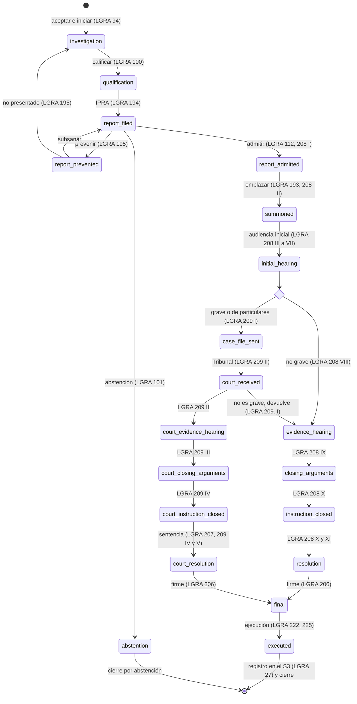

# Ciclo de vida legal de una denuncia en el Estándar S5

Desde el Estándar S5 **0.4.0**, SIGILO expresa el ciclo de vida completo de una denuncia según la
Ley General de Responsabilidades Administrativas (LGRA) y, para la vía penal, el Código Nacional de
Procedimientos Penales (CNPP). Este documento resume la máquina de estados, las acciones, las
funciones que actúan, los plazos y los artículos, y marca qué rutas legales ya cubre el estándar.

El análisis legal completo (con sus fuentes y lo que falta verificar) está en
[`proceso-legal-de-la-denuncia.md`](proceso-legal-de-la-denuncia.md). El catálogo vive en el código:
`packages/contracts/src/procedure.ts` (los enums), `packages/contracts/src/catalogs/procedure.ts`
(etapas, plazos y estatus) y `packages/contracts/src/catalogs/lifecycle.ts` (transiciones, recursos,
motivos legales de cierre, medidas cautelares, vista al Ministerio Público y la regla de recursos
federales). El mismo catálogo se publica en `estandar/catalogo-del-tramite.json` y en
`estandar/catalogos/` (`etapas-legales`, `transiciones`, `recursos`, `motivos-legales-cierre`).

## El diseño: etapas nacionales, asignación por nodo

- **Lo nacional es el estándar.** Las etapas, las acciones, los recursos, las funciones, los plazos y
  los motivos de cierre usan solo las leyes generales: la LGRA, el CNPP, la Ley General del Sistema
  Nacional Anticorrupción y las Bases de la Plataforma Digital Nacional (BPDN). Ninguna ley local
  está escrita en el estándar.
- **Lo de cada nodo es la asignación.** Cada estado, y la federación, dice en su tabla de funciones
  firmada (`packages/red/src/function-table.ts`) y en las funciones de sus cuentas qué institución
  cumple cada función: quién investiga, quién substancia, cuál es su Tribunal y su alzada, su
  fiscalía, su entidad de fiscalización y sus referencias de ley local.
- **La separación de funciones (LGRA, art. 115)** se aplica dos veces: las cuentas nunca combinan
  investigación con substanciación o con el Tribunal, y además una misma cuenta no puede investigar
  y substanciar (o juzgar) la misma denuncia, aunque después cambie de función en el archivo de
  cuentas: el nodo revisa qué funciones ejerció cada seudónimo en esa denuncia.

## Máquina de estados

La vía administrativa (`legalStage`) y la vía penal (`criminalStage`) son dos capas que corren al
mismo tiempo: las vías son autónomas (CPEUM, art. 109; LGRA, art. 14).

```mermaid
stateDiagram-v2
  state "Vía penal (en paralelo)" as penal {
    [*] --> criminal_complaint_filed: vista al MP (LGRA 10 III y 98; CNPP 222)
    [*] --> criminal_investigation: denuncia directa ante la fiscalía
    criminal_complaint_filed --> criminal_investigation
    criminal_investigation --> prosecutor_determination: CNPP 253 a 256
    criminal_investigation --> intermediate_stage
    criminal_investigation --> alternative_exit: CNPP 183 a 200
    prosecutor_determination --> judicial_review: CNPP 258
    prosecutor_determination --> criminal_investigation
    judicial_review --> criminal_investigation
    judicial_review --> prosecutor_determination
    intermediate_stage --> trial
    intermediate_stage --> alternative_exit
    trial --> sentence
  }
```

Encima de las dos capas corren los incidentes y los recursos, que no son etapas: las medidas
cautelares, los cinco recursos con su efecto, la marca de recursos federales y su aviso, la
inscripción de la sanción y el desistimiento.

## Etapas, funciones, plazos y artículos

«dh» = días hábiles; «dn» = días naturales. «Función» es quien da el paso; la del Tribunal la
puede registrar la substanciación si el estado no le dio cuentas (ver más abajo).

| Etapa (`legalStage`)       | Nombre en el seguimiento                                      | Entra con                                                     | Función                                            | Plazo que abre                                                        | Fundamento                 |
| -------------------------- | ------------------------------------------------------------- | ------------------------------------------------------------- | -------------------------------------------------- | --------------------------------------------------------------------- | -------------------------- |
| `investigation`            | Investigación                                                 | Acuerdo de inicio; también al tener el IPRA por no presentado | Investigación (o substanciación, si no se subsanó) | — (30 dn del art. 64 fr. II desde la recepción)                       | LGRA 91, 94, 96            |
| `qualification`            | Calificación de la falta                                      | Calificar, con gravedad, fundamento y acuerdo                 | Investigación                                      | Inconformidad 5 dh si es no grave                                     | LGRA 100, 102              |
| `report_filed`             | Informe de Presunta Responsabilidad Administrativa presentado | Presentar el IPRA (o corregido)                               | Investigación                                      | Admisión 3 días (`report_admission`)                                  | LGRA 100, 194              |
| `report_prevented`         | Informe con observaciones (prevención)                        | Prevenir, con fundamento                                      | Substanciación                                     | Corregir 3 días (`report_correction`)                                 | LGRA 195                   |
| `abstention`               | Abstención                                                    | Abstenerse, con fundamento y acuerdo                          | Substanciación                                     | Inconformidad 5 dh                                                    | LGRA 101, 102              |
| `report_admitted`          | Procedimiento iniciado (informe admitido)                     | Admitir                                                       | Substanciación                                     | Caducidad 6 meses                                                     | LGRA 112, 113, 208 I       |
| `summoned`                 | Emplazamiento                                                 | Emplazar                                                      | Substanciación                                     | Audiencia a 10–15 dh (`initial_hearing_window`); citar 72 horas antes | LGRA 193, 208 II a IV      |
| `initial_hearing`          | Audiencia inicial                                             | Registrar la audiencia                                        | Substanciación                                     | Admitir pruebas 15 dh (no grave) o enviar al Tribunal 3 dh (grave)    | LGRA 208 III a VII, 116 IV |
| `evidence_hearing`         | Admisión y desahogo de pruebas                                | Solo rama no grave (o devolución del Tribunal)                | Substanciación (Tribunal al devolver)              | —                                                                     | LGRA 208 VIII              |
| `closing_arguments`        | Alegatos                                                      | —                                                             | Substanciación                                     | Alegatos 5 dh                                                         | LGRA 208 IX                |
| `instruction_closed`       | Cierre de la instrucción                                      | —                                                             | Substanciación                                     | Resolver 30 + 30 dh                                                   | LGRA 208 X                 |
| `resolution`               | Resolución (falta no grave)                                   | Resolver                                                      | Substanciación y resolución                        | Notificar 10 dh; revocación 15 dh                                     | LGRA 75, 77, 208 X y XI    |
| `case_file_sent`           | Envío del expediente al Tribunal                              | Solo rama grave o de particulares                             | Substanciación                                     | —                                                                     | LGRA 12, 209 I             |
| `court_received`           | Recibido en el Tribunal                                       | Recibir                                                       | Tribunal                                           | Admitir pruebas 15 dh; reclasificar 3 dh si lo ordena                 | LGRA 209 II                |
| `court_evidence_hearing`   | Pruebas en el Tribunal                                        | —                                                             | Tribunal                                           | —                                                                     | LGRA 209 II                |
| `court_closing_arguments`  | Alegatos en el Tribunal                                       | —                                                             | Tribunal                                           | Alegatos 5 dh                                                         | LGRA 209 III               |
| `court_instruction_closed` | Cierre de la instrucción en el Tribunal                       | —                                                             | Tribunal                                           | Resolver 30 + 30 dh                                                   | LGRA 209 IV                |
| `court_resolution`         | Sentencia del Tribunal                                        | Dictar sentencia                                              | Tribunal                                           | Notificar 10 dh; apelación 15 dh; revisión 10 dh                      | LGRA 207, 209 IV y V       |
| `final`                    | Resolución firme                                              | Sin recurso pendiente                                         | Substanciación (no grave) o Tribunal (grave)       | Informe de ejecución 10 días (grave)                                  | LGRA 206, 225              |
| `executed`                 | Sanción ejecutada                                             | Registrar la ejecución                                        | Substanciación                                     | —                                                                     | LGRA 222, 225, 27          |

Vía penal (`criminalStage`): `criminal_complaint_filed` (vista al Ministerio Público; LGRA 10 fr. III,
CNPP 222), `criminal_investigation` (CNPP 211), `prosecutor_determination` (CNPP 253 a 256; abre la
impugnación de 10 días del CNPP 258), `judicial_review` (CNPP 258), `intermediate_stage`,
`alternative_exit` (CNPP 183 a 200 **[verificar artículos exactos]**), `trial` y `sentence` (CNPP 211).
La registra quien investiga: la fiscalía o el órgano interno de control como coadyuvante (LGRA,
art. 42).

### Acciones nuevas del trámite

| Acción de la API (`ProcedureActionRequest`)                                  | Paso en la línea de tiempo                          | Quién                                                  | Fundamento                                        |
| ---------------------------------------------------------------------------- | --------------------------------------------------- | ------------------------------------------------------ | ------------------------------------------------- |
| `advance_stage` a `abstention` (con fundamento y acuerdo)                    | `abstention_declared`                               | Substanciación                                         | LGRA 101                                          |
| `advance_stage` a `report_prevented` / a `investigation` desde la prevención | `stage_advanced` / `report_not_filed`               | Substanciación                                         | LGRA 195                                          |
| `advance_stage` de `court_received` a `evidence_hearing` (con fundamento)    | `returned_by_court`                                 | Tribunal                                               | LGRA 209 fr. II                                   |
| `order_reclassification`                                                     | `reclassification_ordered`                          | Tribunal                                               | LGRA 209 fr. II                                   |
| `request_precautionary` / `decide_precautionary`                             | `precautionary_requested` / `precautionary_decided` | Investigación pide; substanciación o Tribunal resuelve | LGRA 123 a 129                                    |
| `file_remedy` (con `signed: true`) / `resolve_remedy`                        | `remedy_filed` / `remedy_resolved`                  | Según el recurso (abajo)                               | LGRA 102 a 110, 210 a 221                         |
| `refer_to_prosecutor`                                                        | `criminal_referral_filed`                           | Investigación (o substanciación)                       | LGRA 10 fr. III; LGRA 98; CNPP 222                |
| `flag_federal_funds` / `send_federal_notice`                                 | `federal_funds_flagged` / `federal_notice_sent`     | Recepción o investigación                              | LCF 49; LFRCF 47 y 66 Bis; CPF 212                |
| `register_sanction`                                                          | `sanction_registered`                               | Substanciación                                         | LGRA 27 (solo el acto; sin integración con el S3) |
| `record_withdrawal`                                                          | `withdrawal_received` (no cierra)                   | Recepción, investigación o substanciación              | LGRA 91 y 94                                      |
| `close` con `legalOutcome` (y `destination` en la remisión)                  | `closed`                                            | Quien lleva la etapa                                   | Ver motivos legales                               |

### Recursos

| Recurso (`RemedyKind`) | Contra qué                                                 | Lo presenta                                              | Lo registra                                  | Lo resuelve                 | Plazos                                                              | Efecto en el trámite                                                                                                                               | Fundamento                 |
| ---------------------- | ---------------------------------------------------------- | -------------------------------------------------------- | -------------------------------------------- | --------------------------- | ------------------------------------------------------------------- | -------------------------------------------------------------------------------------------------------------------------------------------------- | -------------------------- |
| `inconformity`         | Calificación de no grave o abstención                      | Persona denunciante identificada                         | Investigación, al recibir el escrito firmado | Tribunal (Sala)             | 5 dh para el escrito; 30 dh para resolver, desde el escrito firmado | No se admite el informe ni se cierra por abstención mientras está pendiente; si se revoca, se vuelve a calificar o a pronunciarse sobre el informe | LGRA 102 a 110             |
| `claim`                | Autos de admisión, desechamiento, sobreseimiento o tercero | Las partes                                               | La autoridad que dictó el auto               | La misma                    | 5 dh y 5 dh                                                         | No suspende                                                                                                                                        | LGRA 213, 214              |
| `revocation`           | Sanción por falta no grave                                 | Persona sancionada                                       | Substanciación                               | Substanciación y resolución | 15 dh; 30 dh para resolver                                          | La resolución no queda firme                                                                                                                       | LGRA 210 a 212             |
| `appeal`               | Sentencia del Tribunal                                     | Responsables o terceros, incluida la persona denunciante | Tribunal o investigación                     | Tribunal (alzada)           | 15 dh                                                               | La sentencia no queda firme                                                                                                                        | LGRA 215 a 219, 116 fr. IV |
| `review`               | Sentencias definitivas                                     | Autoridades                                              | Tribunal o investigación                     | Tribunal (alzada)           | 10 dh                                                               | La sentencia no queda firme                                                                                                                        | LGRA 220, 221              |

Resultados (`RemedyOutcome`): `admitted` (procedente, sigue en trámite), `inadmissible`
(improcedente; por ejemplo, sin firma autógrafa), `confirmed`, `revoked` y `modified`.

**La inconformidad y la firma (LGRA, art. 109).** Desde el seguimiento la persona solo **prepara el
aviso de inconformidad**; el sistema nunca dice que la presentó. El recurso cuenta cuando la
autoridad investigadora registra «inconformidad presentada con firma» (`file_remedy` con
`signed: true`), porque sin firma autógrafa «no se tendrá por presentado». El plazo de la Sala corre
desde ese registro. El plazo de 5 días para el escrito lo cuenta el nodo con su reloj y su
calendario; el seguimiento muestra ese mismo número (antes contaba con el reloj del dispositivo y
podía decir «faltan 29 días hábiles» junto a un plazo de 5).

### Motivos legales de cierre (`LegalClosureReason`)

Van aparte de los seis motivos del S5, que se conservan para el mapeo con la bandeja de la SESNA.

| Motivo legal                                                                | Motivo del S5              | Cabe en                                 | Estatus                 | Fundamento          |
| --------------------------------------------------------------------------- | -------------------------- | --------------------------------------- | ----------------------- | ------------------- |
| `archived`                                                                  | `insufficient_information` | Investigación o calificación            | `archived`              | LGRA 100            |
| `abstention`                                                                | `attended`                 | Abstención, sin inconformidad pendiente | `final_no_sanction`     | LGRA 101            |
| `prescribed`                                                                | `other`                    | Cualquier etapa                         | `prescribed_or_expired` | LGRA 74             |
| `expired` (caducidad)                                                       | `other`                    | Después de la admisión                  | `prescribed_or_expired` | LGRA 74             |
| `dismissed` (sobreseimiento)                                                | `other` o `inadmissible`   | Después de la admisión                  | `final_no_sanction`     | LGRA 196, 197       |
| `incompetence` (remisión, con destino obligatorio dentro o fuera de la red) | `channeled`                | Cualquier etapa                         | `resolved`              | LGRA 14, 196 fr. II |
| `sanctioned`                                                                | `attended`                 | Sanción ejecutada                       | `final_sanction`        | LGRA 206, 222       |
| `responsible_no_sanction`                                                   | `attended`                 | Resolución firme                        | `final_no_sanction`     | LGRA 77, 206        |
| `not_responsible`                                                           | `attended`                 | Resolución firme                        | `final_no_sanction`     | LGRA 206            |

El **desistimiento** no es un motivo de cierre: queda documentado (`record_withdrawal`) y no cierra,
porque la investigación también es de oficio (LGRA, arts. 91 y 94).

### Estatus de la API v1

Se agregan `in_procedure`, `in_court`, `under_remedy`, `final_sanction`, `final_no_sanction` y
`prescribed_or_expired` a los siete de siempre, también en la estadística de la PDN
(`EN_PROCEDIMIENTO`, `EN_TRIBUNAL`, `EN_RECURSO`, `CONCLUIDA_CON_SANCION`, `CONCLUIDA_SIN_SANCION`,
`PRESCRITA_O_CADUCADA`), con el mismo redondeo, la misma supresión de celdas pequeñas y el formato
`{ clave, valor }`. Los meses ya congelados antes de 0.4.0 publican los estatus nuevos como
suprimidos (`null`).

## El Tribunal como actor

- La función de cuenta `court` actúa **solo** en las etapas del Tribunal (`COURT_STAGES`: de
  `court_received` a `court_resolution`), recibe el expediente enviado (`case_file_sent`), declara
  la firmeza de su sentencia, resuelve las medidas cautelares de sus etapas y los recursos que le
  tocan (inconformidad, apelación y revisión). Ve el expediente y el trámite, pero no el buzón de la
  persona denunciante ni las solicitudes de apertura de su identidad. Nunca se combina con otra
  función.
- **Si el estado no da cuentas al Tribunal**, la substanciación registra sus actuaciones como
  «registro de actuación del Tribunal», con número de expediente y fundamento (`courtRecord`). En
  la línea de tiempo el paso dice «Registro de actuación del Tribunal: …» y aclara que lo registró
  otra autoridad.
- En la tabla de funciones firmada del nodo, la función `court` (Tribunal) la agrega quien mantiene
  `packages/red/src/function-table.ts` (**pendiente de esa parte**); el estándar ya define la
  función de cuenta.

## Recursos federales en entes locales (B10)

Una denuncia se marca como «involucra recursos federales (aportaciones o convenios)». Con la marca,
el panel muestra a las autoridades federales competentes, la **Auditoría Superior de la Federación**
(LFRCF arts. 47 y 66 Bis), la **Secretaría Anticorrupción y Buen Gobierno** (aviso del art. 49 de la
Ley de Coordinación Fiscal) y la **Fiscalía Especializada en materia de Combate a la Corrupción de
la FGR** (CPF art. 212), y ofrece **«Turnar a otro nodo»** al nodo Federal y **«Dar vista»**
(`send_federal_notice`). En sentido contrario, en el nodo Federal una denuncia sobre un ente estatal
o municipal sin recursos federales se turna al nodo del estado. Es una guía: el sistema no decide la
competencia. La marca por ente (en la tabla de funciones) es **pendiente** de quien mantiene la
tabla.

## Aplicación en cualquier estado y en la federación

| Función                                                                                 | En la federación                                                                                          | En un estado (lo típico)                                                                                                         | ¿Se configura en cada nodo?                                                |
| --------------------------------------------------------------------------------------- | --------------------------------------------------------------------------------------------------------- | -------------------------------------------------------------------------------------------------------------------------------- | -------------------------------------------------------------------------- |
| Recepción y turno (`intake`)                                                            | Ventanilla del S5 y área de quejas del OIC federal                                                        | Unidad receptora que designe el estado (por ejemplo, la de su contraloría) o el área de quejas de cada OIC                       | Sí                                                                         |
| Investigación (`investigation`)                                                         | Área de quejas, denuncias e investigación de cada OIC federal; SABG; ASF en graves con recursos federales | Área de investigación de cada OIC estatal o municipal; Secretaría de la Contraloría; entidad de fiscalización superior en graves | Sí                                                                         |
| Substanciación y resolución de no graves (`substantiation`)                             | Área de responsabilidades del OIC federal o de la SABG                                                    | Área de responsabilidades del OIC o de la Contraloría                                                                            | Sí                                                                         |
| Tribunal, primera instancia (`court`)                                                   | Sala Especializada en Responsabilidades Administrativas del TFJA                                          | Sala o Tribunal de Justicia Administrativa del estado                                                                            | Sí (cuentas o registro por la substanciación)                              |
| Tribunal de alzada (apelación y revisión)                                               | Sección de la Sala Superior del TFJA                                                                      | La sección o sala que diga la ley local                                                                                          | Sí (hoy la resuelve la función `court`; `appeals_court` es siguiente paso) |
| Vía penal (fiscalía)                                                                    | Fiscalía Especializada en Combate a la Corrupción de la FGR                                               | Fiscalía anticorrupción del estado                                                                                               | Sí                                                                         |
| Fiscalización superior                                                                  | ASF                                                                                                       | Entidad de fiscalización superior del estado                                                                                     | Sí (función de tabla: siguiente paso)                                      |
| Supervisión (`supervision`)                                                             | Unidad que supervisa a los OIC (SABG)                                                                     | Superior jerárquico que defina el estado                                                                                         | Sí                                                                         |
| Ejecución y registro en el S3                                                           | Titular del ente, SAT y la SABG                                                                           | Titular del ente, Finanzas o tesorería municipal y la Contraloría                                                                | Sí (se registra como acto)                                                 |
| Operación del nodo (`operation`)                                                        | Quien opere el nodo Federal                                                                               | Quien opere el nodo del estado (sin ver denuncias)                                                                               | Sí                                                                         |
| Etapas, acciones, recursos, plazos y motivos de cierre                                  | LGRA, CNPP, LGSNA y BPDN                                                                                  | Los mismos                                                                                                                       | **No**: son el estándar nacional                                           |
| Referencias de ley local (por ejemplo, plazos o recursos que la ley del estado precisa) | —                                                                                                         | Las que declare el estado                                                                                                        | Sí, en su tabla de funciones (no en el estándar)                           |

## Rutas R1 a R43

✓ cubierta por el estándar 0.4.0; ◐ en parte; → siguiente paso (documentado).

| Ruta                                                       | Estado | Cómo                                                                                      |
| ---------------------------------------------------------- | ------ | ----------------------------------------------------------------------------------------- |
| R1. Archivo y reapertura                                   | ✓      | Motivo legal `archived`; aviso en 10 dh; aceptar reabre                                   |
| R2. Abstención                                             | ✓      | Etapa y acción de abstención, inconformidad y motivo legal `abstention`                   |
| R3. No grave resuelta                                      | ✓      | Admisión, emplazamiento, audiencia, pruebas, alegatos, resolución, firmeza y ejecución    |
| R4. No grave con abstención de sancionar                   | ✓      | Motivo legal `responsible_no_sanction`                                                    |
| R5. Grave al Tribunal                                      | ✓      | Rama del Tribunal con la función `court`                                                  |
| R6. Faltas de particulares                                 | ◐      | Van por la rama grave; → calificación aparte `private_party`                              |
| R7. Inconformidad procedente                               | ✓      | `resolve_remedy` con `revoked`: se vuelve a calificar                                     |
| R8. Inconformidad improcedente                             | ✓      | `inadmissible` o `confirmed`                                                              |
| R9. Inconformidad sin firma                                | ✓      | Aviso en línea; solo cuenta el escrito firmado que registra la autoridad                  |
| R10. Reclamación                                           | ✓      | Recurso `claim`                                                                           |
| R11. Revocación y juicio                                   | ◐      | Recurso `revocation`; → juicio contencioso como recurso                                   |
| R12. Apelación                                             | ✓      | Recurso `appeal` (también de la persona como tercera); → función `appeals_court`          |
| R13. Revisión                                              | ✓      | Recurso `review`                                                                          |
| R14. Medidas cautelares                                    | ✓      | Pedir y resolver, reservadas para la persona                                              |
| R15. Prescripción                                          | ✓      | Motivo legal `prescribed`                                                                 |
| R16. Caducidad                                             | ✓      | Motivo legal `expired`                                                                    |
| R17. Sobreseimiento                                        | ✓      | Motivo legal `dismissed`                                                                  |
| R18. Incompetencia dentro del estado                       | ✓      | Reasignación, o cierre `incompetence` con destino                                         |
| R19. Remisión a otro estado                                | ✓      | Turnado entre nodos                                                                       |
| R20. Remisión a la Federación                              | ✓      | Turnado al nodo Federal                                                                   |
| R21. Fondos federales en ente local                        | ◐      | Marca, aviso y guía para turnar; → reglas `fundingSources` en la tabla de funciones       |
| R22. Vista al Ministerio Público y vía penal en paralelo   | ✓      | `criminalStage` aparte y `refer_to_prosecutor`                                            |
| R23. Denuncia penal directa                                | ✓      | La fiscalía inicia la vía penal                                                           |
| R24. Determinaciones del MP e impugnación                  | ◐      | Etapas `prosecutor_determination` y `judicial_review`; → el tipo de determinación         |
| R25. Salidas alternas                                      | ◐      | Etapa `alternative_exit`; → verificar artículos del CNPP                                  |
| R26. Excusa por conflicto de interés                       | ✓      | Como antes                                                                                |
| R27. Recusación                                            | →      | Acciones `recusal_filed` y `recusal_decided`                                              |
| R28. Escalamiento por inacción                             | ✓      | Como antes (acuerdo de inicio; lectura prudente del art. 64 fr. II)                       |
| R29. Simulación de no grave                                | ✓      | Como antes                                                                                |
| R30. Medidas de protección                                 | ◐      | Solicitud por el buzón; → `protection_decided`                                            |
| R31. Anónima sin datos                                     | ✓      | Como antes                                                                                |
| R32. Sin clasificar                                        | ✓      | Como antes                                                                                |
| R33. Acumulación                                           | ◐      | Cierre `joined`; → folio de destino                                                       |
| R34. Denuncia retirada                                     | ✓      | `record_withdrawal`, que no cierra                                                        |
| R35. Confesión con reducción                               | →      | Aviso en la ventanilla                                                                    |
| R36. Denuncia registrada por la autoridad                  | →      | Alta de denuncia por la autoridad                                                         |
| R37. Denuncia a la entidad de fiscalización (exige nombre) | →      | Regla `requiresIdentifiedReporter` en la tabla de funciones                               |
| R38. Persona denunciante como tercera                      | ◐      | Explicación en el seguimiento y apelación como tercera; → acción `third_party_appearance` |
| R39. Grave y no grave a la vez                             | →      | Calificación con varias conductas                                                         |
| R40. Nueva falta después del IPRA                          | →      | Expediente derivado                                                                       |
| R41. El Tribunal ordena investigar a otras personas        | →      | Expediente derivado                                                                       |
| R42. Juicio político                                       | →      | Fuera de alcance: texto informativo                                                       |
| R43. Persona del Poder Judicial                            | ◐      | Regla por ente en la tabla de funciones                                                   |

## Compatibilidad y migración

- Las claves de etapas, acciones, plazos y estatus anteriores no cambian de significado; se agregan
  nuevas. `appeal_filing` y `appeal_resolution` siguen siendo los plazos de la inconformidad (la
  apelación es `court_appeal_filing`).
- La migración 18 del nodo pasa la etapa penal de las denuncias que la tenían a su capa
  (`criminal_stage`) y lleva a las etapas `court_*` las que ya habían avanzado después de enviar el
  expediente al Tribunal. Los pasos ya guardados no cambian: son de solo agregar.
- El semáforo de turnado de 1 y 2 días hábiles es una **meta de servicio del S5**, no un plazo legal;
  el panel y el seguimiento lo dicen así.
