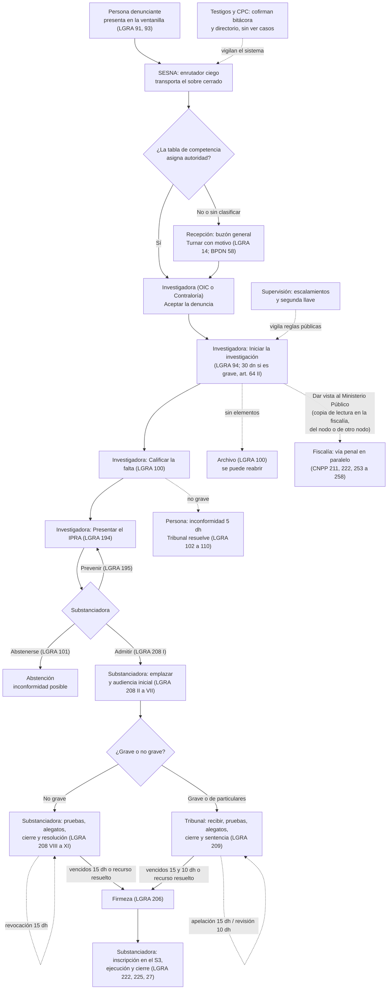

# Manuales de usuario de SIGILO, por perfil

SIGILO es el prototipo de **red federada de denuncias** para el reto S5 (Sistema de denuncias
públicas de faltas administrativas y hechos de corrupción) del Datatón Anticorrupción 2026 de la
SESNA. Estos manuales explican, a cada persona que lo usa, qué hace su perfil, en qué etapas del
ciclo legal interviene, con qué fundamento y cómo usar cada pantalla.

> **Prototipo, no sistema oficial.** Todo lo que aparece aquí es sintético: personas, casos,
> folios, llaves y contraseñas. Las instituciones del escenario de demostración llevan la marca
> «(ficticia)». Los catálogos de entes de la PDN y de municipios del INEGI son reales, pero ningún
> caso acusa a una institución real.

**Versión revisada:** software SIGILO 1.2.1, Estándar S5 0.4.0, rama `main` (versión 1.2.1, con los
lotes 1 a 6 de correcciones), 16 de noviembre
de 2026. Los textos entre comillas («…») son los que aparecen en pantalla.

## Cómo leer estos manuales

- Cada manual sigue el mismo orden: quién eres y tu papel en la ley; qué ves y qué no ves; cómo
  entras; tu bandeja; cada etapa que te toca, en orden; qué hacer si algo falla; limitaciones
  conocidas; glosario; y un diagrama de tu flujo.
- Las cuentas de la demostración (`contraloria.queretaro`, `tja.queretaro`…) solo son ejemplos.
  **Las contraseñas no están en estos manuales:** se generan cada vez que se arma la red y están en
  `.red-demo/nodos/<nodo>/credenciales.json`. Las llaves de autoridad están en
  `.red-demo/autoridades/<authorityId>.json`.
- Los avisos **«Limitación conocida del prototipo»** vienen del recorrido en vivo del 16 de
  noviembre de 2026 y de la revisión del código, actualizada tras los lotes 1 y 2. Dicen lo que hoy
  no funciona como pide la ley, para que nadie lo descubra en una presentación. Lo que ya se
  corrigió se describe como comportamiento normal (ver la tabla del final).
- **Reloj de la demostración.** Varios pasos esperan plazos legales reales: la audiencia inicial,
  10 días hábiles desde el emplazamiento; el cierre de la instrucción, los 5 de alegatos; conceder o
  negar una medida cautelar, la vista de 5; la firmeza, 15. Para mostrarlos sin esperar, quien opera
  la red de demostración corre `npm run demo:reloj -- +10dh` antes de la audiencia,
  `npm run demo:reloj -- +6dh` antes de cerrar la instrucción o resolver la medida, y
  `npm run demo:reloj -- +16dh` antes de la firmeza (ver `docs/demo.md`). Es **solo para la demostración**; en
  producción el reloj es el real.
- Abreviaturas: LGRA (Ley General de Responsabilidades Administrativas), LGSNA (Ley General del
  Sistema Nacional Anticorrupción), BPDN (Bases para el funcionamiento de la Plataforma Digital
  Nacional), CNPP (Código Nacional de Procedimientos Penales), CPF (Código Penal Federal), LCF (Ley
  de Coordinación Fiscal), LFRCF (Ley de Fiscalización y Rendición de Cuentas de la Federación),
  IPRA (Informe de Presunta Responsabilidad Administrativa), OIC (órgano interno de control), «dh»
  (días hábiles), «dn» (días naturales).

## Los manuales

| N.º | Perfil                                                   | Dónde trabaja                                                            | Archivo                                                                                    |
| --- | -------------------------------------------------------- | ------------------------------------------------------------------------ | ------------------------------------------------------------------------------------------ |
| 01  | Persona denunciante (servidora pública o ciudadana)      | Ventanilla única: `/denunciar` y `/seguimiento`                          | [01-persona-denunciante.md](01-persona-denunciante.md)                                     |
| 02  | Unidad receptora (buzón general)                         | Panel del nodo, función «recepción y turnado»                            | [02-unidad-receptora-buzon-general.md](02-unidad-receptora-buzon-general.md)               |
| 03  | Autoridad investigadora (OIC o Contraloría)              | Panel del nodo, funciones «recepción» e «investigación»                  | [03-autoridad-investigadora.md](03-autoridad-investigadora.md)                             |
| 04  | Autoridad substanciadora y resolutora                    | Panel del nodo, función «substanciación»                                 | [04-autoridad-substanciadora-y-resolutora.md](04-autoridad-substanciadora-y-resolutora.md) |
| 05  | Titular o supervisión                                    | Panel del nodo, función «supervisión»                                    | [05-titular-y-supervision.md](05-titular-y-supervision.md)                                 |
| 06  | Tribunal de Justicia Administrativa                      | Panel del nodo, función «Tribunal»                                       | [06-tribunal-de-justicia-administrativa.md](06-tribunal-de-justicia-administrativa.md)     |
| 07  | Fiscalía especializada (vía penal)                       | Panel del nodo                                                           | [07-fiscalia-especializada.md](07-fiscalia-especializada.md)                               |
| 08  | Operación del nodo estatal (SESEA)                       | Panel del nodo, función «operación», y CLI `sigilo`                      | [08-operacion-del-nodo-sesea.md](08-operacion-del-nodo-sesea.md)                           |
| 09  | SESNA: ventanilla, enrutador y red                       | Ventanilla, salud, Swagger, CLI `sigilo-sesna`                           | [09-sesna-ventanilla-y-red.md](09-sesna-ventanilla-y-red.md)                               |
| 10  | Secretaría Anticorrupción y Buen Gobierno (nodo Federal) | Panel del nodo Federal                                                   | [10-nodo-federal-sabg.md](10-nodo-federal-sabg.md)                                         |
| 11  | Institución que solicita su alta                         | Ventanilla: `/solicitar-alta`                                            | [11-institucion-que-solicita-su-alta.md](11-institucion-que-solicita-su-alta.md)           |
| 12  | Testigos y CPC                                           | CLI `sigilo testigo` y proceso testigo                                   | [12-testigos-y-cpc.md](12-testigos-y-cpc.md)                                               |
| 13  | Ciudadanía y academia                                    | Ventanilla: observatorio, datos abiertos, `/verificar`, `/quien-atiende` | [13-ciudadania-y-academia.md](13-ciudadania-y-academia.md)                                 |

El código no tiene más funciones de cuenta que las seis del estándar: `intake` (recepción y
turnado), `investigation` (investigación), `substantiation` (substanciación y resolución),
`supervision` (supervisión), `court` (Tribunal) y `operation` (operación del nodo). Solo
`intake` e `investigation` se pueden juntar en una cuenta; las demás nunca se combinan (LGRA, art.
115). La fiscalía usa en la demostración `intake` + `investigation`, y su autoridad lleva el papel
`prosecution`: con él solo avanza la vía penal y no ve las acciones administrativas. La entidad de fiscalización
superior (ASF o ESFE) es autoridad, pero en la demostración no tiene cuentas (la ESFE ficticia de
Querétaro solo admite denuncias con nombre y firma); por eso no tiene manual propio.

## Matriz perfil × etapa (quién hace qué)

**H** = lo hace (es su acto). **A** = aprueba o participa. **V** = solo ve o recibe aviso. Vacío =
no interviene. Persona = persona denunciante; Rec. = unidad receptora (buzón); Inv. =
investigadora; Sub. = substanciadora y resolutora; Sup. = titular o supervisión; TJA = Tribunal;
Fisc. = fiscalía; Op. = operación del nodo (SESEA); SESNA; Test. = testigos y CPC; Ciud. =
ciudadanía y academia.

| Etapa o acto                                                             | Fundamento                        | Persona                                   | Rec. | Inv.                    | Sub.                    | Sup.                    | TJA                        | Fisc.                | Op. | SESNA                   | Test.        | Ciud.                   |
| ------------------------------------------------------------------------ | --------------------------------- | ----------------------------------------- | ---- | ----------------------- | ----------------------- | ----------------------- | -------------------------- | -------------------- | --- | ----------------------- | ------------ | ----------------------- |
| Presentar la denuncia (anónima o sellada)                                | LGRA 91, 93; BPDN 56 a 58         | H                                         |      |                         |                         |                         |                            |                      |     | V (transporta a ciegas) |              |                         |
| Turnar desde el buzón general («Motivo del turno»)                       | LGRA 14; BPDN 58                  | V (lee el motivo)                         | H    |                         |                         |                         |                            |                      |     |                         |              |                         |
| Aceptar, reasignar o devolver                                            | LGRA 14, 94                       | V                                         | H    | H                       |                         |                         |                            | H                    |     |                         |              |                         |
| Semáforo de turnado (meta del S5, no plazo legal)                        | BPDN 58                           |                                           | V    | V                       |                         | V (aviso si vence)      |                            |                      |     |                         |              |                         |
| Iniciar la investigación                                                 | LGRA 91, 94, 96                   | V                                         |      | H                       |                         |                         |                            |                      |     |                         |              |                         |
| Mensajes cifrados y medidas de protección                                | LGRA 64, 91; CNPP 109             | H                                         |      | H                       |                         |                         |                            | H                    |     |                         |              |                         |
| Excusa o justificación por conflicto de interés                          | LGRA 58                           | V                                         |      | H                       |                         | V (si no se excusa)     |                            |                      |     |                         |              |                         |
| Archivo y reapertura                                                     | LGRA 100, 74                      | V                                         |      | H                       |                         | V                       |                            |                      |     |                         |              |                         |
| Calificar la falta (grave o no grave)                                    | LGRA 100                          | V                                         |      | H                       |                         | V (señales del auditor) |                            |                      |     |                         |              |                         |
| Presentar el IPRA                                                        | LGRA 100, 194                     | V                                         |      | H                       |                         |                         |                            |                      |     |                         |              |                         |
| Prevención del IPRA y corrección                                         | LGRA 195                          |                                           |      | H (corrige)             | H (previene)            |                         |                            |                      |     |                         |              |                         |
| Abstención                                                               | LGRA 101                          | V                                         |      |                         | H                       |                         |                            |                      |     |                         |              |                         |
| Inconformidad (aviso, escrito firmado, resolución)                       | LGRA 102 a 110                    | H (aviso y escrito)                       |      | H (registra el escrito) |                         | A (2.ª aprobación)      | H (resuelve)               |                      |     |                         |              |                         |
| Admitir, emplazar, audiencia inicial                                     | LGRA 112, 193, 208 I a VII        | V (tercera)                               |      |                         | H                       |                         |                            |                      |     |                         |              |                         |
| Vía no grave: pruebas, alegatos, cierre, resolución                      | LGRA 208 VIII a XI                | V                                         |      |                         | H                       |                         |                            |                      |     |                         |              |                         |
| Revocación                                                               | LGRA 210 a 212                    |                                           |      |                         | H (registra y resuelve) |                         |                            |                      |     |                         |              |                         |
| Enviar el expediente al Tribunal (grave)                                 | LGRA 209 I                        | V                                         |      |                         | H                       |                         |                            |                      |     |                         |              |                         |
| Vía grave en el Tribunal hasta la sentencia                              | LGRA 209 II a V                   | V                                         |      |                         |                         |                         | H                          |                      |     |                         |              |                         |
| Reclasificación: el Tribunal ordena, la investigadora reclasifica (3 dh) | LGRA 209 II                       | V (ve la falta reclasificada)             |      | H (registra la falta)   |                         |                         | H (ordena)                 |                      |     |                         |              |                         |
| Apelación y revisión                                                     | LGRA 215 a 221                    | H (apela como tercera, fuera del sistema) |      | H (puede registrar)     |                         |                         | H (registra y resuelve)    |                      |     |                         |              |                         |
| Medidas cautelares                                                       | LGRA 123 a 129                    | V (sin detalle)                           |      | H (pide)                | H (resuelve)            |                         | H (resuelve en sus etapas) |                      |     |                         |              |                         |
| Firmeza (vencidos los recursos o resueltos)                              | LGRA 206                          | V                                         |      |                         | H (no grave)            |                         | H (grave)                  |                      |     |                         |              |                         |
| Ejecución, inscripción en el S3 y cierre                                 | LGRA 222, 225, 27                 | V                                         |      |                         | H                       | V                       |                            |                      |     |                         |              |                         |
| Vista al Ministerio Público                                              | LGRA 10 III, 98; CNPP 222         | V                                         |      | H                       | H                       |                         |                            | V (copia de lectura) |     | V (transporta)          |              |                         |
| Vía penal (investigación, determinación, juicio)                         | CNPP 211, 253 a 258               | V                                         |      |                         |                         |                         |                            | H                    |     |                         |              |                         |
| Recursos federales: marca y aviso                                        | LCF 49; LFRCF 47, 66 Bis; CPF 212 |                                           | H    | H                       |                         |                         |                            |                      |     |                         |              |                         |
| Turnar a otro nodo (solo anónimas)                                       | LGRA 14, 196 II                   | V (folio nuevo)                           | H    | H                       |                         |                         |                            | H                    |     | V (transporta)          |              |                         |
| Abrir la identidad sellada (2 personas)                                  | LGRA 64, 91; CNPP 109 XXVI        | V (lo ve en su seguimiento)               |      | H / A                   |                         | A                       |                            | H / A                |     |                         |              |                         |
| Escalamiento por inacción (segunda llave)                                | LGRA 64 II, 58, 100               |                                           |      |                         |                         | H (abre la copia)       |                            |                      |     |                         |              |                         |
| Alta de instituciones con huella                                         | BPDN 57                           |                                           |      |                         |                         |                         |                            |                      | H   | H (directorio)          | A (cofirman) |                         |
| Competencia por dependencia (firma de la tabla)                          | CPEUM 109 III; LGRA 10            |                                           |      |                         |                         |                         |                            |                      | H   | V (acepta)              | A (cofirman) | V (`/quien-atiende`)    |
| Directorio firmado y bitácora nacional                                   | BPDN 59 a 61; LGSNA 21            |                                           |      |                         |                         |                         |                            |                      |     | H                       | A (cofirman) | V (verifica)            |
| Estadística para la PDN (OAuth)                                          | BPDN 60, 61                       |                                           |      |                         |                         |                         |                            |                      |     | H                       |              | V (datos abiertos)      |
| Observatorio, datos abiertos y registro público                          | BPDN 61; LGSNA 21                 | V                                         |      |                         |                         |                         |                            |                      |     | H (publica)             | V            | H (consulta y verifica) |

## Diagrama general del ciclo legal con las funciones

Las dos vías corren en paralelo y son autónomas (CPEUM, art. 109; LGRA, art. 14). Cada caja dice
qué función da el paso.

## Fuentes

- Código de este repositorio (rama `main`), en especial
  `packages/contracts/src/authority-access.ts` (funciones de cuenta),
  `packages/contracts/src/catalogs/lifecycle.ts` (etapas, recursos, cierres),
  `apps/web/src/pages/authority/` (panel) y `apps/web/src/pages/` (ventanilla).
- Documentos: `docs/ciclo-de-vida-legal.md`, `docs/proceso-legal-de-la-denuncia.md`,
  `docs/competencia-por-dependencia.md`, `docs/proteccion-de-quien-denuncia.md`,
  `docs/instalacion-nodo.md`, `docs/instalacion-sesna.md`, `docs/guia-conecta-tu-estado.md`,
  `docs/criptografia.md`, `docs/contexto-pdn.md`, `docs/auditoria-guia.md`.
- Recorrido completo de la demostración con todos los perfiles y su revisión en vivo del
  16 de noviembre de 2026 (las limitaciones encontradas se marcan en cada manual).

## Contradicciones encontradas entre código, guía y ley

Estado tras los lotes 1, 2 y 5 (rama `lote-5-seguimiento-textos`). **Resuelta** = el código ya hace lo que pide
la ley y los manuales lo describen como comportamiento normal. **Sigue** = limitación conocida.

| Tema                                                | Qué dice cada fuente                                                                                                                                                                        | Estado                                                                                                                                                                              |
| --------------------------------------------------- | ------------------------------------------------------------------------------------------------------------------------------------------------------------------------------------------- | ----------------------------------------------------------------------------------------------------------------------------------------------------------------------------------- |
| Firmeza de la sentencia o resolución                | La ley da 15 dh para la revocación o la apelación y 10 para la revisión antes de la firmeza (LGRA 206, 210, 215, 220)                                                                       | **Resuelta** (lote 1): el panel no ofrece el paso y dice «Podrás hacerlo a partir del …»; el nodo responde `409`. Procede antes si el recurso registrado ya se resolvió             |
| Plazos de los recursos desde la notificación (T8)   | Corren desde la notificación (LGRA 208 fr. XI, 209 fr. V, 210, 215, 220). El sistema no registraba la notificación y contaba desde que se entraba a la etapa                                | **Resuelta**: «Registrar la notificación» (substanciadora, Tribunal o investigadora); los recursos corren desde ese día y sin ella el panel dice «Registra primero la notificación» |
| Cierre con recurso pendiente                        | LGRA 206. El código permitía «Cerrar con fundamento» con un recurso sin resolver                                                                                                            | **Resuelta** (lote 1): el panel lo oculta y dice «hay un recurso pendiente. Primero registra su resolución.»                                                                        |
| Tribunal cierra después de la sentencia             | LGRA 206: dictada la sentencia, se declara firme vencidos los recursos y la autoridad que ejecuta cierra. El panel del Tribunal ofrecía «Cerrar con fundamento» en «Sentencia del Tribunal» | **Resuelta**: en esa etapa nadie cierra (`409`); el sobreseimiento firme lo cierra la substanciadora                                                                                |
| Cierre sin inscripción en el S3                     | LGRA 27. El código permitía cerrar con «Resolución firme con sanción» sin la inscripción                                                                                                    | **Resuelta** (lote 1): la opción queda desactivada hasta registrar el S3, que se puede hacer desde la firmeza                                                                       |
| Informe por no presentado (T1)                      | LGRA 195: 3 días para corregir                                                                                                                                                              | **Resuelta** (lote 1)                                                                                                                                                               |
| Audiencia inicial a los 10 dh (T2)                  | LGRA 208 fr. III: no menos de 10 ni más de 15 dh después del emplazamiento. El código la deja registrar el mismo día                                                                        | **Resuelta**: el panel no la ofrece antes del décimo día hábil y dice «Podrás hacerlo a partir del …»                                                                               |
| Cierre de la instrucción con alegatos abiertos (T3) | LGRA 208 fr. IX; 209 fr. III. El código deja cerrar la instrucción con los 5 dh de alegatos corriendo                                                                                       | **Resuelta**: espera los 5 dh de alegatos, también en el Tribunal                                                                                                                   |
| Cierre por abstención (T4)                          | LGRA 102 y 103: 5 dh para inconformarse desde la notificación                                                                                                                               | **Resuelta** (lote 1): con identidad sellada exige la notificación por el buzón y los 5 dh vencidos, o la inconformidad resuelta                                                    |
| Caducidad y prescripción (T5)                       | LGRA 74: 6 meses sin actuación; 3 o 7 años                                                                                                                                                  | **Resuelta** (lote 1)                                                                                                                                                               |
| Medida cautelar antes de la vista de 5 días (T6)    | LGRA 126 y 127. El código deja conceder o negar sin esperar la vista                                                                                                                        | **Resuelta**: durante la vista solo «Concedida provisionalmente»; vencida, se concede o se niega                                                                                    |
| Cierre sin motivo legal después del IPRA (T7)       | LGRA 100: el archivo es de la investigación                                                                                                                                                 | **Resuelta** (lote 1): desde el IPRA, «Motivo legal» es obligatorio                                                                                                                 |
| «Marcar recursos federales» en «Trámite → Acción»   | La guía y `ciclo-de-vida-legal.md` dicen que está en «Acción». El código tiene el texto, pero el panel nunca lo ofrece ahí; solo en la tarjeta «Recursos federales»                         | **Sigue**: los manuales usan la tarjeta                                                                                                                                             |
| «Cambiar a quién va» con «Buzón general»            | La guía lo menciona. El código solo ofrece el buzón cuando el propio sistema lo propone                                                                                                     | **Sigue**: los manuales describen lo que hace el código                                                                                                                             |
| Vista al Ministerio Público                         | La guía y la ley suponen que la fiscalía la recibe (LGRA 10 fr. III). Antes solo se registraba el acto; no llegaba a la bandeja de la fiscalía                                              | **Resuelta** (lote 3 y después): la fiscalía del nodo o de otro nodo (por la red) la recibe como copia de lectura con hechos y pruebas re-cifradas; sin la identidad sellada        |
| Fiscalía con funciones administrativas              | La fiscalía es el MP. Su cuenta veía el plazo del art. 64 fr. II, «Iniciar la investigación» y «Dar vista al Ministerio Público»                                                            | **Resuelta** (lote 2 y después): con el papel `prosecution` solo ve los plazos de la vía penal                                                                                      |
| Contraloría con etapas penales                      | La vía penal la registra la fiscalía. El código dejaba a cualquier cuenta de investigación registrar etapas penales                                                                         | **Resuelta** (lote 2): solo la fiscalía avanza la vía penal; la investigadora y la substanciadora solo dan vista (`403` si lo intentan)                                             |
| Buzón turna al Tribunal                             | El Tribunal no recibe denuncias (LGRA 209). La lista «Autoridad» del buzón lo incluía                                                                                                       | **Resuelta** (lote 2): turnar y reasignar solo van a autoridades con recepción (`canReceive`); nunca el Tribunal, la supervisión ni el buzón (`400`)                                |
| Tribunal y «Descartar pruebas» o excusa             | El Tribunal no debe disponer de las pruebas; la excusa del panel (LGRA 58) es de quien recibe, investiga o substancia                                                                       | **Resuelta** (lote 2)                                                                                                                                                               |
| Substanciación y buzón con «Solicitar la apertura»  | Solo la investigación y la supervisión abren identidades                                                                                                                                    | **Resuelta** (lote 2): ven «Tu función no solicita ni aprueba aperturas…»                                                                                                           |
| Avisos al titular de Querétaro                      | `contraloria.titular` no recibía escalamientos en vivo («Tu función no permite esta acción»)                                                                                                | **Resuelta** (lote 4): recibe los avisos sin copia (`alertsTo`); la copia sigue exigiendo la segunda llave                                                                          |
| Alta estatal con delitos del CPF                    | Un OIC estatal conoce delitos del código penal local. El formulario de alta ofrece el «Código Penal Federal»                                                                                | **Resuelta** (lote 5): una institución estatal o municipal ve el código penal de su entidad                                                                                         |
| Seguimiento «Lo que sigue» tras la sentencia grave  | Dice que notifica la Contraloría; en la vía grave notifica el Tribunal (LGRA 209 fr. V)                                                                                                     | **Resuelta** (lote 5): en las etapas del Tribunal, «Lo que sigue» nombra al Tribunal                                                                                                |
| Reclasificación ordenada por el Tribunal            | LGRA 209 fr. II: el Tribunal ordena y la investigadora reclasifica en 3 dh. El Tribunal podía ordenarla, pero la investigadora no tenía cómo registrar la falta reclasificada               | **Resuelta**: «Registrar la falta reclasificada (orden del Tribunal)» (conducta grave, fundamento y acuerdo); el Tribunal espera esos 3 dh para admitir las pruebas                 |
