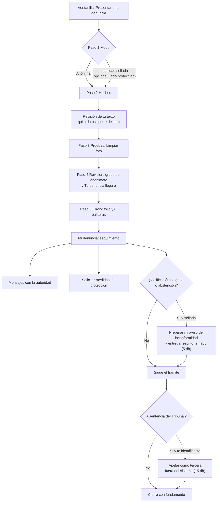

# Manual 01. Persona denunciante

Para: cualquier persona que quiere denunciar una falta administrativa o un hecho de corrupción.
Puede ser una **persona servidora pública** que vio algo en su trabajo (por ejemplo, «Ana», una
persona sintética que trabaja en una dependencia estatal) o una **persona ciudadana** que hizo un
trámite (por ejemplo, alguien a quien le pidieron dinero en una ventanilla de licencias).

> Prototipo del Datatón 2026; no es el sistema oficial. Todo es sintético. No escribas nombres,
> correos, teléfonos ni datos reales en ningún campo.

## 1. Quién eres y qué papel tienes en la ley

- **Puedes denunciar sin dar tu nombre.** La ley permite la denuncia anónima y obliga a guardar en
  secreto la identidad de quien denuncia (LGRA, art. 91). La denuncia puede ser electrónica
  (LGRA, art. 93) y el S5 es el canal único para recibirla (BPDN, arts. 56 a 58).
- **Revelar tu identidad sin motivo es una falta grave** de quien lo haga: obstrucción de la
  justicia (LGRA, art. 64, fr. III).
- **Si eres persona servidora pública** y denuncias una falta grave o de particulares, puedes pedir
  **medidas de protección**. Las evalúa el ente público donde trabajas (LGRA, art. 64, último
  párrafo).
- **Si te identificas, eres «tercera»** en el procedimiento (LGRA, art. 116, fr. IV). Eso te da
  derechos: que te avisen del archivo, de la calificación de no grave y de la resolución; que te
  citen a la audiencia; inconformarte contra la calificación de no grave o la abstención (arts. 102
  a 110) y apelar la sentencia del Tribunal (arts. 215 a 219).
- **Si eres víctima u ofendida en la vía penal**, el CNPP te da derechos de protección y de
  resguardo de tu identidad (art. 109, fr. XVI, XIX y XXVI; art. 137). Quien denuncia corrupción no
  siempre es víctima; esto es orientación.
- **Si eres particular** y pagaste un soborno: dar dinero también puede ser falta (LGRA, art. 66),
  y la ley puede reducir la sanción a quien confiesa primero y colabora (arts. 88 y 89). La LGRA no
  prevé medidas de protección para particulares que no son víctimas ni testigos.

## 2. Qué ves y qué NO ves

| Tú ves                                                                                     | Tú no ves                                               |
| ------------------------------------------------------------------------------------------ | ------------------------------------------------------- |
| Tu folio, tu línea de tiempo, el estado y la etapa legal de tu denuncia                    | El expediente interno de la autoridad                   |
| Las notas públicas, fundamentos y acuerdos en versión pública que escriben las autoridades | Las medidas cautelares concretas (solo que se dictaron) |
| Los mensajes cifrados con la autoridad                                                     | A qué persona concreta de la autoridad le toca          |
| Cada vez que alguien abre tu identidad sellada, con su fundamento                          | Nada de otras denuncias                                 |
| Los plazos que corren y «Lo que sigue»                                                     |                                                         |

**Quién puede ver qué de ti:**

- **Nadie del sistema** (ni la SESNA, ni la SESEA, ni el enrutador) puede leer tu nombre ni tus
  pruebas: viajan cerrados con llave hacia la autoridad competente.
- **Tu nombre** (si elegiste «Identidad sellada») solo se abre con la aprobación de **dos personas
  distintas** de la autoridad, con un fundamento legal que tú vas a leer, o porque tú lo pides para
  un recurso.
- **Tus 8 palabras nunca salen de tu equipo.** Sirven para abrir tu seguimiento.

> **Limitación conocida del prototipo.** Los **hechos** (el relato, la oficina, la conducta)
> llegan al nodo sin cifrar; solo tu identidad y tus pruebas van cerradas con llave. Por eso la
> revisión del texto te ayuda a quitar datos que te delaten. Cifrar también los hechos es el
> siguiente paso.

## 3. Cómo entras

**No hay cuenta, ni contraseña, ni correo.** SIGILO no tiene cuentas para quien denuncia.

- **Para denunciar:** abre la ventanilla única (en la demostración, <http://127.0.0.1:8790/>) y
  pulsa «Cuenta lo que pasó…» / «Presentar una denuncia» (ruta `/denunciar`).
- **Para dar seguimiento:** pulsa «Ver cómo va mi denuncia» (ruta `/seguimiento`), escribe tu folio
  y tus 8 palabras.
- **Recuperación:** **no existe.** Si pierdes el folio o las 8 palabras, nadie puede devolvértelos
  (ni la autoridad, ni la SESNA). Anótalos en papel. No les tomes foto con el equipo que usas.
- **Si alguien se acerca:** pulsa «Salida rápida» (arriba) o la tecla **Esc dos veces**: «Borra lo
  que escribiste y abre una página del clima.»

### Herramientas de accesibilidad y modos de uso

Arriba de cada página está el botón **«Accesibilidad»** («Herramientas de accesibilidad»). Ofrece:

- «Tamaño del texto», «Espacio entre líneas» y «Lectura fácil».
- Colores (claro, oscuro o «como tu sistema»).
- «Guía de teclado» (Tab, Mayús + Tab, flechas, Esc; «Salida rápida: borra todo y sale»).
- «Leer esta página» y «Leer lo que seleccioné»: usa solo la voz instalada en tu equipo («Lo que se
  lee no sale a internet»). Si no hay voz en español, la pantalla te dice cómo instalarla o usar tu
  lector de pantalla.
- **Modos de uso:**
  - «Me ayuda otra persona»: «Te avisamos cuándo pedirle que se aparte, para que solo tú veas tus 8
    palabras.»
  - «Equipo compartido (quiosco)»: «No se puede copiar el recibo y, al terminar, se borra todo de
    esta pantalla.»
  - «Tengo poca conexión»: repite una consulta fallida hasta 4 veces; «Los envíos nunca se repiten
    solos.»

La página **«¿De verdad es seguro? Mira cómo te cuidamos.»** (`/como-te-cuidamos`) explica que
puedes escribir en modo avión («Abre el formulario con internet y luego desconéctate: nada sale de
tu equipo hasta que envías.») y comprobarlo tú.

## 4. Tu «bandeja»: Mi denuncia

En `/seguimiento` («Ver cómo va tu denuncia»):

1. «Folio»: «Tiene 12 letras y números. Ejemplo: ABCD-EFGH-JKMN. Puedes escribirlo sin guiones.»
2. «Las 8 palabras de tu recibo»: basta con las primeras 4 letras de cada una; puedes pegar las 8
   separadas por espacios en la primera casilla. «Cuida que nadie vea tu pantalla.»
3. Pulsa **«Ver mi seguimiento»**.

Verás: el estado, la etapa legal, la línea de tiempo con las notas públicas, los plazos, «Lo que
sigue:», tu identidad («Sellada. Tu identidad sigue bajo llave. Nadie la ha abierto…»), «Mensajes
con la autoridad», «Solicitar medidas de protección» y, cuando procede, «Aviso de inconformidad».
Al terminar: **«Cerrar seguimiento»** («Cerraste tu seguimiento. Borramos tus datos de esta
pantalla.»).

## 5. Etapas que te tocan, en orden

### 5.1 Presentar la denuncia (5 pasos)

El asistente dice «Denunciar, paso N de 5». Pasos: **Modo, Hechos, Pruebas, Revisión, Envío**.

#### Paso 1 «Modo»: ¿Cómo quieres denunciar?

- **«Compruébalo tú»**: al abrir el formulario (con internet) la web descarga los catálogos de todo
  el país, unos 300 KB, y solo los guarda en la memoria de la pestaña. Cuando dice «Listo: ya
  descargamos los catálogos. Puedes desconectarte.», pon el teléfono en modo avión: los pasos 1 a 4
  (estado, institución, tamaño de tu grupo y «Tu denuncia llega a») funcionan sin internet. Si la
  descarga falla, el aviso pide seguir con internet mientras eliges el estado y la institución.
- **«Anónima (recomendada)»**: no das nombre. No podrás inconformarte ni apelar, porque la ley pide
  nombre y firma (LGRA, art. 109).
- **«Identidad sellada»**: das tu nombre, pero «Tus datos se guardan bajo llave antes de salir de tu
  equipo. Nadie del sistema puede leerlos. Solo los abre la autoridad competente, con la aprobación
  de dos personas distintas y un fundamento legal, o tú, si decides inconformarte».
  - «Nombre completo», «Cómo contactarte (opcional)» y «Testigos (opcional)» (uno por línea).
  - Casilla **«Pido protección (por ejemplo, para que no me castiguen en mi trabajo)»**: «La
    autoridad lo verá al recibir tu denuncia.»

Elige sellada si quieres pedir protección como servidora pública o poder inconformarte.

#### Paso 2 «Hechos»: Cuéntanos qué pasó

1. «¿Dónde pasó?» (estado) y «Municipio o alcaldía (opcional)». Puedes elegir «No indicar
   municipio (solo el estado)»: «Si lo dejas en blanco, es más difícil saber que fuiste tú.»
2. «Oficina o institución de gobierno»: escribe parte del nombre y elige de la lista («Primero salen
   las de tu municipio, luego las estatales y las federales.»).
3. «¿Quién lo hizo?» (por ejemplo, «Una persona servidora pública»).
4. «¿Qué hizo la persona? Elige lo más parecido». Si no sabes, elige al final **«Ninguna se parece:
   que la autoridad la clasifique (sin clasificar)»**: «Tu relato es lo que importa. La autoridad
   decide qué falta o delito es…».
5. «¿Trabajas o trabajaste en esa oficina? (opcional)» y «Tu área (opcional)». **No se envían**:
   solo sirven para calcular, en tu equipo, cuántas personas podrían ser tú.
6. «¿Cuándo pasó? (mes y año, aproximados)»: «El mes basta. Es más seguro que el día exacto.»
7. «Persona o cargo denunciado»: mejor el cargo que el nombre.
8. «Describe lo que pasó». Abajo verás:
   - «Lo que ayuda contar»: «Qué pasó», «Cuándo», «Dónde», «Qué efecto tuvo».
   - «Por lo que cuentas, podría ser»: sugerencias con «Puede ser falta grave», «Puede ser falta
     no grave» o «Puede ser delito», y «Usar esta».
   - **«Revisión de tu texto»**: «Encontramos N datos que podrían identificarte.», con «Ir a este
     dato en el texto». Corrige hasta ver «No vemos datos que te delaten.» La revisión corre en tu
     navegador; el texto no se manda a ningún servicio.

Ejemplo de relato seguro (sintético): «En septiembre de 2026 la persona titular de la Dirección de
Adquisiciones pidió a varios proveedores una cooperación de 5 por ciento del monto en efectivo para
liberar sus órdenes de compra.» Evita frases como «Soy la única auxiliar del área» o números de
expediente.

Con el teclado: escribe para filtrar, baja con la flecha a la primera opción y elige con Enter.
Escribir no marca ninguna opción; la flecha abajo empieza por la primera.

#### Paso 3 «Pruebas»: Agrega pruebas (opcional)

1. «Agregar pruebas (opcional)».
2. Si una foto trae datos escondidos verás **«Esta foto revela:»** (lugar, equipo, fecha, autor) y
   «Falta limpiarla.». Pulsa **«Limpiar foto»**. Verás «Antes: original (no se envía)» y «Después:
   copia limpia (se envía)».
3. Un PDF ofrece «Convertir a imágenes» («Así borramos el nombre de quien lo hizo y otros datos
   escondidos.»).
4. Opcional: **«Haz que tu denuncia sume con otras (opcional)»** (corroboración ciega por RFC,
   contrato o nombre de la persona servidora pública). Nadie sabe quién corrobora ni el dato
   comparado.

Si no limpias, el envío se detiene: «Hay pruebas sin limpiar. Regresa al paso de pruebas y límpialas
o quítalas.»

#### Paso 4 «Revisión»: Revisa antes de enviar

- **Servidora pública:** «¿Cuántas personas podrían ser tú?» con el rango («Menos de 5 personas»,
  «Entre 5 y 9 personas»…) o «Tamaño desconocido» si no hay datos del S1. Si sale «Menos de 5», la
  pantalla sugiere guardar notas y enviar más tarde.
- **Ciudadana** (si marcaste que no trabajas ahí): «Cómo protegerte», con consejos como «Quita
  números de trámite, placas o tu dirección.» y «Si puedes, envíala unos días después de tu visita.»
  A ti no te sale el consejo sobre la red de tu trabajo.
- Con riesgo medio o alto, el semáforo dice **«Lo que más pesa:»** y la razón principal; el resto
  está en «Ver por qué». El consejo sobre la red del trabajo, si aplica, sale aparte como
  «Consejo:»; no es un dato que te delate.
- **«Tu denuncia llega a»**: la autoridad propuesta, con «Es la que puede investigar la oficina y la
  conducta que elegiste.» y «¿Por qué ahí?». «Cambiar a quién va» abre «Elige a quién enviarla»,
  con «Propuesta», «También competente» y «Elegir otra autoridad del directorio».
- «Ver lo que leerá la autoridad» y «Ver lo que sale de tu equipo» («Sale, cerrado con llave» /
  «Nunca sale de tu equipo»).

> **Limitación conocida del prototipo.**
>
> - «Cambiar a quién va» no ofrece «Buzón general»; el buzón solo aparece cuando el sistema no
>   encuentra autoridad competente (por ejemplo, con «Ninguna se parece»).
> - Si eliges **identidad sellada** y la denuncia va al **buzón general**, tu nombre se sella con la
>   llave del buzón, y después la autoridad investigadora no podrá abrirlo. Si necesitas que se
>   pueda abrir (por ejemplo, para protección o inconformidad), no la mandes al buzón.

#### Paso 5 «Envío»: Envía tu denuncia

1. Revisa «Se enviará a …» y pulsa **«Enviar denuncia»**. Sin internet, el paso dice **«Para
   enviar necesitas conexión»** y no envía: quita el modo avión y vuelve a pulsar.
2. Mensajes: «Comprobando que la conexión es segura.», «Preparando tus 8 palabras.», (sellada)
   «Guardando tu nombre bajo llave…», «Enviando tu denuncia.» y «Comprobando que tu denuncia llegó
   completa.».
3. Prueba de trabajo: «Protegiendo tu envío contra envíos automáticos. En un celular sencillo puede
   tardar hasta 20 segundos.»
4. «Antes de ver tus palabras. Pide a la persona que te ayuda que se aparte de la pantalla.»
5. «Tu denuncia fue recibida», «Está guardada y cerrada con llave», «Llegó completa».
6. **Anota el folio y las 8 palabras.** La pantalla te pide confirmar **2 palabras**. «Si sales
   ahora, ya no podrás ver tus 8 palabras.» Termina con «Ver mi denuncia» o «Ir al inicio».

Si tu estado no tiene nodo en la red, la ventanilla te lo dice y no envía (las denuncias sobre entes
federales sí llegan al nodo Federal). Si el nodo de tu estado no responde y tu denuncia **no** lleva
pruebas, la SESNA la guarda en cola hasta 7 días y te da un acuse; con pruebas, vuelve a intentar.

### 5.2 Mientras la autoridad trabaja: qué verás

| Momento                     | Lo que ves                                                                                        |
| --------------------------- | ------------------------------------------------------------------------------------------------- |
| Recién enviada              | «Estado: Recibida», la línea de tiempo y el comprobante verificado                                |
| Turnada desde el buzón      | El «Motivo del turno» tal como lo escribió la unidad receptora                                    |
| Aceptada                    | La nota pública de la autoridad                                                                   |
| Investigación               | «En investigación» y «Lo que sigue:»                                                              |
| Calificada                  | La gravedad y el fundamento; si es **no grave**, el aviso de inconformidad (5.4)                  |
| Archivada                   | «Archivada» con el fundamento; si se reabre, lo verás                                             |
| Procedimiento               | «Puedes participar como tercera» (te citan 72 horas antes de la audiencia; LGRA 116 fr. IV y 208) |
| En el Tribunal              | «En el Tribunal»                                                                                  |
| Sentencia                   | «Puedes apelar como tercera» (15 dh, con escrito firmado ante el Tribunal; arts. 215 y 216)       |
| Medidas cautelares          | Solo que se dictaron medidas para proteger la investigación, sin detalle                          |
| Vista al Ministerio Público | Las dos vías: la administrativa y «Vista al Ministerio Público»                                   |
| Final                       | «Concluida con sanción firme» u otro cierre con su fundamento                                     |

Si la ventanilla única envió tu denuncia directo a la autoridad, «Recibida» lo dice («la ventanilla
única la envió directo a la autoridad competente»); solo si pasó por el buzón general dice que llegó
ahí. En las etapas del Tribunal, «Lo que sigue» nombra al Tribunal, que notifica su sentencia (LGRA,
art. 209, fr. V). Al cerrar, «Estado:» dice cómo concluyó (por ejemplo, «Concluida con sanción
firme»), igual que el panel de la autoridad. Si tu denuncia es «Ninguna se parece», no verás los
plazos de falta grave hasta que la autoridad la califique.

> **Limitación conocida del prototipo.** La sentencia ya no se declara firme antes de que terminen
> los 15 días hábiles para apelar, pero el sistema los cuenta **desde que se dicta**, no desde que
> te la notifican. Si quieres apelar, presenta tu escrito cuanto antes y avisa por el buzón.

### 5.3 Mensajes con la autoridad

- En «Mensajes con la autoridad» («Solo tú y la autoridad pueden leer estos mensajes.») lees las
  preguntas, descifradas en tu navegador.
- Responde en «Tu respuesta» («Revisa que no incluya datos que te identifiquen.») y pulsa **«Enviar
  respuesta»** → «Respuesta enviada. Solo la autoridad puede leerla.»
- Si ves «La conversación está incompleta» o «Faltan, sobran o están desordenados algunos
  mensajes», el sistema podría estar ocultando parte de la conversación: guarda tu folio y busca
  apoyo.
- Si ves «Por seguridad no enviamos nada. Alguien podría estar espiando esta conexión.», usa otra
  conexión (por ejemplo, los datos de tu celular).

> **Limitación conocida del prototipo.** En la red, solo puedes escribir después de que la
> autoridad te escribió por primera vez. Antes de eso, la casilla «Pido protección» de la denuncia
> sellada es el único aviso disponible.

### 5.4 Solicitar medidas de protección

- **Quién decide:** «SIGILO no otorga medidas: tu solicitud llega a la autoridad que lleva tu
  denuncia. Si trabajas en el servicio público, la ley pide que la evalúe el ente donde trabajas
  (LGRA, art. 64).» En la vía penal, si eres víctima, deciden el Ministerio Público o el juez (CNPP,
  arts. 109 y 137).
- **Cómo:**
  1. Abre **«Solicitar medidas de protección»** y lee «Quién decide.», «Tu identidad.» y «Si tu
     vida corre peligro ahora» (llama al 911).
  2. «Lo que te preocupa (opcional)»: por ejemplo, «Temo que me cambien de área».
  3. **«Enviar la solicitud de medidas de protección»** → «Enviaste tu solicitud. La verás en el
     hilo de mensajes…».
- La autoridad la ve en el buzón como «Solicitud de medidas de protección».
- Alternativa que conviene conocer: puedes pedir a la autoridad investigadora que solicite una
  **medida cautelar** contra la persona señalada (por ejemplo, suspensión temporal; LGRA, arts. 123
  y 124). Esa no la decide tu ente, sino la substanciadora o el Tribunal.

> **Limitación conocida del prototipo.** El sistema registra tu solicitud, pero todavía no
> registra quién decidió las medidas ni qué decidió.

### 5.5 Inconformidad (solo con identidad sellada)

- **Contra qué:** la calificación de **no grave** o la **abstención** (LGRA, arts. 101 y 102).
- **Plazo:** 5 días hábiles desde que la autoridad te lo **notifica por el buzón** («El plazo de 5
  días hábiles empieza cuando la autoridad te lo notifique por el buzón.»).
- **Requisito legal:** escrito con nombre, domicilio y **firma autógrafa** ante la autoridad
  investigadora (art. 109). Sin firma «no se tendrá por presentado».

Pasos:

1. En la sección «Aviso de inconformidad», lee «Antes de preparar tu aviso, debes saber:» («el
   aviso no es la inconformidad…»).
2. Llena «¿Por qué no estás de acuerdo con la calificación?» (o «…con la abstención?»), al menos una
   frase.
3. Marca «Acepto que se abra mi identidad sellada solo para este recurso.»
4. Pulsa **«Preparar mi aviso de inconformidad»**. Verás «Preparaste tu aviso de inconformidad el
   …». **El sistema nunca dice que ya la presentaste.**
5. **Entrega tu escrito firmado** a la autoridad investigadora. Cuando lo registre, verás
   «Inconformidad presentada con firma el …» y el plazo de la Sala (30 dh).
6. El Tribunal resuelve: «Resultado de la inconformidad: …».

Mientras corren tus 5 días hábiles, o mientras tu inconformidad esté pendiente, la autoridad **no
puede cerrar** la denuncia por abstención: el sistema se lo impide hasta que venza el plazo o se
resuelva el recurso.

En tu tarjeta de identidad verás: «Abriste tu identidad para el recurso de inconformidad. Queda
registrado quién la abrió, cuándo y para qué.»

Con denuncia anónima verás: «Tu denuncia es anónima, así que la inconformidad no está disponible…».

### 5.6 Apelar la sentencia como tercera

Si te identificaste, puedes apelar la sentencia del Tribunal en 15 días hábiles con escrito firmado
(LGRA, arts. 215 a 219). **Se presenta fuera del sistema**, ante el Tribunal; el Tribunal o la
investigadora lo registran en SIGILO. Comparecer en la audiencia también es fuera del sistema.

### 5.7 Si tu denuncia cambia de nodo

Si la autoridad la turna a otro nodo (solo con denuncias anónimas), verás «Tu denuncia continúa en
otro nodo», «Ahora tiene el folio …» y «Ver la denuncia con el folio nuevo». **Tus 8 palabras son
las mismas.**

### 5.8 Si alguien abre tu identidad

En tu tarjeta de identidad verás cada apertura: «Una persona de la autoridad — Recibió el sobre de
tu identidad. — Queda en el registro público.», con el fundamento que escribió. Hasta que termina el
día verás «Pendiente de publicar en el registro público: se publica cuando termina el día.» Si el
sistema detecta una apertura que no te mostró, te avisa y te pide guardar tu folio y buscar apoyo.

## 6. Qué hacer si algo falla

| Síntoma                                                | Qué hacer                                                                                             |
| ------------------------------------------------------ | ----------------------------------------------------------------------------------------------------- |
| «No pudimos abrir tu seguimiento»                      | Revisa el folio (12 caracteres) y las 8 palabras. El error no dice cuál falló, a propósito            |
| «Hay pruebas sin limpiar…»                             | Regresa al paso 3 y pulsa «Limpiar foto», o quita la prueba                                           |
| «Tu denuncia llega a» no es la autoridad que esperabas | Revisa estado, oficina y conducta; usa «¿Por qué ahí?»                                                |
| No aparece el aviso de inconformidad                   | Necesitas identidad sellada, calificación no grave o abstención, y un mensaje de la autoridad después |
| No puedo escribir en el buzón                          | La autoridad todavía no te ha escrito                                                                 |
| «Salida rápida» abre una página de error               | La página neutra no cargó, pero el borrado sí ocurrió                                                 |
| Perdí el folio o las 8 palabras                        | No hay recuperación. Puedes presentar una denuncia nueva                                              |
| Mi vida corre peligro                                  | Llama al 911. SIGILO no es un servicio de emergencia                                                  |

## 7. Limitaciones conocidas del prototipo (resumen)

- Los hechos llegan al nodo sin cifrar; tu identidad y tus pruebas sí van cifradas.
- La regla de «dos personas» para abrir tu identidad la aplica el nodo; no es un umbral
  criptográfico.
- Una denuncia sellada que pasa por el buzón general ya no se puede abrir para la investigadora.
- Las denuncias con identidad sellada no se pueden turnar a otro nodo.
- El plazo para apelar se cuenta desde la sentencia, no desde que te la notifican.
- La accesibilidad está revisada con herramientas y teclado; falta probarla con lectores de pantalla
  y con personas.

## 8. Glosario breve

- **Folio:** 12 letras y números que identifican tu denuncia.
- **8 palabras (recibo):** tu llave para ver el seguimiento. Solo tú las tienes.
- **Identidad sellada:** das tu nombre, pero va cerrado con llave.
- **Grupo de anonimato:** cuántas personas podrían haber escrito tu denuncia.
- **Calificación:** la autoridad decide si la falta es grave o no grave (LGRA, art. 100).
- **Inconformidad:** recurso contra la calificación de no grave o la abstención.
- **Tercera:** tu calidad en el procedimiento si te identificas.
- **Medidas de protección:** te protegen a ti. **Medidas cautelares:** protegen la investigación.

## 9. Diagrama de tu flujo

