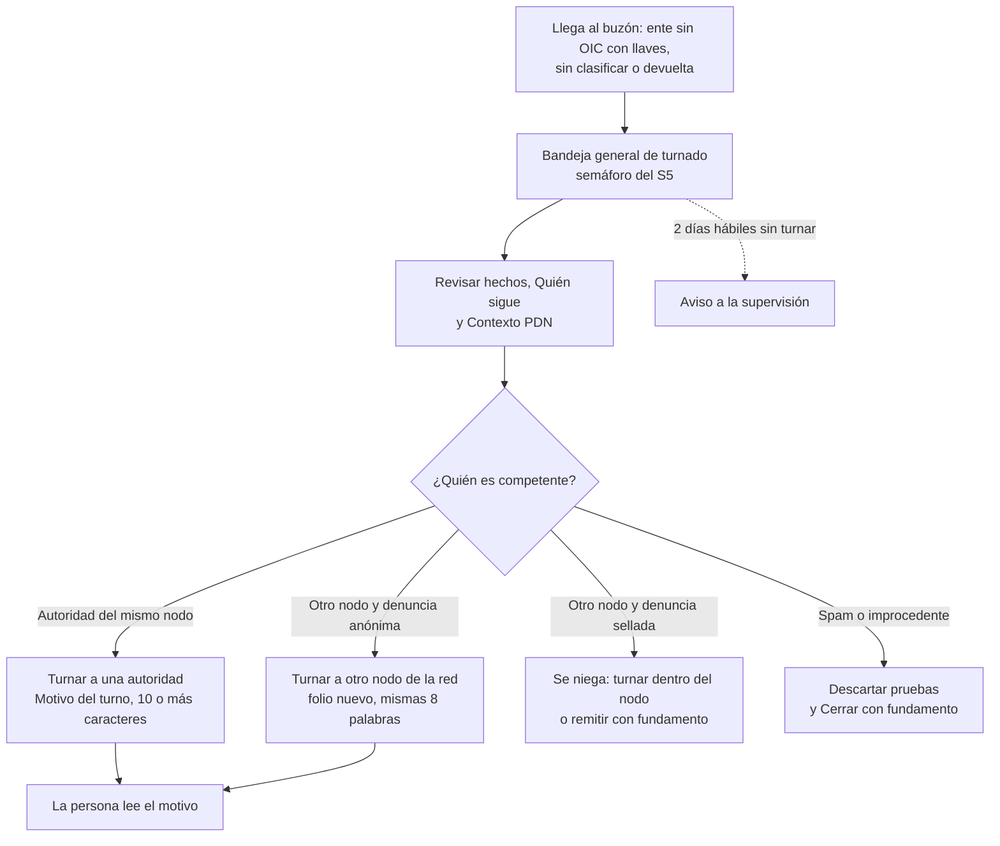

# Manual 02. Unidad receptora: el buzón general del nodo

Para: la persona de la **autoridad receptora** que designa cada estado para atender el buzón
general. En la demostración de Querétaro es la «Unidad receptora de quejas y denuncias de la
Secretaría de la Contraloría del Poder Ejecutivo del Estado de Querétaro (ficticia)», con la cuenta
`buzon.queretaro`. En el nodo Federal, `buzon.federal`; en Oaxaca, `buzon.oaxaca`.

> Prototipo del Datatón 2026; no es el sistema oficial. Datos sintéticos.

## 1. Quién eres y qué papel tienes en la ley

- **Recibes y turnas.** Quien recibe una denuncia que no le toca debe turnarla a la autoridad
  competente (LGRA, art. 14; en Querétaro, LRAEQ, art. 11). Toda institución que reciba una denuncia
  por otro medio la registra en el S5, y el S5 tiene protocolos de turno (BPDN, arts. 56 y 58).
- **No investigas.** Tu función de cuenta es `intake` (recepción y turnado). No calificas, no
  presentas el IPRA, no abres identidades.
- **No eres la SESEA.** En Querétaro la SESEA solo opera el nodo; no recibe ni turna denuncias
  (LSEAQ, arts. 24 y 34, fr. X). Si la ley de un estado faculta a su SESEA para recibir y turnar
  (por ejemplo, Michoacán), su tabla de funciones lo declara expresamente (`settings.operatorReceives`).
- **Cuándo te llega una denuncia:** cuando la tabla de competencia del nodo no asigna un OIC con
  llaves al ente (ente pendiente, OIC nombrado sin alta, llaves vencidas), cuando la persona eligió
  «Ninguna se parece» (sin clasificar), o cuando una autoridad la devuelve al buzón.

## 2. Qué ves y qué NO ves

| Ves                                                                     | No ves                                                                                 |
| ----------------------------------------------------------------------- | -------------------------------------------------------------------------------------- |
| Los hechos de las denuncias que llegan al buzón                         | El nombre de la persona denunciante: nunca ves «Solicitar la apertura» de la identidad |
| Las pruebas de esas denuncias (se abren con la llave del buzón)         | Las denuncias que van directo a un OIC o a la Contraloría                              |
| El semáforo de turnado                                                  | El trámite posterior de la denuncia una vez aceptada por otra autoridad                |
| «Quién sigue en el trámite» y la ficha «Contexto PDN de la dependencia» |                                                                                        |

**Tu llave del buzón es muy sensible:** con ella se leen los hechos de todo lo que llega al buzón.
Nunca debe quedarse en el servidor del nodo.

## 3. Cómo entras

- **Panel:** `/autoridad` del nodo (demostración: Querétaro <http://127.0.0.1:8781/autoridad>,
  Federal 8782, Oaxaca 8783). Usa una pestaña por cuenta.
- **Usuario y contraseña:** los recibes en persona de quien opera el nodo. En la demostración están
  en `.red-demo/nodos/<nodo>/credenciales.json`.
- **«Llave de tu autoridad (archivo .json)»:** la llave del **buzón**, no la de una autoridad. En la
  demostración: `.red-demo/nodos/<nodo>/llaves-demo/authority-demo-key.json`. En producción la
  creaste tú con «Crear mis llaves» o te la entregaron en una memoria cifrada y se borró del
  servidor.
- Pulsa **«Entrar al panel»**.
- **Segundo factor:** en producción el panel lo exige (`SIGILO_MFA=requerido`). La primera vez verás
  «Activa la verificación en dos pasos»: escanea el código QR con tu app, escribe el código y guarda
  tus 10 códigos de recuperación («Ya guardé mis códigos de recuperación en un lugar seguro.»). En
  la demostración las cuentas `buzon.*` entran sin código.
- **Recuperación:** si pierdes el teléfono, usa «No tengo mi teléfono: usar un código de
  recuperación». Si perdiste también los códigos, quien opera el nodo confirma en persona y corre
  `./sigilo cuenta reiniciar-mfa <usuario> --confirmo`.
- **Sesión:** se cierra sola tras 15 minutos sin actividad («Tu sesión está por cerrarse» →
  «Seguir conectada»). La llave vive solo en la memoria de la pestaña: si recargas, la vuelves a
  elegir. Para salir: «Cerrar sesión y borrar la llave de la memoria».

## 4. Tu bandeja: «Bandeja general de turnado»

- Lista de folios con la columna **«Meta de turnado del S5»**: «A tiempo», «Por vencer» o
  «Vencida», con la frase «Menos de 1 día hábil sin turnar» o «N días hábiles sin turnar». Si la
  persona pidió protección, se marca «pide protección».
- En el detalle: «Espera en el buzón general a que la turnen desde el … Es la meta del S5, no un
  plazo legal.» Pasa a «por vencer» a 1 día hábil y vence a los 2; al vencer, «La supervisión recibe
  un aviso.»

**Dilo con claridad:** el semáforo es una **meta de servicio del S5**; la LGRA no fija un plazo
para turnar. El plazo legal que sí corre es el de 30 días naturales para iniciar la investigación de
una posible falta grave (LGRA, art. 64, fr. II), y lo cuenta la autoridad investigadora.

## 5. Etapas que te tocan, en orden

### 5.1 Revisar la denuncia

1. Abre el folio. Revisa la oficina («Oficina o institución de gobierno»), la conducta («En la ley
   que aplica», que puede decir «sin clasificar»), el periodo y la descripción.
2. Revisa **«Quién sigue en el trámite»** y la ficha «Contexto PDN de la dependencia» (si el ente es
   del catálogo real de la PDN) para decidir a quién le toca.
3. Si el sistema propuso turnar a un OIC concreto («turnar al OIC de …»), esa es la pista principal.

> **Limitación conocida del prototipo.** Mientras la denuncia está «Turnada» o en el buzón,
> «Quién sigue en el trámite» puede decir «La tabla no la asigna para este ente» en todas las filas;
> se llena cuando una autoridad la acepta.

### 5.2 Turnar a una autoridad del nodo

1. Tarjeta **«Trámite»** → «Acción»: **«Turnar a una autoridad»**.
2. «Autoridad»: elige la autoridad competente del directorio.
3. **«Motivo del turno (obligatorio)»**: «Por qué la envías a esta autoridad; la persona lo leerá.
   Al menos 10 caracteres.» Ejemplo sintético: `La oficina es del Poder Ejecutivo sin OIC
designado: la investiga la Secretaría de la Contraloría.`
4. Pulsa **«Aplicar»** → «Listo: Turnar a una autoridad. La denuncia ya no está en tu bandeja.»

- **Fundamento:** LGRA, art. 14; BPDN, art. 58.
- **Qué ve la persona:** el motivo del turno, tal cual, en su línea de tiempo.
- **Las pruebas viajan contigo:** tu navegador abre la llave de cada prueba y la vuelve a cerrar
  hacia la autoridad destino antes de cederla. El servidor no las puede leer.
- **Error común:** motivo corto. Verás «Escribe por qué la envías a esta autoridad (al menos 10
  caracteres).»

**Quién aparece en la lista «Autoridad».** Solo las autoridades del nodo que pueden aceptar lo que
turnas: las que tienen una cuenta de recepción (`intake`). El **Tribunal**, la **supervisión** y el
propio buzón no aparecen: el Tribunal no recibe denuncias, solo el expediente que envía la
substanciadora en una falta grave (LGRA, art. 209). Si alguien intenta turnar a una de ellas por la
API, el nodo responde `400`.

En la tarjeta de la identidad sellada solo ves su estado y el aviso «Tu función no solicita ni
aprueba aperturas: lo hacen la investigación y la supervisión de la autoridad que tiene la
denuncia.»

> **Cuidado con las denuncias selladas.** Si una denuncia con identidad sellada llegó al buzón, el
> nombre quedó sellado con la llave del buzón. Al turnarla, la investigadora **no podrá abrir** la
> identidad («La identidad de esta denuncia se selló con otra llave…»). Anótalo en el motivo.

### 5.3 Cerrar desde el buzón

Si la denuncia es claramente improcedente o es spam, «Acción»: **«Cerrar con fundamento»**:
«Motivo de cierre del S5» («Atendido», «Canalizado», «Improcedente», «Información insuficiente»,
«Acumulado», «Otro»), «Fundamento legal» (al menos 20 caracteres, la persona lo verá) y «Acuerdo en
versión pública» (al menos 50, sin datos personales). Si es spam, antes usa **«Descartar pruebas»**:
marca «Entiendo que los archivos se borran para siempre y que la persona lo verá.» → «Descartar
pruebas». No se puede deshacer y queda en la bitácora pública.

Si la autoridad competente está fuera de la red, usa «Motivo legal (opcional)» → «Incompetencia y
remisión» y escribe a dónde se remitió («Escribe a qué autoridad se remitió.»).

### 5.4 Si una autoridad la devuelve al buzón

Cuando una autoridad usa «Devolver al buzón general», la denuncia vuelve a tu bandeja con su nota
pública. Vuelve a turnarla a quien corresponda.

### 5.5 Turnar a otro nodo de la red (solo denuncias anónimas)

Si la autoridad competente está en otro estado o en la federación:

1. Tarjeta **«Turnar a otro nodo de la red»**: «…la denuncia se vuelve a cerrar con llave en tu
   navegador hacia ese nodo. Este servidor solo la transporta y no puede leerla. La persona conserva
   sus mismas 8 palabras con el folio nuevo.»
2. «Elige la autoridad» (por ejemplo, el buzón del nodo Federal).
3. «Nota pública para la persona»: «Explica por qué la turnas. La persona la leerá tal cual.»
4. **«Turnar a otro nodo»** → «Turnada a otro nodo»: «Llegó a … con el folio …».

- **Fundamento:** LGRA, arts. 14 y 196, fr. II.
- **Qué ve la persona:** «Tu denuncia continúa en otro nodo», el folio nuevo y «Ver la denuncia con
  el folio nuevo».
- Si el destino no confirma en 10 días hábiles, se escala («Turnado a otro nodo sin comprobante en
  10 días hábiles») y tu nodo conserva las pruebas.
- **Con identidad sellada se niega a propósito:** «Esta denuncia tiene identidad sellada. Para
  turnarla a otro nodo habría que abrirla con dos aprobaciones y volver a sellarla hacia la
  autoridad destino; este prototipo todavía no lo hace.»

### 5.6 Recursos federales

En la tarjeta **«Recursos federales»** puedes marcar «Origen del dinero» → «Marcar: involucra
recursos federales» y dar aviso a la ASF, la SABG o la FGR (ver manual 03, sección 5.11).

### 5.7 Registrar un desistimiento

Si la persona avisa que retira su denuncia: «Acción» → **«Registrar un desistimiento»** con «Nota
pública (obligatoria)». No cierra la denuncia: «La investigación también es de oficio…» (LGRA, arts.
91 y 94).

## 6. Qué hacer si algo falla

| Síntoma                                                     | Qué hacer                                                                          |
| ----------------------------------------------------------- | ---------------------------------------------------------------------------------- |
| «Esta es la llave del buzón general…» o «Esta llave es de…» | Elegiste otra llave. El buzón usa `llaves-demo/authority-demo-key.json` de su nodo |
| «Elige el archivo de llave de la autoridad.»                | Falta la llave                                                                     |
| «El código no es válido o ya se usó…»                       | Espera el código nuevo; revisa que la hora del teléfono sea automática             |
| «Turnar a otro nodo» se niega                               | La denuncia es sellada: usa «Turnar a una autoridad» dentro del nodo               |
| La denuncia no está en tu bandeja                           | Fue directo a un OIC o ya la turnaste                                              |
| «Tu sesión se cerró por inactividad»                        | «Volver a entrar»; elige otra vez la llave si recargaste                           |

## 7. Limitaciones conocidas del prototipo

- «Quién sigue en el trámite» no asigna funciones mientras la denuncia no está aceptada.
- Una denuncia sellada que pasa por el buzón ya no se puede abrir para la investigadora.
- El turnado entre nodos solo funciona con denuncias anónimas.
- Las denuncias con pruebas no entran a la cola de reenvío de la SESNA si tu nodo está caído.

## 8. Glosario breve

- **Buzón general:** la bandeja de lo que la tabla no asigna. Tiene su propia llave.
- **Turnar:** enviar la denuncia a la autoridad competente, con motivo.
- **Semáforo de turnado:** meta del S5 (1 día «por vencer», 2 «vencida»), no plazo legal.
- **Tabla de competencia:** lista firmada de quién investiga a cada dependencia.
- **Nodo:** el servidor de un estado (o de la federación) en la red.

## 9. Diagrama de tu flujo

