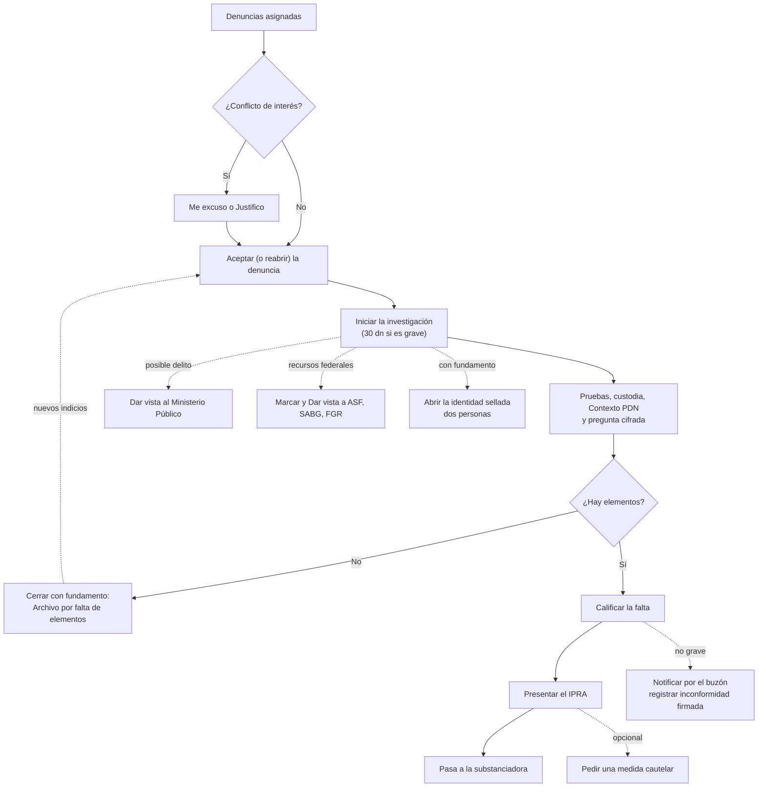

# Manual 03. Autoridad investigadora: OIC o Contraloría estatal

Para: el área de quejas, denuncias e investigación de un **órgano interno de control (OIC)** o de la
**Secretaría de la Contraloría** del estado. En la demostración de Querétaro: «Secretaría de la
Contraloría del Poder Ejecutivo del Estado de Querétaro (ficticia)», cuentas
`contraloria.queretaro` y `contraloria.queretaro.persona2`; OIC ficticios `oic-cea.queretaro`,
`oic-municipio-queretaro` y `oic-el-marques`. En el nodo Federal: `oic-equipamiento.persona1` y
`.persona2` y `oic-programas` (ver también el manual 10).

> Prototipo del Datatón 2026; no es el sistema oficial. Datos sintéticos.

## 1. Quién eres y qué papel tienes en la ley

- **Eres la autoridad investigadora** (LGRA, art. 3, fr. II). Recibes, investigas, calificas la
  falta y presentas el IPRA (LGRA, arts. 91, 94, 96, 100 y 194).
- **Recibir e investigar puede ser la misma área.** La LGRA no obliga a separarlas, así que tu
  cuenta tiene dos funciones: `intake` + `investigation`.
- **No substancias ni resuelves.** Desde que presentas el IPRA, el procedimiento lo lleva otra área
  (LGRA, art. 115). El sistema lo vigila dos veces: tu cuenta no tiene la función de
  substanciación, y además una cuenta que investigó una denuncia nunca puede substanciarla.
- **Competencia:** cada ente público tiene su OIC y cada municipio el suyo (CPEUM, art. 109, fr.
  III; LGRA, arts. 3, fr. XXI, y 10). En Querétaro la Contraloría investiga a las dependencias del
  Ejecutivo sin OIC designado (LRAEQ, arts. 2, fr. XXII, 6 y 7) y **no** a los municipios.
- **Plazos y deberes que te tocan:**
  - Iniciar la investigación de una posible falta grave en **30 días naturales**; no hacerlo es
    obstrucción de la justicia (LGRA, art. 64, fr. II). Simular que una grave es no grave también
    (fr. I).
  - Avisar el archivo a quien denunció, si es identificable, en **10 días hábiles** (art. 100).
  - Guardar la identidad de quien denuncia; revelarla sin motivo es obstrucción (arts. 64, fr. III,
    y 91).
  - Excusarte si tienes conflicto de interés (art. 58).
  - Denunciar ante la fiscalía los hechos que pueden ser delito (art. 10, fr. III; CNPP, art. 222).

## 2. Qué ves y qué NO ves

| Ves                                                                    | No ves                                                        |
| ---------------------------------------------------------------------- | ------------------------------------------------------------- |
| Los hechos y las pruebas de las denuncias asignadas a tu autoridad     | Denuncias de otras autoridades                                |
| Los mensajes cifrados con la persona                                   | El nombre de la persona, salvo apertura con dos aprobaciones  |
| La ficha de contexto, la corroboración ciega y las señales del auditor | La medida de protección decidida por el ente (no se registra) |
| La ficha «Contexto PDN de la dependencia» (datos públicos)             |                                                               |
| La cadena de custodia de las pruebas                                   |                                                               |

## 3. Cómo entras

- Panel `/autoridad` del nodo (demostración: Querétaro <http://127.0.0.1:8781/autoridad>).
- «Usuario» y «Contraseña» (demostración: `.red-demo/nodos/<nodo>/credenciales.json`).
- **«Llave de tu autoridad (archivo .json)»:** la llave de **tu autoridad**, la misma para todas las
  personas de tu área (demostración: `.red-demo/autoridades/authority.comptroller-queretaro.json`).
  El panel la compara con el directorio firmado y rechaza la de otra autoridad o la del buzón.
- **«Entrar al panel»**. Si tu cuenta tiene segundo factor: «Código de 6 dígitos» → «Verificar y
  entrar». En la demostración las cuentas de investigación de Querétaro entran sin código;
  `oic-programas` (Federal) lo inscribe al entrar.
- **Recuperación:** códigos de recuperación («No tengo mi teléfono: usar un código de
  recuperación»), o reinicio del segundo factor por la operación del nodo, confirmado en persona.
- **Si pierdes la llave:** no se recupera. Tu institución crea un par nuevo y hace una nueva alta
  (manual 11). Nadie más tiene una copia: ni la SESEA ni la SESNA.
- Sesión de 15 minutos; la llave solo vive en la pestaña. Salir: «Cerrar sesión y borrar la llave de
  la memoria».

## 4. Tu bandeja: «Denuncias asignadas»

La lista «Denuncias recibidas» muestra folio, «Identidad sellada» o anónima, «pide protección» y la
columna **«Meta de turnado del S5»** («Menos de 1 día hábil sin aceptar»). En el detalle verás
«Recibida», «Estado», el semáforo, «Identidad» («Sellada; aperturas registradas: N» o «No
proporcionada (anónima)»), «Medidas de protección» («Solicitadas» / «No solicitadas»), ubicación,
oficina, conducta, «En la ley que aplica», periodo, persona o cargo y descripción.

Debajo, en este orden: «Ficha de contexto», «Contexto PDN de la dependencia», «Posible conflicto de
interés» (si aplica), «Corroboración ciega», señales del auditor, «Pruebas», «Cadena de custodia»,
«Descartar pruebas», **«Trámite»**, «Recursos federales», «Quién sigue en el trámite», «Turnar a
otro nodo de la red», «Abrir la identidad sellada» (si es sellada) y «Mensajes con la persona
denunciante».

Casi todo se hace en la tarjeta **«Trámite»**: eliges «Acción», llenas los campos y pulsas
**«Aplicar»**. Si eliges «Avanzar a la siguiente etapa legal», aparece «Etapa».

## 5. Etapas que te tocan, en orden

### 5.1 Aceptar la denuncia

- **Cuándo:** al llegar (estado «Turnada»).
- «Acción»: **«Aceptar (o reabrir) la denuncia»**. «Nota pública (opcional)», por ejemplo
  `Recibimos tu denuncia y la atenderá el área de investigación.` → «Aplicar» → «Listo: Aceptar (o
  reabrir) la denuncia.»
- Otras opciones: **«Reasignar a otra autoridad»** (nota pública obligatoria; hay un máximo de
  reasignaciones, como en el S5: después verás «Ya no se puede reasignar») o **«Devolver al buzón
  general»** (nota obligatoria). La lista «Autoridad» solo muestra autoridades del nodo con cuenta
  de recepción: nunca el Tribunal, la supervisión ni el buzón (para eso está «Devolver al buzón
  general»).
- **Fundamento:** LGRA, arts. 14 y 94.
- **La persona ve:** la nota pública y que fue aceptada.
- Si hay alerta de conflicto de interés: «Excúsate o justifica antes de aceptar; si resuelves sin
  hacerlo, se escala.» (ver 5.9).

### 5.2 Iniciar la investigación

- «Acción»: «Avanzar a la siguiente etapa legal» → «Etapa»: **«Iniciar la investigación»** → nota
  opcional → «Aplicar». Verás «Aceptada · Etapa: Investigación» y la lista de plazos que corren.
- **Fundamento:** LGRA, arts. 91, 94 y 96. Si puede ser grave, el plazo «Iniciar ante una posible
  falta grave (LGRA 64)» de 30 dn corre desde la recepción. Si no actúas, la supervisión recibe el
  escalamiento «Falta grave sin iniciar el procedimiento a los 30 días».

> **Limitación conocida del prototipo.** Una denuncia «sin clasificar» ya muestra «Iniciar ante una
> posible falta grave (30 días)», aunque nadie la haya calificado.

### 5.3 Revisar el contexto

- **«Ficha de contexto»:** prioridad sugerida con «Factores de la prioridad y sus pesos», «Por
  qué», «Datos públicos relevantes» y «Avisos que no cambian la prioridad». Es una ayuda; no decide.
- **«Contexto PDN de la dependencia»** (solo si el ente es real del catálogo de la PDN): «Datos
  públicos y agregados de la Plataforma Digital Nacional. No identifican a ninguna persona y el nodo
  no envía nada de la denuncia: solo consulta el identificador público del ente.» Muestra «Nombre en
  el directorio», «Ámbito y poder», «Reporta a la PDN» (S1, S2, S3, S6), «Control de OIC en el
  directorio» y si está entre los 10 compradores con más monto del S6. Sin internet: «Sin conexión
  con la PDN y sin copia guardada.» o «copia guardada». Con entes ficticios no hay ficha.
- **«Corroboración ciega»:** «2 o más personas independientes» o «Posible campaña coordinada» («No
  significa que sean falsas (presunción de buena fe).»).
- **Señales del auditor:** «El auditor aplica reglas públicas y deterministas. Señala con evidencia
  para que una persona revise; no decide nada…».
- **«Quién sigue en el trámite»:** quién substancia, quién resuelve «Si es falta grave» (el
  Tribunal) y «Si es falta no grave», la supervisión y la vía penal; aparte, «Quién vigila el
  sistema (no ve tu caso):».

### 5.4 Pruebas y cadena de custodia

- En «Pruebas», cada «Prueba N (abre en tamaño completo)» se descifra en tu navegador con la llave
  de tu autoridad.
- **«Cadena de custodia»:** «Las pruebas viajan y se guardan cifradas hacia la autoridad: el nodo,
  la SESEA y la SESNA no pueden verlas.» Al abrirlas compara su digesto y su compromiso con la
  bitácora pública: «Comprobado: los digestos de las pruebas están en la bitácora pública…» o
  «Cuidado: lo anclado no coincide…». Si ves lo segundo, no uses la prueba y avisa a tu supervisión.
- Si la denuncia está archivada o sin atender, verás «Denuncia archivada» / «Denuncia sin atender»:
  los archivos se borrarán en la fecha de retención.

### 5.5 Mensajes cifrados con la persona (buzón cifrado)

- Tarjeta «Mensajes con la persona denunciante» → **«Pregunta para la persona denunciante»**
  («No pidas datos que la identifiquen si eligió el anonimato.») → **«Enviar pregunta cifrada»**.
- Las respuestas llegan cifradas y se abren en tu navegador. Una solicitud de protección aparece
  como **«Solicitud de medidas de protección»**, con un texto fijo y lo que la persona quiso
  agregar.
- **Las notificaciones legales también van por aquí:** el archivo (art. 100), la calificación de no
  grave (art. 102) y la abstención. Sin ese mensaje, el plazo de 5 días de la inconformidad no
  empieza.
- Si la persona pidió medidas de protección: la ley dice que las evalúa **el ente donde trabaja**
  (art. 64). Hazle llegar la solicitud y valora pedir una medida cautelar (5.8).

### 5.6 Calificar la falta

- «Acción»: «Avanzar a la siguiente etapa legal» → «Etapa»: **«Calificar la falta»**. Aparece
  «Calificación de la falta (LGRA, art. 100)»:
  - «Gravedad»: «Falta grave (o de particulares)» o «Falta no grave».
  - «Fundamento legal»: «Al menos 20 caracteres. La persona denunciante lo verá.» Ejemplo:
    `LGRA, arts. 52 y 100: la conducta descrita es cohecho, falta grave.`
  - «Acuerdo de calificación en versión pública»: «Al menos 50 caracteres, sin datos personales. La
    persona y el auditor lo leerán.»
  - «Aplicar» → «Calificación: …».
- **No grave:** «Si la calificas como no grave, se notifica a quien denunció y puede inconformarse
  en 5 días hábiles con escrito firmado (arts. 102, 103 y 109). El auditor revisa el acuerdo.» Si el
  auditor marca dos o más señales, se escala a la supervisión («Calificación de no grave con dos o
  más señales del auditor»; LGRA, art. 64, fr. I).
- Envía después el mensaje de notificación por el buzón.

### 5.7 Presentar el IPRA

- «Etapa»: **«Presentar el Informe de Presunta Responsabilidad Administrativa»** → «Aplicar». Etapa
  «Informe de Presunta Responsabilidad Administrativa presentado».
- **Fundamento:** LGRA, arts. 100 y 194. Abre a la substanciadora el plazo de admisión (3 días).
- **Si la substanciadora te previene** («Informe con observaciones (prevención)», art. 195): tienes
  3 días. «Etapa»: **«Presentar el informe corregido»**. Si no lo corriges, cuando venzan esos 3 días
  ella puede «Tener el informe por no presentado (no se corrigió)» y la denuncia vuelve a
  investigación (antes, el sistema no se lo permite).
- **Desde aquí ya no avanzas etapas.** Verás «Tu función no tiene acciones del trámite en este
  estado.» u opciones reducidas. Sí puedes: pedir medidas cautelares, dar vista al MP, registrar la
  inconformidad firmada, registrar una apelación o revisión, escribir a la persona y aprobar
  aperturas.

### 5.8 Pedir una medida cautelar

- **Cuándo:** desde «Informe … presentado» hasta el cierre de la instrucción en el Tribunal.
- «Acción»: **«Pedir una medida cautelar»** → «Medida que pides (reservada: la persona denunciante
  no la ve)» (al menos 10 caracteres). Ejemplo: `Suspensión temporal del presunto responsable de
su cargo mientras dura el procedimiento.` → «Aplicar».
- La resuelve la substanciadora o, en sus etapas, el Tribunal («Concedida», «Concedida
  provisionalmente» o «Negada»).
- **Fundamento:** LGRA, arts. 123 a 129 (por ejemplo, art. 124, fr. I).
- **La persona ve:** solo que se dictaron medidas, sin detalle.

### 5.9 Conflicto de interés: excusa o justificación

- Tarjeta **«Posible conflicto de interés»**, con «Evidencia (nombres, nunca porcentajes)» y
  «Fuentes: S1 (declaraciones de intereses) y S2 (cadena de mando).» Si no hay datos: «Sin
  cobertura: no hay datos para revisar (nunca significa «sin conflicto»)».
- «Tu respuesta»: **«Me excuso: otra persona o autoridad debe atenderla»** o **«Justifico por qué
  no hay conflicto»**. «Nota pública» (la persona la lee). **«Registrar respuesta»** → «¿Registrar
  tu respuesta?» → **«Sí, registrar»** → «Listo: tu respuesta quedó registrada en la bitácora.»
- También en «Acción» como «Excusarse o justificar ante un posible conflicto de interés».
- **Fundamento:** LGRA, art. 58. «El turnado no se bloquea. Antes de archivar o cerrar, quien la
  tiene debe excusarse o justificar. Si resuelve sin hacerlo, la denuncia pasa automáticamente a la
  autoridad supervisora.» Una justificación propia también se avisa a la supervisión.
- **Después de excusarte:** «Tu función no tiene acciones del trámite en este estado.» Solo puedes
  reasignar, devolver o turnar.

> **Limitación conocida del prototipo.** En la tarjeta, las etiquetas del grafo pueden perder
> espacios («Inmobiliaria FicticiaEjemplo»).

### 5.10 Dar vista al Ministerio Público (vía penal en paralelo)

- «Acción»: **«Dar vista al Ministerio Público»**. «La vía penal corre aparte y al mismo tiempo: la
  vista no detiene el procedimiento administrativo, que sigue contigo.»
- «Quién da la vista»: «Órgano interno de control o Secretaría» (LGRA, art. 10, fr. III), «Entidad
  de fiscalización (ASF o del estado)» (art. 98) o «Cualquier persona servidora pública» (CNPP, art.
  222).
- «Fiscalía que recibe la vista»: la lista trae las fiscalías de tu nodo («… (en este nodo)»; en la
  demostración de Querétaro, la Fiscalía Anticorrupción del estado) y, al final, **«Otra fiscalía,
  fuera de este nodo (por oficio)»**, que pide «Nombre de la fiscalía».
- Con una fiscalía del nodo, el panel lo explica: «La fiscalía recibe en su bandeja una copia de
  lectura con los hechos y las pruebas: tu navegador vuelve a cifrar las llaves de las pruebas
  hacia la llave pública de la fiscalía (tu llave nunca sale). Solo ella registra las etapas de la
  vía penal.» Y aparte: «La identidad sellada no se comparte con la fiscalía, ni los mensajes con
  la persona denunciante…».
- «Aplicar» → «Vía penal, en paralelo: Denuncia penal presentada». La denuncia **sigue en tu
  bandeja**: no se reasigna y tú sigues con la vía administrativa.
- **La persona ve:** las dos vías en su seguimiento, con la nota «La fiscalía la recibe en su
  bandeja con los hechos y las pruebas; la identidad sellada de la persona denunciante no se
  comparte con ella.»
- **Tú solo das la vista.** Las etapas penales («Vía penal: …») no aparecen en tu lista «Etapa»:
  solo la fiscalía las avanza (si se intentan por la API, el nodo responde `403`).
- **Si la fiscalía necesita la identidad**, te la pide con requerimiento fundado (CNPP, art. 109):
  la abres tú con las dos aprobaciones de siempre (sección de apertura de la identidad).
- Con «Otra fiscalía, fuera de este nodo», la vista solo queda registrada: remite la denuncia y sus
  pruebas por oficio.

### 5.11 Recursos federales (ASF, SABG y FGR)

- **Cuándo:** si el dinero viene de aportaciones federales (Ramo 33) o de un convenio federal.
- Tarjeta **«Recursos federales»** (no está en «Trámite → Acción»):
  1. «Origen del dinero»: «Aportaciones federales (Ramo 33)» o «Convenio o subsidio federal» →
     **«Marcar: involucra recursos federales»**.
  2. «Dar vista o aviso a las autoridades federales»: casillas «Auditoría Superior de la Federación
     (ASF)», «Secretaría Anticorrupción y Buen Gobierno (SABG)» y «Fiscalía Especializada en materia
     de Combate a la Corrupción de la FGR».
  3. «Fundamento» (al menos 20): `Ley de Coordinación Fiscal, art. 49: posible desvío de
aportaciones del Ramo 33.` → **«Dar vista»**.
- **Fundamento:** LCF, art. 49 (aviso inmediato); LFRCF, arts. 47 y 66 Bis (ASF); CPF, art. 212
  (FGR). «Es una guía: el sistema no decide la competencia.» Si la competencia es federal, turna al
  nodo Federal (5.12); la investigación local puede seguir.

> **Limitación conocida del prototipo.** «Se dio aviso» no dice a qué autoridades. El aviso queda
> registrado, pero no se envía: avisa por los medios oficiales.

### 5.12 Turnar a otro nodo (solo denuncias anónimas)

Igual que en el manual 02, sección 5.5: tarjeta «Turnar a otro nodo de la red», «Elige la
autoridad», «Nota pública para la persona» y «Turnar a otro nodo». Dentro del mismo nodo usa
«Reasignar a otra autoridad». Con identidad sellada se niega a propósito.

### 5.13 Archivo y reapertura

- **Cuándo:** en «Investigación» o «Calificación de la falta», si no hay elementos.
- «Acción»: **«Cerrar con fundamento»** → «Motivo de cierre del S5»: «Información insuficiente» →
  «Motivo legal (opcional)»: **«Archivo por falta de elementos»** («El motivo legal va aparte del
  motivo del S5 y dice el fundamento del cierre.») → «Fundamento legal» (20+) → «Acuerdo en versión
  pública» (50+) → «Aplicar».
- Avisa por el buzón en 10 días hábiles si la persona es identificable; si no, se escala («Archivo
  sin aviso en 10 días hábiles»).
- **Reapertura** si surgen nuevos indicios mientras no prescriba (LGRA, arts. 100 y 74): «Acción»:
  **«Aceptar (o reabrir) la denuncia»** con nota pública.
- Otros motivos legales que puedes usar: «Prescripción» (cualquier etapa, solo si ya corrió el
  plazo) e «Incompetencia y remisión» (con destino). Si la prescripción todavía no corre, el nodo lo
  rechaza con «La facultad de sancionar todavía no prescribe: con hechos de …, lo más pronto sería
  después del … (LGRA, art. 74).» (cuenta 3 años, o 7 si es grave, desde el primer día del mes de
  los hechos).
- Desde que presentas el IPRA, el cierre ya no es un archivo: lleva su motivo legal obligatorio
  (ver manual 04, sección 5.10).
- **La persona ve:** «Archivada» con el fundamento y, si se reabre, la reapertura.

### 5.14 Abrir la identidad sellada (dos personas)

- **Cuándo:** solo con fundamento (por ejemplo, para valorar las medidas de protección que pidió).
- Tarjeta **«Abrir la identidad sellada»**, con el anillo «N de 3 llaves usadas» y la alerta «Se
  necesitan dos personas y la persona denunciante lo verá».
  1. Persona 1: «Fundamento legal y motivo» (al menos 20 caracteres; la persona lo leerá tal cual),
     marca «Entiendo que la apertura queda registrada y que la persona denunciante la verá.» →
     **«Solicitar la apertura»**.
  2. Persona 2 (otra cuenta de la misma autoridad o de supervisión): ve «Hay una solicitud con 1 de
     2 aprobaciones. Fundamento: «…».», escribe su fundamento, marca la casilla → **«Aprobar la
     apertura»**.
  3. Aparece **«Abrir identidad aprobada»** para quien aprobó: «Identidad abierta (solo en este
     navegador)», «Identidad declarada por la persona, no verificada.», con «Nombre», «Contacto»,
     «Testigos» y los digestos de las pruebas originales.
- La misma persona no cuenta dos veces: «Espera la aprobación de otra persona.» La solicitud vence
  a los 7 días naturales.
- **Vía penal:** si la denuncia solo tiene etapa penal, el formulario pide «Fundamento en la vía
  penal» (CNPP, art. 109, fr. XXVI; arts. 218 a 220; o art. 131, fr. IX), «Número de la resolución
  o del requerimiento» y «Motivo».
- **Fundamento:** LGRA, arts. 64 y 91. **La persona ve:** la apertura y su fundamento.

> **Limitación conocida del prototipo.**
>
> - La regla de dos personas la aplica el nodo; no es un umbral criptográfico.
> - Si la denuncia sellada pasó por el buzón, verás «La identidad de esta denuncia se selló con otra
>   llave…»: no se puede abrir.
> - La tarjeta puede decir «Aperturas registradas: 1» cuando solo hay un aviso de inconformidad.

### 5.15 Registrar la inconformidad firmada y aprobar la entrega del nombre

1. La tarjeta dice «La persona dio aviso de inconformidad el …; falta el escrito con firma
   autógrafa.»
2. Cuando recibas el escrito en papel: «Acción»: **«Registrar un recurso presentado con firma»** →
   «Recurso»: «Inconformidad» → «Quién lo presentó»: «La persona denunciante (como tercera)» → marca
   **«Recibí el escrito con firma autógrafa (sin firma no se tiene por presentado).»** → «Aplicar».
   Verás «Inconformidad presentada con firma el …»; corre el plazo de la Sala (30 dh).
3. Mientras está pendiente no se admite el informe ni se cierra la denuncia por ningún motivo.
4. **Entrega del nombre para el recurso:** en la tarjeta de identidad, «Recurso de inconformidad.»
   → «Fundamento de tu aprobación» (20+) → **«Aprobar la entrega para el recurso»**. Hacen falta dos
   personas distintas, **al menos una de supervisión** (manual 05).

- **Fundamento:** LGRA, arts. 102 a 110. Lo resuelve el Tribunal (manual 06).

También puedes registrar una **apelación** o **revisión** de la sentencia del Tribunal («La
autoridad investigadora» como quien la presenta, en revisión; LGRA, arts. 215 a 221).

### 5.16 Descartar pruebas (solo spam)

«Descartar pruebas» borra para siempre los archivos («No se puede deshacer»). Úsalo solo con
envíos sin valor. La persona lo ve y queda en la bitácora pública.

## 6. Qué hacer si algo falla

| Síntoma                                                    | Qué hacer                                                              |
| ---------------------------------------------------------- | ---------------------------------------------------------------------- |
| «no corresponde a … en el directorio firmado»              | Elegiste la llave de otra autoridad                                    |
| «Tu función no tiene acciones del trámite en este estado.» | La etapa ya es de la substanciadora o del Tribunal, o te excusaste     |
| No sale «Abrir identidad aprobada»                         | Falta la aprobación de otra cuenta                                     |
| «La identidad de esta denuncia se selló con otra llave…»   | Pasó por el buzón general; no se puede abrir                           |
| «Turnar a otro nodo» se niega                              | Es sellada: reasigna dentro del nodo                                   |
| No aparece el aviso de inconformidad para la persona       | Falta tu mensaje de notificación por el buzón                          |
| «Cuidado: lo anclado no coincide…»                         | No uses la prueba; avisa a supervisión                                 |
| «Sin conexión con la PDN…»                                 | El nodo no tiene internet o la PDN no responde                         |
| «No pudimos aplicar la acción. Inténtalo de nuevo.»        | Revisa los campos marcados («Revisa los datos marcados de la acción.») |

## 7. Limitaciones conocidas del prototipo

- La vista al MP llega a la bandeja solo de una fiscalía del mismo nodo; a una fiscalía de otro
  nodo o fuera de la red se remite por oficio.
- Los avisos a autoridades federales se registran, no se envían.
- Turnar a otro nodo solo con denuncias anónimas.
- Dos aprobaciones: regla del nodo, no criptográfica.
- Las medidas de protección decididas por el ente no se registran.
- Los hechos llegan sin cifrar al nodo.

## 8. Glosario breve

- **IPRA:** Informe de Presunta Responsabilidad Administrativa.
- **Calificación:** decidir si la falta es grave o no grave.
- **Prevención:** la substanciadora pide corregir el IPRA.
- **Medida cautelar:** protege la investigación (por ejemplo, suspensión temporal).
- **Vista al MP:** aviso a la fiscalía de que puede haber delito.
- **Excusa:** apartarte por conflicto de interés.
- **Cadena de custodia:** prueba de que los archivos no cambiaron desde que llegaron.

## 9. Diagrama de tu flujo

