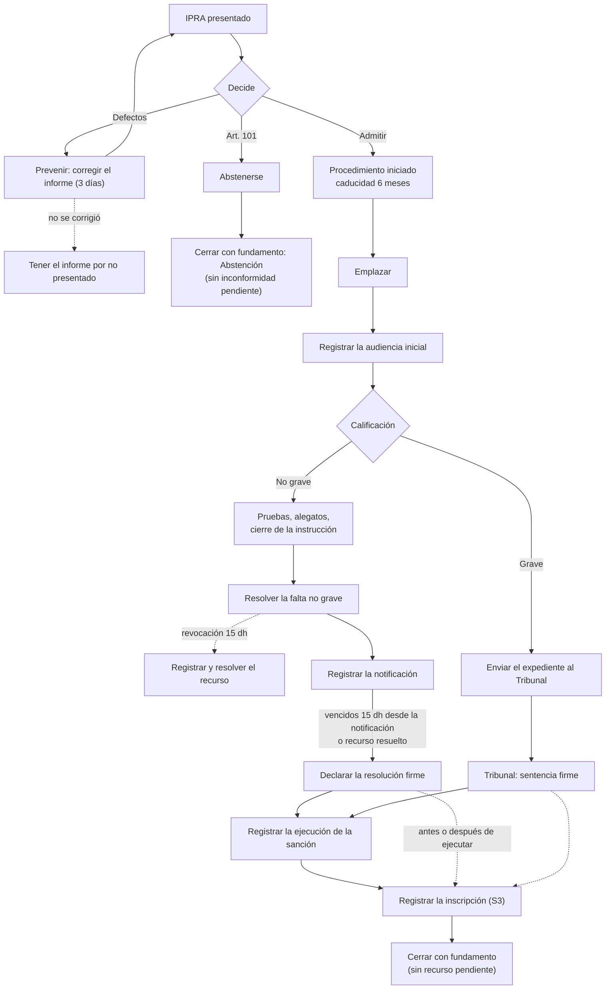

# Manual 04. Autoridad substanciadora y resolutora

Para: el área de responsabilidades de un OIC o de la Contraloría, **distinta** del área que
investiga. En la demostración de Querétaro: «Dirección de Responsabilidades Administrativas de la
Secretaría de la Contraloría de Querétaro (ficticia)», cuenta `contraloria.substanciacion`. En el
nodo Federal: `oic-equipamiento.substanciacion`.

> Prototipo del Datatón 2026; no es el sistema oficial. Datos sintéticos.

## 1. Quién eres y qué papel tienes en la ley

- **Substancias** el procedimiento de responsabilidad desde que recibes el IPRA (LGRA, art. 3, fr.
  III) y, en las faltas **no graves**, también **resuelves** (art. 3, fr. IV; arts. 75, 77 y 208).
- **Nunca eres quien investigó** (LGRA, art. 115). Tu cuenta tiene una sola función,
  `substantiation`, que no se combina con otra; además, el nodo impide que una cuenta que investigó
  una denuncia la substancie.
- **No turnas ni abres identidades.** En la tarjeta de la identidad sellada solo ves su estado y
  «Tu función no solicita ni aprueba aperturas: lo hacen la investigación y la supervisión de la
  autoridad que tiene la denuncia.»
- **En las faltas graves y de particulares** llevas el procedimiento hasta la audiencia inicial y
  envías el expediente al **Tribunal** (art. 209, fr. I). Después registras la ejecución y la
  inscripción en el S3 (arts. 222, 225 y 27).
- Si tu estado no da cuentas al Tribunal en el sistema, tú registras sus actuaciones como «Registro
  de actuación del Tribunal».

## 2. Qué ves y qué NO ves

| Ves                                                 | No ves                                                     |
| --------------------------------------------------- | ---------------------------------------------------------- |
| El expediente, los hechos, las pruebas y el trámite | El nombre de la persona denunciante (no abres identidades) |
| Las medidas cautelares que pide la investigadora    | El buzón cifrado con la persona: no escribes a la persona  |
| Los recursos pendientes                             |                                                            |

## 3. Cómo entras

- Panel `/autoridad` del nodo; «Usuario», «Contraseña» (demostración:
  `.red-demo/nodos/<nodo>/credenciales.json`).
- «Llave de tu autoridad (archivo .json)»: la de tu autoridad (la misma que la investigadora; en la
  demostración `.red-demo/autoridades/authority.comptroller-queretaro.json`). Sirve para abrir las
  pruebas.
- Segundo factor en producción (en la demostración, `contraloria.substanciacion` entra sin código).
  Recuperación con códigos o reinicio por la operación del nodo.
- Sesión de 15 minutos; salir con «Cerrar sesión y borrar la llave de la memoria».

## 4. Tu bandeja: «Expedientes en substanciación»

Muestra los expedientes de tu autoridad que ya te tocan: los aceptados (o cerrados) desde que la
investigadora presenta el IPRA, incluidos los que están en el Tribunal. Las denuncias turnadas sin
aceptar y las que siguen en investigación o calificación no aparecen. Abre el folio y trabaja en la
tarjeta **«Trámite»**: «Acción»: «Avanzar a la siguiente etapa legal» → «Etapa» → «Aplicar». Las
etapas que requieren fundamento piden «Fundamento legal» (20+ caracteres, la persona lo ve) y, a
veces, «Acuerdo en versión pública» (50+, sin datos personales).

## 5. Etapas que te tocan, en orden

### 5.1 Recibir el IPRA: prevenir, abstenerse o admitir

Cuando la investigadora presenta el IPRA («Informe de Presunta Responsabilidad Administrativa
presentado»), tienes **3 días** para admitir (plazo `report_admission`). Tres caminos:

1. **Prevenir** si el informe tiene defectos: «Etapa»: **«Prevenir: pedir que se corrija el
   informe»** → «Fundamento legal» (ejemplo: `LGRA, art. 195: falta precisar la fecha de los
hechos.`) → «Aplicar». Etapa «Informe con observaciones (prevención)». La investigadora tiene 3
   días para «Presentar el informe corregido». Si no lo corrige, **cuando venzan esos 3 días**:
   **«Tener el informe por no presentado (no se corrigió)»** (vuelve a investigación). Antes, la
   opción no aparece en «Etapa» y el panel dice, bajo la lista de plazos: «Tener el informe por
   no presentado (no se corrigió)»: La autoridad investigadora todavía puede corregir el informe
   hasta el …. Podrás hacerlo a partir del …» (sigue el texto común de la espera). Fundamento:
   LGRA, arts. 194 y 195.
2. **Abstenerse**: «Etapa»: **«Abstenerse de iniciar el procedimiento»** → «Fundamento legal» y
   «Acuerdo en versión pública» → «Aplicar». Etapa «Abstención». Fundamento: LGRA, art. 101. Abre la
   inconformidad (5 dh). Pide a la investigadora que lo notifique por el buzón. Si la inconformidad
   se resuelve o no se presenta, cierra con «Cerrar con fundamento» → motivo legal **«Abstención»**.
   Con identidad sellada, el nodo no deja cerrar antes de tiempo: sin el aviso por el buzón responde
   «Primero notifica la abstención a la persona denunciante por el buzón: desde ese aviso tiene 5
   días hábiles para inconformarse (LGRA, arts. 102 y 103).»; con el aviso, mientras corren los 5
   dh, «La persona denunciante todavía puede inconformarse con la abstención hasta el … (LGRA, art.
   103).»
3. **Admitir**: «Etapa»: **«Admitir el informe e iniciar el procedimiento»** → «Procedimiento
   iniciado (informe admitido)». Fundamento: LGRA, arts. 112, 113 y 208, fr. I. Abre la
   **caducidad de 6 meses** (art. 74): si el procedimiento no se mueve, verás las alertas
   «Procedimiento sin actuar a los 5 meses» y «Procedimiento seis meses sin actuar».

Mientras haya una **inconformidad pendiente** no puedes admitir el informe ni cerrar la denuncia.

### 5.2 Emplazar

- «Etapa»: **«Emplazar a la persona señalada»** → «Emplazamiento».
- La audiencia inicial debe celebrarse entre **10 y 15 días hábiles** después; se cita a las partes
  **72 horas** antes. La persona denunciante identificada es tercera y su seguimiento le dice que
  puede participar (LGRA, arts. 116, fr. IV, 193 y 208, fr. II a IV).

- **El sistema exige los 10 días hábiles.** Hasta el décimo día hábil después del emplazamiento,
  «Registrar la audiencia inicial» no aparece en «Etapa» y el panel dice:

  > «Registrar la audiencia inicial»: La audiencia inicial se celebra entre 10 y 15 días hábiles
  > después del emplazamiento. Podrás hacerlo a partir del … (LGRA, art. 208, fracc. III).

  Por la API, el nodo responde `409`: «La audiencia inicial se celebra entre 10 y 15 días hábiles
  después del emplazamiento (LGRA, art. 208, fracc. III): procede a partir del ….»

- **En la demostración**, quien opera la red adelanta el reloj simulado antes de este paso con
  `npm run demo:reloj -- +10dh` (ver `docs/demo.md`). Solo para la demostración.

### 5.3 Audiencia inicial

- «Etapa»: **«Registrar la audiencia inicial»** → «Audiencia inicial». Fundamento: LGRA, art. 208,
  fr. III a VII.
- Después se abre la rama según la calificación:
  - **No grave:** «Admitir las pruebas (falta no grave)» (15 dh).
  - **Grave o de particulares:** «Enviar el expediente al Tribunal (falta grave o de particulares)»
    (3 dh).

### 5.4 Vía no grave: pruebas, alegatos, cierre y resolución

1. **«Admitir las pruebas (falta no grave)»** → «Admisión y desahogo de pruebas» (art. 208, fr.
   VIII).
2. **«Abrir el periodo de alegatos»** → «Alegatos» (5 dh; fr. IX).
3. **«Cerrar la instrucción»** → «Cierre de la instrucción» (resolver en 30 + 30 dh; fr. X).
   **Espera a que venzan los 5 dh de alegatos.** Mientras corren, la opción no aparece y el panel
   dice: «Cerrar la instrucción»: Las partes todavía pueden presentar sus alegatos hasta el ….
   Podrás hacerlo a partir del … (LGRA, art. 208, fracc. IX; LGRA, art. 209, fracc. III). En la
   demostración, adelanta el reloj con `npm run demo:reloj -- +6dh` antes de este paso.
4. **«Resolver la falta no grave»** → «Resolución (falta no grave)». Notificar en 10 dh (fr. XI).
   Fundamento de la sanción: arts. 75 y 77.

La misma rama sigue si el Tribunal te **devuelve** un expediente porque no es grave («Devolver a la
autoridad substanciadora: no es falta grave»).

### 5.5 Recurso de revocación (no grave)

- **Contra qué:** la resolución que sanciona una falta no grave. **Lo presenta:** la persona
  sancionada, en 15 dh. **Lo registras y lo resuelves tú** en 30 dh (LGRA, arts. 210 a 212).
- Registrar: «Acción»: **«Registrar un recurso presentado con firma»** → «Recurso»: «Revocación» →
  «Quién lo presentó: La persona señalada» (la revocación solo la presenta ella, así que se muestra
  como texto) → casilla del escrito con firma autógrafa → «Aplicar». Mientras esté pendiente, la
  resolución no queda firme.
- Resolver: «Acción»: **«Registrar la resolución de un recurso»** → «Recurso» → «Resultado»:
  «Procedente (admitido)», «Improcedente», «Confirmada», «Revocada» o «Modificada» → «Fundamento
  legal» → «Aplicar».

### 5.6 Reclamación

Contra autos que admiten, desechan o tienen por no presentado el informe, la contestación o una
prueba, sobreseimientos antes del cierre y autos sobre terceros: la registra y la resuelve **quien
dictó el auto** (tú o el Tribunal), en 5 dh y 5 dh; no suspende (LGRA, arts. 213 y 214). Mismo
formulario: «Recurso»: «Reclamación».

### 5.7 Vía grave: enviar al Tribunal

- «Etapa»: **«Enviar el expediente al Tribunal (falta grave o de particulares)»** → «Envío del
  expediente al Tribunal». Plazo: 3 días hábiles (LGRA, art. 209, fr. I).
- Desde aquí el expediente es del Tribunal (manual 06) hasta su sentencia.
- **Si el Tribunal no tiene cuentas en tu estado:** con la acción que corresponda verás el modo
  «Registro de actuación del Tribunal», que pide «Número de expediente del Tribunal» y «Fundamento
  de la actuación del Tribunal» (20+). En la línea de tiempo se lee como registrado por otra
  autoridad.

### 5.8 Resolver medidas cautelares

- Cuando la investigadora pide una medida, «Acción»: **«Resolver la medida cautelar»** →
  «Resolución de la medida (LGRA, arts. 125 a 127)»: «Concedida», «Concedida provisionalmente» o
  «Negada» → «Fundamento legal» → «Aplicar».
- En las etapas del Tribunal la resuelve el Tribunal. La persona denunciante no ve la medida.

- **Mientras corre la vista de 5 días hábiles** a quienes afecta la medida (LGRA, arts. 126 y 127),
  la lista solo ofrece «Concedida provisionalmente» y el panel dice: «Resolver la medida cautelar»:
  la vista a quienes afecta corre hasta el …. Mientras tanto solo puedes concederla
  provisionalmente; podrás concederla o negarla a partir del … (LGRA, arts. 126 y 127).
- Vencida la vista, la resuelves en definitiva («Concedida» o «Negada»), también si antes la
  concediste provisionalmente (la provisional se dicta una sola vez). Mientras la medida esté
  pendiente o solo provisional, la investigadora no pide otra.
- Por la API, conceder o negar antes de tiempo da `409`. En la demostración, adelanta el reloj con
  `npm run demo:reloj -- +6dh` después de pedir la medida.

### 5.9 Registrar la notificación de la resolución

- **Cuándo:** dictada la resolución de la falta no grave. Tienes 10 dh para notificarla (LGRA, art.
  208, fr. XI): mientras no la registras, «Plazos que corren» muestra «Notificar la resolución».
- «Acción»: **«Registrar la notificación»** → «Día de la notificación» (si lo dejas vacío, cuenta el
  día de hoy según el reloj del nodo; no puede ser anterior a la resolución ni posterior a hoy) →
  «A quién se notificó»: «La persona señalada» y, si se identificó, «La persona denunciante (si se
  identificó)»; también «La autoridad investigadora» u «Otra parte o tercero» → «Aplicar».
- Desde ese día corren los **15 dh de la revocación** (art. 210) y «Notificar la resolución» se da
  por cumplido. Si registras otra notificación (a otra parte, otro día), cuenta la más tardía.
- **La persona denunciante ve:** «Te notificaron la resolución el …» y «desde ahí corren los
  plazos».
- **Abstención:** también puedes registrar con esta acción la notificación de la abstención a la
  persona denunciante (además del mensaje por el buzón; cuenta la primera de las dos). Desde ahí
  corren sus 5 dh para inconformarse.

### 5.10 Firmeza

- **No grave:** «Etapa»: **«Declarar la resolución firme»** → «Resolución firme» (LGRA, art. 206).
  **Primero registra la notificación (5.9).** Sin ella, la opción no aparece y el panel dice:

  > «Declarar la resolución firme»: Registra primero la notificación: los plazos de los recursos
  > corren desde que se notifica la resolución (LGRA, art. 208, fracc. XI; LGRA, art. 210). Usa
  > «Registrar la notificación»; el paso procede cuando venzan esos plazos.

  Notificada, el paso **espera los 15 días hábiles de la revocación**, contados desde el día de la
  notificación. Mientras corren, la opción no aparece en «Etapa» y, bajo la lista de plazos, el
  panel dice:

  > «Declarar la resolución firme»: La resolución todavía puede impugnarse con el recurso de
  > revocación hasta el …. Podrás hacerlo a partir del … si nadie presenta el recurso, o al
  > registrar la resolución del recurso presentado (LGRA, art. 206).

- **Si se presentó la revocación:** mientras esté pendiente, la firmeza sigue bloqueada. En cuanto
  registras su resolución («Registrar la resolución de un recurso»), puedes declarar la firmeza sin
  esperar al fin de los 15 días (la notificación sí hace falta).
- Si alguien intenta el paso antes por la API, el nodo responde `409` con el mismo aviso («Registra
  primero la notificación…» o «La resolución todavía puede impugnarse con el recurso de revocación hasta el …. Este paso procede a
  partir del día siguiente, o antes si el recurso presentado ya se resolvió (LGRA, art. 206).»).
- **Grave:** la notifica y la declara firme el Tribunal («Declarar la sentencia firme»), con su propia espera (manual
  06, sección 5.5).
- **En la demostración** no hace falta esperar 15 días reales: registra la notificación y después
  quien opera la red adelanta el reloj simulado con `npm run demo:reloj -- +16dh` (ver
  `docs/demo.md`). **Solo sirve para la demostración**; en producción el reloj es el real.

### 5.11 Ejecución, inscripción en el S3 y cierre

1. «Etapa»: **«Registrar la ejecución de la sanción»** → «Sanción ejecutada» (LGRA, arts. 222 y
   225; informe de ejecución en 10 días si es grave).
2. «Acción»: **«Registrar la inscripción de la sanción (S3)»** → «Referencia de la inscripción en
   el S3» (ejemplo sintético `S3-QRO-2026-SINTETICO-001`). «Solo se registra el acto de
   inscripción; no hay conexión con el S3.» (LGRA, art. 27). Aparece desde que la resolución está
   firme, antes o después de registrar la ejecución.
3. «Acción»: **«Cerrar con fundamento»**:
   - «Motivo de cierre del S5»: «Atendido».
   - **«Motivo legal»** (obligatorio desde que se presentó el IPRA: «Desde que se presentó el
     informe, el cierre lleva su motivo legal, aparte del motivo del S5.»): «Resolución firme con
     sanción», «Resolución firme: responsable sin sanción» (art. 77) o «Resolución firme: no
     responsable». Si lo dejas en «Elige el motivo legal», verás «Elige el motivo legal: desde que
     se presentó el informe, el cierre lo lleva.»
   - **La sanción se inscribe antes de cerrar.** Mientras no registres el paso 2, la opción aparece
     desactivada como «Resolución firme con sanción (primero registra la inscripción en el S3)», y
     el nodo rechaza el cierre con «Primero registra la inscripción de la sanción en el registro de
     sancionados (S3, LGRA art. 27).»
   - «Fundamento legal» (20+) y «Acuerdo en versión pública» (50+).
   - Opcional: marca «Declarar la sanción impuesta (se verificará contra el registro público)» y
     llena «Expediente de la resolución», «Persona sancionada», «Sanción (por ejemplo, «Amonestación
     pública»)», «Institución de la persona» y «Entidad (clave INEGI; 00 para lo federal)». El panel
     verifica contra el S3: con datos sintéticos sale «sin cobertura» o «no aparece», nunca
     «falsa». «Solo lo confirmado en el registro público cuenta como sanción verificada.»
   - «Aplicar».

Otros cierres que te tocan después de la admisión: **«Caducidad de la instancia»**,
**«Sobreseimiento»** (LGRA, arts. 196 y 197), «Prescripción» (art. 74) e «Incompetencia y
remisión». Si la sentencia del Tribunal fue de sobreseimiento, cierras tú con ese motivo cuando
quede firme: dictada la sentencia, el Tribunal ya no cierra la denuncia. La caducidad y la prescripción solo proceden con su plazo corrido; antes, el nodo lo
rechaza con «La caducidad procede con más de 6 meses sin actuación: la última fue el … y el plazo
vence el … (LGRA, art. 74).» o «La facultad de sancionar todavía no prescribe: con hechos de …, lo
más pronto sería después del … (LGRA, art. 74).»

**Con un recurso pendiente no se cierra.** Mientras haya un recurso presentado o admitido sin
resolver, «Cerrar con fundamento» no aparece en «Acción» y el panel dice:

> «Cerrar con fundamento»: hay un recurso pendiente. Primero registra su resolución.

Por la API, el nodo responde `409`: «Hay
un recurso pendiente: primero registra su resolución y después cierra la denuncia.»

> **Limitación conocida del prototipo.** No hay integración real con el S3: solo se registra la
> referencia.

### 5.12 Dar vista al Ministerio Público

También puedes dar vista al MP («Dar vista al Ministerio Público», ver manual 03, sección 5.10),
igual que la investigadora: con una fiscalía de tu nodo, la recibe en su bandeja como copia de
lectura con los hechos y las pruebas (tu navegador re-cifra sus llaves hacia ella), sin la
identidad sellada; con una fiscalía fuera del nodo, se remite por oficio.

## 6. Qué hacer si algo falla

| Síntoma                                                    | Qué hacer                                                                                                               |
| ---------------------------------------------------------- | ----------------------------------------------------------------------------------------------------------------------- |
| No veo «Enviar el expediente al Tribunal…»                 | La calificación fue no grave, o aún no registras la audiencia inicial                                                   |
| No puedo admitir el informe                                | Hay una inconformidad pendiente                                                                                         |
| No aparece «Declarar la resolución firme»                  | Falta «Registrar la notificación», corre la revocación (lee «Podrás hacerlo a partir del …») o hay un recurso pendiente |
| No aparece «Cerrar con fundamento»                         | Hay un recurso pendiente: registra su resolución                                                                        |
| No aparece «Registrar la audiencia inicial»                | No han pasado 10 dh desde el emplazamiento (lee «Podrás hacerlo a partir del …»)                                        |
| No aparece «Cerrar la instrucción»                         | Corren los 5 dh de alegatos (lee «Podrás hacerlo a partir del …»)                                                       |
| Solo puedo elegir «Concedida provisionalmente»             | Corre la vista de 5 dh de la medida cautelar                                                                            |
| «Resolución firme con sanción» está desactivada            | Primero «Registrar la inscripción de la sanción (S3)»                                                                   |
| «El sistema no aceptó los datos» al registrar un recurso   | Marca la casilla del escrito con firma y revisa el fundamento                                                           |
| «Tu función no tiene acciones del trámite en este estado.» | La etapa es del Tribunal o de la investigadora                                                                          |
| No veo una denuncia en la bandeja                          | La investigadora todavía no presenta el IPRA                                                                            |

## 7. Limitaciones conocidas del prototipo

- Sin integración real con el S3; la comparecencia de terceros se hace fuera del sistema.

## 8. Glosario breve

- **Substanciar:** conducir el procedimiento (admitir, emplazar, audiencia, pruebas, alegatos).
- **Emplazar:** llamar a la persona señalada al procedimiento.
- **Abstención:** decidir no iniciar el procedimiento (LGRA, art. 101).
- **Firmeza:** la resolución ya no admite recurso.
- **S3:** sistema de servidores públicos y particulares sancionados de la PDN.
- **Caducidad:** fin del procedimiento por 6 meses de inactividad.

## 9. Diagrama de tu flujo

