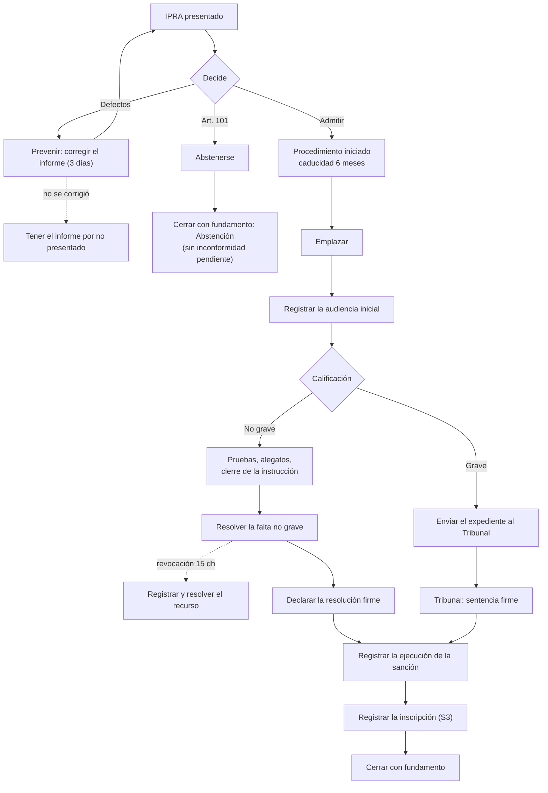

# Manual 04. Autoridad substanciadora y resolutora

Para: el área de responsabilidades de un OIC o de la Contraloría, **distinta** del área que
investiga. En la demostración de Querétaro: «Dirección de Responsabilidades Administrativas de la
Secretaría de la Contraloría de Querétaro (ficticia)», cuenta `contraloria.substanciacion`. En el
nodo Federal: `oic-equipamiento.substanciacion`.

> Prototipo del Datatón 2026; no es el sistema oficial. Datos sintéticos.

## 1. Quién eres y qué papel tienes en la ley

- **Substancias** el procedimiento de responsabilidad desde que recibes el IPRA (LGRA, art. 3, fr.
  III) y, en las faltas **no graves**, también **resuelves** (art. 3, fr. IV; arts. 75, 77 y 208).
- **Nunca eres quien investigó** (LGRA, art. 115). Tu cuenta tiene una sola función,
  `substantiation`, que no se combina con otra; además, el nodo impide que una cuenta que investigó
  una denuncia la substancie.
- **No turnas ni abres identidades.**
- **En las faltas graves y de particulares** llevas el procedimiento hasta la audiencia inicial y
  envías el expediente al **Tribunal** (art. 209, fr. I). Después registras la ejecución y la
  inscripción en el S3 (arts. 222, 225 y 27).
- Si tu estado no da cuentas al Tribunal en el sistema, tú registras sus actuaciones como «Registro
  de actuación del Tribunal».

## 2. Qué ves y qué NO ves

| Ves                                                 | No ves                                                     |
| --------------------------------------------------- | ---------------------------------------------------------- |
| El expediente, los hechos, las pruebas y el trámite | El nombre de la persona denunciante (no abres identidades) |
| Las medidas cautelares que pide la investigadora    | El buzón cifrado con la persona: no escribes a la persona  |
| Los recursos pendientes                             |                                                            |

## 3. Cómo entras

- Panel `/autoridad` del nodo; «Usuario», «Contraseña» (demostración:
  `.red-demo/nodos/<nodo>/credenciales.json`).
- «Llave de tu autoridad (archivo .json)»: la de tu autoridad (la misma que la investigadora; en la
  demostración `.red-demo/autoridades/authority.comptroller-queretaro.json`). Sirve para abrir las
  pruebas.
- Segundo factor en producción (en la demostración, `contraloria.substanciacion` entra sin código).
  Recuperación con códigos o reinicio por la operación del nodo.
- Sesión de 15 minutos; salir con «Cerrar sesión y borrar la llave de la memoria».

## 4. Tu bandeja: «Expedientes en substanciación»

Muestra los expedientes de tu autoridad. Abre el folio y trabaja en la tarjeta **«Trámite»**:
«Acción»: «Avanzar a la siguiente etapa legal» → «Etapa» → «Aplicar». Las etapas que requieren
fundamento piden «Fundamento legal» (20+ caracteres, la persona lo ve) y, a veces, «Acuerdo en
versión pública» (50+, sin datos personales).

> **Limitación conocida del prototipo.** La bandeja lista **todas** las denuncias del nodo, también
> las que siguen turnadas sin aceptar. Trabaja solo las que ya tienen «Informe … presentado».

## 5. Etapas que te tocan, en orden

### 5.1 Recibir el IPRA: prevenir, abstenerse o admitir

Cuando la investigadora presenta el IPRA («Informe de Presunta Responsabilidad Administrativa
presentado»), tienes **3 días** para admitir (plazo `report_admission`). Tres caminos:

1. **Prevenir** si el informe tiene defectos: «Etapa»: **«Prevenir: pedir que se corrija el
   informe»** → «Fundamento legal» (ejemplo: `LGRA, art. 195: falta precisar la fecha de los
hechos.`) → «Aplicar». Etapa «Informe con observaciones (prevención)». La investigadora tiene 3
   días para «Presentar el informe corregido». Si no lo corrige: **«Tener el informe por no
   presentado (no se corrigió)»** (vuelve a investigación). Fundamento: LGRA, arts. 194 y 195.
2. **Abstenerse**: «Etapa»: **«Abstenerse de iniciar el procedimiento»** → «Fundamento legal» y
   «Acuerdo en versión pública» → «Aplicar». Etapa «Abstención». Fundamento: LGRA, art. 101. Abre la
   inconformidad (5 dh). Pide a la investigadora que lo notifique por el buzón. Si la inconformidad
   se confirma o no se presenta, cierra con «Cerrar con fundamento» → motivo legal **«Abstención»**.
3. **Admitir**: «Etapa»: **«Admitir el informe e iniciar el procedimiento»** → «Procedimiento
   iniciado (informe admitido)». Fundamento: LGRA, arts. 112, 113 y 208, fr. I. Abre la
   **caducidad de 6 meses** (art. 74): si el procedimiento no se mueve, verás las alertas
   «Procedimiento sin actuar a los 5 meses» y «Procedimiento seis meses sin actuar».

Mientras haya una **inconformidad pendiente** no puedes admitir el informe ni cerrar por abstención.

### 5.2 Emplazar

- «Etapa»: **«Emplazar a la persona señalada»** → «Emplazamiento».
- La audiencia inicial debe celebrarse entre **10 y 15 días hábiles** después; se cita a las partes
  **72 horas** antes. La persona denunciante identificada es tercera y su seguimiento le dice que
  puede participar (LGRA, arts. 116, fr. IV, 193 y 208, fr. II a IV).

### 5.3 Audiencia inicial

- «Etapa»: **«Registrar la audiencia inicial»** → «Audiencia inicial». Fundamento: LGRA, art. 208,
  fr. III a VII.
- Después se abre la rama según la calificación:
  - **No grave:** «Admitir las pruebas (falta no grave)» (15 dh).
  - **Grave o de particulares:** «Enviar el expediente al Tribunal (falta grave o de particulares)»
    (3 dh).

### 5.4 Vía no grave: pruebas, alegatos, cierre y resolución

1. **«Admitir las pruebas (falta no grave)»** → «Admisión y desahogo de pruebas» (art. 208, fr.
   VIII).
2. **«Abrir el periodo de alegatos»** → «Alegatos» (5 dh; fr. IX).
3. **«Cerrar la instrucción»** → «Cierre de la instrucción» (resolver en 30 + 30 dh; fr. X).
4. **«Resolver la falta no grave»** → «Resolución (falta no grave)». Notificar en 10 dh (fr. XI).
   Fundamento de la sanción: arts. 75 y 77.

La misma rama sigue si el Tribunal te **devuelve** un expediente porque no es grave («Devolver a la
autoridad substanciadora: no es falta grave»).

### 5.5 Recurso de revocación (no grave)

- **Contra qué:** la resolución que sanciona una falta no grave. **Lo presenta:** la persona
  sancionada, en 15 dh. **Lo registras y lo resuelves tú** en 30 dh (LGRA, arts. 210 a 212).
- Registrar: «Acción»: **«Registrar un recurso presentado con firma»** → «Recurso»: «Revocación» →
  «Quién lo presentó»: «La persona señalada» → casilla del escrito con firma autógrafa → «Aplicar».
  Mientras esté pendiente, la resolución no queda firme.
- Resolver: «Acción»: **«Registrar la resolución de un recurso»** → «Recurso» → «Resultado»:
  «Procedente (admitido)», «Improcedente», «Confirmada», «Revocada» o «Modificada» → «Fundamento
  legal» → «Aplicar».

> **Limitación conocida del prototipo.** Registrar la revocación falló una vez con «El sistema no
> aceptó los datos» y funcionó al elegir a mano «Quién lo presentó», aunque tenga una sola opción.
> Elige siempre ese campo aunque parezca ya elegido.

### 5.6 Reclamación

Contra autos que admiten, desechan o tienen por no presentado el informe, la contestación o una
prueba, sobreseimientos antes del cierre y autos sobre terceros: la registra y la resuelve **quien
dictó el auto** (tú o el Tribunal), en 5 dh y 5 dh; no suspende (LGRA, arts. 213 y 214). Mismo
formulario: «Recurso»: «Reclamación».

### 5.7 Vía grave: enviar al Tribunal

- «Etapa»: **«Enviar el expediente al Tribunal (falta grave o de particulares)»** → «Envío del
  expediente al Tribunal». Plazo: 3 días hábiles (LGRA, art. 209, fr. I).
- Desde aquí el expediente es del Tribunal (manual 06) hasta su sentencia.
- **Si el Tribunal no tiene cuentas en tu estado:** con la acción que corresponda verás el modo
  «Registro de actuación del Tribunal», que pide «Número de expediente del Tribunal» y «Fundamento
  de la actuación del Tribunal» (20+). En la línea de tiempo se lee como registrado por otra
  autoridad.

### 5.8 Resolver medidas cautelares

- Cuando la investigadora pide una medida, «Acción»: **«Resolver la medida cautelar»** →
  «Resolución de la medida (LGRA, arts. 125 a 127)»: «Concedida», «Concedida provisionalmente» o
  «Negada» → «Fundamento legal» → «Aplicar».
- En las etapas del Tribunal la resuelve el Tribunal. La persona denunciante no ve la medida.

### 5.9 Firmeza

- **No grave:** cuando no hay recurso pendiente, «Etapa»: **«Declarar la resolución firme»** →
  «Resolución firme» (LGRA, art. 206).
- **Grave:** la declara el Tribunal («Declarar la sentencia firme»).

> **Limitación conocida del prototipo.** El sistema solo bloquea la firmeza si hay un recurso
> **registrado**; no espera a que venzan los 15 días hábiles de la revocación. **Espera tú el plazo**
> antes de pulsar el botón.

### 5.10 Ejecución, inscripción en el S3 y cierre

1. «Etapa»: **«Registrar la ejecución de la sanción»** → «Sanción ejecutada» (LGRA, arts. 222 y
   225; informe de ejecución en 10 días si es grave).
2. «Acción»: **«Registrar la inscripción de la sanción (S3)»** → «Referencia de la inscripción en
   el S3» (ejemplo sintético `S3-QRO-2026-SINTETICO-001`). «Solo se registra el acto de
   inscripción; no hay conexión con el S3.» (LGRA, art. 27).
3. «Acción»: **«Cerrar con fundamento»**:
   - «Motivo de cierre del S5»: «Atendido».
   - «Motivo legal (opcional)»: «Resolución firme con sanción», «Resolución firme: responsable sin
     sanción» (art. 77) o «Resolución firme: no responsable».
   - «Fundamento legal» (20+) y «Acuerdo en versión pública» (50+).
   - Opcional: marca «Declarar la sanción impuesta (se verificará contra el registro público)» y
     llena «Expediente de la resolución», «Persona sancionada», «Sanción (por ejemplo, «Amonestación
     pública»)», «Institución de la persona» y «Entidad (clave INEGI; 00 para lo federal)». El panel
     verifica contra el S3: con datos sintéticos sale «sin cobertura» o «no aparece», nunca
     «falsa». «Solo lo confirmado en el registro público cuenta como sanción verificada.»
   - «Aplicar».

Otros cierres que te tocan después de la admisión: **«Caducidad de la instancia»**,
**«Sobreseimiento»** (LGRA, arts. 196 y 197), «Prescripción» (art. 74) e «Incompetencia y
remisión».

> **Limitación conocida del prototipo.**
>
> - Puedes «Cerrar con fundamento» con «Resolución firme con sanción» **sin** haber registrado la
>   inscripción en el S3. Hazlo siempre en el orden de arriba.
> - «Cerrar con fundamento» sigue disponible aunque haya un recurso pendiente. No cierres hasta que
>   se resuelva.
> - No hay integración real con el S3: solo se registra la referencia.

### 5.11 Dar vista al Ministerio Público

También puedes dar vista al MP («Dar vista al Ministerio Público», ver manual 03, sección 5.10),
con la misma limitación: la vista no llega a la bandeja de la fiscalía.

## 6. Qué hacer si algo falla

| Síntoma                                                    | Qué hacer                                                             |
| ---------------------------------------------------------- | --------------------------------------------------------------------- |
| No veo «Enviar el expediente al Tribunal…»                 | La calificación fue no grave, o aún no registras la audiencia inicial |
| No puedo admitir el informe                                | Hay una inconformidad pendiente                                       |
| No aparece «Declarar la resolución firme»                  | Hay un recurso pendiente                                              |
| «El sistema no aceptó los datos» al registrar un recurso   | Elige a mano «Quién lo presentó» y marca la casilla de firma          |
| «Tu función no tiene acciones del trámite en este estado.» | La etapa es del Tribunal o de la investigadora                        |
| Veo denuncias que no tienen IPRA                           | Limitación de la bandeja; ignóralas                                   |

## 7. Limitaciones conocidas del prototipo

- La firmeza no espera el plazo del recurso.
- El cierre no exige la inscripción en el S3 ni espera recursos pendientes.
- La bandeja muestra denuncias sin IPRA.
- Sin integración real con el S3; la comparecencia de terceros se hace fuera del sistema.

## 8. Glosario breve

- **Substanciar:** conducir el procedimiento (admitir, emplazar, audiencia, pruebas, alegatos).
- **Emplazar:** llamar a la persona señalada al procedimiento.
- **Abstención:** decidir no iniciar el procedimiento (LGRA, art. 101).
- **Firmeza:** la resolución ya no admite recurso.
- **S3:** sistema de servidores públicos y particulares sancionados de la PDN.
- **Caducidad:** fin del procedimiento por 6 meses de inactividad.

## 9. Diagrama de tu flujo

