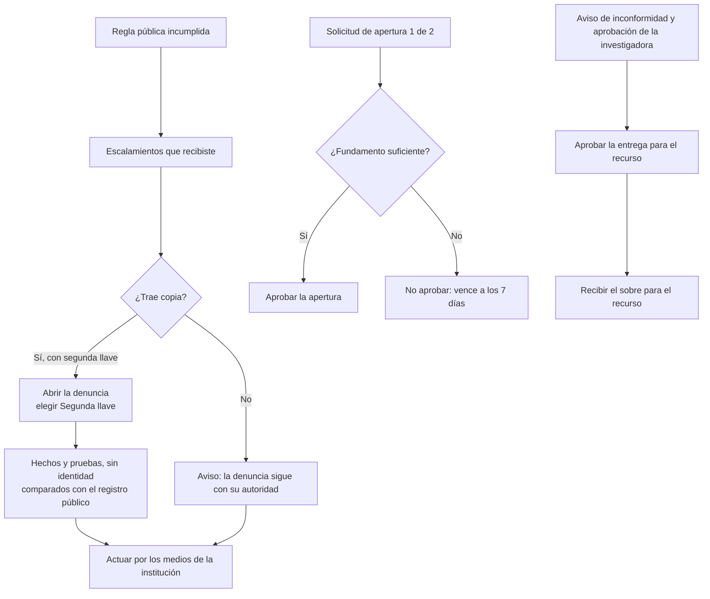

# Manual 05. Titular o supervisión

Para: la persona **titular** de una autoridad investigadora (por ejemplo, el titular de la
Contraloría o de un OIC) o la **unidad que supervisa a los OIC**. En la demostración:
`contraloria.titular` («Titular de la Secretaría de la Contraloría de Querétaro (ficticia)»),
`oic-equipamiento.titular` (Federal) y `supervision-oic` («Unidad Ficticia de Supervisión de Órganos
Internos de Control», Federal, con **segunda llave**).

> Prototipo del Datatón 2026; no es el sistema oficial. Datos sintéticos.

## 1. Quién eres y qué papel tienes en la ley

- **Eres el superior jerárquico** de quien investiga. Vigilas que se cumplan los deberes de la LGRA:
  iniciar en 30 días naturales una posible falta grave (art. 64, fr. II), no simular que una grave
  es no grave (fr. I), no revelar la identidad (fr. III), avisar el archivo (art. 100) y excusarse
  por conflicto de interés (art. 58; la excusa se presenta ante el jefe inmediato).
- **Tu función de cuenta es `supervision`.** No se combina con otra. Con ella:
  - recibes los **escalamientos** y avisos de reglas públicas;
  - ves las denuncias y los cierres de tu institución;
  - **apruebas aperturas de identidad** como segunda persona;
  - eres la **aprobación obligatoria** en la entrega del nombre para el recurso de inconformidad
    (dos aprobaciones, al menos una de supervisión).
- **Con segunda llave** (si tu autoridad supervisada la tiene configurada), recibes además una
  **copia cerrada** de los hechos y las pruebas de la denuncia escalada, **nunca** la identidad.
- **Sin segunda llave** (por ejemplo, la titular de la Contraloría de Querétaro), recibes los avisos
  y las denuncias escaladas de las autoridades que te los mandan (`alertsTo` en el archivo de
  cuentas del nodo), pero **sin copia**: solo la supervisora con segunda llave la abre.
- No investigas, no substancias, no turnas. Tampoco **recibes** denuncias turnadas: una supervisora
  sin cuenta de recepción no aparece en la lista «Autoridad» del turnado ni de la reasignación.

## 2. Qué ves y qué NO ves

| Ves                                                         | No ves                                                                 |
| ----------------------------------------------------------- | ---------------------------------------------------------------------- |
| «Denuncias de tu institución» y sus cierres                 | La identidad de la persona en un escalamiento: la copia nunca la lleva |
| «Escalamientos que recibiste», agrupados por regla          | Denuncias de otras instituciones que no supervisas                     |
| Con segunda llave: hechos y pruebas de la denuncia escalada | Sin segunda llave: la copia cerrada de la denuncia escalada            |
| La identidad, solo si participas en una apertura aprobada   |                                                                        |

## 3. Cómo entras

- Panel `/autoridad` del nodo. «Usuario», «Contraseña» (demostración:
  `.red-demo/nodos/<nodo>/credenciales.json`).
- «Llave de tu autoridad (archivo .json)»: la de tu autoridad (por ejemplo,
  `.red-demo/autoridades/authority.comptroller-queretaro.json` o
  `authority.oversight-federal.json`).
- **Segundo factor obligatorio** en la demostración para `contraloria.titular` y `supervision-oic`:
  «Verificación en dos pasos» → «Código de 6 dígitos» → «Verificar y entrar». En la demostración el
  código se obtiene con `npm run demo:codigo -- <usuario>` (el reloj está adelantado, la app del
  teléfono no sirve).
- **Segunda llave** (solo supervisoras con segunda llave): un archivo aparte, «Segunda llave de la
  supervisora (archivo .json)». En la demostración: `.red-demo/nodos/federal/llaves-demo/supervisor-demo-key.json`.
  Custódiala fuera del servidor.
- **Recuperación:** «No tengo mi teléfono: usar un código de recuperación». Si perdiste los
  códigos, la operación del nodo reinicia tu segundo factor tras confirmarlo en persona.

## 4. Tu bandeja: «Denuncias de tu institución»

Arriba, la lista de denuncias de tu institución. Abajo, **«Escalamientos que recibiste»**: «Cada
denuncia llegó aquí porque se cumplió una regla pública. Las escaladas traen una copia que la
persona cerró con tu segunda llave, sin su identidad: ábrela con «Abrir». Los avisos no traen copia;
la denuncia sigue con su autoridad.»

Sin segunda llave, además verás: «Tu autoridad recibe los avisos de las reglas públicas, pero no
custodia la segunda llave: ves cada aviso sin la copia de la denuncia. Pide cuentas a la autoridad
de origen por los medios de tu institución.» Cada grupo dice «Aviso, sin copia» y, en una denuncia
escalada, en lugar de «Abrir» verás «Sin copia: la copia cerrada solo la abre la supervisora con
segunda llave, y tu autoridad no la custodia. Requiere a … que actúe.»

Se agrupan por regla, de la más grave a la menos grave. Reglas del catálogo:

| Regla (texto en pantalla)                                        | Fundamento                     |
| ---------------------------------------------------------------- | ------------------------------ |
| «Falta grave sin iniciar el procedimiento a los 30 días»         | LGRA 64 fr. II                 |
| «Cierre que declina una posible falta grave»                     | LGRA 64 fr. II                 |
| «Acto resolutivo con conflicto de interés sin excusa»            | LGRA 58                        |
| «Justificación propia ante un posible conflicto de interés»      | LGRA 58                        |
| «Calificación de no grave con dos o más señales del auditor»     | LGRA 64 fr. I, 100             |
| «Archivo o cierre que declina con dos o más señales del auditor» | LGRA 100                       |
| «Archivo sin aviso en 10 días hábiles»                           | LGRA 100                       |
| «Turnado a otro nodo sin comprobante en 10 días hábiles»         | LGRA 64 fr. II                 |
| «Meta de turnado del S5 vencida» (aviso, sin copia)              | BPDN 58 (meta, no plazo legal) |
| Alertas de inactividad, caducidad y prescripción                 | LGRA 74                        |

## 5. Etapas que te tocan, en orden

### 5.1 Recibir y revisar un escalamiento

1. En «Escalamientos que recibiste», pulsa **«Abrir la denuncia <folio>»**.
2. Verás «Escalada el … desde …. El expediente sigue con esa autoridad: aquí ves la copia que la
   persona cerró con tu segunda llave, sin su identidad.»
3. En «Segunda llave de la supervisora (archivo .json)» elige tu segunda llave. «Abriendo el sobre en
   este navegador.»
4. Verás «Oficina o institución de gobierno», «Descripción» y las pruebas («La persona no envió
   pruebas.» si no hay). El navegador compara la copia con el registro público: si coincide, el
   nodo no cambió los hechos.
5. Actúa por los medios de tu institución: requerir a la autoridad, ordenar que se excuse o se
   reasigne, o dar vista a quien corresponda. **El expediente sigue con la autoridad original.**

> **En Querétaro (sin segunda llave).** La Contraloría no tiene supervisora con segunda llave. Con
> `contraloria.titular`, «Escalamientos que recibiste» lista los avisos de la unidad receptora y de
> la Contraloría (por ejemplo, la «Meta de turnado del S5 vencida» de la denuncia que llegó por la
> ventanilla y nadie aceptó), todos «Aviso, sin copia». Para abrir una copia escalada usa
> `supervision-oic` en el nodo Federal (caso sintético `ZCH3-Q437-KDYK`).

### 5.2 Segunda aprobación de una apertura de identidad

1. En el detalle de la denuncia, tarjeta «Abrir la identidad sellada»: «Hay una solicitud con 1 de
   2 aprobaciones. Fundamento: «…».»
2. Lee el fundamento. Si es legal y suficiente, escribe el tuyo en «Fundamento legal y motivo» (20+
   caracteres; la persona lo leerá), marca «Entiendo que la apertura queda registrada y que la
   persona denunciante la verá.» → **«Aprobar la apertura»**.
3. Si no estás de acuerdo, **no apruebes**. La solicitud vence a los 7 días naturales.

- **Fundamento:** LGRA, arts. 64, fr. III, y 91. Revelar sin motivo es obstrucción de la justicia.

### 5.3 Aprobar la entrega del nombre para el recurso de inconformidad

- **Cuándo:** la persona preparó su aviso de inconformidad y aceptó abrir su identidad solo para el
  recurso; la investigadora ya aprobó.
- Tarjeta de identidad → «Recurso de inconformidad.» («…se necesitan dos aprobaciones de personas
  distintas de tu autoridad, al menos una de supervisión, mientras corre el plazo de la Sala.») →
  «Aprobaciones: 1 de 2» → «Fundamento de tu aprobación» (20+), por ejemplo `LGRA, art. 109: la
inconformidad exige el nombre de quien la presenta.` → **«Aprobar la entrega para el recurso»**.
- Al llegar a «Aprobaciones: 2 de 2» aparece **«Recibir el sobre para el recurso»** para quien dio
  la segunda aprobación (la supervisión). Ábrelo y entrega el nombre a quien tramita el recurso.
- Cada entrega queda en el registro público y la persona la ve.
- **Fundamento:** LGRA, arts. 102 a 110 (el art. 109 exige nombre, domicilio y firma).

### 5.4 Revisar cierres y archivos

En «Denuncias de tu institución» revisa los cierres. Si un archivo o una calificación de no grave
trae señales del auditor, revisa «Lo que dice el acuerdo» contra «Lo que lo contrasta». Si una
excusa no se hizo antes de resolver, la denuncia te llegó escalada.

## 6. Qué hacer si algo falla

| Síntoma                                              | Qué hacer                                                                                                |
| ---------------------------------------------------- | -------------------------------------------------------------------------------------------------------- |
| «El código no es válido o ya se usó…»                | Espera el código siguiente (demostración: `npm run demo:codigo -- <usuario> --siguiente`)                |
| No puedo abrir la copia escalada                     | Usa la **segunda llave**, no la llave de la autoridad                                                    |
| No aparece «Abrir» en una denuncia escalada          | Tu autoridad no custodia la segunda llave: recibes el aviso sin copia (ver 5.1)                          |
| No aparece «Recibir el sobre para el recurso»        | Faltan aprobaciones o venció el plazo de la Sala («Puede que la ventana del recurso ya haya terminado.») |
| «Ya aprobaste. Falta la aprobación de otra persona…» | Espera a la otra persona                                                                                 |

## 7. Limitaciones conocidas del prototipo

- Querétaro no tiene segunda llave: la cuenta del titular recibe los avisos, sin copia. Los OIC
  municipales no le mandan sus avisos (la Contraloría del Ejecutivo no los supervisa).
- La regla de dos personas la aplica el nodo, no la criptografía.
- El escalamiento informa; las órdenes a la autoridad se dan fuera del sistema.

## 8. Glosario breve

- **Escalamiento:** aviso automático por una regla pública incumplida.
- **Segunda llave:** llave de la supervisora para abrir la copia cerrada de una denuncia escalada.
- **Aviso sin copia:** escalamiento que solo informa (por ejemplo, la meta de turnado vencida).
- **Señales del auditor:** reglas públicas que comparan un acuerdo con datos que lo contrastan.

## 9. Diagrama de tu flujo

