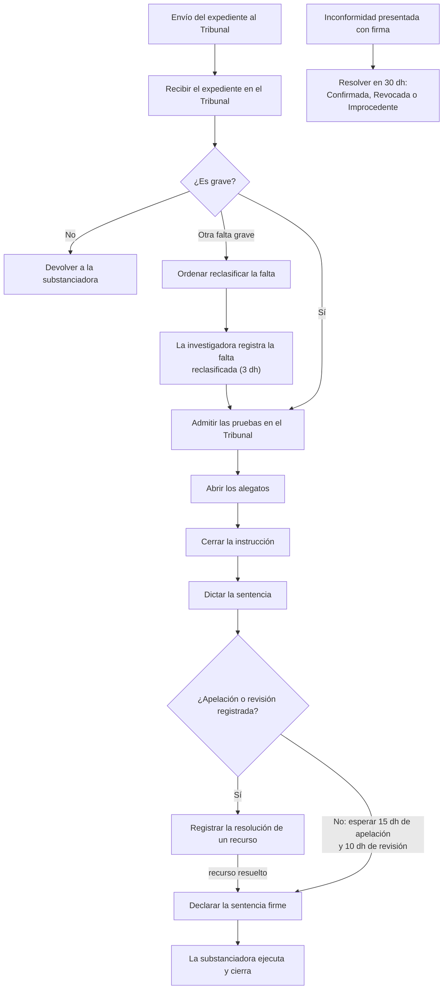

# Manual 06. Tribunal de Justicia Administrativa

Para: la **Sala Especializada en materia de Responsabilidades Administrativas** del Tribunal de
Justicia Administrativa del estado (y su **alzada**), o la Sala Especializada del Tribunal Federal
de Justicia Administrativa. En la demostración: `tja.queretaro` («Sala Especializada en materia de
Responsabilidades Administrativas del Tribunal de Justicia Administrativa del Estado de Querétaro
(ficticia)»; alzada: «Cuarta Sección de la Sala Superior… (ficticia)») y `tribunal.federal` (Sala
Especializada del TFJA, ficticia; alzada: Tercera Sección).

> Prototipo del Datatón 2026; no es el sistema oficial. Datos sintéticos.

## 1. Quién eres y qué papel tienes en la ley

- **Resuelves las faltas graves y las de particulares** e impones sus sanciones (LGRA, arts. 3, fr.
  IV, 12 y 209). En Querétaro: LOTJAEQ, arts. 15 y 23.
- **Resuelves los recursos** que te tocan: **inconformidad** contra la calificación de no grave o la
  abstención (arts. 102 a 110), **apelación** (arts. 215 a 219) y **revisión** (arts. 220 y 221),
  estas dos en la alzada.
- Resuelves las **medidas cautelares** en tus etapas (arts. 123 a 129) y puedes **ordenar a la
  autoridad investigadora que reclasifique** la falta si es otra falta grave, o **devolver** el
  expediente si no es grave (art. 209, fr. II). Tú ordenas; quien reclasifica es la investigadora.
- **Tu función de cuenta es `court`.** Nunca se combina con otra. Solo actúas en tus etapas: desde
  el expediente enviado hasta tu sentencia y su firmeza.
- **No recibes denuncias.** Recibes el expediente que te envía la substanciadora. Por eso no
  apareces en la lista «Autoridad» del turnado ni de la reasignación (no tienes cuenta de
  recepción).

## 2. Qué ves y qué NO ves

| Ves                                                       | No ves                                                      |
| --------------------------------------------------------- | ----------------------------------------------------------- |
| El expediente y el trámite de las denuncias en tus etapas | El buzón cifrado con la persona denunciante                 |
| Los hechos y las pruebas                                  | Las solicitudes de apertura de identidad: no puedes abrirla |
| Los recursos que te tocan                                 | Las tarjetas «Recursos federales» y «Turnar a otro nodo»    |
|                                                           | «Descartar pruebas» y la excusa por conflicto de interés    |

Es a propósito: juzgas el expediente, no a la persona que denunció.

## 3. Cómo entras

- Panel `/autoridad` del nodo. «Usuario», «Contraseña» (demostración:
  `.red-demo/nodos/<nodo>/credenciales.json`).
- **Llave:** el Tribunal no está en el directorio como destinatario de denuncias. En la demostración
  sus cuentas usan la llave del buzón de su nodo:
  `.red-demo/nodos/<nodo>/llaves-demo/authority-demo-key.json`.
- **Segundo factor:** `tja.queretaro` lo tiene inscrito («Verificación en dos pasos» → código →
  «Verificar y entrar»; en la demostración, `npm run demo:codigo -- tja.queretaro`).
  `tribunal.federal` entra sin código en la demostración.
- Recuperación: códigos de recuperación o reinicio por la operación del nodo.

> **Limitación conocida del prototipo.** Que el Tribunal entre con la llave del buzón es un atajo de
> la demostración. En producción el Tribunal debería tener su propia llave para abrir las pruebas
> del expediente.

## 4. Tu bandeja: «Expedientes en el Tribunal»

Muestra los expedientes enviados («Envío del expediente al Tribunal») y los que están en tus etapas.
Trabajas en la tarjeta **«Trámite»**: «Acción» → «Aplicar».

## 5. Etapas que te tocan, en orden

### 5.1 Recibir el expediente

- «Acción»: «Avanzar a la siguiente etapa legal» → «Etapa»: **«Recibir el expediente en el
  Tribunal»** → «Recibido en el Tribunal» (LGRA, art. 209, fr. II). Abre 15 dh para admitir pruebas.
- **Solo en este momento** puedes también:
  - **«Devolver a la autoridad substanciadora: no es falta grave»** (pide «Fundamento legal»). La
    substanciadora sigue por la vía no grave.
  - **«Ordenar reclasificar la falta (Tribunal)»** (con fundamento), si los hechos son de otra falta
    grave. La autoridad investigadora tiene **3 dh** para registrar la falta reclasificada.

«Ordenar reclasificar la falta (Tribunal)» está en el campo **«Acción»**, no en «Etapa», y solo
mientras la etapa es «Recibido en el Tribunal» (art. 209, fr. II): el campo «Acción» lo recuerda con
una ayuda. Después de admitir las pruebas ya no aparece.

**Qué pasa después de tu orden:**

1. En la tarjeta «Trámite» verás «Orden de reclasificar del Tribunal (…). La autoridad
   investigadora tiene hasta el … para registrar la falta reclasificada (LGRA, art. 209 fr. II).» y
   el plazo «Reclasificar la falta» en la lista de plazos. Mientras está pendiente no puedes ordenar
   otra.
2. **Mientras corren esos 3 dh no admites las pruebas:** «Admitir las pruebas en el Tribunal» no
   aparece en «Etapa» y el panel dice: «Admitir las pruebas en el Tribunal»: La autoridad
   investigadora tiene la orden de reclasificar la falta (si la registra antes, podrás admitir las
   pruebas en cuanto lo haga); su plazo corre hasta el …. Podrás hacerlo a partir del … (LGRA, art.
   209, fracc. II). Por la API, el nodo responde `409` con un aviso parecido.
3. Cuando la investigadora la registra (manual 03, 5.16), la línea de tiempo dice «La autoridad
   investigadora reclasificó la falta» y la tarjeta muestra «Falta reclasificada: …» con su
   fundamento; la «Calificación» pasa a ser la nueva, con su acuerdo. El expediente sigue en
   «Recibido en el Tribunal» y los 15 dh para admitir las pruebas corren desde ese día.
4. Si vencen los 3 dh sin que la registre, la tarjeta lo dice y puedes seguir con el procedimiento:
   «Admitir las pruebas en el Tribunal» vuelve a aparecer.

> **Limitación conocida del prototipo.** Si la investigadora se niega a reclasificar (la ley le pide
> que te lo diga, fundando su negativa), no hay una acción para registrarlo: lo comunica fuera del
> sistema y tú sigues al vencer los 3 dh.

### 5.2 Pruebas, alegatos y cierre

1. **«Admitir las pruebas en el Tribunal»** → «Pruebas en el Tribunal» (209, fr. II).
2. **«Abrir los alegatos en el Tribunal»** → «Alegatos en el Tribunal» (5 dh; fr. III).
3. **«Cerrar la instrucción en el Tribunal»** → «Cierre de la instrucción en el Tribunal» (resolver
   en 30 + 30 dh; fr. IV).

- **El cierre espera a que venzan los 5 dh de alegatos.** Mientras corren, «Cerrar la instrucción
  en el Tribunal» no aparece y el panel dice: «Cerrar la instrucción en el Tribunal»: Las partes
  todavía pueden presentar sus alegatos hasta el …. Podrás hacerlo a partir del … (LGRA, art. 208,
  fracc. IX; LGRA, art. 209, fracc. III). Por la API, el nodo responde `409` con el mismo aviso.
- **En la demostración**, quien opera la red adelanta el reloj antes de este paso con
  `npm run demo:reloj -- +6dh` (ver `docs/demo.md`).

### 5.3 Dictar la sentencia

- **«Dictar la sentencia»** → «Sentencia del Tribunal». «Nota pública», por ejemplo `La Sala dictó
sentencia: se acreditó la falta grave y se impuso sanción.`
- Abre: notificar en 10 dh (art. 209, fr. V), **apelación 15 dh** y **revisión 10 dh**.
- **La persona ve:** «Sentencia» y «Puedes apelar como tercera» si se identificó.
- **Dictada la sentencia, no cierras la denuncia.** «Cerrar con fundamento» ya no aparece en
  «Acción»: la sentencia se declara firme cuando vencen los recursos (5.5) y la substanciadora, que
  ejecuta, cierra con su motivo legal (también si la sentencia fue de sobreseimiento). Por la API, el
  nodo responde `409`. Antes de la sentencia, en tus etapas, sí puedes cerrar con «Sobreseimiento»,
  «Caducidad de la instancia» o «Prescripción».

### 5.4 Registrar y resolver la apelación o la revisión

- **Registrar:** «Acción»: **«Registrar un recurso presentado con firma»** → «Recurso»: «Apelación»
  (la presentan «La persona señalada», «La persona denunciante (como tercera)», «La autoridad
  investigadora» u «Otra parte o autoridad») o «Revisión» (autoridades) → casilla del escrito con
  firma autógrafa → «Aplicar». Mientras esté pendiente, la sentencia no queda firme.
- **Resolver (alzada):** «Acción»: **«Registrar la resolución de un recurso»** → «Recurso» →
  «Resultado»: «Procedente (admitido)», «Improcedente», «Confirmada», «Revocada» o «Modificada» →
  «Fundamento legal» → «Aplicar».
- **Fundamento:** LGRA, arts. 215 a 221.

### 5.5 Declarar la sentencia firme

- **«Declarar la sentencia firme»** → «Resolución firme» (LGRA, art. 206). Después la
  substanciadora registra la inscripción en el S3, la ejecución y el cierre.
- **El paso espera los plazos de los recursos:** 15 dh de apelación y 10 dh de revisión, contados
  desde que la denuncia entró a «Sentencia del Tribunal»; manda el que vence más tarde. Mientras
  corren, la opción no aparece en «Etapa» y, bajo la lista de plazos, el panel dice:

  > «Declarar la sentencia firme»: La sentencia todavía puede apelarse hasta el …. Podrás hacerlo a
  > partir del … si nadie presenta el recurso, o al registrar la resolución del recurso presentado
  > (LGRA, art. 206).

- **Con un recurso registrado:** mientras esté pendiente, la firmeza sigue bloqueada. Cuando
  registras su resolución (5.4), puedes declarar la firmeza sin esperar al fin del plazo.
- Si alguien intenta el paso antes por la API, el nodo responde `409`: «La sentencia todavía puede
  apelarse hasta el …. Este paso procede a partir del día siguiente, o antes si el recurso
  presentado ya se resolvió (LGRA, art. 206).»
- **En la demostración**, para no esperar 15 días reales, quien opera la red adelanta el reloj
  simulado con `npm run demo:reloj -- +16dh` (ver `docs/demo.md`). **Solo para la demostración**;
  en producción el reloj es el real. La sesión puede vencer con el salto: vuelve a entrar.

> **Limitación conocida del prototipo.** La apelación y la revisión corren desde la
> **notificación** de la sentencia (art. 209, fr. V), que el sistema todavía no registra; se cuentan
> desde que se dicta, la cota más temprana. Si notificaste después, espera tú los días que falten.

### 5.6 Resolver la inconformidad

- **Cuándo:** la investigadora registró «Inconformidad presentada con firma». Tienes 30 dh desde ese
  registro (LGRA, art. 107).
- «Acción»: **«Registrar la resolución de un recurso»** → «Recurso»: «Inconformidad» → «Resultado».
  - **Revocada:** la investigadora vuelve a calificar, o la substanciadora vuelve a pronunciarse
    sobre el informe.
  - **Confirmada o Improcedente** (por ejemplo, sin firma autógrafa): sigue el trámite; si era
    abstención, la substanciadora cierra.
- **La persona ve:** «Resultado de la inconformidad: …».

### 5.7 Resolver medidas cautelares en tus etapas

«Acción»: **«Resolver la medida cautelar»** → «Concedida», «Concedida provisionalmente» o «Negada»
→ fundamento → «Aplicar» (LGRA, arts. 125 a 127). La persona no ve la medida.

- Mientras corre la vista de 5 dh a quienes afecta (art. 126), solo aparece «Concedida
  provisionalmente» y el panel dice desde qué día podrás concederla o negarla. Vencida la vista, la
  resuelves en definitiva, también después de la provisional. En la demostración:
  `npm run demo:reloj -- +6dh`.

### 5.8 Reclamación

Contra tus autos (admisión o desechamiento de pruebas, sobreseimientos antes del cierre): la
registras y la resuelves tú, en 5 dh y 5 dh (LGRA, arts. 213 y 214).

### 5.9 Si tu estado no te da cuentas

La substanciadora registra tus actuaciones como «Registro de actuación del Tribunal», con «Número
de expediente del Tribunal» y «Fundamento de la actuación del Tribunal». En la línea de tiempo se
lee como registrado por otra autoridad.

## 6. Qué hacer si algo falla

| Síntoma                                                    | Qué hacer                                                                                                               |
| ---------------------------------------------------------- | ----------------------------------------------------------------------------------------------------------------------- |
| No veo el buzón ni la tarjeta de identidad                 | Es a propósito                                                                                                          |
| «Tu función no tiene acciones del trámite en este estado.» | El expediente no está en tus etapas                                                                                     |
| No aparece «Declarar la sentencia firme»                   | Corren la apelación o la revisión (lee «Podrás hacerlo a partir del …»), o hay un recurso pendiente: resuélvelo primero |
| No aparece «Ordenar reclasificar la falta»                 | Ya pasaste de «Recibido en el Tribunal», o ya hay una orden pendiente                                                   |
| No aparece «Admitir las pruebas en el Tribunal»            | Hay una orden de reclasificar pendiente: espera a la investigadora o a que venzan sus 3 dh                              |
| No aparece «Cerrar la instrucción en el Tribunal»          | Corren los 5 dh de alegatos (lee «Podrás hacerlo a partir del …»)                                                       |
| No aparece «Cerrar con fundamento» después de la sentencia | Es a propósito: declara la sentencia firme; la substanciadora cierra                                                    |
| «El código no es válido o ya se usó…»                      | Espera el código siguiente                                                                                              |

## 7. Limitaciones conocidas del prototipo

- La apelación y la revisión se cuentan desde la sentencia, no desde su notificación.
- La reclasificación solo está disponible al recibir el expediente.
- La negativa fundada de la investigadora a reclasificar no tiene acción propia en el sistema.
- La comparecencia de las partes y la presentación de escritos ocurren fuera del sistema.

## 8. Glosario breve

- **Sala Especializada:** primera instancia en responsabilidades administrativas graves.
- **Alzada:** sección de la Sala Superior que resuelve la apelación y la revisión.
- **Reclasificar:** cambiar la conducta del informe a otra falta grave. Tú lo ordenas; la
  autoridad investigadora lo hace en 3 dh.
- **Firmeza:** la sentencia ya no admite recurso.
- **Inconformidad:** recurso de quien denunció contra la no grave o la abstención.

## 9. Diagrama de tu flujo

