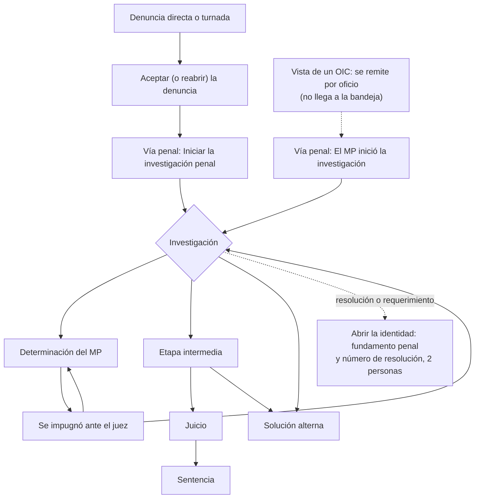

# Manual 07. Fiscalía especializada en combate a la corrupción (vía penal)

Para: la **Fiscalía Especializada en el Combate a la Corrupción** del estado o la **Fiscalía
Especializada en materia de Combate a la Corrupción de la FGR**. En la demostración:
`fiscalia.queretaro` («Fiscalía Especializada en el Combate a la Corrupción de la Fiscalía General
del Estado de Querétaro (ficticia)») y `fiscalia` («Fiscalía Ficticia Especializada en Hechos de
Corrupción», nodo Federal).

> Prototipo del Datatón 2026; no es el sistema oficial. Datos sintéticos.

## 1. Quién eres y qué papel tienes en la ley

- **Investigas delitos de corrupción** como Ministerio Público: Título Décimo del CPF (por ejemplo,
  cohecho, art. 222; peculado; uso ilícito de atribuciones) y sus equivalentes locales (en
  Querétaro, por ejemplo, cohecho en el CPQ, art. 268). Ley de la FGR, art. 13, fr. V.
- **La vía penal es autónoma** y corre en paralelo a la administrativa (CPEUM, art. 109; LGRA, art.
  14). La vista que te da un OIC no detiene el procedimiento administrativo.
- **Recibes denuncias por medios digitales, incluso anónimas** (CNPP, art. 131, fr. II); ante
  informaciones anónimas, la Policía constata los datos (art. 221); la denuncia lleva la
  identificación «salvo los casos de denuncia anónima o reserva de identidad» (art. 223).
- **Los OIC y las secretarías te denuncian** los hechos que pueden ser delito (LGRA, art. 10, fr.
  III; art. 98 para las entidades de fiscalización; CNPP, art. 222 para cualquier servidor público).
- **Proteges a víctimas y testigos** y ordenas medidas de protección (CNPP, arts. 109, fr. XVI y
  XIX, 131, fr. XV, y 137). El resguardo de la identidad cede solo ante una resolución del Órgano
  jurisdiccional o un requerimiento fundado del MP, sin dañar la defensa (art. 109, fr. XXVI; arts.
  131, fr. IX, y 218 a 220).

## 2. Qué ves y qué NO ves

| Ves                                                         | No ves                                                          |
| ----------------------------------------------------------- | --------------------------------------------------------------- |
| Las denuncias que llegan a tu bandeja (directas o turnadas) | Las vistas al MP que registran los OIC (no llegan a tu bandeja) |
| Hechos, pruebas y buzón cifrado de esas denuncias           | La identidad sellada, salvo apertura con fundamento penal       |
| Las etapas penales que registras                            | Denuncias de otras autoridades                                  |

## 3. Cómo entras

- Panel `/autoridad` del nodo. «Usuario», «Contraseña» (demostración:
  `.red-demo/nodos/<nodo>/credenciales.json`).
- «Llave de tu autoridad (archivo .json)»: la de tu fiscalía (demostración:
  `.red-demo/autoridades/authority.prosecutor-queretaro.json` o
  `authority.prosecutor-anticorruption.json`).
- **Segundo factor obligatorio** en la demostración (`npm run demo:codigo -- fiscalia.queretaro`).
- Recuperación con códigos o reinicio por la operación del nodo, confirmado en persona.

## 4. Tu bandeja: «Denuncias asignadas»

Tu cuenta tiene, en la demostración, las funciones `intake` + `investigation`: por eso la bandeja se
llama igual que la de un OIC. Lo que te distingue es el **papel `prosecution`** de tu autoridad (en
el directorio de red o, sin directorio, en el archivo de cuentas del nodo; la sesión lo indica con
`account.isProsecution`). Con ese papel **solo llevas la vía penal**: no ves «Iniciar la
investigación» (administrativa), «Dar vista al Ministerio Público» ni los plazos del procedimiento
administrativo («Iniciar ante una posible falta grave (LGRA 64)», «Prescripción de faltas graves»
o «no graves» (LGRA 74), audiencia, alegatos…), porque tú eres el Ministerio Público. En «Plazos»
solo ves los de la vía penal, como el de impugnar la determinación del Ministerio Público. Te
llegan:

- denuncias que la persona envió **directo** a la fiscalía desde la ventanilla (en «Revisión»,
  eligiendo la fiscalía como «También competente» u «Otra del directorio» para una conducta que
  «Puede ser delito»);
- denuncias de delitos que la tabla de funciones manda a la función «vía penal» (`prosecution`);
- denuncias que te turna el buzón o te reasigna otra autoridad (puedes recibirlas porque tienes
  cuenta de recepción).

## 5. Etapas que te tocan, en orden

### 5.1 Aceptar

«Trámite» → «Acción»: **«Aceptar (o reabrir) la denuncia»** con nota pública opcional → «Aplicar».
Si no te corresponde: «Reasignar a otra autoridad» o «Devolver al buzón general».

### 5.2 Registrar la vía penal

Todas las etapas penales se registran con «Acción»: «Avanzar a la siguiente etapa legal» → «Etapa»
(las opciones empiezan con «Vía penal:») → «Aplicar». **Solo tu fiscalía las avanza:** la
investigadora y la substanciadora solo dan la vista y, si intentan una etapa penal por la API, el
nodo responde `403`.

| Desde                                           | Etapa que eliges                                                                          | Fundamento                                            |
| ----------------------------------------------- | ----------------------------------------------------------------------------------------- | ----------------------------------------------------- |
| Sin etapa (denuncia directa)                    | «Vía penal: Iniciar la investigación penal»                                               | CNPP 211                                              |
| Vista registrada («Denuncia penal presentada»)¹ | «Vía penal: El Ministerio Público inició la investigación»                                | CNPP 211, 222                                         |
| Investigación                                   | «Vía penal: Determinación del Ministerio Público»                                         | CNPP 253 a 256 (abre 10 días para impugnar, art. 258) |
| Investigación                                   | «Vía penal: Etapa intermedia»                                                             | CNPP 211                                              |
| Investigación o etapa intermedia                | «Vía penal: Solución alterna»                                                             | CNPP 183 a 200 (por verificar)                        |
| Determinación                                   | «Vía penal: Se impugnó la determinación ante el juez» / «Se reabrió la investigación»     | CNPP 258                                              |
| Impugnación                                     | «Vía penal: El juez ordenó seguir la investigación» / «El juez confirmó la determinación» | CNPP 258                                              |
| Etapa intermedia                                | «Vía penal: Juicio»                                                                       | CNPP 211                                              |
| Juicio                                          | «Vía penal: Sentencia»                                                                    | CNPP 211                                              |

¹ Solo si la denuncia con la vista llega a tu bandeja (por ejemplo, reasignada). Hoy la vista no te
llega sola: ver la sección 7.

**La persona ve** la vía penal en su seguimiento, en paralelo a la administrativa.

### 5.3 Mensajes y medidas de protección

- Escribe a la persona por «Pregunta para la persona denunciante» → «Enviar pregunta cifrada». Si
  eligió el anonimato, no le pidas datos que la identifiquen.
- Si te llega una «Solicitud de medidas de protección» y la persona es víctima, ofendida o testigo,
  tú decides las medidas (CNPP, art. 137; ratifica el juez). Algunas requieren saber quién es la
  persona: pídeselo por el buzón; ella decide.

### 5.4 Abrir la identidad en la vía penal

- Cuando la denuncia **solo tiene etapa penal**, la tarjeta «Abrir la identidad sellada» muestra
  «Vía penal.»: «En el proceso penal el resguardo de la identidad cede solo ante una resolución del
  Órgano jurisdiccional o un requerimiento fundado del Ministerio Público, salvaguardando los
  derechos de la defensa (CNPP, art. 109 fr. XXVI).»
- Campos:
  - «Fundamento en la vía penal»: «CNPP art. 109 fr. XXVI / resolución del Órgano jurisdiccional»,
    «CNPP arts. 218 a 220 / resolución del Juez de control sobre el acceso de la defensa» o «CNPP
    art. 131 fr. IX / requerimiento fundado y motivado del Ministerio Público».
  - «Número de la resolución o del requerimiento» («Por ejemplo, la causa penal o la carpeta de
    investigación.»), por ejemplo `CP-QRO-0000/2026 (sintético)`.
  - «Motivo» (20+ caracteres).
  - Casilla «Entiendo que la apertura queda registrada y que la persona denunciante la verá.» →
    **«Solicitar la apertura»**.
- Una **segunda persona distinta** de la fiscalía aprueba («Aprobar la apertura»). Después,
  «Abrir identidad aprobada».
- **La persona ve** el fundamento y el número de la resolución. Una vez abierta, la identidad entra
  a la carpeta y su reserva la rigen los arts. 106 y 218 a 220: SIGILO ya no la controla.

> **Limitación conocida del prototipo.** Cada fiscalía de la demostración tiene **una sola cuenta**,
> así que la segunda aprobación no se puede completar en la fiscalía. Para mostrarla, usa la
> Contraloría con una denuncia sellada que solo tenga etapa penal.

## 6. Qué hacer si algo falla

| Síntoma                                            | Qué hacer                                                                                                           |
| -------------------------------------------------- | ------------------------------------------------------------------------------------------------------------------- |
| Mi bandeja está vacía aunque un OIC dio vista      | Limitación conocida: la vista no llega. El OIC la remite por oficio; pídela por los medios oficiales                |
| No veo «Vía penal: Iniciar la investigación penal» | La denuncia ya tiene etapa administrativa; usa «El Ministerio Público inició la investigación» después de una vista |
| No veo «Iniciar la investigación» ni «Dar vista»   | Es a propósito: tu fiscalía solo lleva la vía penal                                                                 |
| No sale «Abrir identidad aprobada»                 | Falta una segunda cuenta de tu fiscalía                                                                             |
| «El código no es válido o ya se usó…»              | Espera el código siguiente                                                                                          |

## 7. Limitaciones conocidas del prototipo

- **La vista al MP no llega a tu bandeja.** Solo se registra en la denuncia del OIC, que te la
  remite por oficio, fuera del sistema.
- Los tipos de determinación del MP y los recursos penales todavía no están tipados.
- El sistema no registra qué medidas de protección decidiste.

## 8. Glosario breve

- **Vista al MP:** aviso de una autoridad administrativa de que puede haber delito.
- **Determinación del MP:** decisión sobre la investigación (por ejemplo, archivo o no ejercicio).
- **Solución alterna:** acuerdo reparatorio o suspensión condicional del proceso.
- **Carpeta de investigación:** expediente penal del MP.
- **Resguardo de identidad:** reserva del nombre de víctimas o testigos.

## 9. Diagrama de tu flujo

