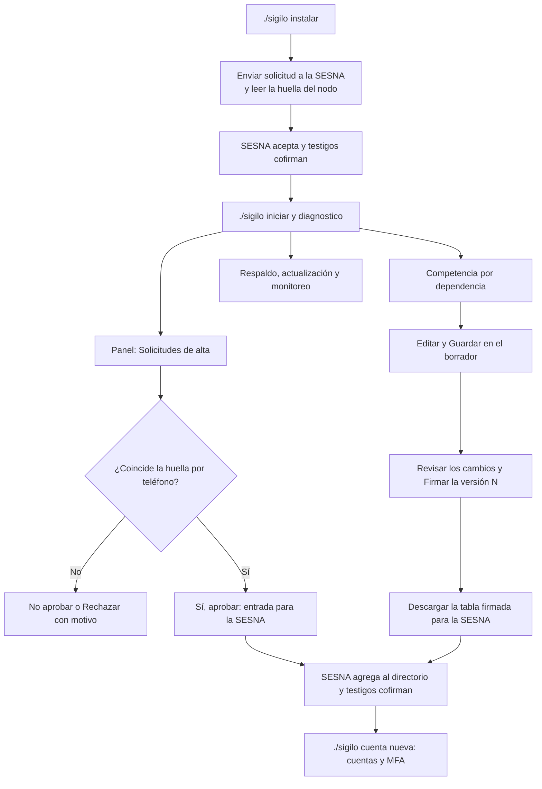

# Manual 08. Operación del nodo estatal (SESEA)

Para: la **Secretaría Ejecutiva del Sistema Estatal Anticorrupción (SESEA)** de cada estado, o la
institución que la ley local designe para operar el nodo (en Oaxaca, en el escenario sintético, la
propia contraloría). Dos personas típicas: **la responsable de la operación** (cuenta de operación
del panel) y **el equipo de TI** (servidor y CLI `sigilo`). En la demostración: `operacion.queretaro`
(«Secretaría Ejecutiva del Sistema Estatal Anticorrupción de Querétaro (ficticia)»),
`operacion.oaxaca` y `operacion.federal`.

> Prototipo del Datatón 2026; no es el sistema oficial. Datos sintéticos.

## 1. Quién eres y qué papel tienes en la ley

- **Operas el nodo, no las denuncias.** Mantienes el servidor en marcha, das de alta a las
  autoridades de tu estado, declaras quién investiga a cada dependencia y firmas esa tabla.
- **Fundamento (Querétaro como ejemplo):** la SESEA es el órgano de apoyo técnico del Comité
  Coordinador estatal (LSEAQ, art. 24) y su Secretario Técnico administra las plataformas digitales
  que establezca el Comité (LSEAQ, art. 34, fr. X). **Esa ley no le da atribución para recibir,
  clasificar, turnar ni investigar denuncias.**
- **Equivalente general:** la LGSNA da a la Secretaría Ejecutiva el apoyo técnico y la
  administración de plataformas, y deja la denuncia a las autoridades investigadoras (LGRA, art. 9).
  Que una SESEA reciba y turne depende de **su** ley: en Michoacán la ley y los lineamientos de su
  Comité Coordinador sí lo prevén. Si tu ley lo hace, tu tabla de funciones lo declara con su
  fundamento (`settings.operatorReceives`); si no, el buzón general lo atiende la **autoridad
  receptora** que designe tu estado (manual 02).
- **Competencia por dependencia:** cada ente público tiene su OIC y cada municipio el suyo (CPEUM,
  art. 109, fr. III, último párrafo); la contraloría del Ejecutivo no investiga municipios (CPEUM,
  art. 115). En Querétaro: LRAEQ, arts. 2, fr. XXII, 6, 7, 22 y 25.

### Lo que la SESEA NO hace

- **No ve denuncias ni identidades.** La cuenta de operación «no ve denuncias ni identidades».
- **No recibe ni turna** (salvo que su ley lo faculte y la tabla lo declare).
- **No abre pruebas:** viajan cifradas hacia la autoridad; ni el nodo ni la SESEA pueden verlas.
- **No decide medidas de protección** ni ninguna etapa del procedimiento.
- **No custodia llaves de autoridades:** cada autoridad crea la suya en su navegador; la del buzón
  general se saca del servidor.

> **Limitación conocida del prototipo.** Los **hechos** de las denuncias se guardan sin cifrar en
> la base del nodo. Quien administra el servidor podría leerlos técnicamente. Por eso la
> administración del servidor debe hacerse **bajo convenio** con las autoridades responsables de los
> datos (figura de encargado del tratamiento, LGPDPPSO). Cifrar también los hechos es el siguiente
> paso.

## 2. Qué ves y qué NO ves

| Ves                                                  | No ves                               |
| ---------------------------------------------------- | ------------------------------------ |
| «Solicitudes de alta» de instituciones de tu estado  | Denuncias, hechos, pruebas, mensajes |
| «Competencia por dependencia» con pistas del S1 y S2 | Identidades                          |
| Las versiones firmadas de la tabla                   | El contenido de la cola de la SESNA  |
| El diagnóstico y los registros del servidor (TI)     |                                      |

## 3. Cómo entras

### Al panel (responsable de la operación)

- Panel `/autoridad` del nodo (en producción, puerto 8443, solo por VPN o red institucional).
- «Usuario» y «Contraseña» (demostración: `.red-demo/nodos/<nodo>/credenciales.json`).
- **«Llave de tu autoridad (archivo .json)»: déjala vacía.** «La cuenta de operación del nodo no la
  necesita.»
- **Segundo factor obligatorio.** Primera vez: «Activa la verificación en dos pasos» → escanea el
  QR («¿No puedes escanearlo?» muestra la clave) → código → «Confirmar y activar» → guarda los 10
  códigos («Descargar códigos (.txt)», «Imprimir códigos») → marca «Ya guardé mis códigos de
  recuperación en un lugar seguro.» → «Continuar al panel».
- Al entrar: «Operación del nodo. Revisas las solicitudes de alta de las instituciones y asignas el
  órgano interno de control de cada dependencia. Esta cuenta no ve denuncias ni identidades.» Dos
  botones: **«Solicitudes de alta»** y **«Competencia por dependencia»**.

### Al servidor (TI)

Usuario de servicio sin privilegios (nunca root), en el grupo `docker`, carpeta `/opt/sigilo`. El
envoltorio `./sigilo` corre el CLI dentro de la imagen publicada; no se edita YAML ni JSON.

## 4. Tu bandeja: «Solicitudes de alta»

Lista por nombre, estado y fecha. En cada una: «Qué hace», «Qué conoce», «Quién solicita» y
«Cuentas que pide».

## 5. Tareas, en orden

### 5.1 Instalar el nodo (una vez, TI)

Requisitos: Linux con Docker ≥ 24 y Compose ≥ 2.24; 2 vCPU y 2 GB (mínimo); 20 GB SSD; NTP activo;
subdominio institucional con registro A; puertos 443 (red, solo SESNA y testigos), 8443 (panel,
solo VPN) y 80 (solo con Let's Encrypt).

1. Descarga lo que entrega la SESNA y verifica: `sha256sum -c SHA256SUMS`.
2. `./sigilo instalar` (unas 10 preguntas): confirma la **huella de la red** contra el oficio de la
   SESNA; estado; institución que opera; nombre e identificador del nodo; dominio; HTTPS
   (automático, certificado propio o proxy); responsable; usuarios del panel (operación y buzón).
3. Al final: envía `salida/solicitud-alta-<estado>.json` a la SESNA (no lleva secretos); lee por
   teléfono la **huella del nodo** cuando la SESNA llame; anota las contraseñas temporales; **saca
   del servidor la llave del buzón** (`salida/llave-buzon-<estado>.json`) y entrégala en persona a
   la autoridad receptora; haz tu primer respaldo.
4. Cuando la SESNA confirme que publicó el directorio: `./sigilo iniciar`.
5. `./sigilo diagnostico`: todo en ✓. Sale con 0 (bien), 1 (avisos) o 2 (problemas).
6. `./sigilo programar`: revisión diaria del directorio (03:15).

### 5.2 Aprobar o rechazar una solicitud de alta (panel)

- **Fundamento:** la ventanilla única también sirve para que las autoridades se registren (BPDN,
  art. 57). La huella por teléfono evita que alguien cambie el candado en el camino.

1. «Solicitudes de alta» → elige la solicitud.
2. **«1. Confirma la huella por teléfono»**: «Llama a la institución a un número que obtengas por tu
   cuenta (no el de la solicitud) y pide que te lean su huella.» Escribe la huella en «Huella que te
   leyó la institución».
   - Si no coincide: «No coincide. No apruebes: el candado pudo cambiar en el camino.» y «Aprobar»
     queda deshabilitado.
   - Si coincide: «Coincide con la huella del candado recibido.»
3. **«2. Decide»** → «Aprobar» → «¿Aprobar la solicitud de …? Queda registrado con tu cuenta.» →
   **«Sí, aprobar»**. O «Rechazar» → «Motivo del rechazo» (al menos 5 caracteres; «Escribe el
   motivo; queda registrado.») → «Rechazar».
4. Tras aprobar: «Esta es la entrada propuesta. Agrégala al directorio, fírmalo y pide a los testigos
   que lo cofirmen… Después crea las cuentas de la lista.» Descarga la entrada y envíala a la SESNA
   (`./sigilo-sesna aceptar <entrada.json>`, manual 09).
5. Cuando el directorio con la autoridad nueva esté publicado, **crea las cuentas** (5.4).

> **Limitación conocida del prototipo.** El identificador propuesto de la autoridad puede salir
> cortado (por ejemplo, `authority.organo-interno-de-control-ficticio-de-la-secreta`). Revísalo antes
> de mandarlo a la SESNA.

### 5.3 Competencia por dependencia (panel)

1. Pulsa **«Competencia por dependencia»**. La tabla trae los entes reales de tu entidad (del
   catálogo de la PDN, 7,213 entes en total) agrupados en administración centralizada, paraestatal,
   poderes y organismos autónomos, y municipios. Columna «Quién la investiga»: «Su OIC», «Sin OIC
   designado, lo atiende …» o «Nadie todavía: va a la autoridad receptora». Distintivos: «OIC con
   llaves ✓», «OIC nombrado, falta alta» y «pendiente».
2. Pistas por ente: «aparece en S1 con N personas (rango)», «tiene áreas de contratación (S2)» o
   «sin datos». El S3 no está por ente.
3. «Buscar y filtrar» → «Buscar dependencia».
4. En una fila: **«Editar»** → **«¿Quién investiga a esta dependencia?»**:
   - «Asignar su OIC registrado» → «Autoridad registrada» (con llaves: la denuncia le llega
     cifrada).
   - «Nombrar su OIC (pendiente de alta)» → «Nombre oficial del órgano interno de control»: sus
     denuncias van a la receptora con la nota de turnarlas.
   - «Sin OIC designado: lo atiende otra autoridad» → «Quién la atiende» y «Fundamento legal» («Solo
     con fundamento legal.»).
   - «Dejar pendiente».
   - Casilla «Solo admite denuncias con nombre y firma» (por ejemplo, una entidad de fiscalización
     cuya ley lo exige: nunca le llegará una anónima ni sellada).
   - **«Guardar en el borrador»** → «Asignación guardada en el borrador…». La fila dice «Cambio sin
     firmar».
5. Opcional: «Asignar en bloque» → «Elige un grupo» → «Solo las que están pendientes» → «Aplicar a N
   dependencias». También «Descargar el borrador en CSV» e «Importar un CSV» (o por CLI: `./sigilo
tabla exportar`, editar `config/competencia-por-dependencia.csv`, `./sigilo tabla revisar`).
6. **«Firmar la versión nueva»** → «Revisar los cambios» → «Cambios de la versión N». El nodo revisa
   las reglas de coherencia: cada ente es de tu entidad y aparece una vez; su OIC es investigadora
   de tu nodo; **ninguna regla general manda municipios a una autoridad estatal**; investigación y
   substanciación son áreas distintas (LGRA, art. 115); quien opera no es la receptora salvo
   `operatorReceives`. Si algo falla: «No se puede firmar todavía».
7. **«Firmar la versión N»** → «Versión N firmada con la llave del nodo.» → **«Descargar la tabla
   firmada para la SESNA»**. Abajo, «Versiones firmadas desde el panel».
8. Envíala a la SESNA. **La versión vale cuando los testigos cofirman el directorio**; hasta
   entonces la ventanilla sigue usando la vigente.

### 5.4 Cuentas del panel (TI)

- `./sigilo cuenta nueva`: crea una cuenta con contraseña temporal y una o dos funciones
  (`intake`, `investigation`, `substantiation`, `supervision`, `court`, `operation`; solo `intake` +
  `investigation` se combinan). Reinicia el nodo. Entrega la contraseña **en persona**; cada persona
  firma la carta responsiva. Si la contraseña temporal pudo verse, crea otra cuenta antes de que la
  persona entre.
- Una cuenta por persona: cada acción queda registrada con el seudónimo de la cuenta.
- La separación de funciones es del estándar: el nodo impide que una cuenta investigue y substancie
  la misma denuncia, aunque cambies sus funciones.

### 5.5 Segundo factor (MFA)

- El panel lo exige (`SIGILO_MFA=requerido`); `./sigilo diagnostico` avisa si no.
- Si alguien pierde el teléfono **y** sus códigos: confírmalo en persona y corre
  `./sigilo cuenta reiniciar-mfa <usuario> --confirmo`. Borra el factor, lo deja en el registro de
  seguridad y cierra sus sesiones; la persona inscribe uno nuevo al entrar.
- Los secretos se guardan cifrados con `datos/mfa-key`, que entra en el respaldo: no la borres.

### 5.6 Tabla de funciones y calendario (TI)

- Funciones de la tabla: buzón (`intake`), operación, investigación, substanciación, Tribunal
  (`court`, con su alzada), vía penal (`prosecution`), supervisión y observador.
  `config/tabla-de-funciones.csv` → `./sigilo tabla revisar` → `./sigilo tabla firmar`.
- **Quién recibe turnos:** solo las autoridades con al menos una cuenta de recepción (`intake`) son
  destino de «Turnar a una autoridad» y «Reasignar a otra autoridad» (el perfil publica
  `canReceive`). El Tribunal, una supervisora sin recepción y el buzón no lo son; si se intenta por
  la API, el nodo responde `400`. Crea la cuenta de recepción de cada autoridad que deba recibir.
- **Quién es la fiscalía:** la autoridad con papel `prosecution` en el directorio de red o, si el
  nodo no tiene directorio, con `"role": "prosecution"` en el archivo de cuentas. Solo ella avanza
  la vía penal y no lleva la administrativa; si falta el papel, nadie del nodo podrá registrar
  etapas penales.
- Días inhábiles locales: `config/dias-inhabiles.csv` (`fecha,nombre,fundamento`) → `./sigilo
calendario revisar`. Se suman a los oficiales en plazos, escalamientos, auditor y semáforo, y el
  nodo los publica en `/datos/dias-inhabiles.json`.

### 5.7 Respaldo, actualización y monitoreo (TI)

| Tarea                                           | Comando                                                                                                   |
| ----------------------------------------------- | --------------------------------------------------------------------------------------------------------- |
| Respaldo cifrado (frase de 8 palabras en papel) | `./sigilo respaldar` (`--frase-de-archivo` para cron)                                                     |
| Verificar un respaldo                           | `./sigilo respaldar --verificar salida/respaldos/<archivo>`                                               |
| Restaurar                                       | `./sigilo restaurar <archivo>` o `--sobrescribir`                                                         |
| Actualizar o regresar                           | `./sigilo actualizar 1.2.0` / `./sigilo actualizar --regresar`                                            |
| Rotar los secretos con la SESNA                 | `./sigilo rotar-llaves --enlace`, enviar el archivo, `--aplicar` al confirmar                             |
| Estado, registros, detener                      | `./sigilo estado` · `./sigilo registros` · `./sigilo detener`                                             |
| Diagnóstico para un monitor                     | `./sigilo diagnostico` (código 0, 1 o 2; deja `salida/diagnostico-<fecha>.txt` sin secretos ni denuncias) |
| Directorio                                      | `./sigilo directorio actualizar`                                                                          |

El nodo responde `GET /api/v1/red/health`; la SESNA lo consulta cada minuto. Si la SESNA fija una
versión mínima y tu nodo queda abajo, no te entrega denuncias hasta que actualices.

### 5.8 Conexión con la PDN

Pide a la SESNA la conexión (formato de solicitud, ambiente de pruebas y productivo). La SESNA es
cliente OAuth 2.0 de tu nodo (`POST /oauth/token`) con los permisos `sesna:entregas`,
`sesna:estadisticas` y `sesna:salud`; tu nodo guarda solo el digesto del secreto, que ambos lados
derivan sin enviarlo.

### Seguridad operativa

- Ningún proxy registra IP. El panel, solo por VPN y con segundo factor.
- Las llaves de autoridades y del buzón nunca entran al servidor. `./sigilo diagnostico` marca como
  problema una llave del buzón en `datos/`.
- Nunca uses en producción `SIGILO_DEMO`, `SIGILO_E2E`, reloj simulado ni `SIGILO_NODE_INTAKE`.
  `npm run demo:reloj -- +16dh` adelanta el reloj simulado de la red de demostración para mostrar
  la firmeza sin esperar los plazos reales; es **solo para la demostración** (`docs/demo.md`).

## 6. Qué hacer si algo falla

| Síntoma                                                       | Qué hacer                                                      |
| ------------------------------------------------------------- | -------------------------------------------------------------- |
| «La huella de la red no coincide»                             | No sigas; pide a la SESNA la descarga oficial                  |
| «Tu nodo todavía no está en el directorio»                    | Espera la confirmación de la SESNA y repite `./sigilo iniciar` |
| «… aparece en el directorio con OTRAS llaves»                 | No arranques; llama a la SESNA para un alta nueva              |
| «La SESNA no te entrega denuncias: versión menor a la mínima» | `./sigilo actualizar <versión>`                                |
| «El directorio de la red no verifica (expired/stale)»         | `./sigilo directorio actualizar`; `./sigilo programar`         |
| «El panel no exige el segundo factor»                         | `SIGILO_MFA=requerido` y `./sigilo iniciar`                    |
| «Hay variables de demostración en config/nodo.env»            | Bórralas                                                       |
| «No coincide» en la huella de un alta                         | No apruebes; vuelve a llamar a un número oficial               |
| «No se puede firmar todavía»                                  | Corrige las reglas de coherencia que marca                     |
| Puertos 80/443 ocupados, DNS sin resolver, `EACCES`           | Ver «Problemas comunes» de `docs/instalacion-nodo.md`          |

## 7. Limitaciones conocidas del prototipo

- Los hechos de las denuncias están en claro en la base del nodo.
- Agregar una autoridad aprobada al directorio es un paso de línea de comandos de la SESNA, no del
  panel.
- Firmar la tabla no cambia de inmediato a quién llegan las denuncias: hace falta la cofirma.
- El identificador propuesto en un alta puede salir cortado.
- Las pistas del S1 no existen para Querétaro ni Oaxaca («sin datos»).

## 8. Glosario breve

- **Nodo:** servidor de un estado en la red S5.
- **Tabla de funciones:** quién cumple cada función en el estado, firmada por el nodo.
- **Competencia por dependencia:** el OIC de cada ente.
- **Huella:** resumen corto de una llave pública que se lee por teléfono.
- **Directorio firmado:** lista de nodos, autoridades y tablas, firmada por la SESNA y cofirmada por
  los testigos.
- **Candado:** la llave pública de una autoridad.

## 9. Diagrama de tu flujo

