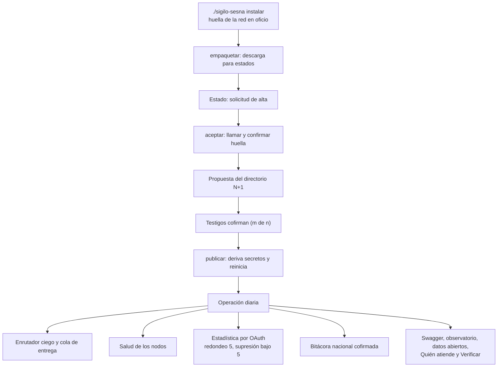

# Manual 09. SESNA: ventanilla única, enrutador ciego y red

Para: el equipo de la **Secretaría Ejecutiva del Sistema Nacional Anticorrupción (SESNA)** que opera
la ventanilla única nacional, el enrutador ciego, el directorio firmado, la bitácora nacional y la
estadística para la PDN. En la demostración: «Operación ficticia de la ventanilla única
(demostración)», en <http://127.0.0.1:8790/>.

> Prototipo del Datatón 2026; no es el sistema oficial. Datos sintéticos.

## 1. Quién eres y qué papel tienes en la ley

- **Administras la PDN** (LGSNA, art. 48). Estableces el canal y la ventanilla únicos de denuncias,
  donde también se registran las autoridades, los protocolos de recepción, turno y seguimiento, la
  estadística para el Comité Coordinador y el portal público agregado (BPDN, arts. 56 a 61).
- **El S5 lo establece el Comité Coordinador y lo implementan las autoridades competentes** (LGSNA,
  art. 56).
- **No investigas, no calificas, no substancias ni resuelves.** No eres autoridad del art. 9 de la
  LGRA. «La PDN será el medio para recibir las denuncias, pero quedará en las autoridades
  competentes dar trámite y respuesta.»
- **En SIGILO no tienes llaves de denuncias:** no puedes leer ni una. Transportas sobres cerrados.

## 2. Qué ves y qué NO ves

| Ves                                                              | No ves                                                                    |
| ---------------------------------------------------------------- | ------------------------------------------------------------------------- |
| Salud de los nodos: arriba o abajo, versión, último contacto     | Hechos, identidades, pruebas, mensajes                                    |
| La cola de sobres **cerrados** por nodo (con token)              | A qué autoridad va un sobre (el sobre v2 solo nombra el nodo)             |
| La bitácora nacional y sus cofirmas                              | El contenido de la bitácora de cada nodo más allá de los eventos públicos |
| La estadística agregada (redondeada a 5 y suprimida bajo 5)      | Cifras de celdas pequeñas                                                 |
| Las solicitudes de alta de nodos y autoridades (llaves públicas) | Llaves privadas de nadie                                                  |

## 3. Cómo entras

- **Páginas públicas** (sin cuenta): ventanilla, salud, Swagger, estadística, datos abiertos,
  observatorio, «¿Quién atiende?», `/verificar`.
- **Operación:** el CLI `./sigilo-sesna` en el servidor de la ventanilla, con la llave de la
  operación (`datos/operator-key.json`) y la llave de enlace (`llaves/enlace-key.json`, fuera del
  volumen).
- **Token de operación** (`config/enrutador.env`): con `Authorization: Bearer …`, la salud incluye la
  cola por nodo.
- **Custodia:** decide quién tiene la llave de la operación, en qué equipo y con qué respaldo fuera
  de línea. Firma el directorio y la cabeza nacional. La llave de enlace deriva los secretos de
  todos los nodos: custódiala igual.

## 4. Tu tablero

| Qué                                         | Dirección (demostración)                                         |
| ------------------------------------------- | ---------------------------------------------------------------- |
| Salud de los nodos                          | `/api/v1/red/health/nodes.html` («Salud de los nodos de la red») |
| Swagger del estándar                        | `/estandar/swagger/`                                             |
| Corte nacional de estadística               | `/api/v1/red/national/statistics`                                |
| Corte nacional de datos abiertos            | `/api/v1/red/national/open-data`                                 |
| Cabeza de la bitácora nacional con cofirmas | `/api/v1/red/national/head`                                      |

## 5. Tareas, en orden

### 5.1 Instalar la ventanilla y el enrutador (una vez)

1. **Testigos:** cada uno corre en su equipo `./sigilo testigo crear-llave --id observer.<id>
--nombre "…" --clase cpc` y te entrega su archivo **público**. Confirmas su huella por teléfono
   (manual 12).
2. `./sigilo-sesna instalar`: dominio, HTTPS, nombre de la operación y de la red, huellas de los
   testigos, **umbral m de n** y versión mínima de los nodos. Deja `red.json`, `datos/`, `llaves/`
   y `config/`.
3. Publica la **huella de la red** (32 caracteres) en un oficio a las 32 entidades y en tu sitio.
4. `./sigilo-sesna empaquetar` (y `--sin-conexion`): la descarga `sigilo-nodo-<v>.tar.gz` para los
   estados.

Requisitos: 4 vCPU y 8 GB (mínimo), 100 GB SSD, Docker ≥ 24, NTP; puerto 443 de entrada (ventanilla,
registro de nodos, testigos) y de salida (cada nodo por `https://`).

### 5.2 Alta de un estado nuevo

1. Recibes `solicitud-alta-<estado>.json` (sin secretos).
2. `./sigilo-sesna aceptar solicitud-alta-<estado>.json`: verifica la firma del nodo, que nadie más
   cubra la entidad y la tabla. **Llama a un número oficial** del estado y escribe la huella que te
   leen. Si no coincide, no aceptes. Muestra «Cambios del directorio N → N+1» y deja
   `propuestas/directorio-propuesto-<N+1>.json`.
3. Envía la propuesta a cada testigo; te devuelven `cofirma-<id>-<N+1>.json`. Cópialas a
   `cofirmas/`.
4. `./sigilo-sesna publicar propuestas/directorio-propuesto-<N+1>.json`: junta las cofirmas,
   verifica, instala, **deriva** los secretos de enlace del nodo nuevo (nunca viajan) y reinicia el
   enrutador.
5. Avisa al estado que corra `./sigilo iniciar`.

Con el mismo `aceptar` entran las **tablas de funciones nuevas** de un estado, las **entradas de
autoridad** que exporta la bandeja «Solicitudes de alta» de un nodo y las **rotaciones del enlace**.

**Fundamento:** BPDN, art. 57 (registro de autoridades en la ventanilla). La operación no puede
cambiar la tabla de un estado: la firma el nodo y la cofirman los testigos.

### 5.3 Enrutador ciego y cola de entrega

- La ventanilla cifra la denuncia en el navegador de la persona; el enrutador solo ve el **sobre v2**
  (`{v:2, node, sealed}`), que nombra el nodo y nada más, y lo entrega con el token OAuth
  `sesna:entregas` y la etiqueta HMAC v2 del buzón.
- Si el nodo no responde, una denuncia **sin pruebas** espera en la cola: reintentos de 30 s a 1 h,
  hasta 7 días, tope de 500 sobres o 64 MiB por nodo; la persona recibe un acuse firmado por la
  operación. Las denuncias con pruebas no entran a la cola.
- Un estado sin nodo no recibe denuncias de sus entes estatales y municipales; la ventanilla lo dice
  a la persona.

### 5.4 Salud de la red

`/api/v1/red/health/nodes.html`: cada nodo «Arriba» o abajo, software (1.1.0), estándar (0.4.0),
último contacto y cola. «Solo nodos, versiones y sobres cerrados en la cola de entrega: ninguna
denuncia, autoridad ni contenido.» Estados: «unreachable» (pide al estado `./sigilo diagnostico`),
«below-minimum-version» (avísale; lo de la cola espera), 401 al entregar (secretos de enlace en
épocas distintas: acepta la rotación).

Versión mínima: `SIGILO_ROUTER_MIN_NODE_VERSION` en `config/enrutador.env`. Avisa con días de
anticipación.

### 5.5 Estadística nacional y OAuth al estilo PDN

- Como en el S2 y el S3, **cada nodo es proveedor**: tiene su servidor de autorización
  (`POST /oauth/token`) y la SESNA es el **cliente**, con `client_credentials` y los permisos
  `sesna:entregas`, `sesna:estadisticas` y `sesna:salud`. Token de 5 minutos; renovación de un solo
  uso.
- Consultas: `POST /v1/denuncias/estadisticas` (respuesta `{pagination, results}`, filas con `id` y
  `fechaCaptura`) y `GET /v1/denuncias/estadisticas/autoridades`.
- Reglas de privacidad: conteos **redondeados de 5 en 5**, **celdas menores a 5 suprimidas**
  (`null`), medianas solo con 10 o más. Estatus nuevos del estándar 0.4.0: «EN_PROCEDIMIENTO»,
  «EN_TRIBUNAL», «EN_RECURSO», «CONCLUIDA_CON_SANCION», «CONCLUIDA_SIN_SANCION»,
  «PRESCRITA_O_CADUCADA».
- El corte nacional (`/api/v1/red/national/statistics`) trae «cutAt», los nodos «included» y filas
  por mes cerrado, autoridad, entidad y conducta.
- **Fundamento:** BPDN, arts. 60 y 61. Esta API es para que la SESNA publique en la PDN.

### 5.6 Estándar y Swagger

`/estandar/swagger/` («Estándar S5 · OpenAPI», con la franja «Prototipo para el Datatón 2026 · no es
el sistema oficial»). El desplegable tiene **5 definiciones**:

1. «S5 - Estadísticas de denuncias (PDN)» (`OAS_API_S5_Estadisticas_Denuncias.json`, OpenAPI 3.0.3,
   el formato del Swagger de la PDN).
2. «S5 - Denuncia y seguimiento (nodo)».
3. «S5 - Red federada».
4. «S5 - Corroboración ciega».
5. «S5 - Estándar completo (OpenAPI 3.1)».

El estándar también publica diccionarios de datos en formato PDN, catálogos (`etapas-legales`,
`transiciones`, `recursos`, `motivos-legales-cierre`) y perfiles de seguridad y privacidad. Para
probar un nodo: `npm run validate -- <url>` y `npm run validate:pdn`.

### 5.7 Bitácora nacional y coordinación con testigos

- Cada nodo publica su bitácora firmada. La SESNA arma la cabeza nacional (`seq`, `hash`, `at`, la
  firma de la operación) y los testigos la **cofirman** («cosignatures»).
- Testigos de la demostración: `observer.cpc-queretaro` y `observer.university-ejemplo` (más el nodo
  de Querétaro), umbral **2 de 3**.
- Pide a cada testigo un compromiso de cofirmar en un plazo (por ejemplo, 2 días hábiles). Si falta
  uno, `publicar` dice «El directorio N no se puede publicar (faltan cofirmas…)».

### 5.8 Páginas públicas que publicas

- **Observatorio** (`/observatorio`), **Datos abiertos** (`/datos-abiertos`), **«¿Quién atiende tu
  denuncia en tu estado?»** (`/quien-atiende`) y **registro público** (`/verificar`). Ver manual 13.
- **Fundamento:** BPDN, art. 61 (portal público agregado).

### 5.9 Corroboración ciega (opcional)

El evaluador y el índice (perfil `corroboracion` de `compose.sesna.yaml`) conviene que los opere
**otra institución**, para que ninguna tenga las dos piezas.

## 6. Qué hacer si algo falla

| Síntoma                                                                    | Qué hacer                                  |
| -------------------------------------------------------------------------- | ------------------------------------------ |
| «El directorio N no se puede publicar (faltan cofirmas…)»                  | Revisa qué testigo falta                   |
| «… no es la versión siguiente …»                                           | Rehaz la propuesta sobre la vigente        |
| «Ya hay una propuesta N sin publicar»                                      | Publícala primero o usa `--reemplazar`     |
| «La huella no coincide»                                                    | No aceptes; pide reenvío y vuelve a llamar |
| El enrutador no arranca: «… solo habla con los nodos por https://»         | Corrige el alta del nodo                   |
| «No pudimos verificar el directorio firmado de la red…» (en la ventanilla) | El enrutador no respondió; revisa la salud |

## 7. Limitaciones conocidas del prototipo

- Se puede correlacionar el tiempo entre el enrutador y el nodo (no hay retardo mínimo ni tráfico de
  cobertura).
- Las denuncias con pruebas no entran a la cola de reenvío.
- En `/verificar`, lo del día no aparece hasta que termina el día (en la demostración, el día
  simulado).
- No hay protocolo oficial de turno del S5 publicado; este estándar es una propuesta.

## 8. Glosario breve

- **Ventanilla única:** la web nacional donde se denuncia.
- **Enrutador ciego:** reenvía sobres cerrados sin poder leerlos.
- **Sobre v2:** paquete cifrado que solo dice a qué nodo va.
- **Directorio firmado:** lista de nodos, autoridades y tablas; vale con m de n cofirmas.
- **Cabeza de la bitácora:** el último resumen firmado de todos los eventos públicos.
- **OAuth `client_credentials`:** forma estándar en que la SESNA pide un token a cada nodo.

## 9. Diagrama de tu flujo

