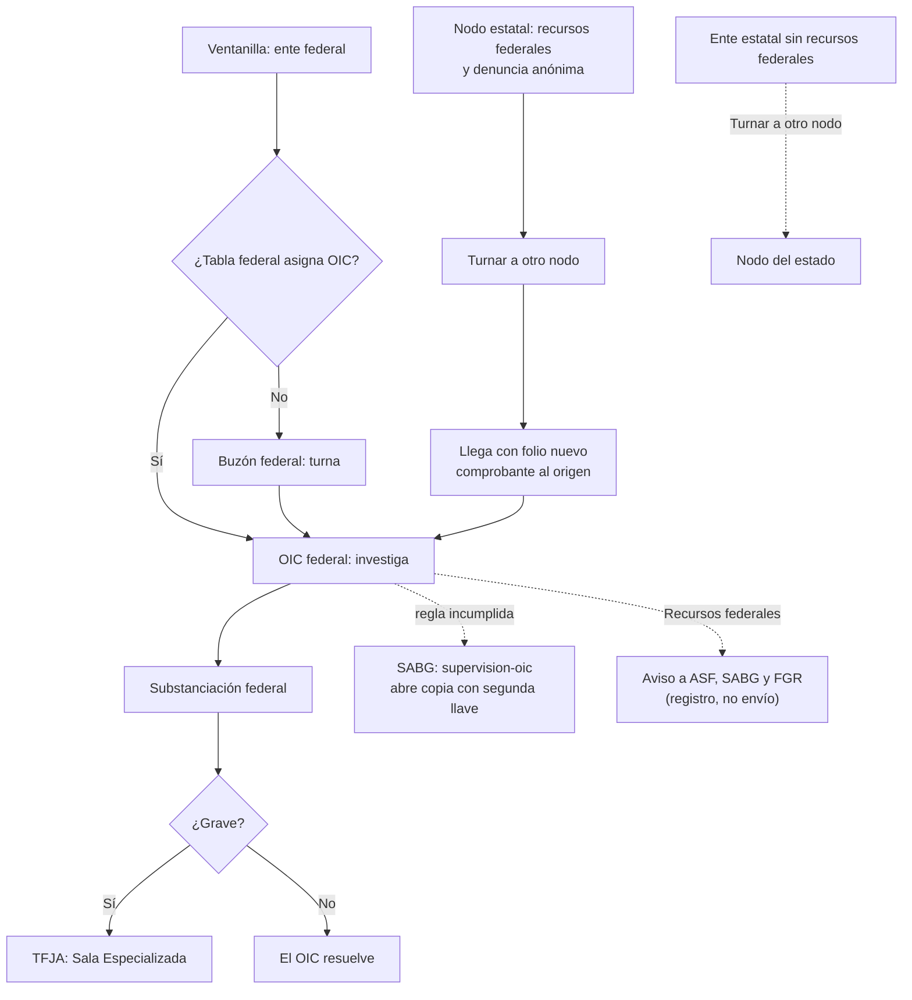

# Manual 10. Secretaría Anticorrupción y Buen Gobierno: el nodo Federal

Para: la **Secretaría Anticorrupción y Buen Gobierno (SABG)**, que opera el nodo Federal, y las
autoridades federales que trabajan en él: los **OIC federales**, la **unidad que supervisa a los
OIC**, el buzón federal, la Sala Especializada del TFJA y la Fiscalía Especializada de la FGR. En la
demostración todo es ficticio: «Secretaría Anticorrupción y Buen Gobierno (ficticia)», el «Órgano
Interno de Control en el Instituto Federal Ficticio de Equipamiento», el «Órgano Interno de Control
en la Delegación Federal Ficticia de Programas Sociales» y la «Unidad Ficticia de Supervisión de
Órganos Internos de Control». Panel: <http://127.0.0.1:8782/autoridad>.

> Prototipo del Datatón 2026; no es el sistema oficial. Datos sintéticos.

## 1. Quién eres y qué papel tienes en la ley

- **El nodo Federal aloja solo autoridades federales.** No hay nodo común: ningún estado vive en el
  nodo Federal. Lo opera la SABG (función `operation`, cuenta `operacion.federal`).
- **Los OIC federales** son autoridades investigadoras, substanciadoras y, en no graves, resolutoras
  de su ente (LGRA, arts. 3, fr. XXI, 9 y 10). Un ente federal **sin OIC designado** lo atiende la
  SABG (LOAPF, art. 37, fr. XXIX; LGRA, art. 9, fr. I).
- **La SABG supervisa a los OIC** del Ejecutivo federal y recibe los escalamientos con **segunda
  llave** (cuenta `supervision-oic`).
- **Recursos federales en entes locales:** la autoridad local que detecte el desvío de aportaciones
  debe avisar «en forma inmediata» a la ASF y a la Secretaría federal (LCF, art. 49). La ASF
  fiscaliza e investiga las graves y las lleva al TFJA (LFRCF, arts. 47 y 66 Bis; LGRA, arts. 11 y
  98). La FGR investiga el delito, que es federal cuando se manejan recursos federales (CPF, art.
  212).
- **Faltas graves federales:** Sala Especializada en Responsabilidades Administrativas del TFJA;
  alzada: Tercera Sección de la Sala Superior (LOTFJA, arts. 13, 37 y 38).

## 2. Qué ve y qué no ve cada cuenta del nodo

| Cuenta (demostración)                     | Función                                                         | Ve                                                       | No ve                                                    |
| ----------------------------------------- | --------------------------------------------------------------- | -------------------------------------------------------- | -------------------------------------------------------- |
| `buzon.federal`                           | Recepción                                                       | Lo que la tabla federal no asigna                        | Identidades                                              |
| `oic-equipamiento.persona1` / `.persona2` | Recepción e investigación                                       | Denuncias de su OIC                                      | Las de otros OIC                                         |
| `oic-equipamiento.substanciacion`         | Substanciación                                                  | Expedientes de su OIC desde el IPRA                      | Identidades, buzón                                       |
| `oic-equipamiento.titular`                | Supervisión                                                     | Denuncias de su institución                              | —                                                        |
| `oic-programas`                           | Recepción e investigación                                       | Denuncias de su OIC                                      | —                                                        |
| `supervision-oic`                         | Supervisión con segunda llave                                   | Escalamientos de los OIC supervisados, con copia cerrada | La identidad                                             |
| `tribunal.federal`                        | Tribunal                                                        | Expedientes en sus etapas                                | Buzón e identidad                                        |
| `fiscalia`                                | Recepción e investigación, papel `prosecution` (solo vía penal) | Su bandeja; solo ella avanza la vía penal                | Las vistas de los OIC (no llegan); la vía administrativa |
| `operacion.federal`                       | Operación                                                       | Altas y competencia federal                              | Denuncias                                                |

## 3. Cómo entras

Igual que en los demás nodos (manuales 02 a 08): panel `/autoridad`, usuario, contraseña
(demostración: `.red-demo/nodos/federal/credenciales.json`), llave de la autoridad
(`.red-demo/autoridades/<authorityId>.json`; el buzón y el Tribunal usan
`.red-demo/nodos/federal/llaves-demo/authority-demo-key.json`) y segundo factor.

- Con segundo factor ya inscrito: `supervision-oic`, `fiscalia` y `operacion.federal`.
- **`oic-programas` lo inscribe al entrar**: «Activa la verificación en dos pasos» → QR o «¿No puedes
  escanearlo?» → código → «Confirmar y activar» → 10 códigos de recuperación → «Ya guardé mis
  códigos…» → «Continuar al panel». Se gasta una vez.
- Segunda llave de la supervisora: `.red-demo/nodos/federal/llaves-demo/supervisor-demo-key.json`.

## 4. Las bandejas

«Bandeja general de turnado» (buzón), «Denuncias asignadas» (OIC y fiscalía), «Expedientes en
substanciación», «Denuncias de tu institución» con «Escalamientos que recibiste» (supervisión),
«Expedientes en el Tribunal» y «Solicitudes de alta» (operación).

## 5. Tareas propias del nodo Federal

### 5.1 OIC federales: el ciclo completo

Los OIC federales siguen exactamente los manuales 03 (investigación) y 04 (substanciación). El caso
sembrado de Marta (`ZCH3-Q437-KDYK`, sintético) muestra la falta no grave con plantilla, el
conflicto de interés y el aviso de inconformidad ya preparado:

- `oic-equipamiento.persona1` registra el escrito firmado de la inconformidad («Registrar un recurso
  presentado con firma» → «Inconformidad» → «La persona denunciante (como tercera)»).
- `tribunal.federal` la resuelve («Registrar la resolución de un recurso»).
- La apertura de identidad necesita a `persona1` **y** a `persona2` (dos personas distintas).

### 5.2 Supervisión de OIC con segunda llave

1. `supervision-oic` (con código) → «Escalamientos que recibiste», agrupados por regla. Marta aparece
   en «Acto resolutivo con conflicto de interés sin excusa» y en «Calificación de no grave con dos
   o más señales del auditor»; otras, en «Falta grave sin iniciar el procedimiento a los 30 días».
   Al final, los avisos «Meta de turnado del S5 vencida», sin copia.
2. **«Abrir la denuncia <folio>»** → «Segunda llave de la supervisora (archivo .json)» → «Abriendo el
   sobre en este navegador.»
3. Ves los hechos y las pruebas comparados con el registro público, **nunca la identidad**. El
   expediente sigue con el OIC.
4. Actúa por los medios de la SABG. Detalle: manual 05.

**Fundamento:** reglas de escalamiento públicas del estándar (LGRA, arts. 58, 64 y 100).

### 5.3 Buzón federal

`buzon.federal` turna lo que la tabla federal no asigna (manual 02). Recibe, entre otras, las
denuncias que un nodo estatal le turna por recursos federales.

### 5.4 Recibir denuncias turnadas desde un estado

1. Un estado marca «involucra recursos federales» y usa **«Turnar a otro nodo de la red»** hacia una
   autoridad federal (buzón u OIC). Solo funciona con denuncias **anónimas**.
2. Te llega con **folio nuevo**; la persona conserva sus 8 palabras. El navegador del estado volvió a
   cerrar la denuncia y las pruebas hacia tu autoridad; el enrutador no la lee.
3. Tu nodo emite el comprobante; el nodo de origen registra la entrega de custodia y borra sus
   copias. Si no confirmas en 10 días hábiles, el origen escala («Turnado a otro nodo sin
   comprobante en 10 días hábiles») y conserva las pruebas.
4. Acepta e investiga como cualquier denuncia.

**En sentido contrario:** si en el nodo Federal llega una denuncia sobre un ente estatal o municipal
**sin** recursos federales (o con faltas locales además de las federales), túrnala al nodo del
estado con «Turnar a otro nodo».

### 5.5 Relación con la ASF y la FGR

- En la tarjeta **«Recursos federales»** de cualquier denuncia aparecen la ASF, la SABG y la Fiscalía
  Especializada de la FGR con su papel y fundamento. «Es una guía: el sistema no decide la
  competencia.»
- La ASF no es «observadora»: es autoridad que investiga graves (LGRA, art. 9, fr. III). La ASF
  **sí** admite denuncias sin nombre (LFRCF, art. 60).
- La vista a la FGR se registra con «Dar vista al Ministerio Público»; **no llega a la bandeja** de
  `fiscalia` (limitación conocida). Remite la denuncia y sus pruebas por oficio, por los medios
  oficiales. Los OIC solo dan la vista: las etapas penales las avanza `fiscalia`.

### 5.6 Operación del nodo Federal

`operacion.federal` hace lo mismo que la SESEA en un estado (manual 08): altas con huella y
competencia por dependencia de los **entes federales** (fragmento `00` del catálogo de la PDN).
Ejemplos sintéticos de la tabla federal: los OIC de los dos entes ficticios del escenario, dos OIC
nombrados sin alta, una oficina ficticia «sin OIC designado → la SABG», la ASF (graves), el TFJA y
la FGR. Una solicitud rechazada sembrada: `ALTA-C5DF583BA885`.

## 6. Qué hacer si algo falla

| Síntoma                                                 | Qué hacer                                                                                                                 |
| ------------------------------------------------------- | ------------------------------------------------------------------------------------------------------------------------- |
| Una denuncia sellada no se puede turnar desde el estado | Limitación conocida; el estado la remite con «Incompetencia y remisión» o la persona denuncia de nuevo en el nodo Federal |
| No aparece la copia escalada                            | Usa la **segunda llave**, no la llave de la autoridad                                                                     |
| La fiscalía no ve la vista                              | Limitación conocida                                                                                                       |
| El QR de `oic-programas` ya no aparece                  | La inscripción ya se usó; entra con el código                                                                             |

## 7. Limitaciones conocidas del prototipo

- El turnado entre nodos solo funciona con denuncias anónimas.
- La marca de recursos federales es manual; las reglas por ente (`fundingSources`) son un siguiente
  paso.
- Los avisos a la ASF, la SABG y la FGR se registran, pero no se envían.
- La vista al MP no llega a la fiscalía.

## 8. Glosario breve

- **Nodo Federal:** el nodo de las autoridades federales; lo opera la SABG.
- **Ramo 33:** aportaciones federales a estados y municipios.
- **Segunda llave:** llave de la supervisora para abrir copias de denuncias escaladas.
- **Turnado entre nodos:** la denuncia cambia de nodo con folio nuevo y las mismas 8 palabras.

## 9. Diagrama de tu flujo

