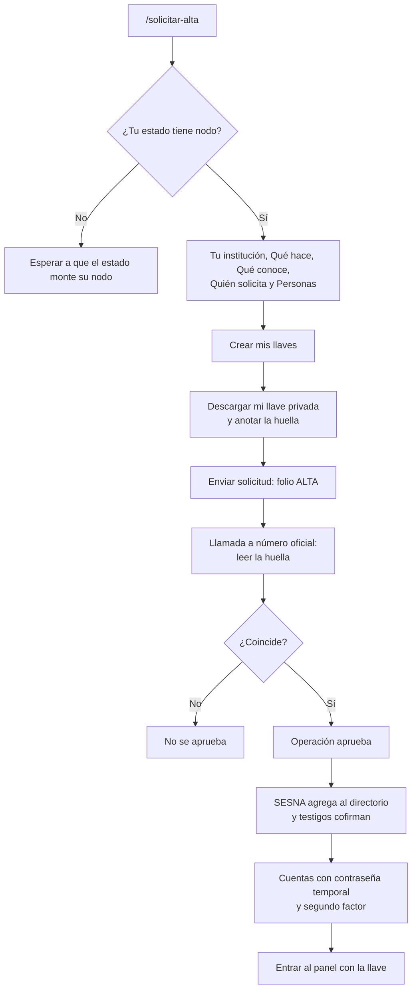

# Manual 11. Institución que solicita su alta en la red

Para: la persona **titular** (o responsable designada) de una institución que quiere recibir
denuncias en SIGILO: por ejemplo, el órgano interno de control de una secretaría estatal, un OIC
municipal o una fiscalía anticorrupción. Ejemplo sintético: «Órgano Interno de Control Ficticio de la
Secretaría de Turismo Ficticia de Querétaro».

> Prototipo del Datatón 2026; no es el sistema oficial. Datos sintéticos. No uses nombres ni oficios
> reales.

## 1. Quién eres y qué papel tienes en la ley

- **Tu institución es autoridad competente** para investigar faltas administrativas (LGRA, arts. 3,
  fr. II y XXI, 9 y 10) o delitos de corrupción (fiscalía). Cada ente tiene su OIC y cada municipio
  el suyo (CPEUM, art. 109, fr. III).
- **Las autoridades también se registran en la ventanilla única** del S5 (BPDN, art. 57). Toda
  institución que recibe denuncias por otros medios debe registrarlas en el S5 (BPDN, art. 58).
- **Separación de funciones:** «La LGRA pide que quien substancia y resuelve no sea quien investiga
  (art. 115).» Por eso pides cuentas distintas para cada persona.
- **Solo si tu estado ya tiene nodo.** Una institución de un estado sin nodo no puede pedir el alta:
  primero su estado monta su nodo (manual 08).

## 2. Qué ves y qué NO ves

- Durante la solicitud solo ves tu propio formulario y tus llaves.
- **Tu llave privada nunca sale de tu equipo.** Solo el **candado** (la llave pública) viaja con la
  solicitud. «Nunca te pediremos tu llave privada. Si alguien te la pide, no la compartas.»
- Después del alta, cada persona de tu institución verá en el panel solo las denuncias asignadas a
  tu autoridad, según su función.

## 3. Cómo entras

**Sin cuenta.** Abre la ventanilla en `/solicitar-alta` (demostración:
<http://127.0.0.1:8790/solicitar-alta>), o desde el panel: «Solicita su alta en la ventanilla única».

## 4. Tu «bandeja»

No hay bandeja: guardas el **folio** de tu solicitud (`ALTA-…`) y la **huella** de tu candado. El
resultado te lo comunica quien opera el nodo de tu estado.

## 5. Pasos, en orden

### 5.1 Llenar la solicitud («Solicitar alta de mi institución»)

«Para recibir denuncias en la red, tu institución necesita estar en el directorio firmado y tener
cuentas en el panel. Llena esta solicitud; quien opera el nodo la revisa y te llama para
confirmarla.»

1. **«Tu institución»:** «Nombre oficial», «Orden de gobierno» (federal, estatal o municipal) y la
   entidad («Elige la entidad»).
2. **«¿Qué hace?»:** «Investiga faltas administrativas (OIC o contraloría)», «Substanciación y
   resolución», «Titular o supervisión» o «Fiscalía de hechos de corrupción».
3. **«¿Qué conoce?»:** «Faltas administrativas (Ley General de Responsabilidades Administrativas)» o
   «Delitos por hechos de corrupción (…)», con el Código Penal Federal si tu institución es federal
   o el código penal de tu entidad si es estatal o municipal.
4. **«Quién solicita»:** «Tu nombre», «Tu cargo» y «Oficio de nombramiento (número y fecha)» («Por
   ejemplo: Oficio SC/001/2026 del 2 de enero de 2026.»).
5. **«Personas que tendrán cuenta»:** «Persona 1: nombre» y «Persona 1: qué hará» (por ejemplo,
   «Recibe e investiga»); «Agregar otra persona» para quien substancia y resuelve, y para la
   titular o supervisión. «Cada persona tendrá su propia cuenta.» Pide al menos **dos personas que
   investiguen** si quieres poder abrir identidades (se necesitan dos aprobaciones distintas).

### 5.2 Crear las llaves de tu institución

1. En «Las llaves de tu institución» pulsa **«Crear mis llaves»**. «Se crean aquí, en tu
   navegador.» No se envía nada todavía.
2. **«Descargar mi llave privada»** y guárdala en un lugar seguro. «Si la pierdes, no se puede
   recuperar: habría que crear otro par y cambiar tu candado en el directorio.» Con ella tu
   institución abre las identidades selladas, las pruebas y los mensajes.
3. **«Descargar el candado»** (opcional; el candado ya va con la solicitud).
4. **Anota la huella** (16 caracteres en grupos de 4): «Guarda también esta huella: te la pedirán
   por teléfono.»

Si tu autoridad ya existe y solo necesitas llaves nuevas, el panel ofrece «¿Tu autoridad todavía no
tiene llaves? Crear mis llaves», con los mismos pasos.

### 5.3 Enviar

- Pulsa **«Enviar solicitud»** (el navegador resuelve una prueba de trabajo). Verás «Solicitud
  enviada» y «Guarda este folio» (`ALTA-…`).
- La solicitud va al **nodo de tu estado**. Si tu entidad no tiene nodo: «Tu entidad todavía no
  tiene nodo en la red. Primero tu estado debe montar su nodo…»

### 5.4 Confirmar la huella por teléfono

Quien opera el nodo te **llama a un número oficial** (no al que pusiste en la solicitud) y te pide
que le leas tu huella. «Cuando quien opera la red te llame, lean juntos esta huella. Si no coincide,
no la agreguen.» Si alguien te llama y te pide la **llave privada**, cuelga: nunca se pide.

### 5.5 Después de la aprobación

1. Quien opera el nodo aprueba («Sí, aprobar») o rechaza con motivo.
2. «Después de aprobar, tu institución se agrega al directorio firmado de la red y se crean las
   cuentas.» La SESNA agrega tu entrada al directorio y los testigos lo cofirman.
3. Quien opera el nodo crea las cuentas con contraseña temporal y te las entrega en persona; cada
   persona firma la carta responsiva.
4. Cada persona entra al panel con «Usuario», «Contraseña», el archivo de **llave** que descargaste y
   su segundo factor (manuales 02 a 07). Desde ahí, la tabla de competencia puede asignarte las
   dependencias que investigas (manual 08).

## 6. Qué hacer si algo falla

| Síntoma                                                 | Qué hacer                                                                         |
| ------------------------------------------------------- | --------------------------------------------------------------------------------- |
| «Tu entidad todavía no tiene nodo en la red…»           | Tu estado debe montar su nodo primero                                             |
| «No pudimos comprobar el directorio firmado de la red…» | Inténtalo más tarde                                                               |
| «No se envió la solicitud» con campos marcados          | Corrige: «Escribe el nombre oficial.», «Crea las llaves de tu institución.», etc. |
| Perdí la llave privada antes de la aprobación           | Crea llaves nuevas y envía una solicitud nueva                                    |
| La huella no coincide en la llamada                     | No se aprueba: el candado pudo cambiar; envía otra solicitud                      |
| Me rechazaron                                           | Lee el motivo; corrige y vuelve a solicitar                                       |

## 7. Limitaciones conocidas del prototipo

- Agregar tu institución al directorio y crear las cuentas son pasos de línea de comandos (SESNA y
  operación del nodo), no del panel.
- El identificador propuesto de tu autoridad se recorta entre palabras si el nombre es largo; pide
  que lo revisen.

## 8. Glosario breve

- **Candado:** tu llave pública; con ella otros cierran lo que solo tú abres.
- **Llave privada:** el archivo que abre lo que te mandan. Nunca se comparte.
- **Huella:** resumen corto del candado que se lee por teléfono.
- **Directorio firmado:** la lista oficial de autoridades de la red.
- **Carta responsiva:** compromiso de cada persona que recibe una cuenta.

## 9. Diagrama de tu flujo

