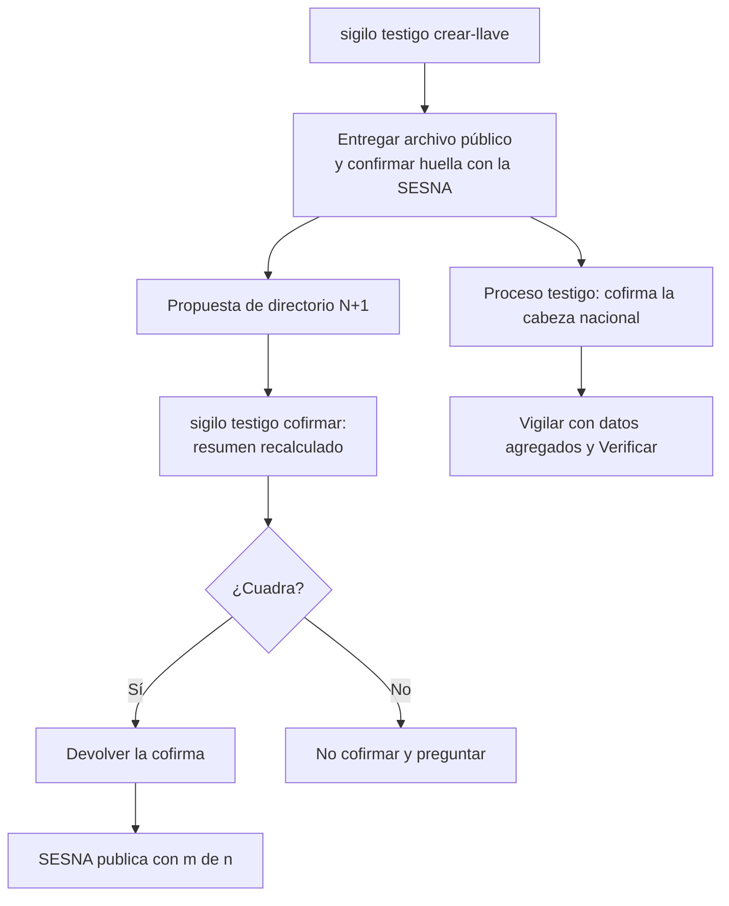

# Manual 12. Testigos y Comité de Participación Ciudadana (CPC)

Para: las instituciones **distintas de la SESNA** que cofirman la bitácora nacional y el directorio
firmado de la red: el **CPC** (nacional o de un estado), la academia u otra institución que acepte el
papel. En la demostración: `observer.cpc-queretaro` (contenedor `testigo-cpc-queretaro`),
`observer.university-ejemplo` (contenedor `testigo-universidad-ejemplo`) y el propio nodo de
Querétaro, con umbral **2 de 3**.

> Prototipo del Datatón 2026; no es el sistema oficial. Datos sintéticos.

## 1. Quién eres y qué papel tienes en la ley

- **El CPC vigila el sistema, no el caso.** Accede a la información que genere el Sistema por
  conducto del Secretario Técnico, propone mejoras al «sistema electrónico de denuncia y queja» y da
  seguimiento al funcionamiento del sistema (LGSNA, art. 21, fr. V, VII d), XVII y XVIII, y art.
  23; en Querétaro, LSEAQ, art. 21). Sus integrantes tienen deberes de confidencialidad (LGSNA, art.
  17).
- **No eres parte del procedimiento:** no investigas, no ves expedientes ni identidades y no decides
  nada de un caso. La revisión de un caso se hace por recursos, no por observadores.
- **Como testigo de SIGILO**, tu tarea es técnica: recalcular y **cofirmar** con tu propia llave
  1. la **cabeza de la bitácora nacional** (comprobar que solo creció, sin reescrituras), y
  2. cada versión del **directorio firmado** (nodos, autoridades y tablas de funciones de cada
     estado).
     Así la SESNA no puede cambiar la tabla de un estado ni reescribir la bitácora sin que lo notes.
- **La ASF y la ESFE no son observadoras:** son autoridades (LGRA, art. 9, fr. III). Si cofirman el
  directorio, lo hacen como institución, no como vigilantes de casos.
- Un «testigo social» de contrataciones o un testigo en el procedimiento (medio de prueba, LGRA,
  arts. 144 a 157) son figuras distintas.

## 2. Qué ves y qué NO ves

| Ves                                                      | No ves                                 |
| -------------------------------------------------------- | -------------------------------------- |
| La bitácora pública: eventos con digestos, sin contenido | Hechos, identidades, pruebas, mensajes |
| El resumen de cambios de cada versión del directorio     | Qué autoridad tiene cada denuncia      |
| La estadística agregada y los datos abiertos             | Celdas menores a 5                     |

## 3. Cómo entras

**No tienes cuenta ni pantalla en el panel.** Trabajas con el CLI en tu propio equipo y, si quieres
cofirmar la bitácora de forma continua, con el proceso testigo.

1. **Crear tu llave (una vez), en tu equipo:**
   `./sigilo testigo crear-llave --id observer.<id> --nombre "<nombre de la institución>" --clase cpc`.
   Deja `salida/testigo-<id>.llave.json` (**privada: nunca sale de tu equipo**) y
   `salida/testigo-<id>.publico.json`, que entregas a la SESNA.
2. **Confirmar tu huella** (32 caracteres) por teléfono con la SESNA.
3. **Recuperación:** si pierdes la llave privada, no se recupera. Crea otra y pide a la SESNA que la
   agregue en una versión nueva del directorio (con las cofirmas de los demás testigos).

## 4. Tu «bandeja»

- Las propuestas de directorio que te envía la SESNA (`directorio-propuesto-<N+1>.json`).
- La cabeza nacional: `/api/v1/red/national/head` («seq», «hash», «at», la firma de la operación y
  «cosignatures»).

## 5. Tareas, en orden

### 5.1 Cofirmar una versión nueva del directorio

1. Recibes `directorio-propuesto-<N+1>.json` de la SESNA.
2. Corre `./sigilo testigo cofirmar directorio-propuesto-<N+1>.json --llave testigo-<id>.llave.json
--ventanilla https://<ventanilla>`.
3. El CLI **recalcula el resumen de cambios** contra la versión vigente que descarga él mismo. Léelo:
   ¿entra un estado nuevo? ¿cambia la tabla de un estado? ¿la firmó el nodo de ese estado?
4. Si todo cuadra, devuelve a la SESNA `cofirma-<id>-<N+1>.json`. Si no, **no cofirmes** y
   pregunta. Sin m de n cofirmas, la SESNA no puede publicar.
5. Cumple el plazo comprometido (por ejemplo, 2 días hábiles).

### 5.2 Cofirmar la bitácora nacional (proceso continuo)

- Corre la imagen `ghcr.io/guilleop/sigilo-testigo` con tu llave como `witness-key.json`, la raíz de
  la red (`trust.json`) y `SIGILO_WITNESS_ROUTER_URL=https://<ventanilla>`.
- El testigo recalcula la bitácora nacional, comprueba que solo creció y cofirma su cabeza.
- Para revisarlo: en `/api/v1/red/national/head`, «cosignatures» debe tener tu firma.
- Si tu testigo se detiene, la cabeza sigue firmada con los demás mientras se cumpla el umbral (en
  la demostración: `docker compose stop testigo-cpc-queretaro` y después `start`; la cabeza conserva
  las cofirmas previas).

### 5.3 Vigilar con datos agregados

- Observatorio, datos abiertos, cobertura de OIC por estado, estadística nacional (manual 13).
- `/verificar` para comprobar desde tu navegador que la bitácora de un nodo no se reescribió, y
  «Comparar con anclajes publicados (opcional)».
- Con eso puedes proponer mejoras, pedir exhortos públicos o informar al Comité Coordinador.

## 6. Qué hacer si algo falla

| Síntoma                                                     | Qué hacer                                                    |
| ----------------------------------------------------------- | ------------------------------------------------------------ |
| El resumen recalculado no coincide con lo que dijo la SESNA | No cofirmes; pide explicación por escrito                    |
| La propuesta no es la versión siguiente                     | La SESNA debe rehacerla sobre la vigente                     |
| Tu firma no aparece en «cosignatures»                       | Revisa que tu testigo esté en marcha y alcance la ventanilla |
| Perdiste la llave privada                                   | Crea otra y pide su alta en el directorio                    |

## 7. Limitaciones conocidas del prototipo

- No hay pantalla para testigos; todo es por CLI o contenedor.
- En la demostración el umbral 2 de 3 no se ve en vivo hasta el cierre del día simulado.
- El sellado de tiempo con una autoridad externa (RFC 3161) es trabajo futuro; hoy la fecha la da
  la bitácora, anclada fuera del sistema.

## 8. Glosario breve

- **Cofirma:** tu firma sobre una versión del directorio o una cabeza de la bitácora.
- **Umbral m de n:** cuántas cofirmas hacen falta (en la demostración, 2 de 3).
- **Cabeza de la bitácora:** último resumen firmado de los eventos públicos.
- **Directorio firmado:** nodos, autoridades y tablas de funciones de la red.
- **Huella:** resumen corto de tu llave pública, confirmado por teléfono.

## 9. Diagrama de tu flujo

