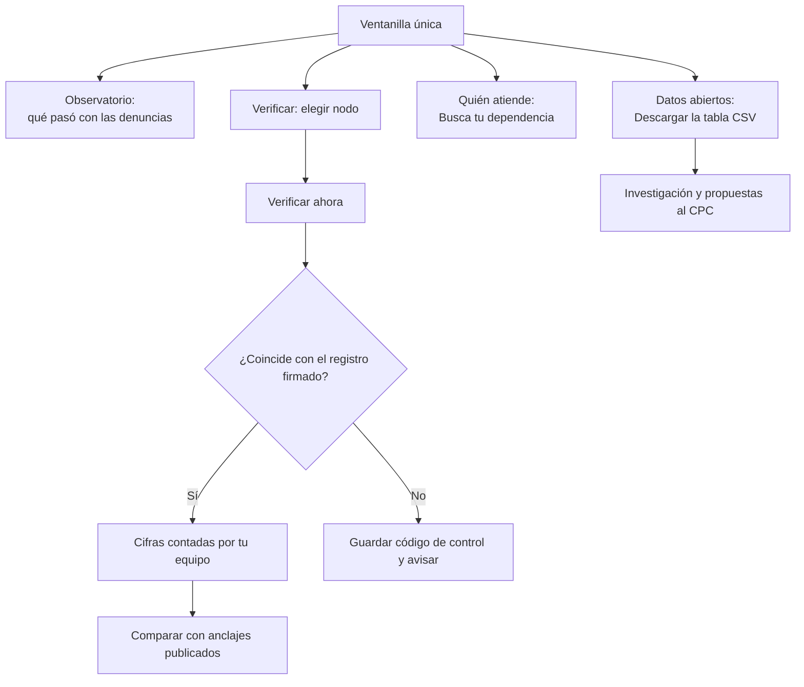

# Manual 13. Ciudadanía y academia: observatorio, datos abiertos y registro público

Para: cualquier persona, organización de la sociedad civil, periodista o equipo académico que quiera
**vigilar cómo funciona el sistema de denuncias** sin ver ningún caso: cuántas denuncias llegan, qué
pasa con ellas, quién debe atenderlas en cada estado y si el registro público se ha alterado.

> Prototipo del Datatón 2026; no es el sistema oficial. Las cifras de la demostración son
> sintéticas.

## 1. Quién eres y qué papel tienes en la ley

- **La PDN debe tener un portal público con información agregada** de las denuncias (BPDN, art. 61)
  y estadística para el Comité Coordinador (art. 60).
- La sociedad participa en la vigilancia del sistema: el CPC propone mecanismos para que la sociedad
  denuncie y lleva un **registro voluntario de organizaciones** (LGSNA, art. 21, fr. VII y IX);
  existe la contraloría social en programas sociales.
- **Tienes derecho a datos abiertos**, pero no a datos personales: los datos que tiene una autoridad
  se rigen por la LGPDPPSO (arts. 10 y 36). Por eso todo lo que ves aquí está agregado, redondeado y
  con las celdas pequeñas suprimidas.
- Si además quieres **denunciar**, ve al manual 01.

## 2. Qué ves y qué NO ves

| Ves                                                          | No ves                                                          |
| ------------------------------------------------------------ | --------------------------------------------------------------- |
| Número de denuncias por estado, conducta, mes y estatus      | Folios, descripciones, nombres, pruebas                         |
| Indicadores por autoridad y el mapa por entidad              | Cifras de celdas con menos de 5 denuncias (se suprimen)         |
| Quién atiende cada dependencia en cada estado                | Lo del mes en curso (solo meses completos)                      |
| La bitácora pública de cada nodo, verificada en tu navegador | La hora de llegada de cada denuncia (se publica una vez al día) |

## 3. Cómo entras

Sin cuenta. Todo es público en la ventanilla única (demostración: <http://127.0.0.1:8790/>).

| Página                                   | Ruta                 |
| ---------------------------------------- | -------------------- |
| Observatorio                             | `/observatorio`      |
| Datos abiertos                           | `/datos-abiertos`    |
| ¿Quién atiende tu denuncia en tu estado? | `/quien-atiende`     |
| Comprueba el registro público            | `/verificar`         |
| Cómo te cuidamos                         | `/como-te-cuidamos`  |
| Estándar y API (Swagger)                 | `/estandar/swagger/` |

## 4. Tu tablero

### 4.1 Observatorio (`/observatorio`)

- «¿Qué pasó con las denuncias?»: cuántas siguen en trámite, en procedimiento, en el Tribunal, en
  recurso y cuántas concluyeron con o sin sanción.
- «Indicadores por autoridad».
- **«El S5 en cada entidad»**: mapa con tres capas, «Conexión al S5», «Denuncias por 100 000
  habitantes» y «Protección del anonimato».
- «¿Qué se puede comprobar en cada entidad?»: qué sistemas de la PDN cubren cada entidad. **«Sin
  cobertura» nunca quiere decir que no haya sanciones o conflictos.**

### 4.2 Datos abiertos (`/datos-abiertos`)

- «Número de denuncias por estado, conducta, mes en que llegaron y estatus. No incluye folios,
  descripciones ni datos de personas.»
- «Esta tabla es de toda la red: suma los datos abiertos que publica cada nodo, con las mismas
  reglas. Cualquiera puede rehacer la suma con el CSV de cada nodo.»
- **«Descargar la tabla (archivo CSV, se abre con Excel)»**.
- «Cómo protegemos a quienes denuncian»: conteos **redondeados de 5 en 5**, celdas **menores a 5
  suprimidas**, solo **meses completos** («Las denuncias de este mes aparecerán cuando termine el
  mes.»).
- «Más conjuntos de datos»: «Matriz de cobertura de la PDN por entidad», «Indicadores de
  contratación federal por comprador» («Por año (CSV)»), «Grupos de anonimato (tamaños en rangos)»
  y «Metodología».
- El corte nacional también trae la **cobertura de OIC por estado**: porcentaje de dependencias con
  OIC asignado, con llaves y pendientes. No usa ninguna denuncia.

### 4.3 ¿Quién atiende tu denuncia en tu estado? (`/quien-atiende`)

- La tabla firmada de funciones de cada nodo: quién recibe, quién investiga, quién substancia, el
  Tribunal y su alzada, la fiscalía, la supervisión y el observador.
- **«Busca tu dependencia»**: elige «Estado o federación» y escribe el «Nombre de la dependencia».
  Te dice quién la investiga, con su distintivo («OIC con llaves ✓», «OIC nombrado, falta alta» o
  «pendiente»). Si está pendiente, la denuncia llega a la autoridad receptora.
- «Cobertura de órganos internos de control» y «Entidades que todavía no tienen nodo».
- La vigilancia del sistema (CPC) aparece aparte: «no ve tu caso» (LGSNA, arts. 21 y 23).

## 5. Tareas, en orden

### 5.1 Comprobar el registro público (`/verificar`)

1. «Comprueba el registro público» → «Nodo» (por ejemplo, «Nodo estatal Querétaro»).
2. Pulsa **«Verificar ahora»**. Tu navegador descarga la bitácora del nodo y la comprueba con la
   llave del nodo en el directorio firmado.
3. Resultados posibles:
   - «La bitácora coincide con el registro firmado» y un «Código de control».
   - «Atención: la bitácora fue alterada.» con la causa («alguien cambió el contenido de un
     registro», «falta un registro o están desordenados», «un registro no está unido al anterior»).
   - «No pudimos comprobar la firma de la bitácora».
4. **«Lo que dice la bitácora que acabas de comprobar»**: denuncias recibidas, «Aperturas de un
   nombre sellado (incluye las que pidió la propia persona para su inconformidad)» y «Entregas del
   sobre con el nombre a una persona de la autoridad». «Estas cifras no te las da el sistema: las
   contó tu equipo…»
5. Opcional: **«Comparar con anclajes publicados (opcional)»**: pega anclajes publicados fuera del
   sistema (por ejemplo, en un diario o en otra institución) y pulsa «Comparar con los anclajes».
   Si coinciden, la bitácora no se reescribió hasta ese punto.

«Para no revelar a qué hora llega cada denuncia, el registro se publica una vez al día: lo de hoy se
publica mañana.»

### 5.2 Usar los datos para investigación

- Descarga el CSV de cada nodo y rehaz la suma nacional.
- Consulta el estándar en el Swagger: la definición «S5 - Estadísticas de denuncias (PDN)» describe
  los campos y estatus («EN_PROCEDIMIENTO», «EN_TRIBUNAL», «EN_RECURSO», «CONCLUIDA_CON_SANCION»,
  «CONCLUIDA_SIN_SANCION», «PRESCRITA_O_CADUCADA»).
- Cita siempre las reglas de privacidad: un `null` es una celda suprimida, no un cero.
- Para auditar el código: `docs/auditoria-guia.md` del repositorio.

### 5.3 Proponer mejoras

Lleva tus hallazgos al CPC o al Comité Coordinador (LGSNA, art. 21, fr. VII d). Las recomendaciones
del Comité son no vinculantes y deben responderse en 15 días (LGSNA, arts. 57 a 59).

## 6. Qué hacer si algo falla

| Síntoma                                                 | Qué hacer                                                                         |
| ------------------------------------------------------- | --------------------------------------------------------------------------------- |
| Lo de hoy no aparece en `/verificar`                    | Se publica al terminar el día                                                     |
| Una celda dice `null` o vacío                           | Celda suprimida (menos de 5), no cero                                             |
| «Atención: la bitácora fue alterada.»                   | Guarda el código de control y la fecha; avisa a la SESNA, al CPC y a los testigos |
| «Atención: no pudimos comprobar la bitácora.»           | Problema de red; inténtalo después                                                |
| «No pudimos verificar el directorio firmado de la red…» | El enrutador no respondió; recarga                                                |

## 7. Limitaciones conocidas del prototipo

- Las cifras de la demostración son sintéticas.
- Los meses congelados antes del estándar 0.4.0 publican los estatus nuevos como suprimidos.
- El sellado de tiempo con una autoridad externa es trabajo futuro.
- Los datos del S1 no cubren todos los entes; donde faltan, el grupo de anonimato dice «desconocido».

## 8. Glosario breve

- **Datos abiertos:** tablas descargables, agregadas y sin datos personales.
- **Supresión de celdas:** ocultar cifras menores a 5 para que nadie pueda identificar a alguien.
- **Bitácora pública:** lista encadenada y firmada de eventos (sin contenido de las denuncias).
- **Anclaje:** copia de un punto de la bitácora publicada fuera del sistema.
- **Tabla de funciones:** quién cumple cada función en cada estado.

## 9. Diagrama de tu flujo

