# SIGILO: presentación ejecutiva

Versión escrita de la presentación ejecutiva de SIGILO para el Datatón Anticorrupción 2026 (reto S5,
Sistema de denuncias públicas de la Plataforma Digital Nacional). La presentación oficial es un
video; este documento resume lo mismo en una lectura de unos seis minutos.

| Dato        | Valor                                                                           |
| ----------- | ------------------------------------------------------------------------------- |
| Autor       | Guillermo Adrián Gutiérrez Olvera, único integrante del equipo «Sigilo»         |
| Versión     | SIGILO 1.2.1 · Estándar S5 0.4.0                                                |
| Video       | [Presentación en YouTube](https://www.youtube.com/watch?v=IaeL5tmaNVs) (9:51)   |
| Repositorio | <https://github.com/GuilleOp/sigilo-s5>                                         |
| Licencia    | [CC BY-NC 4.0](../LICENSE): código público para uso no comercial con atribución |
| Metodología | [Metodología y tecnologías](metodologia.md)                                     |

> [!IMPORTANT]
> SIGILO es un prototipo funcional de referencia, **no el sistema oficial**. Todas las personas y
> los casos son sintéticos; los catálogos de entes (PDN) y de municipios (INEGI) son reales.

## 1. Problemática

En el Datatón se citó que el SIDEC recibió 222,174 denuncias de 2019 a 2022 y solo cuatro tuvieron
medidas de protección. Quien denuncia desde dentro de una institución arriesga su trabajo, y no
pedirle su nombre no basta para protegerla:

- **El relato la delata.** Una frase como «soy la única que captura las licencias» reduce el grupo
  de sospechosas a una persona.
- **Las pruebas la delatan.** Una foto lleva el lugar, el modelo del teléfono y a veces un nombre.
- **El sistema la puede delatar.** Quien opera el servidor ve la hora, la IP y el contenido; un
  servicio de terceros incrustado en la página también ve parte de eso.
- **Nadie ve si la denuncia muere.** Sin plazos visibles ni registro público, una denuncia puede
  cerrarse sin atenderse.

Partí de la versión de pruebas del S5 y encontré áreas de oportunidad en esos mismos puntos:
servicios de terceros, identificadores previsibles, metadatos de las pruebas y permisos que no
equivalen a privacidad ([matriz de requisitos](requisitos.md)).

## 2. Metodología

Analicé las bases, la versión de pruebas del S5 (con un validador propio), las conferencias de la
SESNA y el marco legal (LGRA, LGSNA, CNPP y Bases de la PDN). Diseñé con privacidad por defecto: un
modelo de amenazas con LINDDUN y STRIDE y decisiones registradas en ADR. Medí con datos agregados de
la PDN, procesados en Python de forma reproducible. Construí con datos sintéticos, pruebas
automáticas en cada cambio, seis rondas de revisión de seguridad interna y una revisión de la
versión de entrega. El desarrollo usó Claude Code como asistente bajo mi dirección y revisión; la
aplicación no usa IA. Fases, tecnologías y cómo replicarlo: [metodología](metodologia.md).

## 3. La herramienta

SIGILO fortalece al S5 sin sustituir su flujo. Atiende el eje obligatorio (proteger la identidad en
la recepción, el trámite y el seguimiento) y los ejes opcionales de accesibilidad, datos abiertos y
visualización, experiencia de usuario y trámite, y cruce con los sistemas de la PDN.

**Recepción.** Todo lo que puede identificar a la persona se procesa en su navegador: se puede
llenar en modo avión y nada sale del equipo hasta enviar. Una revisión del texto marca las frases que
delatan; el navegador quita los metadatos de fotos y PDF; un botón de salida rápida borra lo escrito.

**Trámite.** El nombre y las pruebas se cifran en el navegador hacia la autoridad competente
(identidad sellada). Abrir la identidad exige dos personas y un fundamento, y cada apertura queda en
una bitácora pública. Las pruebas guardan su cadena de custodia. El trámite sigue la LGRA hasta la
resolución o el Tribunal, con recursos y la vía penal en paralelo
([ciclo de vida legal](ciclo-de-vida-legal.md)).

**Seguimiento.** Basta un folio y ocho palabras, sin cuenta ni correo. La persona ve cada etapa con
su plazo y su artículo, conversa por un buzón cifrado, puede pedir medidas de protección y ve si
alguien abrió su identidad.

**Red federada.** Las Bases de la PDN piden una ventanilla única; SIGILO propone sumarle un nodo por
estado (más el federal). La ventanilla de la SESNA es un enrutador ciego: ve el nodo destino y un
tamaño estándar, no guarda la hora ni la IP y no puede leer el sobre. Cada estado firma su tabla de
funciones, que dice quién investiga a cada dependencia. La SESNA recibe solo estadística agregada
por OAuth 2.0, como en S2 y S3.

**Estándar S5.** Como la especificación del S5 sigue en construcción, propongo una con el formato de
la PDN: OpenAPI, diccionarios de datos, catálogos, perfiles de seguridad y privacidad, y un validador
([estándar](../estandar/README.md)).

**La PDN como escudo.** Con el S1 el navegador estima el grupo de anonimato: el 38.0 % de quienes
declaran en el S1 trabaja en áreas con menos de 10 personas. Los 7,213 entes de la PDN permiten
llegar a la autoridad correcta, y el 95 % del catálogo de faltas del S5 se traduce a 38 conductas en
lenguaje llano. El conflicto de interés con S1 y S2 funciona hoy solo con datos sintéticos. Publico
tres conjuntos de datos abiertos y un observatorio, «¿Sirvió denunciar?».

**Accesibilidad.** Teclado, alto contraste, texto grande, lectura fácil y modos para conexión
lenta, denuncia asistida y equipos compartidos. Revisada con axe contra WCAG 2.0 AA; las pruebas con
lectores de pantalla reales están pendientes ([accesibilidad](accesibilidad.md)).

## 4. Evidencia de funcionamiento

El video recorre el caso de **Ana** (sintético): trabaja en el Instituto de Movilidad Estatal
(ficticio), en Querétaro, y su jefe cobra «cooperaciones» por entregar licencias. Es cohecho, falta
grave (LGRA art. 52). El instituto no tiene OIC, así que investiga la Secretaría de la Contraloría
del Poder Ejecutivo del Estado de Querétaro (ficticia). Estas capturas salen del video, con la
demostración corriendo en local.

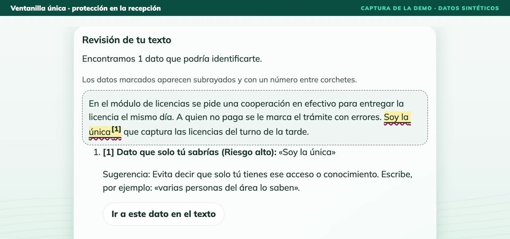

**1. Revisión del texto.** La ventanilla marca «Soy la única» como dato de riesgo alto y propone una
redacción más general.

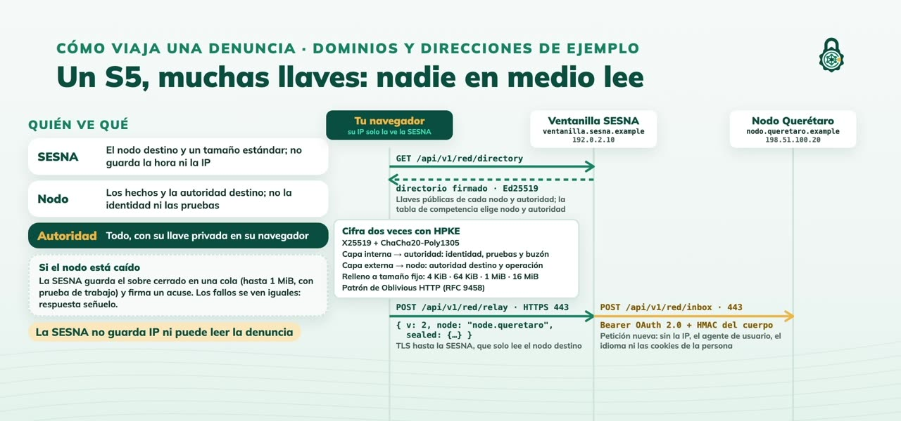

**2. Cómo viaja una denuncia.** El navegador baja el directorio firmado y cifra dos veces con HPKE;
la ventanilla de la SESNA solo ve el nodo destino y un tamaño estándar, y el nodo recibe la petición
con OAuth 2.0 y una etiqueta HMAC. Dominios y direcciones de ejemplo.

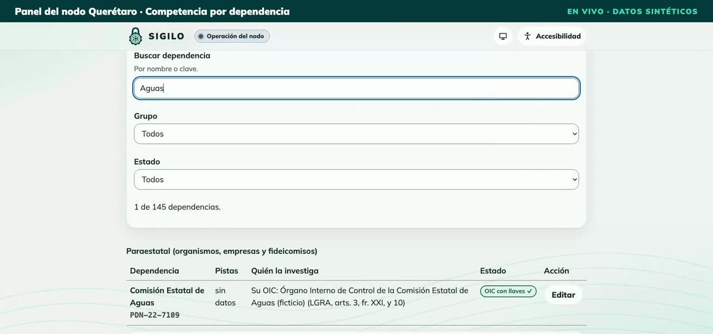

**3. Competencia por dependencia.** La operación del nodo de Querétaro declara quién investiga a
cada una de sus 145 dependencias; aquí, la Comisión Estatal de Aguas va a su OIC, que ya tiene
llaves.

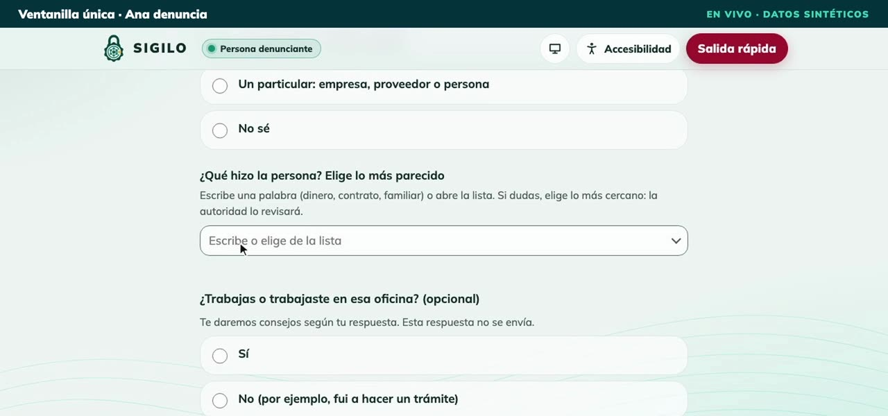

**4. Elegir la conducta.** Ana escribe una palabra o abre la lista de conductas en lenguaje llano. La
pregunta de si trabaja en esa oficina solo sirve para darle consejos y no se envía.

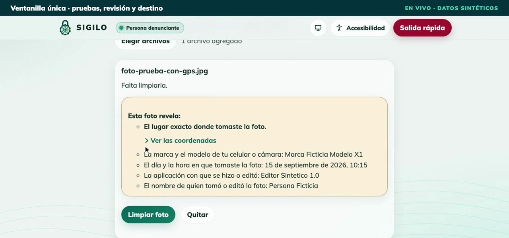

**5. Lo que revela una foto.** Antes de subirla, el navegador muestra lo que la foto revela (lugar,
cámara, fecha, aplicación y autor, todos sintéticos) y la limpia en el equipo.

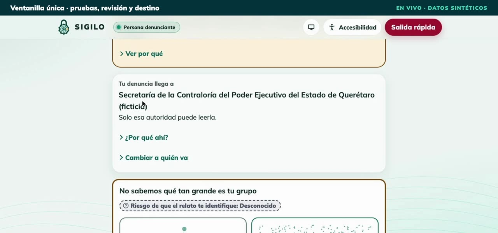

**6. A quién llega.** Antes de enviar, Ana ve la autoridad que podrá leer su denuncia. Como el S1 de
la descarga de la PDN no trae Querétaro, el sistema admite que no sabe el tamaño de su grupo.

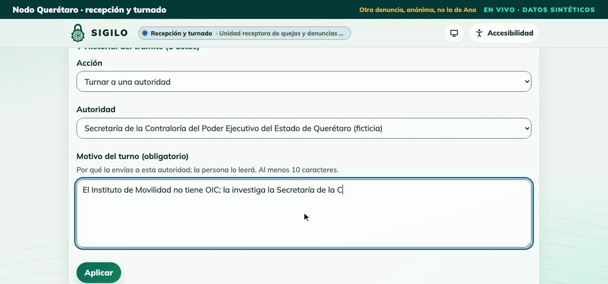

**7. Turnado con motivo.** La unidad receptora turna otra denuncia anónima del mismo instituto (no
la de Ana) a la Contraloría. El motivo es obligatorio y la persona denunciante lo leerá.

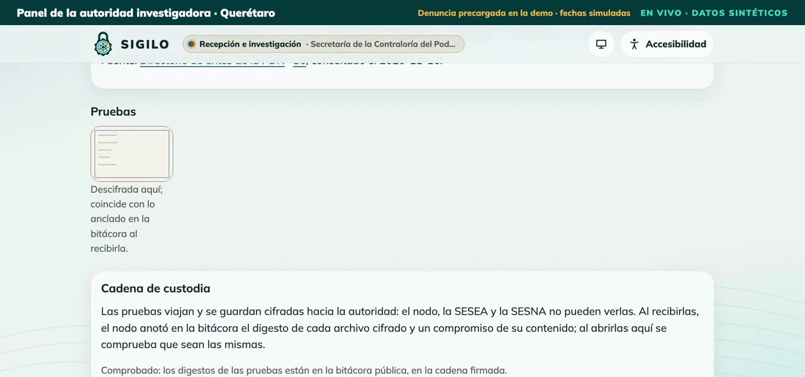

**8. Cadena de custodia.** En una denuncia precargada de la demostración, la investigadora descifra
la prueba en su equipo y comprueba que coincide con el digesto anotado en la bitácora al recibirla.
El nodo, la SESEA y la SESNA no pueden ver las pruebas.

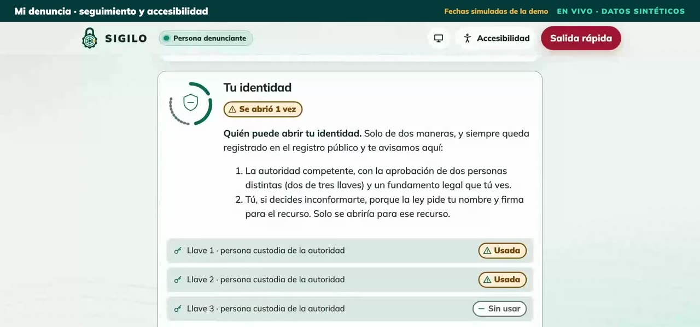

**9. Seguimiento de la identidad.** La persona ve que su identidad se abrió una vez y con qué llaves
(dos de tres), además de las dos únicas formas en que se puede abrir.

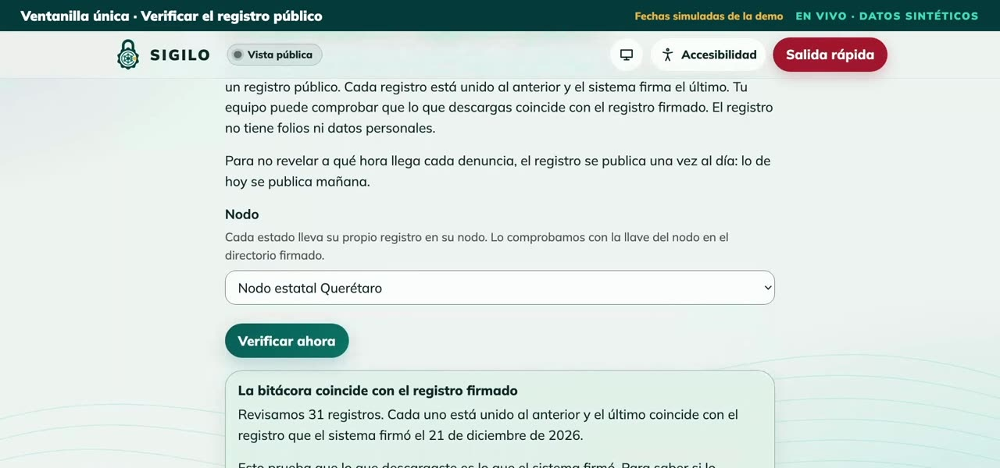

**10. Verificar la bitácora.** Cualquiera comprueba que los registros publicados están encadenados y
coinciden con lo que firmó el nodo. Se publican una vez al día para no revelar la hora de cada
denuncia (fechas simuladas).

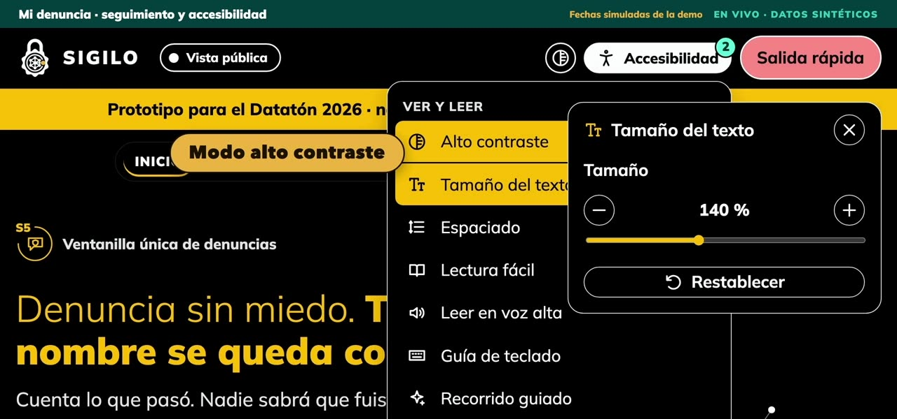

**11. Accesibilidad.** Menú con alto contraste, tamaño del texto, espaciado, lectura fácil, lectura
en voz alta, guía de teclado y recorrido guiado.

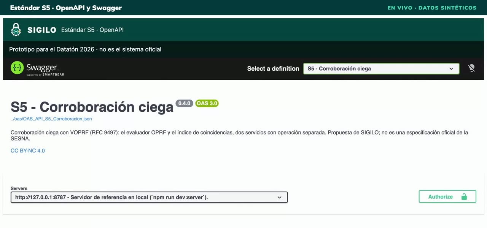

**12. Estándar S5.** La ventanilla sirve el Swagger UI del estándar sin CDN; cada grupo de la API
tiene su documento OpenAPI 3.0, como en la PDN.

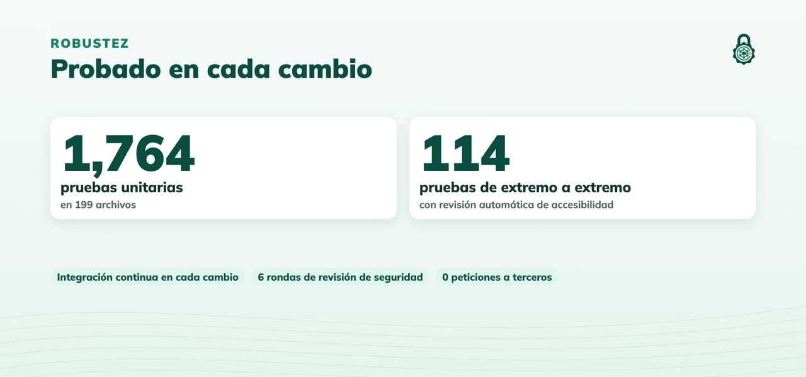

**13. Pruebas.** La lámina del video muestra las cifras de la versión 1.2.0 (1,764 unitarias). En
la 1.2.1, la integración continua corre **1,766 pruebas unitarias en 199 archivos, 114 de extremo a
extremo y 34 del proceso de datos** en cada cambio, incluidas cero peticiones a terceros,
denuncia anónima y sellada, limpieza de metadatos, segundo factor, ciclo legal y accesibilidad. La
revisión de seguridad de la entrega (caja negra sobre la demostración local, código de las 90 rutas
y cadena de suministro) no encontró hallazgos críticos ni altos; es interna, no de terceros
([pruebas de seguridad](pruebas-de-seguridad.md)).

## 5. Valor público y replicabilidad

- **Para la ciudadanía:** denunciar sin exponerse y saber qué pasa con la denuncia.
- **Para las autoridades:** denuncias más completas, competencia clara y pruebas con cadena de
  custodia.
- **Para la SESNA:** una sola ventanilla y estadística para la PDN, sin identidades.

Todo usa herramientas libres y sin costo. Un estado instala su nodo con un servidor Linux, Docker y
tres comandos (`./sigilo instalar`, `iniciar` y `diagnostico`) con imágenes firmadas; entre el
primero y el segundo, la SESNA aprueba el alta ([instalación del nodo](instalacion-nodo.md)). El
código es público con licencia CC BY-NC 4.0 y queda disponible para la SESNA y las demás autoridades
del Sistema Nacional Anticorrupción.

Límites declarados: los hechos quedan en claro en el nodo destino; las dos aprobaciones para abrir
la identidad son una regla, no criptografía; y antes de recibir denuncias reales hace falta una
evaluación de seguridad independiente ([metodología](metodologia.md#8-limitaciones-y-trabajo-futuro)).

## 6. Cómo evaluarlo en 10 minutos

1. **Levanta la red** (Docker en marcha y Node.js 22.18 o posterior; con caché, alrededor de un
   minuto):

   ```sh
   git clone https://github.com/GuilleOp/sigilo-s5 && cd sigilo-s5
   npm ci
   npm run demo:todo
   ```

2. **Denuncia como Ana** en <http://127.0.0.1:8790/> («Denunciar»): escribe «soy la única que…» en el relato,
   sube una foto y mira la revisión y «Tu denuncia llega a». Anota el folio y las ocho palabras.
3. **Sigue la denuncia** en «Mi denuncia» con el folio y las palabras, y entra a «Registro público»
   (en el pie de página) para comprobar la bitácora.
4. **Entra al panel** de Querétaro en <http://127.0.0.1:8781/autoridad> con una cuenta de
   `.red-demo/nodos/<nodo>/credenciales.json` y el código de `npm run demo:codigo -- <cuenta>`.
5. **Revisa el estándar** en <http://127.0.0.1:8790/estandar/swagger/>.
6. **Corre las pruebas** (opcional): `npm run check`.

Para apagar: `npm run demo:apagar`. El recorrido completo, con cuentas y tiempos, está en el
[guion de la demostración](demo.md); para una revisión a fondo, la
[guía para la auditoría](auditoria-guia.md).
