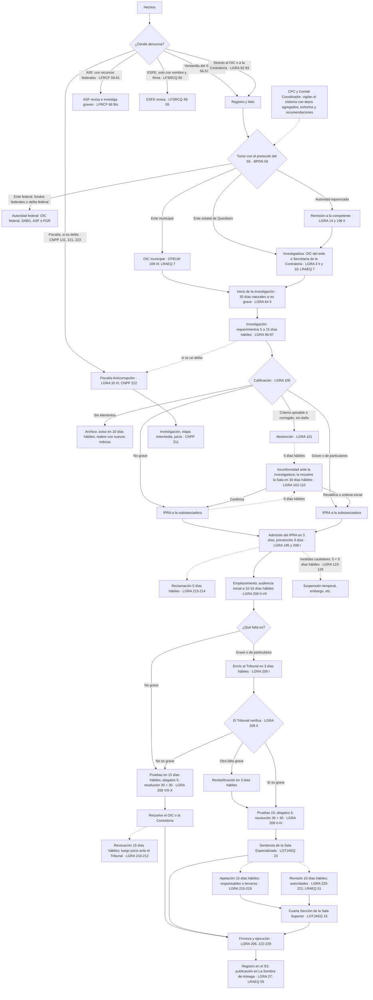

# El proceso legal de una denuncia: quién hace qué, en qué plazo y con qué artículo

Documento para personas que no son abogadas. Consultado y verificado el **16 de noviembre de 2026**
contra los textos vigentes (ver [fuentes legales](fuentes-legales.md)). Lo que no se pudo confirmar
en una fuente primaria está marcado con **[verificar]**. Es información general, no asesoría legal.
Los casos y las personas del ejemplo son ficticios.

Cómo lo usa SIGILO: el estándar define **una vez, a nivel nacional**, las etapas y las funciones de
una denuncia, y **cada estado asigna** en su tabla de funciones firmada qué institución cumple cada
función (LGSNA art. 56; Bases de la PDN art. 58; LGRA art. 115). Documentos relacionados:

- [Ciclo de vida legal en el estándar](ciclo-de-vida-legal.md) (Estándar S5 0.4.0): etapas,
  recursos, Tribunal, abstención, vía penal y fondos federales en el modelo de SIGILO, con el estado
  de las rutas R1 a R43.
- [Competencia por dependencia](competencia-por-dependencia.md): quién investiga a cada ente en la
  tabla de funciones (formato 2).
- [¿Quién protege a quien denuncia?](proteccion-de-quien-denuncia.md) y
  [ADR 0007](adr/0007-rendicion-de-cuentas-de-la-autoridad.md) (rendición de cuentas de la autoridad).

Abreviaturas (cada una enlaza al texto consultado; el detalle de versiones está en
[fuentes legales](fuentes-legales.md)):

| Sigla   | Ordenamiento                                                                                                                                                                                                                   |
| ------- | ------------------------------------------------------------------------------------------------------------------------------------------------------------------------------------------------------------------------------ |
| CPEUM   | [Constitución Política de los Estados Unidos Mexicanos](https://www.diputados.gob.mx/LeyesBiblio/pdf/CPEUM.pdf)                                                                                                                |
| LGRA    | [Ley General de Responsabilidades Administrativas](https://www.diputados.gob.mx/LeyesBiblio/pdf/LGRA.pdf)                                                                                                                      |
| LGSNA   | [Ley General del Sistema Nacional Anticorrupción](https://www.diputados.gob.mx/LeyesBiblio/pdf/LGSNA_200521.pdf)                                                                                                               |
| BPDN    | [Bases para el Funcionamiento de la Plataforma Digital Nacional](https://www.dof.gob.mx/nota_detalle.php?codigo=5541802&fecha=23/10/2018)                                                                                      |
| CNPP    | [Código Nacional de Procedimientos Penales](https://www.diputados.gob.mx/LeyesBiblio/pdf/CNPP.pdf)                                                                                                                             |
| CPF     | [Código Penal Federal](https://www.diputados.gob.mx/LeyesBiblio/pdf/CPF.pdf)                                                                                                                                                   |
| LFRCF   | [Ley de Fiscalización y Rendición de Cuentas de la Federación](https://www.diputados.gob.mx/LeyesBiblio/pdf/LFRCF.pdf)                                                                                                         |
| LCF     | [Ley de Coordinación Fiscal](https://www.diputados.gob.mx/LeyesBiblio/pdf/LCF.pdf)                                                                                                                                             |
| LOAPF   | [Ley Orgánica de la Administración Pública Federal](https://www.diputados.gob.mx/LeyesBiblio/pdf/LOAPF.pdf)                                                                                                                    |
| LOTFJA  | [Ley Orgánica del Tribunal Federal de Justicia Administrativa](https://www.diputados.gob.mx/LeyesBiblio/pdf/LOTFJA.pdf)                                                                                                        |
| LRAEQ   | [Ley de Responsabilidades Administrativas del Estado de Querétaro](https://esfe-qro.gob.mx/download/1311/regulaciones/7573/16-ley-de-responsabilidades-administrativas-del-estado-de-queretaro.pdf)                            |
| LSEAQ   | [Ley del Sistema Estatal Anticorrupción de Querétaro](https://esfe-qro.gob.mx/download/1311/regulaciones/7585/35-ley-del-sistema-estatal-anticorrupcion-de-queretaro.pdf)                                                      |
| LOTJAEQ | [Ley Orgánica del Tribunal de Justicia Administrativa del Estado de Querétaro](https://queretaro.gob.mx/documents/20121/947210/24+-+LEY+ORGA_uNICA+DEL+TRIBUNAL+2021.pdf/b446145a-5b9c-0b44-249f-4cc6a1125dc2?t=1729107594847) |
| CPQ     | [Código Penal para el Estado de Querétaro](https://armonizacion.cndh.org.mx/Content/Files/DMVLV/CP/QRO-CP.pdf)                                                                                                                 |
| LFSRCQ  | [Ley de Fiscalización Superior y Rendición de Cuentas del Estado de Querétaro](https://esfe-qro.gob.mx/download/1311/regulaciones/7565/10-ley-de-fiscalizacion-superior-y-rendicion-de-cuentas-del-estado-de-queretaro.pdf)    |

Otras: fr. (fracción), DOF (Diario Oficial de la Federación), P.O. (periódico oficial «La Sombra de
Arteaga»), SABG (Secretaría Anticorrupción y Buen Gobierno, antes Secretaría de la Función Pública),
ASF (Auditoría Superior de la Federación), ESAF (entidad de fiscalización superior de un estado), ESFE (Entidad Superior de Fiscalización del Estado de
Querétaro), FGR (Fiscalía General de la República).

---

## Un estándar nacional: la federación y los 32 estados

SIGILO es un **estándar nacional**: las mismas etapas, plazos y funciones valen para los 32 estados y
para la federación, porque el procedimiento lo fija una ley general (la LGRA) y el S5 lo establece
el Comité Coordinador nacional (LGSNA art. 56). Lo que cambia de un lugar a otro es **quién** cumple
cada función, y eso no va en el estándar: cada nodo lo declara en su **tabla de funciones firmada**.
**Querétaro y Oaxaca son solo el ejemplo de la demostración**; en este documento, Querétaro aparece
como ejemplo, rotulado así.

| Función                                       | En cada estado                                                                                                                                                         | En la federación                                                                                                     | Ejemplo: Querétaro                                                                                                      | Fundamento                                                        |
| --------------------------------------------- | ---------------------------------------------------------------------------------------------------------------------------------------------------------------------- | -------------------------------------------------------------------------------------------------------------------- | ----------------------------------------------------------------------------------------------------------------------- | ----------------------------------------------------------------- |
| Ventanilla única y protocolo de turno         | La misma ventanilla nacional                                                                                                                                           | La misma                                                                                                             | La misma                                                                                                                | BPDN arts. 56 a 58                                                |
| Operación del nodo                            | La SESEA o la secretaría de control interno (contraloría) del estado: da de alta autoridades, no lee denuncias                                                         | La Secretaría Anticorrupción y Buen Gobierno (SABG)                                                                  | SESEA de Querétaro                                                                                                      | LGSNA art. 56; ley del sistema anticorrupción de cada estado      |
| Recepción y turno (buzón general)             | La autoridad receptora que designe la ley del estado; la SESEA solo si su ley se lo da                                                                                 | El área receptora de la SABG o de cada OIC federal                                                                   | Unidad receptora de la Secretaría de la Contraloría (la ley no se lo da a la SESEA)                                     | BPDN art. 58; LGRA art. 14                                        |
| Investigación y calificación                  | El OIC de cada ente estatal o municipal; la secretaría de control interno del estado; la entidad de fiscalización superior del estado (ESAF) en las graves que detecte | El OIC federal de cada ente; la SABG; la Auditoría Superior de la Federación (ASF)                                   | OIC del ente, Secretaría de la Contraloría, OIC de cada municipio, ESFE                                                 | LGRA arts. 3 fr. II, 9, 10 y 11                                   |
| Substanciación                                | Un área distinta de la que investigó                                                                                                                                   | Igual                                                                                                                | Área de responsabilidades                                                                                               | LGRA arts. 3 fr. III y 115                                        |
| Resolución de faltas no graves                | El OIC o la secretaría de control interno                                                                                                                              | El OIC federal o la SABG                                                                                             | OIC o Secretaría de la Contraloría                                                                                      | LGRA arts. 3 fr. IV y 10                                          |
| Resolución de faltas graves y de particulares | La sala especializada del Tribunal de Justicia Administrativa del estado                                                                                               | Las Salas Especializadas en Responsabilidades Administrativas del Tribunal Federal de Justicia Administrativa (TFJA) | Sala Especializada en materia de Responsabilidades Administrativas del TJA (alzada: Cuarta Sección de la Sala Superior) | LGRA arts. 12 y 209; LOTFJA arts. 37 y 38; LOTJAEQ arts. 15 y 23  |
| Vía penal                                     | La fiscalía anticorrupción del estado                                                                                                                                  | La Fiscalía Especializada en materia de Combate a la Corrupción de la Fiscalía General de la República (FGR)         | Fiscalía Especializada en el Combate a la Corrupción de la FGE                                                          | CPEUM art. 109; LGRA art. 10 fr. III; Ley de la FGR art. 13 fr. V |
| Fiscalización superior                        | La ESAF del estado; según su ley, puede exigir nombre y firma                                                                                                          | La ASF, que recibe denuncias sin nombre                                                                              | La ESFE desecha las denuncias sin nombre y firma                                                                        | LFRCF arts. 59 a 61; LFSRCQ arts. 50 y 51                         |
| Observación del sistema (no ve casos)         | El CPC y el Comité Coordinador del estado                                                                                                                              | El CPC y el Comité Coordinador nacionales                                                                            | CPC de Querétaro                                                                                                        | LGSNA arts. 21, 23 y 36                                           |
| Medidas de protección de servidores públicos  | El ente donde trabaja quien denuncia                                                                                                                                   | Igual                                                                                                                | —                                                                                                                       | LGRA art. 64, último párrafo                                      |

**Lo que depende de la ley de cada estado** (se configura en la tabla de funciones de su nodo, no en
el estándar):

- si la SESEA recibe y turna denuncias: en Michoacán sí, por ley y por lineamientos de su Comité
  Coordinador; en Querétaro no;
- si la entidad de fiscalización superior del estado acepta denuncias anónimas: la ESFE de Querétaro
  no; la ASF sí;
- los nombres de las salas, fiscalías y secretarías, y qué autoridad investiga a un ente cuando el
  señalado es su titular;
- los plazos internos de turno que fijen lineamientos locales (en Michoacán, 10 días hábiles);
- los tipos penales y sus artículos (cada código penal estatal).

**Lo que es igual en todo el país** (va en el estándar): las etapas y plazos de la LGRA, la separación
entre investigar y substanciar, que las graves las resuelve un tribunal, la inconformidad con firma
autógrafa, los recursos, la confidencialidad de la identidad y el canal único con su protocolo de
turno.

**Cuándo sube a la federación** aunque los hechos ocurran en un estado: si el ente es federal, si el
dinero es federal (aportaciones del Ramo 33 o convenios) o si el delito es federal (sección 5).

---

## 0. La respuesta corta (ejemplo: Querétaro)

Lo que sigue usa Querétaro como ejemplo; en otro estado cambian los nombres y los puntos que dependen
de su ley (ver la sección anterior).

Un flujo que parece natural, pero que **no** es el de la ley:

1. la persona denuncia;
2. el enrutador la manda a la autoridad de Querétaro que turna (la SESEA);
3. la SESEA la envía a la unidad que investiga;
4. esa autoridad la manda a la que substancia y resuelve;
5. al final entra un observador y revisa.

**Lo que dice la ley (con correcciones en negritas):**

1. **La persona denuncia.** Puede hacerlo por la ventanilla del S5 (Plataforma Digital Nacional),
   directamente ante la autoridad investigadora (en Querétaro: el Órgano Interno de Control del
   ente, la Secretaría de la Contraloría o el órgano interno de control municipal; DenunciaNet es el
   canal de la Contraloría estatal) o, si es delito, ante la Fiscalía. Puede ser anónima
   (LGRA art. 91; CNPP arts. 131 fr. II, 221 y 223).
2. **El turno lo define el protocolo del S5, que fija la SESNA** (BPDN art. 58), y la denuncia debe
   llegar **directamente a la autoridad investigadora competente**. **La SESEA de Querétaro no
   recibe, no califica ni turna denuncias:** su ley solo la hace «órgano de apoyo técnico del Comité
   Coordinador» y le da la administración de las plataformas digitales (LSEAQ arts. 24 y 34
   fr. X). En Querétaro no existe norma que le dé esa función. (En Michoacán sí la tiene, por ley y
   por lineamientos del Comité Coordinador; es una decisión de cada estado, ver sección 6.2.)
3. **La autoridad investigadora** (área de quejas, denuncias e investigación del OIC, o de la
   Contraloría) investiga, **califica** la falta como grave o no grave, **archiva** si no hay
   elementos o, en su caso, se **abstiene**. Si ve un delito, **está obligada a denunciarlo ante la
   Fiscalía** (LGRA art. 10 fr. III; CNPP art. 222). Si califica, escribe el **Informe de Presunta
   Responsabilidad Administrativa (IPRA)** (LGRA arts. 100 y 194).
4. **La autoridad substanciadora** (otra área, nunca la que investigó, LGRA art. 115) admite el IPRA,
   emplaza y celebra la audiencia inicial. Luego:
   - **falta no grave:** resuelve el propio OIC o la Contraloría (LGRA arts. 10 y 208);
   - **falta grave o de particulares:** la substanciadora **envía el expediente al Tribunal de
     Justicia Administrativa**, que es el único que puede sancionarla (LGRA arts. 12 y 209). En
     Querétaro: la **Sala Especializada en materia de Responsabilidades Administrativas** del
     Tribunal de Justicia Administrativa del Estado (LOTJAEQ art. 23).
5. **Nadie «entra a revisar» el caso desde fuera.** El Comité de Participación Ciudadana (CPC) y el
   Comité Coordinador **vigilan el sistema con información agregada**, pueden pedir exhortos
   públicos y hacer recomendaciones (LGSNA arts. 21 y 23; LSEAQ arts. 9 fr. XV y 21), pero no ven
   expedientes ni identidades ni deciden nada del caso. **La revisión de un caso existe, pero por la
   vía de los recursos:** inconformidad (la persona denunciante identificada), reclamación,
   revocación, apelación (incluso la persona denunciante como tercera) y revisión (las autoridades)
   (LGRA arts. 102 a 110 y 210 a 221).

**¿Cuándo sube a lo federal?** En una frase: **cuando el ente es federal, cuando el dinero es
federal (aportaciones del Ramo 33 o convenios con la Federación) o cuando el delito es federal**. Las
participaciones (Ramo 28) se quedan, en principio, en lo estatal, aunque la Auditoría Superior de la
Federación también las puede auditar. La tabla completa está en la sección 5.

---

## 1. Mini glosario

| Término                          | Qué es, en palabras simples                                                                                                                                                                              | Fundamento                                                                                               |
| -------------------------------- | -------------------------------------------------------------------------------------------------------------------------------------------------------------------------------------------------------- | -------------------------------------------------------------------------------------------------------- |
| Falta administrativa no grave    | Incumplir deberes del cargo (por ejemplo, no denunciar lo que se ve, no custodiar documentos). La sanciona el OIC o la Contraloría.                                                                      | LGRA arts. 3 fr. XV, 49 y 50                                                                             |
| Falta administrativa grave       | Conductas como cohecho, peculado, desvío, abuso de funciones, conflicto de interés, tráfico de influencias, encubrimiento, obstrucción de la justicia. Solo la sanciona un Tribunal.                     | LGRA arts. 3 fr. XVI, 51 a 64 Quáter                                                                     |
| Falta de particulares            | Lo que hace una persona o empresa privada vinculada con una falta grave (soborno, colusión, uso de información falsa…). La sanciona el Tribunal.                                                         | LGRA arts. 3 fr. XVII, 65 a 73                                                                           |
| Hecho de corrupción (delito)     | Conducta prevista en un código penal. La investiga la Fiscalía y la juzga un juez penal. Corre en paralelo a lo administrativo.                                                                          | CPEUM art. 109 fr. II; CPF Título Décimo; CPQ Título Segundo                                             |
| Autoridad investigadora          | Quien investiga y califica. Está en las Secretarías (Contralorías), los OIC y los órganos de fiscalización.                                                                                              | LGRA art. 3 fr. II                                                                                       |
| Autoridad substanciadora         | Quien conduce el procedimiento desde que admite el IPRA hasta que termina la audiencia inicial. Nunca puede ser la investigadora.                                                                        | LGRA art. 3 fr. III y art. 115                                                                           |
| Autoridad resolutora             | En no graves, el área de responsabilidades del OIC o la Contraloría; en graves y de particulares, el Tribunal.                                                                                           | LGRA art. 3 fr. IV                                                                                       |
| IPRA                             | Informe de Presunta Responsabilidad Administrativa: el documento con el que la investigadora acusa ante la substanciadora.                                                                               | LGRA arts. 3 fr. XVIII y 194                                                                             |
| Secretaría / Secretarías         | En lo federal, la Secretaría Anticorrupción y Buen Gobierno (antes Secretaría de la Función Pública); en los estados, sus homólogas (en Querétaro, la Secretaría de la Contraloría del Poder Ejecutivo). | LGRA art. 3 fr. XXIII y XXIV; LOAPF transitorio cuarto del decreto DOF 28-11-2024; LRAEQ art. 2 fr. XXII |
| OIC                              | Órgano Interno de Control de cada ente público.                                                                                                                                                          | LGRA art. 3 fr. XXI                                                                                      |
| Días hábiles en el procedimiento | Todos los días del año menos los inhábiles por ley o acuerdo; horario de 9:00 a 18:00.                                                                                                                   | LGRA art. 119                                                                                            |

---

## 2. Quién es quién en el procedimiento

| Actor                                                  | ¿Es parte del procedimiento?                | Qué hace                                                                                                                         | Fundamento                                                          |
| ------------------------------------------------------ | ------------------------------------------- | -------------------------------------------------------------------------------------------------------------------------------- | ------------------------------------------------------------------- |
| Persona denunciante                                    | Sí, como **tercera** si se identifica       | Denuncia; recibe avisos (archivo, calificación no grave, resolución); puede inconformarse, ofrecer pruebas como tercera y apelar | LGRA arts. 3 fr. IX, 91, 100, 102, 116 fr. IV, 208 fr. VI y XI, 215 |
| Autoridad investigadora (OIC, Contraloría, ASF o ESFE) | Sí, es **parte**                            | Investiga, califica, emite el IPRA, pide medidas cautelares, presenta denuncia penal, apela                                      | LGRA arts. 3 fr. II, 10, 11, 90 a 101, 116 fr. I, 123, 194          |
| Autoridad substanciadora                               | Sí, conduce                                 | Admite el IPRA, emplaza, audiencia inicial; en no graves sigue hasta la resolución                                               | LGRA arts. 3 fr. III, 112, 115, 208                                 |
| Autoridad resolutora no grave (OIC o Contraloría)      | Sí, resuelve                                | Resuelve y ejecuta no graves; puede abstenerse de sancionar                                                                      | LGRA arts. 3 fr. IV, 10, 75 a 77, 208 fr. X, 222                    |
| Tribunal (Sala Especializada)                          | Sí, resuelve graves                         | Verifica que sea grave, ordena reclasificar, admite pruebas, resuelve, ordena ejecutar                                           | LGRA arts. 12, 209, 225 a 229; LOTJAEQ art. 23                      |
| Sala Superior (Cuarta Sección en Querétaro)            | Sí, en segunda instancia                    | Resuelve apelación y revisión contra la Sala Especializada                                                                       | LGRA arts. 215 a 221; LOTJAEQ art. 15; LRAEQ arts. 50 y 51          |
| Persona señalada (servidora pública o particular)      | Sí, es **parte**                            | Se defiende, ofrece pruebas, alega, recurre                                                                                      | LGRA arts. 116 fr. II y III, 135, 208, 210, 215                     |
| Fiscalía Anticorrupción y juez penal                   | No en lo administrativo; sí en la vía penal | Investiga y juzga delitos, en un proceso autónomo                                                                                | CPEUM art. 109; LGRA art. 14; CNPP arts. 131, 211, 221 a 224        |
| SESNA                                                  | **No**                                      | Administra la PDN y fija los protocolos de recepción, turno y seguimiento del S5                                                 | LGSNA arts. 25, 35 fr. X y 48; BPDN arts. 56 a 61                   |
| SESEA de Querétaro                                     | **No**                                      | Apoyo técnico del Comité Coordinador estatal; administra la Plataforma Digital Estatal (hoy S1, S2 y S3)                         | LSEAQ arts. 24 y 34 fr. X                                           |
| Comité Coordinador (nacional y estatal)                | **No**                                      | Establece el S5, emite lineamientos, recibe estadística, recomienda y exhorta                                                    | LGSNA arts. 9 y 56; BPDN arts. 58 y 60; LSEAQ art. 9                |
| CPC                                                    | **No**                                      | Vigila el funcionamiento del sistema, propone mejoras al sistema de denuncia, pide exhortos                                      | LGSNA arts. 21 y 23; LSEAQ art. 21                                  |

---

## 3. El procedimiento paso a paso, con plazos

Cada paso dice **quién**, **qué**, **plazo** (con su unidad), **artículo** y **qué ve la persona
denunciante**.

### Paso 0. Presentar la denuncia

- **Quién:** cualquier persona física o moral, o una persona servidora pública (LGRA art. 3 fr. IX).
- **Qué:** datos o indicios que permitan advertir la presunta responsabilidad. **No se exige
  nombre** (LGRA arts. 91 y 93).
- **Dónde:**
  - por medios electrónicos de las autoridades investigadoras «sin menoscabo de la plataforma digital
    que determine el Sistema Nacional Anticorrupción» (LGRA art. 93);
  - en «áreas de fácil acceso» de las autoridades investigadoras (LGRA art. 92);
  - en la ventanilla única del S5, «en la que podrán ingresar información tanto los denunciantes como
    las autoridades que por cualquier otro medio reciban una denuncia» (BPDN art. 57);
  - en Querétaro, la SESEA remite a la ciudadanía a **DenunciaNet** (app del Gobierno del Estado), a
    la página de la Contraloría (`www2.queretaro.gob.mx/repci/`) y a la **Fiscalía Especializada en el
    Combate a la Corrupción** (sitio de la SESEA, «Preguntas frecuentes»);
  - **ante la ASF**, si hay manejo irregular de recursos federales: sin nombre obligatorio, con el
    ejercicio y la descripción de los hechos; la ASF debe proteger la identidad (LFRCF arts. 59 a 61,
    reformados DOF 14-05-2026);
  - **ante la ESFE de Querétaro**, solo **con nombre y firma**: sin ellos la denuncia se desecha, y
    debe referirse a daños a la hacienda o al patrimonio (LFSRCQ arts. 50 y 51). **Por eso una
    denuncia anónima nunca debe dirigirse a la ESFE**;
  - **ante la Fiscalía**, si es delito: oral, escrita o digital, también anónima (CNPP arts. 131
    fr. II, 221 y 223).
- **Obligación de denunciar:** las personas servidoras públicas deben denunciar las faltas que vean y
  las instrucciones contrarias a la ley (LGRA art. 49 fr. II y III); quien en funciones públicas
  conozca un delito debe denunciarlo «inmediatamente» (CNPP art. 222, párr. 2).
- **Qué ve la persona:** folio y forma de seguimiento (BPDN art. 59).

### Paso 1. Recepción y turno

- **Quién:** el S5 conforme a los «protocolos, normas y disposiciones para la recepción de las
  denuncias y su turno a las autoridades competentes» **que establece la SESNA** (BPDN art. 58). Todo
  ente que reciba una denuncia por otro medio y la califique como falta o hecho de corrupción **debe
  registrarla en el sistema** (BPDN art. 58, párr. 2).
- **Si llegó a la autoridad equivocada:** las autoridades del art. 9 deben **turnar** las denuncias
  a quien deba conocer de ellas (LGRA art. 14); si la substanciadora o resolutora no es competente,
  el asunto es improcedente y «mediante oficio» se hace del conocimiento de la autoridad competente
  (LGRA art. 196 fr. II). En Querétaro, la misma regla de turno (LRAEQ art. 11).
- **Plazo:** **la LGRA no fija plazo para turnar.** El semáforo de 1 y 2 días hábiles es una
  convención de servicio de la versión de pruebas del S5, no un plazo legal. Como referencia
  histórica en Querétaro, las «Normas y procedimientos que se deberán observar en las investigaciones
  administrativas» de la Contraloría (expedidas con la ley abrogada de 2009) fijaban: el OIC remite a
  la Contraloría en 48 horas; la Contraloría dictamina, registra y turna en 3 días hábiles; declina
  por incompetencia en 3 días hábiles; acuerdo de inicio en 15 días hábiles **[verificar vigencia]**.
  En Michoacán, los lineamientos del Comité Coordinador fijan 10 días hábiles para turnar (P.O.
  Michoacán 05-12-2022, art. 12).
- **Qué ve la persona:** «turnada» y a quién.

### Paso 2. Inicio de la investigación

- **Quién:** la autoridad investigadora competente.
- **Plazo clave:** ante una conducta que pudiera ser falta grave, falta de particulares o acto de
  corrupción, quien investiga debe **iniciar el procedimiento correspondiente en 30 días naturales**
  desde que la conoce; no hacerlo es **obstrucción de la justicia, falta grave** (LGRA art. 64
  fr. II). Qué cuenta como «iniciar» no lo precisa la ley: la lectura prudente es el acuerdo de
  inicio de la investigación **[verificar criterio del Tribunal]**.
- **Fundamento:** LGRA arts. 91 y 94.

### Paso 3. Investigación

- **Principios:** legalidad, imparcialidad, objetividad, verdad material, derechos humanos (LGRA
  art. 90).
- **Acceso a información:** incluso reservada o confidencial; en faltas graves no les oponen los
  secretos fiscal, bursátil, fiduciario ni bancario (LGRA art. 95; CPEUM art. 109).
- **Requerimientos:** plazo de **5 a 15 días hábiles**, ampliable una vez hasta la mitad (LGRA
  art. 96).
- **Medidas de apremio:** multa de 100 a 150 UMA (hasta 2 000), fuerza pública o arresto hasta 36
  horas (LGRA art. 97).
- **Confesión de quien participó:** reduce la sanción 50 a 70 % si es la primera y antes del
  emplazamiento (LGRA arts. 88 y 89).
- **Identidad de quien denuncia:** confidencial (LGRA art. 91); revelar la de un denunciante anónimo
  es obstrucción de la justicia (LGRA art. 64 fr. III).

### Paso 4. Calificación: cuatro salidas posibles

Al terminar de investigar, la autoridad determina si existe falta y la califica como grave o no grave
(LGRA art. 100). La clasificación **interrumpe la prescripción** (LGRA art. 74).

| Salida                         | Qué pasa                                                                                                      | Plazo y aviso                                                                                                                    | Artículo                  |
| ------------------------------ | ------------------------------------------------------------------------------------------------------------- | -------------------------------------------------------------------------------------------------------------------------------- | ------------------------- |
| **a. Archivo**                 | No hay elementos: acuerdo de conclusión y archivo. Puede reabrirse con nuevos indicios mientras no prescriba. | Aviso a la persona denunciante identificable en **10 días hábiles**                                                              | LGRA art. 100             |
| **b. Abstención**              | Hay conducta pero no daño a la hacienda y es cuestión de criterio opinable o se corrigió espontáneamente.     | Impugnable por la investigadora o la persona denunciante con inconformidad                                                       | LGRA art. 101             |
| **c. No grave**                | IPRA a la substanciadora del OIC o la Contraloría.                                                            | Se notifica a la persona denunciante identificable, con la forma de acceder al expediente; **5 días hábiles** para inconformarse | LGRA arts. 100, 102 y 103 |
| **d. Grave o de particulares** | IPRA a la substanciadora; después irá al Tribunal.                                                            | Sin inconformidad (no la hay contra la calificación de grave)                                                                    | LGRA arts. 100, 102 y 209 |

- **Grave y no grave a la vez** por la misma persona: las graves van al Tribunal y el Tribunal toma en
  cuenta las no graves al graduar la sanción (LGRA art. 13).
- **Simular una no grave** cuando es grave es obstrucción de la justicia (LGRA art. 64 fr. I).
- **Regla del art. 80 Bis (cuidado):** solo convierte en no grave dos supuestos muy específicos, el
  de no devolver en 30 días un pago en exceso del salario (art. 52, párr. 2) y el de pagar
  remuneraciones fuera de tabulador (art. 54, párr. 2), si no exceden 5 000 UMA y se devolvieron. **No
  aplica al cohecho por «cooperaciones»** (art. 52, párr. 1).

### Paso 5. Recurso de inconformidad (solo contra no grave o abstención)

| Momento                                                                                | Quién               | Plazo                                    | Artículo                  |
| -------------------------------------------------------------------------------------- | ------------------- | ---------------------------------------- | ------------------------- |
| Presentar el escrito **ante la autoridad investigadora** que calificó                  | Persona denunciante | **5 días hábiles** desde la notificación | LGRA arts. 102, 103 y 104 |
| La investigadora corre traslado con el expediente y su informe a la Sala Especializada | Investigadora       | Sin plazo expreso                        | LGRA art. 104             |
| Prevenir si el escrito es oscuro                                                       | Sala                | **5 días hábiles** para subsanar         | LGRA art. 105             |
| Vista a la persona señalada                                                            | Sala                | **5 días hábiles**                       | LGRA art. 106             |
| Resolver                                                                               | Sala                | **30 días hábiles** máximo               | LGRA art. 107             |

- **Requisitos:** nombre y domicilio, fecha de notificación, razones y **firma autógrafa**; sin firma
  «no se tendrá por presentado» y no hay prevención (LGRA art. 109). Una persona anónima solo puede
  usarlo si revela su identidad.
- **Efecto:** mientras se resuelve, no se inicia el procedimiento (LGRA art. 102).
- **Resultado:** confirma, o deja sin efecto y recalifica u ordena iniciar; sin recurso posterior
  (LGRA arts. 108 y 110).
- **En Querétaro:** la LRAEQ remite a la LGRA (art. 43). La LOTJAEQ no menciona expresamente la
  inconformidad; conforme a la LGRA la conoce la Sala Especializada (LGRA art. 104; LOTJAEQ art. 23
  fr. IV) **[verificar práctica del Tribunal]**.

### Paso 6. El IPRA

- **Contenido obligatorio:** autoridad investigadora y su domicilio; quién puede consultar los autos;
  nombre, domicilio, ente y cargo de la persona señalada; narración lógica y cronológica; la falta y
  por qué; pruebas; medidas cautelares, si se piden; firma autógrafa (LGRA art. 194).
- **Si tiene defectos:** la substanciadora previene y la investigadora subsana en **3 días**; si no,
  se tiene por no presentado, pero puede volver a presentarse si no prescribió (LGRA art. 195).

### Paso 7. Admisión del IPRA (aquí empieza el procedimiento)

- **Quién:** la substanciadora, que **debe ser distinta** de la investigadora; cada institución
  necesita estructura que garantice la independencia entre ambas (LGRA arts. 3 fr. III y 115).
- **Plazo:** se pronuncia sobre la admisión en **3 días** (LGRA art. 208 fr. I).
- **Efectos:** inicia el procedimiento, interrumpe la prescripción y fija la materia (LGRA arts. 112
  y 113). Desde aquí cuenta la **caducidad**: no puede pararse más de **6 meses** sin causa
  justificada (LGRA art. 74).
- **Recurso:** contra la admisión, el desechamiento o el «no presentado» procede la **reclamación**
  (LGRA art. 213).

### Paso 8. Emplazamiento y audiencia inicial (común a graves y no graves)

| Acto                                                                                                                                | Plazo                    | Artículo                          |
| ----------------------------------------------------------------------------------------------------------------------------------- | ------------------------ | --------------------------------- |
| Emplazar personalmente, con copia del IPRA y del expediente, avisando el derecho a no declarar y a defensor (de oficio si no tiene) | —                        | LGRA arts. 193 fr. I y 208 fr. II |
| Entre emplazamiento y audiencia inicial                                                                                             | **10 a 15 días hábiles** | LGRA art. 208 fr. III             |
| Citar a las demás partes (incluida la persona denunciante identificada, como tercera)                                               | **72 horas** antes       | LGRA art. 208 fr. IV              |
| Declaración y pruebas de la persona señalada; terceros manifiestan y ofrecen pruebas                                                | En la audiencia          | LGRA art. 208 fr. V y VI          |
| Cierre de la audiencia inicial: ya no hay más pruebas salvo supervenientes                                                          | —                        | LGRA art. 208 fr. VII             |

Las audiencias son públicas (LGRA art. 198). La persona señalada se presume inocente y la carga de la
prueba es de la investigadora (LGRA art. 135).

### Paso 9A. Falta no grave: sigue y resuelve el OIC o la Contraloría

| Acto                                                                                                      | Plazo                                             | Artículo               |
| --------------------------------------------------------------------------------------------------------- | ------------------------------------------------- | ---------------------- |
| Acuerdo de admisión de pruebas                                                                            | **15 días hábiles** tras la audiencia inicial     | LGRA art. 208 fr. VIII |
| Alegatos                                                                                                  | **5 días hábiles** comunes                        | LGRA art. 208 fr. IX   |
| Cierre de instrucción y resolución                                                                        | **30 días hábiles**, ampliable una vez por **30** | LGRA art. 208 fr. X    |
| Notificación (persona señalada; persona denunciante «para su conocimiento»; jefe inmediato para ejecutar) | **10 días hábiles**                               | LGRA art. 208 fr. XI   |

Sanciones: amonestación, suspensión de 1 a 30 días, destitución, inhabilitación de 3 meses a 1 año
(LGRA art. 75); puede abstenerse si no hubo dolo ni antecedentes (LGRA art. 77). Ejecución inmediata
(LGRA art. 222).

### Paso 9B. Falta grave o de particulares: resuelve el Tribunal

| Acto                                                                  | Quién                    | Plazo                                             | Artículo              |
| --------------------------------------------------------------------- | ------------------------ | ------------------------------------------------- | --------------------- |
| Enviar los autos originales al Tribunal y avisar a las partes         | Substanciadora           | **3 días hábiles** tras la audiencia inicial      | LGRA art. 209 fr. I   |
| Verificar que la falta sea grave; si no, devolver a la substanciadora | Tribunal                 | Al recibir                                        | LGRA art. 209 fr. II  |
| Ordenar reclasificar a otra falta grave                               | Tribunal → investigadora | **3 días hábiles**                                | LGRA art. 209 fr. II  |
| Notificar la recepción y admitir pruebas                              | Tribunal                 | **15 días hábiles**                               | LGRA art. 209 fr. II  |
| Alegatos                                                              | Partes                   | **5 días hábiles**                                | LGRA art. 209 fr. III |
| Resolver                                                              | Tribunal                 | **30 días hábiles**, ampliable una vez por **30** | LGRA art. 209 fr. IV  |
| Notificar (persona denunciante «para su conocimiento»)                | Tribunal                 | **10 días hábiles**                               | LGRA art. 209 fr. V   |

Sanciones a servidores públicos: suspensión de 30 a 90 días, destitución, sanción económica de hasta
dos tantos del beneficio, inhabilitación de 1 a 10 años o de 10 a 20 si el monto supera 200 UMA, e
indemnización (LGRA arts. 78 y 79). A particulares: económica, inhabilitación, suspensión de
actividades o disolución (LGRA art. 81).

### Paso 10. Medidas cautelares (en cualquier momento después del IPRA)

- **Quién las pide:** la investigadora, a la substanciadora o resolutora (LGRA art. 123).
- **Cuáles:** suspensión temporal del presunto responsable (con mínimo vital y sin exhibirlo como
  culpable), exhibición de documentos, apercibimientos, embargo precautorio y otras para evitar daño
  irreparable (LGRA art. 124).
- **Plazos:** incidente; vista a los afectados **5 días hábiles**; resolución interlocutoria **5 días
  hábiles**, sin recurso; se pueden conceder provisionalmente (LGRA arts. 125 a 127).
- Incumplirlas es causa de responsabilidad (LGRA art. 229).

### Paso 11. Recursos

| Recurso           | Contra qué                                                                                                                                     | Quién lo presenta                                                              | Ante quién y plazo                                                                                                                                 | Resolución                                                                                                                 | Artículo                                                    |
| ----------------- | ---------------------------------------------------------------------------------------------------------------------------------------------- | ------------------------------------------------------------------------------ | -------------------------------------------------------------------------------------------------------------------------------------------------- | -------------------------------------------------------------------------------------------------------------------------- | ----------------------------------------------------------- |
| **Inconformidad** | Calificación de no grave o abstención                                                                                                          | Persona denunciante identificada                                               | Investigadora; **5 días hábiles**                                                                                                                  | Sala, **30 días hábiles**                                                                                                  | LGRA arts. 102 a 110                                        |
| **Reclamación**   | Admitir, desechar o tener por no presentado el IPRA, la contestación o una prueba; sobreseer antes del cierre; admitir o rechazar a un tercero | Las partes                                                                     | La autoridad que dictó el auto; **5 días hábiles**; traslado 3 días                                                                                | **5 días hábiles**, sin recurso                                                                                            | LGRA arts. 213 y 214; LRAEQ art. 49                         |
| **Revocación**    | Sanción por falta no grave del OIC o la Contraloría                                                                                            | Persona sancionada                                                             | La autoridad que resolvió; **15 días hábiles**                                                                                                     | Admisión en **3 días hábiles**; resolución en **30 días hábiles**; notificación en 72 horas; luego juicio ante el Tribunal | LGRA arts. 210 a 212; LRAEQ art. 48; LOTJAEQ art. 23 fr. II |
| **Apelación**     | Sentencia del Tribunal que sanciona o que absuelve                                                                                             | Responsables **o terceros** (incluida la persona denunciante, art. 116 fr. IV) | El Tribunal que resolvió; **15 días hábiles**                                                                                                      | Admisión en 3 días hábiles, vista 3 días; en Querétaro la Cuarta Sección de la Sala Superior                               | LGRA arts. 215 a 219; LRAEQ art. 50; LOTJAEQ art. 15        |
| **Revisión**      | Sentencias definitivas del Tribunal                                                                                                            | Las autoridades (Secretaría, OIC, ASF o ESFE)                                  | Federal: ante el TFJA, **10 días hábiles**, lo resuelve un Tribunal Colegiado. Querétaro: ante el Tribunal, **10 días hábiles**, la Cuarta Sección | —                                                                                                                          | LGRA arts. 220 y 221; LRAEQ art. 51; LOTJAEQ art. 15        |

Después de estos recursos, la persona sancionada puede acudir al amparo **[verificar vía y plazo en
la Ley de Amparo]**.

### Paso 12. Firmeza, ejecución y registro

- Una resolución queda **firme** si no se recurrió en plazo o si no admite recurso (LGRA art. 206).
- **Ejecución:** no graves, de inmediato por el OIC o la Contraloría y, en personal de base, por el
  titular del ente (LGRA arts. 222 y 223). Graves: el Tribunal gira oficio sin petición de parte; el
  superior y la Secretaría informan en **10 días** (LGRA art. 225). Sanciones económicas: créditos
  fiscales que cobra el SAT o, en Querétaro, la Secretaría de Finanzas o la tesorería municipal
  (LGRA art. 224; LRAEQ arts. 41, 53 y 54).
- **Publicidad:** las sentencias por faltas graves y de particulares se publican en «La Sombra de
  Arteaga» (LRAEQ art. 55).
- **Registro en la PDN (S3):** las sanciones firmes por faltas graves con inhabilitación son públicas;
  las no graves se registran solo para reincidencia (LGRA art. 27; LGSNA arts. 52 y 53; LRAEQ
  art. 22).

### Paso 13. Prescripción y caducidad

| Plazo                                | Cuánto                                                    | Desde cuándo                                    | Qué la interrumpe                                    | Artículo            |
| ------------------------------------ | --------------------------------------------------------- | ----------------------------------------------- | ---------------------------------------------------- | ------------------- |
| Prescripción no grave                | **3 años** (días naturales)                               | Día siguiente a la falta o a que cesó           | La clasificación del art. 100 y la admisión del IPRA | LGRA arts. 74 y 113 |
| Prescripción grave y de particulares | **7 años**                                                | Igual                                           | Igual                                                | LGRA art. 74        |
| Caducidad de la instancia            | **6 meses** sin actuar, a petición del presunto infractor | Desde la última actuación, tras admitir el IPRA | — (la prescripción se reanuda desde la admisión)     | LGRA art. 74        |

### Paso 14. La vía penal (corre en paralelo y es autónoma)

- Los procedimientos administrativo y penal son **autónomos**; no se imponen dos sanciones de la misma
  naturaleza por la misma conducta (CPEUM art. 109; LGRA art. 14).
- **Quién da vista al Ministerio Público:**
  - el OIC debe presentar denuncia ante la Fiscalía Especializada en Combate a la Corrupción o su
    homóloga local (LGRA art. 10 fr. III; LRAEQ art. 7 fr. III);
  - la ASF y la ESFE, si de sus investigaciones resultan delitos (LGRA arts. 11 y 98; LFRCF art. 67
    fr. III);
  - la Secretaría y el OIC, ante enriquecimiento no justificado (LGRA arts. 37 y 41);
  - las autoridades substanciadoras o resolutoras dan vista a la autoridad penal cuando las medidas de
    apremio no bastan (LGRA art. 122);
  - toda persona servidora pública que conozca un delito (CNPP art. 222).
- La autoridad investigadora que denuncia es **coadyuvante** del Ministerio Público (LGRA art. 42).
- **Nota sobre lo que se pidió verificar:** el art. 98 de la LGRA sí obliga a la ASF y a las ESFE a
  denunciar ante el Ministerio Público; el **art. 222 de la LGRA no es sobre vistas penales**, regula
  la ejecución de sanciones no graves. La obligación general de denunciar está en el **art. 222 del
  CNPP**.
- **Etapas penales:** investigación (inicial y complementaria), intermedia y juicio (CNPP art. 211).
- **La persona denunciante en lo penal:** si es víctima u ofendida, tiene los derechos del CNPP
  art. 109 (ser informada, protección, medidas de protección, impugnar omisiones, resguardo de
  identidad en los supuestos de la fr. XXVI); las medidas de protección las ordena el Ministerio
  Público (CNPP art. 137).

### Paso 15. Protección de quien denuncia

- Identidad confidencial (LGRA art. 91); revelarla es falta grave (LGRA art. 64 fr. III).
- Las personas servidoras públicas que denuncian una falta grave o son testigos pueden **pedir
  medidas de protección razonables**, que evalúa y atiende **el ente donde trabajan** (LGRA art. 64,
  último párrafo). Ojo: en el caso de Ana, ese ente es el mismo donde trabaja su jefe.
- Medidas cautelares contra la persona señalada, como la suspensión temporal (LGRA art. 124 fr. I).
- En lo penal: CNPP arts. 109 y 137.

---

## 4. Diagrama completo

---

## 5. Federal o estatal: reglas de decisión

### 5.1 Las tres preguntas

1. **¿De quién es el ente?** Si es una dependencia o entidad federal (incluso con oficina en
   Querétaro), es federal: el OIC federal, que depende de la SABG (LOAPF art. 37 fr. XXXIX, XL y
   XLIII), resuelve las no graves y la Sala Especializada del TFJA las graves (LOTFJA arts. 37 y 38).
2. **¿De quién es el dinero?**
   - **Aportaciones (Ramo 33, como FAIS, FORTAMUN, FONE o FASSA):** son federales y condicionadas. El
     control interno durante el ejercicio es local, pero la fiscalización es de la ASF, y las
     responsabilidades administrativas, civiles y penales «serán determinadas y sancionadas por las
     autoridades federales, en los términos de las leyes federales» (LCF arts. 25 y 49, fr. II a IV
     y último párrafo). Si la autoridad local detecta desvío, debe avisar «en forma inmediata» a la ASF
     y a la Secretaría federal (LCF art. 49).
   - **Convenios y subsidios federales:** la ASF los fiscaliza directamente, aunque los ejerza un
     estado, un municipio o un particular (CPEUM art. 79 fr. I, párr. 2; LFRCF art. 47). Tratamiento
     de responsabilidad análogo al de las aportaciones **[verificar en el convenio y en la Ley Federal
     de Presupuesto y Responsabilidad Hacendaria]**.
   - **Participaciones (Ramo 28):** se ejercen conforme a las leyes locales (LFRCF art. 50 fr. III), así
     que las responsabilidades por su ejercicio son, en principio, **estatales** (Contraloría, OIC,
     ESFE, Tribunal estatal). Pero la ASF también puede auditarlas, de forma coordinada o directa
     (CPEUM art. 79; LFRCF arts. 50 y 51). En lo penal, el criterio de fuero para participaciones
     **[verificar jurisprudencia de la SCJN]**.
   - **Recursos estatales o municipales propios:** estatal.
3. **¿Es delito federal?** Lo es si lo comete una persona servidora pública federal o alguien que
   «maneje recursos económicos federales» (CPF art. 212), si la Federación es sujeto pasivo o si se
   comete con motivo de un servicio público federal (Ley Orgánica del Poder Judicial de la Federación,
   art. 48 fr. I, incisos e, f, h, i y j). Lo investiga la Fiscalía Especializada en Combate a la
   Corrupción de la FGR (Ley de la Fiscalía General de la República, art. 13 fr. V). Si hay delitos
   del fuero común conexos, el Ministerio Público federal puede conocerlos (CNPP art. 20 fr. IV).

### 5.2 Tabla de decisión

| Situación                                                                            | Investiga                                                                                                            | Resuelve no grave                                                                                                                          | Resuelve grave                                   | Vía penal                                                       | Ejemplo                                                                                                          |
| ------------------------------------------------------------------------------------ | -------------------------------------------------------------------------------------------------------------------- | ------------------------------------------------------------------------------------------------------------------------------------------ | ------------------------------------------------ | --------------------------------------------------------------- | ---------------------------------------------------------------------------------------------------------------- |
| Ente estatal de Querétaro, dinero estatal o participaciones                          | OIC del ente o Secretaría de la Contraloría; ESFE en graves que detecte al fiscalizar                                | OIC o Contraloría                                                                                                                          | Sala Especializada del TJA de Querétaro          | Fiscalía Anticorrupción de Querétaro (CPQ arts. 259 a 273)      | Ana: su jefe cobra «cooperaciones» por licencias estatales                                                       |
| Ente municipal (por ejemplo, el Municipio de Querétaro), dinero municipal            | OIC municipal; ESFE en graves de fiscalización                                                                       | OIC municipal                                                                                                                              | Sala Especializada del TJA de Querétaro          | Fiscalía Anticorrupción de Querétaro                            | Un inspector municipal pide dinero para no clausurar                                                             |
| Ente estatal o municipal que ejerce **aportaciones (Ramo 33)** o convenios federales | ASF (graves, LGRA art. 11; LFRCF arts. 47, 49, 66 Bis y 71); control local durante el ejercicio (LCF art. 49 fr. II) | Vista de la ASF al OIC competente (LGRA art. 11, párr. 2; LFRCF art. 67 fr. II) **[verificar si es el OIC local o la Secretaría federal]** | Sala Especializada del **TFJA**                  | **FGR** (CPF art. 212: «manejen recursos económicos federales») | Un director de obra municipal desvía FAIS a una empresa de su cuñado                                             |
| Ente federal con oficina en Querétaro                                                | OIC federal del ente; SABG                                                                                           | OIC federal                                                                                                                                | **TFJA**                                         | **FGR**                                                         | Un servidor de una oficina federal pide «cooperación» por un trámite federal (por ejemplo, una licencia federal) |
| Particular que soborna a un servidor estatal                                         | Investigadora del caso                                                                                               | — (no hay faltas de particulares no graves)                                                                                                | TJA de Querétaro (LGRA arts. 3 fr. XVII, 12, 66) | CPQ art. 281 (cohecho por particulares, si es espontáneo)       | Un gestor ofrece dinero para acelerar licencias                                                                  |
| Particular que soborna a un servidor federal                                         | OIC federal o SABG                                                                                                   | —                                                                                                                                          | TFJA                                             | FGR (CPF art. 222 fr. II)                                       | Una empresa ofrece dinero a un servidor federal                                                                  |
| Colusión en transacciones comerciales internacionales                                | **SABG**                                                                                                             | —                                                                                                                                          | TFJA                                             | FGR                                                             | Una empresa mexicana soborna a un funcionario extranjero (LGRA art. 70; LRAEQ art. 37)                           |
| Persona del Poder Judicial                                                           | Tribunal de Disciplina Judicial (federal o local)                                                                    | El mismo                                                                                                                                   | El mismo                                         | Fiscalía según fuero                                            | LGRA art. 9 fr. V; LRAEQ art. 6 fr. V                                                                            |

### 5.3 Concurrencia y doble competencia

- Federación y estados **concurren** en la LGRA; el sistema coordina (LGRA art. 8).
- Una misma conducta puede tener **varias vías a la vez**: administrativa, penal y, en su caso, juicio
  político, cada una autónoma (CPEUM art. 109; LGRA art. 14). Lo que no puede haber es **dos
  sanciones de la misma naturaleza** por la misma conducta.
- **Fiscalización paralela:** la ASF y la ESFE pueden revisar el mismo ente, cada una sus recursos; el
  Sistema Nacional de Fiscalización pide evitar duplicidades (LGSNA arts. 37 a 47). Desde el
  14-05-2026 la ASF puede convenir con las ESFE que apoyen la revisión de recursos federales, **sin
  delegarles su facultad y conservando la conducción** (LFRCF art. 47, párrafos adicionados).
- **Avisos cruzados obligatorios:** la autoridad local que detecte desvío de aportaciones avisa a la
  ASF y a la Secretaría federal; la ESFE que lo detecte avisa a la ASF (LCF art. 49). La ASF que
  detecte no graves da vista al OIC (LGRA arts. 11 y 99).

### 5.4 ¿Quién puede «atraer» un caso?

| Quién                                     | Qué puede atraer                                                                                                                                                                                                            | Fundamento                                                                                                                                  |
| ----------------------------------------- | --------------------------------------------------------------------------------------------------------------------------------------------------------------------------------------------------------------------------- | ------------------------------------------------------------------------------------------------------------------------------------------- |
| ASF                                       | Revisar recursos federales de estados y municipios en cualquier momento por denuncia, auditar participaciones directamente aunque haya convenio, e investigar faltas graves de oficio o por denuncia «en cualquier momento» | CPEUM art. 79; LFRCF arts. 47, 51, 59, 62 y 66 Bis (DOF 14-05-2026)                                                                         |
| SABG                                      | Atraer asuntos de sus propios OIC (los OIC federales dependen de ella) y conocer cualquier conducta de servidores federales                                                                                                 | LOAPF art. 37 fr. XL y XLIII                                                                                                                |
| FGR                                       | Delitos del fuero común conexos con federales                                                                                                                                                                               | CNPP art. 20 fr. IV; CNPP art. 131 fr. VI                                                                                                   |
| Secretaría de la Contraloría de Querétaro | Conoce las quejas contra titulares de dependencias y entidades y contra el personal de los OIC del Ejecutivo; investiga donde no hay OIC                                                                                    | LRAEQ art. 56, párr. 3 (solo quejas); para denuncias, normas de la Contraloría, punto quinto **[verificar vigencia y reglamento interior]** |

### 5.5 Si la denuncia llega a la autoridad equivocada

1. La autoridad que la recibe **no la tira**: la turna a la competente (LGRA art. 14; LRAEQ art. 11).
2. Si ya inició el procedimiento y no es competente, lo hace saber por oficio a la que estime
   competente (LGRA art. 196 fr. II).
3. Si la recibió fuera del S5, debe registrarla en el S5 (BPDN art. 58).
4. Si es federal, la autoridad local avisa a la ASF y a la Secretaría federal cuando se trate de
   aportaciones (LCF art. 49).

---

## 6. El papel de cada institución: qué hace y qué no hace

### 6.1 SESNA

- **Hace:** administra la PDN (LGSNA art. 48); establece el canal y la ventanilla únicos, los
  protocolos de recepción, turno y seguimiento, la estadística para el Comité Coordinador y el portal
  público agregado (BPDN arts. 56 a 61). En 2018 lo dijo así: «la PDN será el medio para recibir las
  denuncias, pero quedará en las autoridades competentes dar trámite y respuesta» (blog de la PDN,
  26-09-2018).
- **No hace:** no investiga, no califica, no substancia ni resuelve. No es autoridad del art. 9 de la
  LGRA.
- **Estado del S5:** la versión beta 0.9 se presentó a las SESEA el 10-06-2025; los siguientes pasos
  anunciados fueron revisar «formatos y protocolo para la atención de las denuncias a nivel
  regional», mapear OIC y ministerios públicos y evaluar interoperabilidad (blog de la PDN,
  20-06-2025). **No se encontró publicado un protocolo de turno ni lineamientos del Comité
  Coordinador sobre el S5**; la especificación del S5 sigue «en construcción» (taller del Datatón,
  27-10-2026).

### 6.2 SESEA de Querétaro

- **Hace:** apoyo técnico al Comité Coordinador estatal (LSEAQ art. 24); su Secretario Técnico
  administra las plataformas digitales que establezca el Comité Coordinador (LSEAQ art. 34 fr. X);
  opera la Plataforma Digital Estatal, que hoy publica **S1, S2 y S3** (plataformadigitalqro.org);
  emite catálogos de perfiles de usuario de esos sistemas (P.O. 09-06-2023).
- **No hace:** **no recibe, no clasifica, no turna y no investiga denuncias.** La LSEAQ no le da esa
  atribución, y la propia SESEA remite a la ciudadanía a DenunciaNet, a la Contraloría y a la
  Fiscalía. Tampoco es autoridad investigadora del art. 9 de la LGRA ni del art. 6 de la LRAEQ.
- **Comparación útil:** en **Michoacán** la ley estatal sí faculta al Comité Coordinador a «recibir y
  canalizar a través de la Secretaría Ejecutiva las denuncias» y al Secretario Técnico a clasificarlas
  y turnarlas en 10 días hábiles, y hay lineamientos publicados (P.O. Michoacán 05-12-2022). Querétaro
  **no** tiene esas normas. Si Querétaro quisiera que su SESEA turnara, necesitaría reforma legal o, al
  menos, lineamientos del Comité Coordinador con fundamento suficiente **[verificar]**.
- **Lo que sí puede hacer en el S5:** operar técnicamente un nodo o la infraestructura, sin acceso a
  los hechos ni a identidades, bajo convenio con las autoridades responsables de los datos
  **[verificar figura de encargado en la ley de datos personales aplicable]**.

### 6.3 Comité Coordinador (nacional y estatal)

- **Hace:** establece el S5 (LGSNA art. 56); emite lineamientos de registro (BPDN art. 58); recibe la
  estadística de denuncias (BPDN art. 60); diseña y evalúa la política; emite recomendaciones no
  vinculantes, que deben responderse en 15 días (LGSNA arts. 9, 57 a 59; LSEAQ arts. 9, 36 a 39);
  en Querétaro emite **exhortos públicos** cuando un hecho de corrupción requiere aclaración pública
  (LSEAQ art. 9 fr. XV).
- **No hace:** no conoce casos individuales ni ordena a una autoridad cómo resolver.
- **Composición nacional:** ASF, Fiscalía Especializada en Combate a la Corrupción, la secretaría
  federal de control interno, presidencia del TFJA, un representante del Tribunal de Disciplina Judicial
  y uno del CPC, que preside (CPEUM art. 113 fr. I, reformada DOF 15-09-2024 y 20-12-2024; el art. 10
  de la LGSNA aún menciona al INAI y al Consejo de la Judicatura).
- **Composición en Querétaro:** CPC (preside), ESFE, Fiscalía Especializada en el Combate a la
  Corrupción, Secretaría de la Contraloría, Consejo de la Judicatura, Comisión de Transparencia y TJA
  (Constitución de Querétaro art. 38 ter, reformado P.O. 14-07-2021; LSEAQ art. 10). Tras la reforma
  nacional de transparencia de 2025, la integración de la comisión de transparencia **[verificar]**.

### 6.4 CPC: ¿es «observador»?

- **Hace:** accede «sin ninguna restricción, por conducto del Secretario Técnico, a la información
  que genere el Sistema»; propone mejoras al «sistema electrónico de denuncia y queja» y mecanismos
  para que la sociedad denuncie; lleva un **registro voluntario de organizaciones**; propone reglas
  para recibir denuncias dirigidas a la ESFE; da seguimiento al funcionamiento del sistema; pide
  exhortos públicos; propone mecanismos para la contraloría social (LGSNA art. 21 fr. V, VII d), VIII,
  IX, XII, XVII y XVIII, y art. 23; LSEAQ art. 21 fr. V, VII c), IX, X, XIII, XVIII, XIX y XX).
- **Sus integrantes** tienen deberes de confidencialidad y secrecía por lo que vean en las
  plataformas (LGSNA art. 17; LSEAQ art. 17).
- **No hace:** no es parte del procedimiento, no investiga, no ve expedientes ni identidades y no
  decide nada del caso. Su papel de «observador» es **del sistema, no del caso**.

### 6.5 Testigos y observadores sociales

- **Testigos en el procedimiento:** son medios de prueba que ofrecen las partes y reciben las
  autoridades resolutoras (LGRA arts. 132 y 144 a 157); los servidores que sean testigos pueden pedir
  medidas de protección (LGRA art. 64).
- **«Testigo social»:** es una figura de las **contrataciones públicas** (observa licitaciones), no
  del procedimiento de denuncia **[verificar artículo vigente de la ley de adquisiciones federal y de
  la de Querétaro]**.
- **Contraloría social:** comités de beneficiarios de programas sociales que vigilan y pueden
  presentar quejas y denuncias **[verificar Ley General de Desarrollo Social, arts. 69 a 71]**; el CPC
  propone mecanismos para facilitarla (LSEAQ art. 21 fr. XX).

### 6.6 OIC, Secretaría de la Contraloría y unidad de investigación

- **OIC:** unidad de cada ente; investiga, substancia y califica; resuelve no graves; revisa recursos
  federales, estatales y municipales en su ámbito; denuncia delitos (LGRA arts. 3 fr. XXI y 10; LRAEQ
  art. 7). Todos los entes estatales y municipales deben tener OIC (CPEUM art. 109 fr. III, último
  párrafo; Constitución de Querétaro art. 38).
- **Secretaría de la Contraloría del Poder Ejecutivo de Querétaro:** autoridad investigadora,
  substanciadora y resolutora para el Ejecutivo estatal; emite lineamientos para los OIC del Ejecutivo;
  conoce quejas contra titulares y contra el personal de los OIC; inscribe sanciones en la PDN (LRAEQ
  arts. 2 fr. XXII, 6, 7, 12, 22 y 56). **No tiene competencia sobre servidores municipales**, que
  corresponden a su OIC municipal (LRAEQ arts. 6, 7, 22 y 25).
- **Unidad de investigación y unidad de responsabilidades:** dentro de cada OIC o de la Contraloría
  deben existir áreas distintas para investigar y para substanciar, con independencia (LGRA art. 115;
  ASF: LFRCF art. 72). La estructura exacta de la Contraloría (dirección de investigación y dirección
  de responsabilidades) está en su reglamento interior, que **no se pudo descargar** del sitio oficial
  **[verificar]**.

### 6.7 El Tribunal

- **Federal:** Sección Tercera de la Sala Superior y Salas Especializadas en materia de
  Responsabilidades Administrativas (LOTFJA arts. 13, 37 y 38).
- **Querétaro:** tres magistraturas; Sala Superior, juzgados administrativos y **Sala Especializada en
  materia de Responsabilidades Administrativas**, integrada por tres jueces administrativos con
  jurisdicción en todo el estado, que resuelve las graves, impone sanciones y dicta medidas
  cautelares; conoce juicios contra sanciones no graves y la reclamación. La **Cuarta Sección** de la
  Sala Superior resuelve la apelación y la revisión (Constitución de Querétaro art. 34; LOTJAEQ
  arts. 5, 6, 15, 20 y 23; texto del Prontuario 2021 **[verificar reformas posteriores]**).

### 6.8 La Fiscalía

- **Federal:** Fiscalía Especializada en materia de Combate a la Corrupción, para el Título Décimo del
  CPF (Ley de la FGR art. 13 fr. V).
- **Querétaro:** Fiscalía Especializada en el Combate a la Corrupción, órgano de la Fiscalía General
  del Estado con autonomía técnica y operativa; su titular la nombran dos terceras partes de la
  Legislatura por 9 años (Constitución de Querétaro art. 30 ter; Ley Orgánica de la Fiscalía General
  del Estado arts. 7 fr. III y 13 bis a 13 quáter).
- **Delitos de Querétaro relevantes:** Libro Segundo, Título Segundo, «Delitos contra el servicio
  público cometidos por los servidores públicos» (CPQ arts. 259 a 273): **cohecho es el art. 268**
  (verificado), concusión el 269, peculado el 267, enriquecimiento ilícito el 270, tráfico de
  influencias el 272; penas en el art. 260. Título Tercero, delitos «en materia de combate a la
  corrupción cometidos por particulares»: cohecho por particulares en el art. 281, con reducción o
  exención si se denuncia espontáneamente (art. 282). Compilación de la CNDH con reformas a 2017
  **[verificar reformas posteriores a 2017]**.

### 6.9 Las entidades de fiscalización (ASF y ESFE)

- **ASF:** investiga y substancia graves y las lleva al TFJA; da vista de no graves a los OIC; denuncia
  delitos; recibe denuncias ciudadanas sin exigir nombre (LGRA arts. 11 y 98; LFRCF arts. 59 a 72).
- **ESFE de Querétaro:** investiga y substancia graves y las lleva al TJA; da cuenta de no graves a los
  OIC; denuncia delitos ante la Fiscalía Especializada (LRAEQ art. 8; LFSRCQ, P.O. 16-09-2022). Recibe
  denuncias **solo con nombre y firma** y referidas a daño a la hacienda (LFSRCQ arts. 49 a 51).
- **No son observadores:** son autoridades del procedimiento (LGRA art. 9 fr. III).

---

## 7. Querétaro, verificado

| Punto                                                      | Resultado                                                                                                                                                                                                                                            | Fuente                                                                                                          |
| ---------------------------------------------------------- | ---------------------------------------------------------------------------------------------------------------------------------------------------------------------------------------------------------------------------------------------------- | --------------------------------------------------------------------------------------------------------------- |
| ¿Ley propia de responsabilidades?                          | **Sí**, la LRAEQ (P.O. 18-04-2017, vigente desde el 19-07-2017; reformada P.O. 30-09-2021). Es **complementaria**: remite a la LGRA en faltas, sanciones, investigación y procedimiento, y regula autoridades locales, recursos, ejecución y quejas. | Copia de la Biblioteca del Poder Legislativo en el sitio de la ESFE **[verificar reformas posteriores a 2021]** |
| Ley del Sistema Estatal Anticorrupción                     | P.O. 18-04-2017; sin reformas en la ficha consultada. No da a la SESEA funciones de denuncia.                                                                                                                                                        | Idem                                                                                                            |
| Reglamento interior de la Contraloría                      | **No se pudo descargar** (el sitio que lo aloja negó el acceso). Hay unas normas de investigación anteriores a 2017 con plazos de turno.                                                                                                             | **[verificar]**                                                                                                 |
| TJA de Querétaro                                           | Sala Superior, juzgados, Sala Especializada en Responsabilidades Administrativas; Cuarta Sección para apelación y revisión.                                                                                                                          | LOTJAEQ (Prontuario 2021)                                                                                       |
| Fiscalía Anticorrupción                                    | Existe; Ley Orgánica de la FGE con reformas hasta P.O. 04-04-2025.                                                                                                                                                                                   | Sitio de la Fiscalía (mayo de 2026)                                                                             |
| ESFE                                                       | LFSRCQ nueva (P.O. 16-09-2022): denuncia con nombre y firma. Reglamento actualizado en 2025.                                                                                                                                                         | Sitio de la ESFE                                                                                                |
| CPQ, cohecho                                               | **Art. 268 = cohecho** (confirmado en las versiones de 2015 y de 2017).                                                                                                                                                                              | Legislatura (2015) y CNDH (2017)                                                                                |
| Municipio de Querétaro                                     | Tiene **Órgano Interno de Control municipal** (antes Secretaría de la Contraloría Municipal) **[verificar nombre y reglamento vigentes]**.                                                                                                           | Prensa local y portal municipal                                                                                 |
| ¿La SESEA opera una plataforma de denuncias?               | **No.** La Plataforma Digital Estatal publica S1, S2 y S3; las denuncias van a DenunciaNet, a la Contraloría o a la Fiscalía.                                                                                                                        | plataformadigitalqro.org y seaqueretaro.org (16-11-2026)                                                        |
| Página oficial de la Legislatura (`legislaturaqro.gob.mx`) | Certificado TLS inválido (pertenece a otro dominio); no se usó. Se usaron copias de la propia Biblioteca Legislativa alojadas en `legislaturaqueretaro.gob.mx`, la ESFE y la SESEA.                                                                  | —                                                                                                               |

---

## 8. El caso de Ana, de principio a fin

**Hechos (ficticios):** Ana trabaja en el Departamento de Licencias del **Instituto de Movilidad
Estatal** (organismo ficticio del Poder Ejecutivo de Querétaro). En la demostración el Instituto **no tiene OIC designado**: lo atiende la Secretaría de la Contraloría del Poder Ejecutivo del Estado de Querétaro (ficticia), que en la tabla de abajo ocupa el lugar del «OIC» (rama e). En el
departamento son cuatro personas. Su jefe cobra «cooperaciones» a quienes tramitan licencias para
entregarlas o para entregarlas más rápido.

**Calificación probable:** **cohecho, falta grave** (LGRA art. 52: «exija, acepte, obtenga o pretenda
obtener… cualquier beneficio no comprendido en su remuneración»). **No le aplica el art. 80 Bis.** En
lo penal: **cohecho** (CPQ art. 268) o, si el cobro se presenta como un «pago» o «derecho» que no se
debe, **concusión** (CPQ art. 269) **[la Fiscalía decide el tipo]**.

### 8.1 Camino principal

| Día                  | Qué pasa                                                                                                                                                                    | Quién                                                   | Fundamento                                                           | Qué ve Ana                    |
| -------------------- | --------------------------------------------------------------------------------------------------------------------------------------------------------------------------- | ------------------------------------------------------- | -------------------------------------------------------------------- | ----------------------------- |
| D0                   | Ana denuncia en la ventanilla del S5 con identidad sellada y pide protección.                                                                                               | Ana                                                     | LGRA arts. 49 fr. II, 91 y 93; BPDN arts. 56 y 57                    | Folio y recibo                |
| D0                   | El S5 la turna, por su protocolo, al **OIC del Instituto de Movilidad Estatal** (ente estatal, falta de la LGRA). No pasa por la SESEA.                                     | Protocolo del S5                                        | BPDN art. 58; LGRA arts. 3 fr. II y 10; LRAEQ art. 7                 | «Turnada al OIC»              |
| D0 a D30             | El área de investigación del OIC **inicia** la investigación (30 días naturales por ser posible grave).                                                                     | OIC, investigación                                      | LGRA arts. 64 fr. II y 94                                            | «En investigación» y el plazo |
| Investigación        | Pide al Instituto los registros de licencias, a cajas los ingresos oficiales y entrevista a solicitantes; cada requerimiento con 5 a 15 días hábiles.                       | OIC, investigación                                      | LGRA arts. 95 y 96                                                   | Mensajes por el buzón         |
| Investigación        | **Da vista a la Fiscalía Especializada en el Combate a la Corrupción de Querétaro** (cohecho o concusión).                                                                  | OIC                                                     | LGRA art. 10 fr. III; LRAEQ art. 7 fr. III; CNPP art. 222            | «Se presentó denuncia penal»  |
| Investigación        | Si el jefe puede destruir pruebas o presionar a Ana, el OIC prepara la solicitud de **suspensión temporal** como medida cautelar para cuando presente el IPRA.              | OIC, investigación                                      | LGRA arts. 123 y 124 fr. I                                           | —                             |
| Calificación         | Califica **grave** (cohecho). Interrumpe la prescripción de 7 años.                                                                                                         | OIC, investigación                                      | LGRA arts. 74 y 100                                                  | «Calificada como grave»       |
| IPRA                 | Presenta el IPRA a la **autoridad substanciadora** del OIC (área distinta) con la solicitud de medida cautelar.                                                             | OIC, investigación                                      | LGRA arts. 115, 123 y 194                                            | «Informe presentado»          |
| +3 días              | Admite (o previene 3 días). Inicia el procedimiento.                                                                                                                        | OIC, substanciación                                     | LGRA arts. 112, 195 y 208 fr. I                                      | «Procedimiento iniciado»      |
| +5 y +5 días hábiles | Incidente de medida cautelar: vista al jefe y resolución.                                                                                                                   | Substanciación o resolutora                             | LGRA arts. 125 a 127                                                 | —                             |
| Emplazamiento        | Emplaza al jefe; audiencia inicial a 10 a 15 días hábiles. Si Ana se identificó, la citan como tercera 72 horas antes.                                                      | OIC, substanciación                                     | LGRA arts. 116 fr. IV, 193 y 208 fr. II a VII                        | Fecha de audiencia            |
| +3 días hábiles      | Envía los autos a la **Sala Especializada del TJA de Querétaro**.                                                                                                           | OIC, substanciación                                     | LGRA art. 209 fr. I; LOTJAEQ art. 23                                 | «Enviado al Tribunal»         |
| Tribunal             | Verifica que sea grave; admite pruebas en 15 días hábiles; alegatos 5; sentencia en 30 (más 30).                                                                            | Sala Especializada                                      | LGRA art. 209 fr. II a IV                                            | Etapas del Tribunal           |
| +10 días hábiles     | Notifica: al jefe en persona; a Ana «para su conocimiento»; al titular del Instituto para ejecutar.                                                                         | Sala Especializada                                      | LGRA art. 209 fr. V                                                  | «Resolución»                  |
| +15 días hábiles     | Apelación del jefe, o del OIC si absuelve; Ana también puede apelar como tercera si se identificó.                                                                          | Partes                                                  | LGRA arts. 215 y 216; LOTJAEQ art. 15                                | «Apelada»                     |
| Firmeza              | Ejecución: destitución, inhabilitación y sanción económica (crédito fiscal que cobra la Secretaría de Finanzas). Publicación en «La Sombra de Arteaga» y registro en el S3. | Titular del Instituto, Secretaría de Finanzas, Tribunal | LGRA arts. 78, 79, 225; LRAEQ arts. 41, 53 a 55; LGSNA arts. 52 y 53 | «Sancionado»                  |

**En paralelo, la vía penal:** la Fiscalía investiga; Ana puede ser víctima u ofendida o testigo; si
lo es, tiene los derechos del CNPP art. 109 y puede pedir medidas de protección al Ministerio Público
(CNPP art. 137).

### 8.2 Caminos alternos

| Rama | Si…                                                                                         | Entonces                                                                                                                                                                                                                                                                                                                                                                                                     | Fundamento                                                                  |
| ---- | ------------------------------------------------------------------------------------------- | ------------------------------------------------------------------------------------------------------------------------------------------------------------------------------------------------------------------------------------------------------------------------------------------------------------------------------------------------------------------------------------------------------------ | --------------------------------------------------------------------------- |
| a    | El OIC no encuentra elementos                                                               | Archivo; aviso a Ana en 10 días hábiles si es identificable; reabre con nuevos indicios hasta 7 años                                                                                                                                                                                                                                                                                                         | LGRA arts. 74 y 100                                                         |
| b    | El OIC lo califica como **no grave**                                                        | Ana, identificada, puede inconformarse en 5 días hábiles ante el OIC, con firma autógrafa; resuelve la Sala en 30 días hábiles. Además, simular una no grave es obstrucción (falta grave)                                                                                                                                                                                                                    | LGRA arts. 64 fr. I y 102 a 110                                             |
| c    | El OIC se **abstiene**                                                                      | Solo cabe sin daño y por criterio opinable o corrección espontánea; un cobro doloso no encaja. Ana puede inconformarse                                                                                                                                                                                                                                                                                       | LGRA arts. 101 y 102                                                        |
| d    | Nadie inicia en 30 días naturales                                                           | Obstrucción de la justicia del personal del OIC (falta grave); Ana o cualquiera puede denunciarla ante la Secretaría de la Contraloría, de la que dependen los OIC del Ejecutivo y que conoce las quejas contra su personal (la competencia para la denuncia por falta grave contra personal del OIC **[verificar en el reglamento interior]**); el CPC puede pedir al Comité Coordinador un exhorto público | LGRA art. 64 fr. II; LRAEQ arts. 12 y 56; LSEAQ arts. 9 fr. XV y 21 fr. XIX |
| e    | El jefe es el **titular del Instituto** o el Instituto **no tiene OIC**                     | Investiga la **Secretaría de la Contraloría**                                                                                                                                                                                                                                                                                                                                                                | LRAEQ arts. 6 y 7; normas de la Contraloría, punto quinto **[verificar]**   |
| f    | El departamento es **municipal**                                                            | OIC municipal y Sala Especializada del TJA; la Contraloría estatal no es competente                                                                                                                                                                                                                                                                                                                          | CPEUM art. 109 fr. III; LRAEQ art. 7                                        |
| g    | La licencia es **federal** (por ejemplo, de una oficina federal)                            | OIC federal y SABG, TFJA y FGR                                                                                                                                                                                                                                                                                                                                                                               | LOAPF art. 37; LOTFJA art. 38; CPF arts. 212 y 222                          |
| h    | Las «cooperaciones» se desvían a un programa pagado con **aportaciones o convenio federal** | La ASF fiscaliza e investiga graves y lleva al TFJA; la FGR investiga el delito; el OIC local debe avisar a la ASF y a la Secretaría federal                                                                                                                                                                                                                                                                 | LCF art. 49; LFRCF arts. 47 y 66 Bis; CPF art. 212                          |
| i    | Ana **cobró por instrucción** de su jefe                                                    | Debió denunciar la instrucción (LGRA art. 49 fr. III); si confiesa primero, reduce su sanción 50 a 70 %                                                                                                                                                                                                                                                                                                      | LGRA arts. 49, 88 y 89                                                      |
| j    | Ana teme **represalias**                                                                    | Pide medidas de protección; las evalúa «el ente donde presta sus servicios», que es el mismo Instituto, por eso conviene pedirlas también al OIC (que puede solicitar la suspensión del jefe) y, en lo penal, al Ministerio Público                                                                                                                                                                          | LGRA arts. 64 último párrafo y 124 fr. I; CNPP art. 137                     |
| k    | Ana prefiere **anonimato total**                                                            | El OIC sigue igual, pero Ana no recibe notificaciones legales ni puede inconformarse, ser tercera o apelar                                                                                                                                                                                                                                                                                                   | LGRA arts. 91, 100, 102, 109, 116 y 215                                     |
| l    | Ana denuncia ante la **ESFE**                                                               | Sin nombre y firma se desecha, y la ESFE exige daño a la hacienda; no es el canal adecuado para este cohecho                                                                                                                                                                                                                                                                                                 | LFSRCQ arts. 50 y 51                                                        |
| m    | Un **solicitante que pagó** quiere denunciar                                                | Puede hacerlo; en lo penal estatal, el cohecho por particulares exige que la entrega sea «espontánea», y la denuncia espontánea reduce o exime la pena; en lo administrativo, el soborno de particulares (LGRA art. 66) existe aunque no haya pedido **[valorar caso por caso]**                                                                                                                             | CPQ arts. 281 y 282; LGRA art. 66                                           |
| n    | El Tribunal **absuelve**                                                                    | Apelan el OIC y, si es tercera, Ana, en 15 días hábiles                                                                                                                                                                                                                                                                                                                                                      | LGRA arts. 215 y 216                                                        |
| o    | El Tribunal **condena**                                                                     | Apela el jefe; el OIC puede usar la revisión contra la sentencia de segunda instancia según la ley local                                                                                                                                                                                                                                                                                                     | LGRA arts. 215, 221; LRAEQ art. 51                                          |

---

## 9. Pendientes por verificar antes de afirmarlos en público

1. Texto vigente del Reglamento Interior de la Secretaría de la Contraloría de Querétaro (nombres de
   las direcciones de investigación y de responsabilidades).
2. Reformas posteriores a 2021 de la LRAEQ y posteriores a 2017 del Código Penal de Querétaro.
3. Integración actual del Comité Coordinador de Querétaro tras la reforma de transparencia de 2025.
4. Quién recibe la vista de no graves cuando la ASF fiscaliza aportaciones: OIC local o Secretaría
   federal.
5. Criterio de fuero penal para participaciones federales.
6. Qué acto cuenta como «iniciar» para el art. 64 fr. II de la LGRA.
7. Nombre y reglamento vigentes del OIC del Municipio de Querétaro.
8. Si existen lineamientos del Comité Coordinador nacional sobre el S5 publicados después de junio de 2025.

---

## 10. Qué significa para SIGILO

Lo que el estándar ya refleja:

- separación de funciones en las cuentas, y la substanciación nunca combinada con la investigación
  (LGRA art. 115);
- identidad confidencial por diseño, apertura con dos personas y fundamento, y aviso de cada
  apertura (LGRA arts. 64 fr. III y 91; CNPP art. 109 fr. XXVI);
- escalamiento automático a los 30 días naturales y señales de simulación de no grave (LGRA art. 64
  fr. I y II). SIGILO toma como «iniciar» el acuerdo de inicio de la investigación, la lectura
  prudente del paso 2, mientras no haya criterio del Tribunal;
- aviso de archivo en 10 días hábiles y reapertura con nuevos indicios (LGRA art. 100);
- inconformidad con la advertencia de nombre, domicilio y firma autógrafa: el seguimiento prepara
  el escrito y avisa, pero el recurso cuenta cuando se entrega firmado a la autoridad investigadora
  (LGRA art. 109);
- conflicto de interés revisado antes de turnar y excusa registrada (LGRA art. 58);
- canal único, protocolo de turno y estadística sin que la SESNA lea denuncias (BPDN arts. 56 a 61);
- etapas nacionales con asignación firmada por cada estado (LGSNA art. 56).

Lo que es meta de servicio y no ley: el semáforo de turnado de 1 y 2 días hábiles (paso 1).

Lo que agregó el Estándar S5 0.4.0 (son etapas y funciones nacionales, y cada estado solo asigna
quién): el Tribunal como actor (función `court`), la prevención, la admisión y la abstención del
informe, el emplazamiento y la audiencia inicial, las dos ramas (no grave y grave o de particulares),
la firmeza y la ejecución, los recursos (inconformidad con firma, reclamación, revocación, apelación
y revisión), las medidas cautelares, la vista al Ministerio Público con la vía penal en paralelo y
la marca de recursos federales con la ASF, la SABG y la FGR. La tabla de funciones de formato 2
agrega la competencia por dependencia (el OIC de cada ente) y la marca de quien solo admite
denuncias con nombre y firma. Ver [ciclo de vida legal](ciclo-de-vida-legal.md) y
[competencia por dependencia](competencia-por-dependencia.md).

Lo que sigue pendiente (siguiente paso, documentado en las rutas R1 a R43 del
[ciclo de vida legal](ciclo-de-vida-legal.md#rutas-r1-a-r43)): la calificación aparte de las faltas
de particulares, la recusación, quién decidió las medidas de protección, la comparecencia de la
persona como tercera, los expedientes derivados, la denuncia con varias conductas y las reglas de
recursos federales por ente en la tabla.
